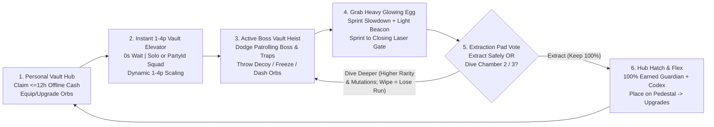

# Game Design Document — `C2: Egg Heist: Boss Vault`

**Document Status:** Production-Ready Solo GDD (`v1.0`)  
**Collection & Research Anchor:** `2026-11-22` (Derived from `#1` Ranked Concept `8.43 / 10` across 5 Sensitivity Profiles)  
**Primary Developer Profile:** Solo Indie Developer (`$50–$200` / `₱3,188–₱12,750` upfront; ~`110–145` solo hours to Public MVP)  
**Source Research Backing:** [Research_Results_Visual_Summary.md](Research_Results_Visual_Summary.md) · [I_Alternative_Game_Concepts.md](research/deliverables/I_Alternative_Game_Concepts.md) · [K_Prototype_Roadmap_Validation_and_Risks.md](research/deliverables/K_Prototype_Roadmap_Validation_and_Risks.md) · [G_Retention_and_Monetization_Framework.md](research/deliverables/G_Retention_and_Monetization_Framework.md)

---

## 1. Executive Game Concept & Design Pillars

### 1.1 One-Sentence Pitch
A **1–4 player PvE co-op boss-heist extraction roguelike** where you dodge patrolling mega-bosses, launch curved **Utility Orbs** to distract or stun them and crack their vault pedestals, snatch **heavy glowing eggs** that slow your sprint, and decide whether to extract safely or push deeper before the vault collapses.

### 1.2 How `C2` Reimagines [GameIdea.txt](GameIdea.txt)
Rather than building the static simulator loop in `GameIdea.txt` (scored `4.22 / 10`, Rank `#7/7`), `C2` keeps its three core creative ingredients—**throwable orbs**, **bosses**, and **collectible eggs**—and rebuilds them around late-2026 Roblox's highest-performing discovery, retention, and solo-feasibility architecture:

| Original `GameIdea.txt` Element | Problem Identified by Research | `C2: Egg Heist: Boss Vault` Reimagined Solution |
| :--- | :--- | :--- |
| **Stationary target shooting** | Zero skill ceiling, unclippable on Moments, triggers "3-minute killer" boredom. | **Active Move-Dodge + Curved Utility Orbs** (Decoy, Freeze, Dash-Bomb) with thumb-friendly mobile auto-curve assist. |
| **5-minute mandatory boss timer** | Spikes `<60s` & `61–180s` RFY First-Play Bounce Rate; breaks at 1–3 CCU. | **Instant 1–4p Vault Elevator (`0s` wait)** with dynamic `1–4` player scaling (100% playable at 1 CCU). |
| **Private training range** | Isolates players (hurts *Intentional Co-Play Days*) and feels like filler homework. | **Removed.** Progression comes directly from active Vault runs + bounded **12-hour offline Vault Hub** cash. |
| **5+ static biomes + unrestricted portals** | Solo 3D art burnout trap + Day-1 carry-bypass exploits + newbie 1-shot quits. | **1 Modular Transforming Vault** with soft-gated **Chambers 1–5** (dynamic lighting, traps, and procedural mutators). |
| **Undefined boss-dropped eggs** | Missing payoff loop; Paid Random Items legal risk if linked to Robux/Luck. | **100% Gameplay-Earned Vault Guardians** displayed physically on Hub pedestals, completing a silhouette **Codex** and ticking capped 12h offline cash. |
| ***Steal An Egg* heist inspiration** | Copying PvP base-robbing causes griefing rage-quits and competes head-on with Do Big Studios. | **PvE Co-Op Boss-Vault Extraction:** Keeps the high-adrenaline heist/sprint rush with **zero toxic PvP griefing**. |

### 1.3 Five Non-Negotiable Platform Pillars (Late-2026 Roblox)
1. **1-CCU Cold-Start Viable:** Every Vault run launches immediately for 1 solo player and scales cleanly up to 4 friends (`HP`, egg value, aggro pacing).
2. **80% Mobile-First Ergonomics (`<2GB` Android RAM):** Two-thumb controls, generous magnetic aim-assist, `StreamingEnabled`, capped particles, readable silhouettes on small screens.
3. **Zero-Chat Co-Op Architecture:** Built to excel under Roblox's Jan 2026 mandatory age-gated chat walls using emergent roles, diegetic VFX, and a **4-Icon Non-Verbal Ping Wheel**.
4. **100% Paid Random Items Exempt:** Zero Robux-purchasable egg currency and zero Paid Luck Boosts—playable identically worldwide (UK, Australia, Brazil, Belgium, Netherlands) with zero legal friction.
5. **R15 Articulated Avatars:** Eligible for Roblox's **`$0.0054/R$`** (+42.1%) U.S. 18+ DevEx tier.

---

## 2. Core Gameplay Loop & Player Experience Flow

### 2.1 End-to-End Gameplay Loop

### 2.2 First 5 Minutes Experience (Engineered to Crush `<60s` Bounce)
- **0–10 seconds (Instant Visual Clarity):** Player spawns inside their bright personal **Vault Hub** directly facing the towering, animated **Boss Vault Door** (matching the 16:9 Home thumbnail 1:1; zero modal popups, zero text walls).
- **10–20 seconds (First Action `<15s`):** A glowing diegetic floor beam guides the player straight over a free starter **Decoy Orb** rack and into **Chamber 1** (instant solo launch—no lobby waiting).
- **20–90 seconds (Complete First Micro-Loop):** A lumbering Chamber-1 Boss (*Iron Sentinel*) patrols near a glowing Rare Egg pedestal. On-screen contextual prompt (`<8 words`): *"Throw Decoy Orb to Lure Boss!"* Player tosses the orb, boss charges toward the hologram, player snatches the glowing Egg (feeling the dramatic weight slowdown + pulsing heartbeat audio), and sprints through the closing laser gate onto the Extraction Pad.
- **~2 minutes (First Payoff & Endowment Effect):** Back in the Hub, the Egg cracks open immediately into a glowing **Ember Beetle** Vault Guardian that hops onto Pedestal #1 and begins ticking **Vault Cash** with floating coin popups.
- **3–5 minutes (Upgrade #1 & Push-Your-Luck Hook):** Player spends starter Vault Cash to unlock the **Freeze Orb**, enters a fresh run, and hits their first **Extract vs. Dive Chamber 2** decision—crossing the critical `61–180s` RFY bounce threshold into a 10–15 minute target session.

---

## 3. Core Gameplay Mechanics (Detailed Specifications)

### 3.1 Movement, Dodge & Heavy-Egg Carry Physics
- **Base Movement:** Snappy R15 walk/sprint speed (`18 studs/s` base; `24 studs/s` sprint with short regenerating stamina bar) plus a quick **Dash/Roll** (`0.35s` burst, `2.5s` cooldown, brief obstacle-clearance feel).
- **Heavy-Egg Carry State (The Signature Tension Mechanic):**
  - Picking up an Egg mounts it visibly above/in front of the R15 character with a bright rarity-colored glow beam (readable in 3 seconds on mute for TikTok/Roblox Moments!).
  - **Carry Trade-Off:** Movement speed drops by **`-22%`** (Common/Rare) up to **`-32%`** (Mythic/Mutated), and stamina regen slows—forcing the carrier to rely on **Utility Orbs**, smart routing, or **teammates** to escape!
  - **Emergency Drop / Pass:** Players can tap **Drop/Toss Egg** to pass an egg across a short gap to a teammate (or drop it to sprint-dodge a fatal lunge, risking the egg rolling slightly and alerting the boss).
  - **Carry Capacity:** Default **1 Egg** in hands (upgradable/assisted via Vault Backpack straps only for light eggs, never removing heavy-egg sprint tension on Mythic carries).

### 3.2 Throwable Utility Orbs (`OrbConfigs.luau`)
All combat and stealth interaction flows through a single data-driven projectile controller with **client visual arc preview + generous magnetic mobile auto-curve assist + server-authoritative impact validation**.

| Orb Name | Tier | Role / Core Effect | Cooldown | Upgrade Path (Vault Cash Only) |
| :--- | :---: | :--- | :---: | :--- |
| **1. Decoy Orb** | **MVP** (Starter) | Lands and projects a noisy holographic clone for `5.0s`, overriding Boss patrol/chase aggro within `45 studs`. | `8s` | +Duration (`5s → 7.5s`), +Aggro Radius, -Cooldown |
| **2. Freeze Orb** | **MVP** (Min 3) | Shatters in a `14-stud` cryo burst that **stuns Bosses for `3.5s`** (interrupts lunges!) and **pauses laser gates for `4.0s`**. | `11s` | +Stun Duration (`3.5s → 5.0s`), +Burst Radius, +Pedestal Crack Dmg |
| **3. Dash-Bomb Orb** | **MVP** (Mid) | Detonates under feet or at impact: launches carrier forward (`+28 studs` burst) OR knocks Boss backward to buy escape space. | `10s` | +Impulse Distance, +Brief Carry-Slow Immunity (`2.0s`) |
| **4. Boomerang Orb** | *Post-Launch* | Curves around pillars to hit shielded back-weak-spots or snag distant loose loot back to the thrower. | `9s` | +Curve Arc Strength, +Multi-Target Bounce |
| **5. Grapple Orb** | *Post-Launch* | Fires a kinetic tether pulling a **downed teammate** or **dropped Egg** directly across laser traps to safety. | `14s` | +Tether Range, +Pull Speed |
| **6. Cloak-Smoke Orb** | *Post-Launch* | Releases an `18-stud` stealth cloud breaking Boss line-of-sight instantly for `4.5s` (clutch solo/squad escape). | `15s` | +Cloud Duration, +Speed Boost Inside Smoke |

> **Design Rule:** Players equip **2 Orb Slots** by default (**3rd Slot** earnable via Depth-4 mastery milestone *or* optional Extra Utility Belt Game Pass). Every Orb is **100% unlocked and upgraded with gameplay-earned Vault Cash**.

### 3.3 Patrolling Boss AI & Telegraph System (`BossConfigs.luau`)
Bosses are engineered as clean, deterministic, server-authoritative **5-state machines**:
`PATROL` → `INVESTIGATE` (Decoy / loud sprint / egg alarm) → `TELEGRAPH` (`0.9s–1.3s` bright red floor zone + unmistakable audio cue) → `LUNGE / ATTACK` → `STUNNED` (Freeze Orb / weak-spot break).

| Boss Archetype | Tier | Patrol Style & Signature Threat | Counterplay Hook |
| :--- | :---: | :--- | :--- |
| **1. Iron Vault Sentinel** | **MVP** (Ch. 1–3) | Heavy stomping patrol with wide flashlight sight-cone; telegraphs a straight-line **Shield Slam Charge** that shatters temporary cover. | Bait charge with **Decoy Orb** into a vault pillar for a bonus self-stun, or interrupt mid-windup with **Freeze Orb**. |
| **2. Volt Stalker** | **MVP** (Ch. 2–3) | Fast, agile hunter attracted strongly to **glowing Egg carriers**; fires telegraphed **Shock Rings** across corridor choke points. | Use **Dash-Bomb** to vault over Shock Rings or let a teammate pull aggro while Carrier sprints through the gate. |
| **3. Twin Warden / Chrono Golem** | *Post-Launch* (Ch. 4–5) | Dual-patrol coordination or pulsing time-slow aura during Vault Collapse countdowns. | Rewards synchronized 2–4p Freeze + Decoy chaining. |

- **1–4 Player Dynamic Scaling:**
  - Solo (`1p`): Slightly narrower Boss sight cone (`-15%`), `1` active revival safety drone (1 free self-revive per Chamber 1 run), generous Decoy lure duration.
  - Squad (`2–4p`): Faster Boss patrol speed (`+8%` per extra player), higher Armored Pedestal crack threshold, **teammate hand-revive** (`3.0s` hold when downed; carrying a downed ally or tossing a Decoy to cover a revive creates peak co-op drama).

### 3.4 Modular Transforming Vault Chambers & Push-Your-Luck Extraction (`MutatorConfigs.luau`)
Instead of building 5+ static open worlds (solo art burnout), `C2` uses **1 modular tileable Vault Architecture** that dynamically swaps lighting palettes, prop layouts, laser patterns, and procedural mutators on every chamber descent:

| Chamber Depth | Unlock Rule (Soft-Gated — Zero Carry Bypass!) | Egg Rarity Multiplier | Environmental Threats |
| :---: | :--- | :---: | :--- |
| **Chamber 1** *(Bronze Vault)* | Open immediately on Join | `1.0x` (Common → Epic) | 1 Sentinel Boss, slow sweeping lasers, forgiving extraction timer (`75s` after alarm). |
| **Chamber 2** *(Cobalt Vault)* | Clear Chamber 1 once *or* survive Chamber 1 & vote **Dive Deeper** | `1.8x` (Rare → Legendary + *Cracked* Mutation) | Faster lasers, pressure plates, Volt Stalker entry, `60s` collapse sprint. |
| **Chamber 3** *(Obsidian Vault)* | Clear Chamber 2 once *or* vote **Dive Deeper** from Ch. 2 | `3.0x` (Epic → Mythic + *Golden* / *Storm* Mutations) | Active **Chamber Mutator**, tighter sightlines, multi-pedestal vault core, `50s` collapse sprint. |
| **Chambers 4–5** *(Apex Vaults)* | *Post-Launch Expansion* | `4.5x – 6.0x` (Apex Mythics) | Stacked dual mutators + Twin Boss patrols. |

#### Procedural Chamber Mutators (High Replayability, Near-Zero Art Cost)
- **`LowGravity`:** Higher jumps & longer floaty Dash-Bomb arcs; Eggs bounce dramatically if dropped.
- **`Darkness`:** Dimmed vault lighting where only the **Boss's red spotlight** and **glowing Mythic Eggs** illuminate the room (massive horror-heist tension!).
- **`LaserSweep`:** Synchronized moving laser grids paused cleanly by **Freeze Orbs**.
- **`DoubleBoss`:** Two slower patrolling Sentinels requiring coordinated Decoy + Freeze splits.
- **`VaultStorm` *(Automated Hourly Server Event)*:** Every hour on the hour for 8 minutes, all Chambers gain electrified sky/lighting + guaranteed **Storm-Charged** mutation roll chance (delivers *"Admin Abuse"* excitement 24/7 with zero solo developer crunch!).

#### The Push-Your-Luck Extraction Vote
Once any Egg is carried onto the **Extraction Pad** (within the collapse timer), a crisp **10-second on-screen choice** appears (solo players confirm instantly; squads vote by majority/individual door):

- **GREEN PAD (`Extract Now`):** Bank **100%** of collected Eggs safely back to your Vault Hub.
- **GOLD ELEVATOR (`Dive Deeper`):** Carry current loot value forward as a **Streak Multiplier** into the next Chamber for rarer mutated Eggs—**if the squad wipes, unextracted Eggs from this run are lost!**

---

## 4. Progression, Collection & Economy Design

### 4.1 Eggs, Vault Guardians & Visual Codex (`CollectionConfigs.luau`)
- **100% Gameplay-Earned Eggs:** Eggs drop *only* from Vault Pedestals during active heists. They can **never** be bought with Robux or Robux-convertible currency.
- **MVP Roster:** **20 Distinct Vault Guardians** across 5 Rarity Tiers (*Common, Uncommon, Rare, Epic, Mythic*) × **3 Visual Mutations**:
  - **Cracked** (`1.25x` Hub Cash/hr + glowing magma seams)
  - **Golden** (`1.6x` Hub Cash/hr + gleaming metallic shader + shimmer trail)
  - **Storm-Charged** (`2.0x` Hub Cash/hr + crackling electric arcs, boosted during hourly *Vault Storm*)
- **Practical Dual Purpose (Solving `GameIdea.txt`'s Missing Link):**
  1. **Physical Hub Income & Showcase:** Place your best Guardians on **8 Vault Hub Display Pedestals** (visitable by friends/server neighbors for social flexing). Each displayed Guardian generates **Vault Cash** continuously.
  2. **Passive Heist Synergy Perk (Selected Active Companion):** Equip **1 Active Vault Mascot** perched on your shoulder/hovering behind you granting a modest, non-P2W utility trait (e.g., *+8% Decoy radius*, *+6% heavy-egg carry speed*, *+10% laser-freeze duration*).
- **Deterministic Duplicate Fusion (Zero Wasted Hatches):** Combining `3` duplicate Guardians of the same species deterministically upgrades them into a **Starred / Evolved** version (`+25%` Hub Cash + glowing crown VFX) — no frustrating dead duplicates and no paid pity dark patterns!
- **Visual Silhouette Codex:** Every undiscovered Guardian appears as a dark mystery silhouette with chamber hints (*"Found in Chamber 2+ during Vault Storm"*), driving Zeigarnik completion pull across D7–D28.

### 4.2 Personal Vault Hub & Bounded 12-Hour Offline Economy
- **Why Capped at 12 Hours (`43,200s`):** Provides a warm, non-punitive **Day-1 return greeting** (*"Your Vault Guardians collected 4,200 Vault Cash while you were away!"*) without turning the game into an AFK zombie server or triggering hyperinflation.
- **Strict Anti-Inflation Guardrails:**
  - `OfflineCash = Sum(EquippedPedestalRates) × min(os.time() - LastLogout, 43200) × 0.75` (active heists ALWAYS out-earn idle waiting!).
  - **Permanent Currency Sinks:** Utility Orb Level Upgrades (`Lv. 1 → 10`), Hub Visual Floor/Wall Themes, Pedestal Tier Upgrades, and Codex Trophy Statues.
  - **Zero Currency Isolation Breach:** **Vault Cash** can *never* be purchased with Robux (maintaining 100% Paid Random Items exemption).

---

## 5. Social Mechanics, Zero-Chat Co-Op & Viral Clip Engineering

### 5.1 Emergent Co-Op Roles (Zero Text Chat Required)
Because Jan 2026 Roblox segregates text chat by Facial Age Estimation buckets (`5–8`, `9–15`, `16–17`, `18+`), `C2` makes teamwork effortless via visual signifiers and **4 natural roles**:

1. **Distractor:** Lures bosses away from pedestals using **Decoy Orbs**.
2. **Stunner:** Interrupts boss lunges & freezes closing laser gates with **Freeze Orbs**.
3. **Carrier:** Hauls the glowing slowed **Mythic Egg** toward Extraction while teammates clear the path.
4. **Rescuer:** Covers and revives downed teammates inside the Vault.

### 5.2 Built-In Social Features (Targeting RFY *Intentional Co-Play Days*)
- **4-Icon Non-Verbal Ping Wheel** (single thumb tap / `Q` key — spawns a 3D floating icon + directional chime visible through walls):
  - 🎯 **`Distract!`** (lure boss here)
  - ❄️ **`Freeze Now!`** (stun boss / stop lasers)
  - 🚪 **`Extract!`** (sprint to pad)
  - 🆘 **`Help!`** (revive / cover carrier)
- **Native Party & Friend Multipliers:** Full `Player.PartyId` support keeping Roblox Parties together inside Reserved Vault Servers (officially credited toward **Intentional Co-Play Days**), **+10% Friend Haul Bonus** per friend in squad (capped at 3 friends = `+30%`), and contextual post-win `SocialService:PromptGameInvite()` after close-call extractions.
- **Visitable Neighbor Vault Hubs:** Players spawn on a shared floating ring of 6–8 Vault Hubs so you can walk across a glowing bridge to admire neighbors' Golden/Storm Mythic Guardians and jump straight into their Elevator together.

### 5.3 Viral Clip & Roblox Moments Engine (3-Second Mute Readability)
- Every close-call extraction (*escaping with `<5s` on the laser gate* or *a teammate freezing a lunging Boss `10 studs` behind a Mythic Egg carrier*) reads instantly in **3 seconds on mute** for TikTok, YouTube Shorts, and Home Auto-Play Videos (`+39%` playtime lift).
- **Post-Launch Moments Integration:** Auto-prompt Roblox's **Video Captures API** on close-call escapes and first Mythic hatches so players publish directly to **Roblox Moments** with one-tap Join links.

---

## 6. Ethical Monetization Stack (100% Paid Random Items Exempt)

Every monetized item is strictly **non-random**, **non-P2W**, dynamically priced via `MarketplaceService:GetProductInfo()` with **Managed Regional Pricing**, and compliant across all global youth-safety jurisdictions (UK, AU, Brazil Digital ECA, BE, NL).

| Product / Pass | Type | Release Tier | Target Price (Base R$) | Player Value & Ethical Guardrail |
| :--- | :--- | :---: | :---: | :--- |
| **Extra Pedestals (`+4 Slots`)** | Game Pass | **MVP** | `149 R$` | Showcase more Guardians & expand Hub income breadth (still strictly 12h capped). |
| **Mega Vault (`+8 Pedestals`)** | Game Pass | **MVP** | `349 R$` | Collector flex expansion for mid/late-game Codex hunters. |
| **3rd Utility Orb Belt Slot** | Game Pass | **MVP** | `199 R$` | Carry all 3 MVP Orbs simultaneously *(also earnable free at Depth-4 mastery milestone!)*. |
| **Cosmetic Orb Skins & Hub Themes** | Direct-Buy Passes / Products | **MVP** | `49 – 249 R$` | Direct purchase—ZERO blind lootboxes (e.g., *Neon Cyber Orbs*, *Magma Vault Hub*, *Rainbow Carry Trail*). |
| **Emergency Revive / Safe-Drop** | Developer Product | **MVP** | `29 R$` | 1× per run optional clutch revive or egg-insurance save if wiped in Chamber 2+. |
| **Private Squad Servers** | Private Server | **MVP** | `50 R$/mo` | Ideal for friend squads; earns automatic **Roblox Plus** creator payout (up to `100 R$/mo` per Plus user logging `≥60m`). |
| **Vault VIP Club** | **Subscription** | *Post-Launch* | `$2.99` / `199 R$/mo` | **100% creator share Month 2+!** Grants VIP Hub Crown, monthly exclusive Cosmetic Orb Skin, `+2` Pedestal Slots, and VIP badge. |
| **Double Offline Vault Claim** | **Rewarded Video** | *Post-2k MAU* | Free (Opt-in Ad) | Strictly safe-state Hub rest button: watch 1 optional ad per day to 2× your 12h offline collection. |

> **Hard Compliance Rule:** NEVER sell Vault Cash for Robux, NEVER sell Paid Luck Boosts, and NEVER lock Chamber access behind Robux.

---

## 7. Mobile-First UI/UX & Control Scheme

| Action | Mobile Touch Control (`80%` of DAU) | PC / Keyboard + Mouse | Console / Gamepad |
| :--- | :--- | :--- | :--- |
| **Move** | Left Dynamic Thumbstick | `WASD` | Left Stick |
| **Aim & Throw Orb** | Hold **Throw Button** (shows glowing 3D arc + soft magnetic snap to Boss/Pedestal) → Release to throw | Hold `LMB` → Release | Hold `RT` → Release |
| **Switch Active Orb** | 2–3 large thumb-arc icon buttons (bottom-right) | `1` / `2` / `3` or `Scroll` | `LB` / `RB` |
| **Dash / Drop Egg** | Dedicated **Dash** button (`⚡`) / Contextual **Drop** tap | `Shift` or `Space` / `G` | `B` / `Y` |
| **4-Icon Ping Wheel** | Tap **Ping** icon → flick 1 of 4 icons | Hold `Q` → flick mouse | `DPad` directions |

- **Diegetic First:** Boss aggro cones, red lunge slam zones, laser-pause freeze timers, egg weight beacons, and Hub onboarding beams live **in 3D world space**—minimizing cluttered 2D HUD panels on small 6-inch phones.

---

## 8. Technical Architecture & Instrumentation (Solo-Maintainable)

### 8.1 Data-Driven Modular Codebase (Cuts Future Update Cost ~70%)
- **`ReplicatedStorage/Configs/OrbConfigs.luau`** — Defines arc speed, blast radius, effect type (`Decoy`, `Freeze`, `Impulse`), cooldown, and upgrade curves. Adding a new Orb takes ~2 hours, not a rewrite.
- **`ReplicatedStorage/Configs/BossConfigs.luau`** — Defines patrol speed, sight angle/distance, aggro radius, telegraph duration, lunge speed, and stun duration.
- **`ReplicatedStorage/Configs/MutatorConfigs.luau`** — Defines lighting preset, gravity, laser speed, boss count, and reward multiplier per chamber modifier.
- **`ReplicatedStorage/Configs/CollectionConfigs.luau`** — Single source of truth for all 20 Guardians, 3 Mutations, base Hub Cash/hr, passive traits, and Codex silhouettes.
- **`ServerScriptService/Data/ProfileManager.luau`** — Uses **`ProfileStore`** (`UpdateAsync` + session-locking) with strict **kick-on-load-fail** protection (never overwrites a failed load with a blank profile!) and `os.time()` offline delta capped at `43,200s`.
- **`ServerScriptService/Security/PolicyGate.luau`** — Fail-closed server gate wrapping `PolicyService` (`GetPolicyInfoForPlayerAsync`), `MarketplaceService.ProcessReceipt`, and server-side RemoteEvent rate limiting.

### 8.2 Day-1 `AnalyticsService` Telemetry (Server-Only)
1. **Onboarding Funnel (`LogOnboardingFunnelStepEvent`):** `1: Join_Hub_Loaded` (deviceType) → `2: Entered_First_Vault_Run` → `3: Threw_First_Orb` → `4: Extracted_First_Egg` → `5: Hatched_First_Guardian`.
2. **Core Run Funnel (`LogFunnelStepEvent` + `LogJourneyEvent`):** Tracks `Start → Egg Grab → Extract vs. Dive Deeper → Win/Wipe`, segmented by `"Solo"` vs. `"Coop"`.
3. **Economy Health (`LogEconomyEvent`):** Logs `VaultCash` sources (`Heist`, `OfflineClaim`) and sinks (`OrbUpgrade`, `HubTheme`) plus verified `ProcessReceipt` IAP completions.
4. **Milestone & Custom Events (`LogFunnelStepEvent` + `LogCustomEvent`):** Tracks Chamber unlocks (replacing non-charted `LogProgressionEvent`), Egg hatch rarities/mutations, and batched per-run Orb hit rates (protecting the `120 + 20×CCU` req/min rate limit).

---

## 9. Scope Discipline, Build Effort & Validation Gates

### 9.1 Solo MVP Build Breakdown (`~145` Total Hours)

| Module | Est. Solo Hours | Deliverable Outcome |
| :--- | :---: | :--- |
| 1. Core Throw/Orb & Heavy-Egg Carry Physics | `18h` | `OrbConfigs.luau`, client arc preview, mobile aim-assist, carry slowdown |
| 2. Modular Boss Patrol / Telegraph / Stun AI | `18h` | `BossConfigs.luau`, 5-state machine, Iron Sentinel + Volt Stalker |
| 3. Personal Vault Hub + `ProfileStore` 12h Offline | `20h` | 8 display pedestals, neighbor ring, atomic session-locked persistence |
| 4. Data-Driven 3-Chamber Extraction & Mutators | `22h` | Instant 1–4p Elevator, Chambers 1–3, Extraction Vote, 4 Mutators |
| 5. Earned Egg Hatch + 20-Guardian Codex | `16h` | Hatch reveal, 3 visual mutations, 3-to-1 deterministic fusion, Codex UI |
| 6. Mobile-First UI, Floor Beams & Ping Wheel | `20h` | `UIScale` layouts, 4-icon Ping Wheel, Studio Device Simulator QA |
| 7. Ethical Shop, `PolicyService` & `AnalyticsService` | `16h` | `GetProductInfo()`, Regional Pricing, `ProcessReceipt`, full telemetry |
| 8. `<2GB` Android QA, Thumbnails & Packaging | `15h` | `StreamingEnabled`, particle caps, 5× 16:9 tiles, 15s Gameplay Video |
| **Total Public Soft-Launch MVP** | **`~145 hrs`** | **~6–8 weeks part-time solo (`~35–45h` for 10-Day Gate 1 Greybox!)** |

### 9.2 Features Explicitly Excluded (Anti-Burnout & Safety Guardrails)
- ❌ **Peer-to-Peer Trading** (severe anti-dupe & `IsPaidItemTradingAllowed` burden for a solo dev)
- ❌ **Robux Egg Currency / Paid Luck Boosts** (global Paid Random Items bans)
- ❌ **5+ Hand-Crafted Biomes** (linear art treadmill)
- ❌ **5-Minute Boss Respawn Timers** (`<60s` bounce killer)
- ❌ **Custom Text Chat or Unlicensed IP** (`TextChatService` / DMCA termination risks)

### 9.3 Quantitative Go / Fix / Pivot Decision Gates
- **Gate 1 — Day 10 Greybox (`n = 20` silent playtesters, ≥50% mobile):**
  - **PASS:** `≥ 70%` start Run #2 unprompted + `≥ 7.5/10` fun rating → build full MVP.
  - **YELLOW (`45%–69%`):** Run a focused 3-day physics/boss tuning sprint and re-test.
  - **FAIL (`< 45%` after tuning):** Zero sunk-cost pivot immediately to ultra-lean backup **`C3: Curve Clash: Duel Pads`** (only 10 days invested!).
- **Gate 4 — Soft Launch Day 14 (`n = 500+` D0 users, `$50–$100` diagnostic test + Share Links):**
  - **GO / SCALE:** **D1 `≥ 13%–16%+`**, **D7 `≥ 2.5%–3.9%+`**, Avg Session **`≥ 11m`** (beating GameAnalytics 2026 P50 `9.8m`), Like Ratio **`≥ 85%`**.
  - **KILL ADS / PIVOT:** **D1 `< 8.4%`** (below GA P25) and Session `< 6m` after 2 targeted FTUE/tuning iterations.
