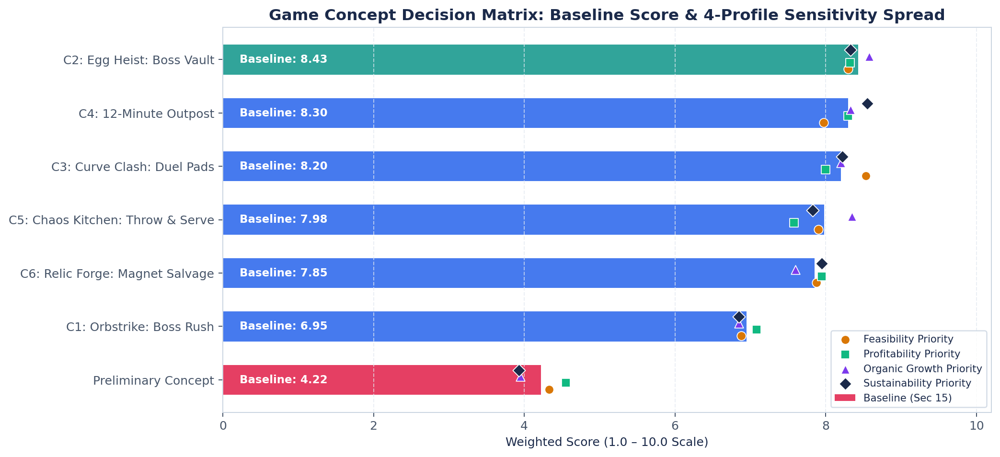

# Roblox Deep Market Research & Product Validation (`Throw-a-ball`)

Evidence-based late-2026 Roblox market discovery, discovery algorithm analysis, competitive intelligence (`n = 44` verified experiences), concept evaluation, sensitivity decision modeling, and USD/PHP financial feasibility research anchored to a solo indie developer.

**Collection Date:** `2026-11-22`

---

## Start Here

- **[Visual Results Summary (Charts + Mermaid Diagrams)](Research_Results_Visual_Summary.md)** — Executive scorecard, 6 high-DPI Matplotlib charts, and architecture/roadmap diagrams.
- **[Compiled Master Research Report (44,477 words)](Roblox_Deep_Research_Report.md)** — Complete single-file report containing Deliverables A–N, Section 22's 12 direct strategic recommendations, and the 29-source Appendix.
- **[Modular Research Vault Index](research/README.md)** — Individual Markdown deliverables (`A`–`N`), CSV/JSON datasets, Python modeling/validation scripts, and `unittest` suite.



---

## Repository Structure

```text
.
├── GameIdea.txt                          # Original preliminary brainstorm
├── Research.txt                          # Full 22-section research brief
├── Research_Results_Visual_Summary.md    # Executive visual results & charts
├── Roblox_Deep_Research_Report.md        # Compiled single-file master report
└── research/
    ├── README.md                         # Modular deliverables index
    ├── charts/                           # 6 verified 180-DPI PNG charts
    ├── data/                             # Audited CSV/JSON datasets (44 games x 41 mechanics)
    ├── deliverables/                     # Deliverables A through N
    ├── scripts/                          # Zero-external-dep math/validation + chart scripts
    └── tests/                            # 16 automated unittest cases
```

## Reproducing Models, Charts & Tests

```bash
python3 -m unittest discover -s research/tests -v
python3 research/scripts/validate_research_data.py --data-dir research/data --print-frequencies
python3 research/scripts/decision_matrix.py --input research/data/decision_matrix.json --markdown
python3 research/scripts/financial_model.py --input research/data/financial_assumptions.json --markdown
python3 research/scripts/generate_charts.py --data-dir research/data --out-dir research/charts
```
