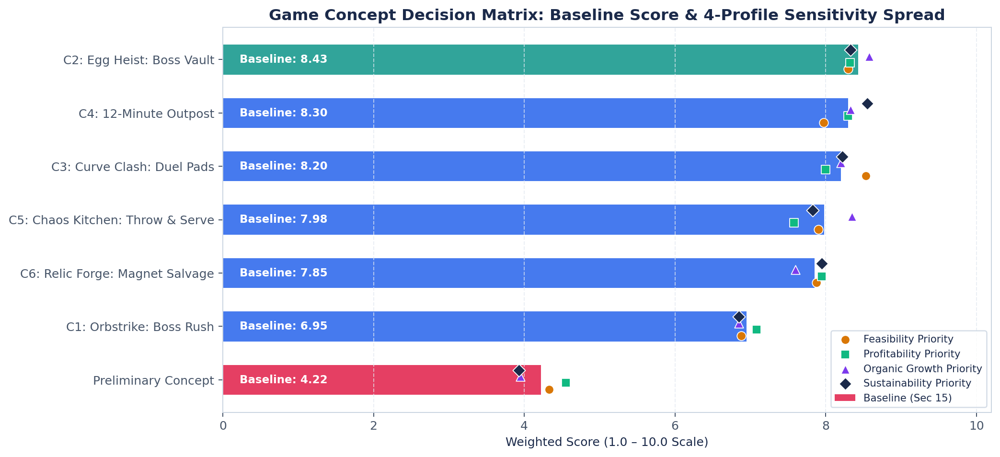
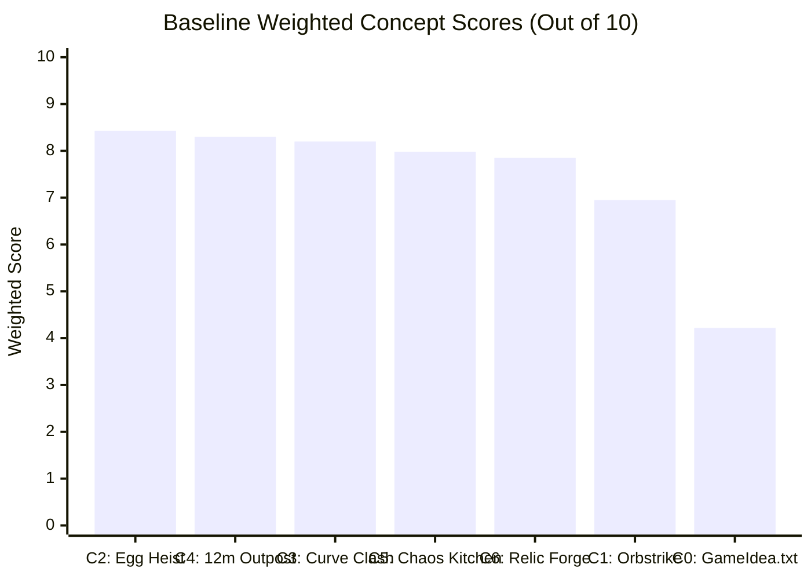
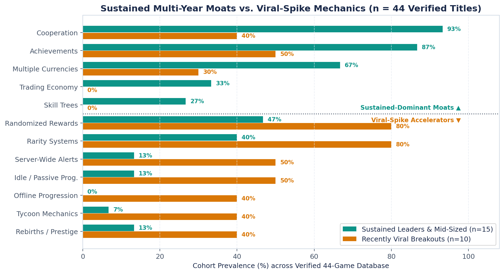
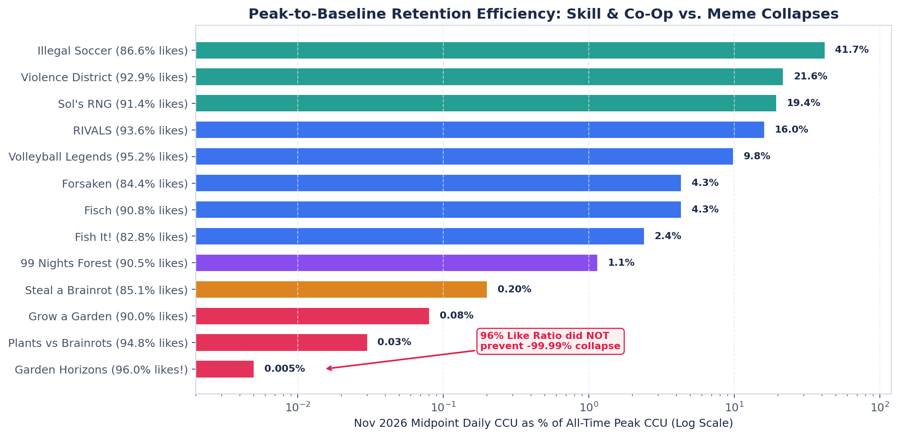
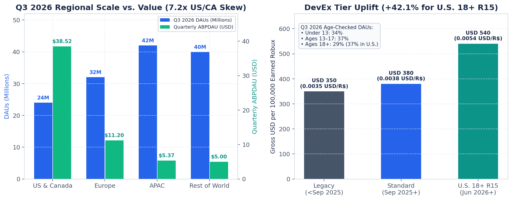
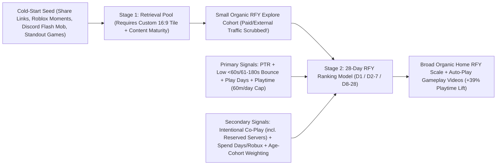
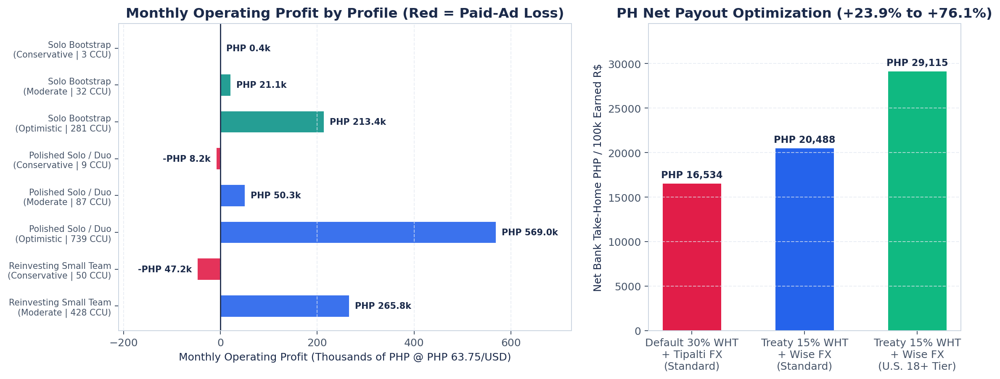
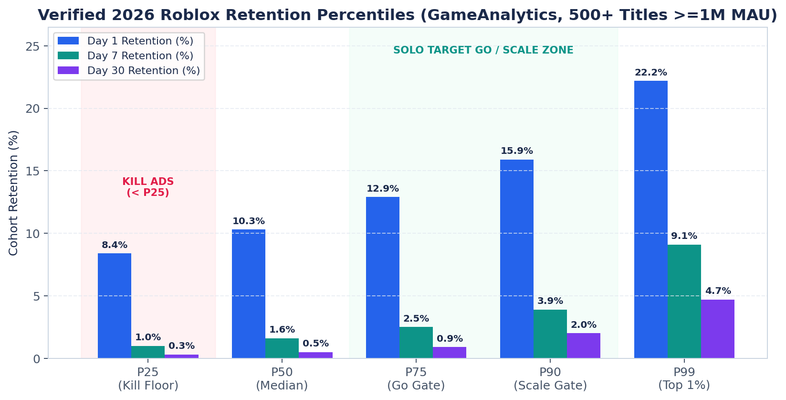
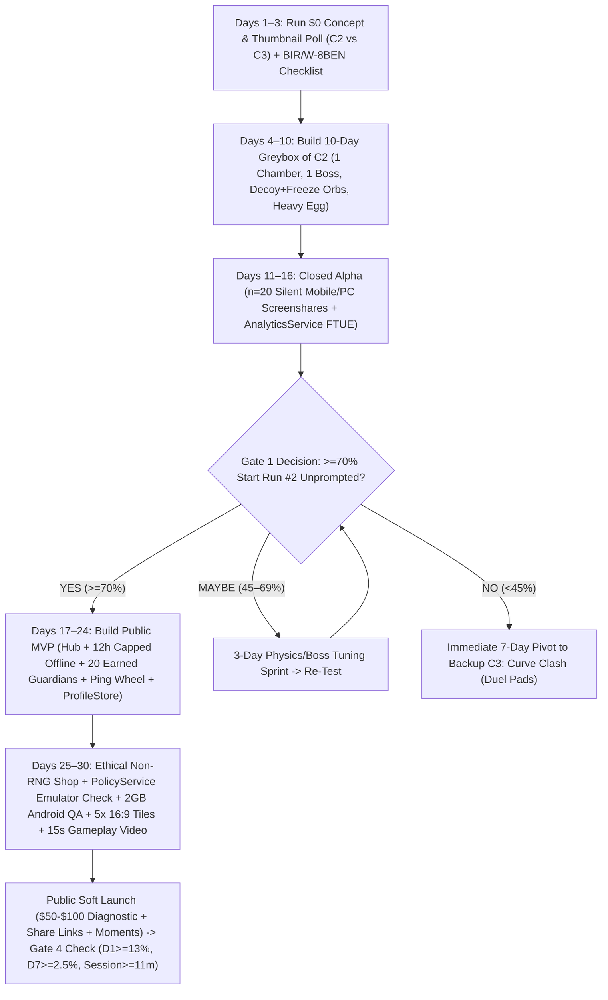

# Roblox Deep Research — Detailed Visual Results Summary

**Collection Date:** `2026-11-22`  
**Primary Anchor:** Solo Indie Developer (Zero / Small Budget, USD & PHP @ `₱63.75/USD`)  
**Dataset Backing:** `44` Verified Roblox Experiences · `41` Audited Mechanics · `12` Viral Case Studies · `9` Python-Verified Financial Scenarios · `7` Scored Concepts (`5` Sensitivity Profiles)  
**Full Master Report (`44,477` words):** [Roblox_Deep_Research_Report.md](Roblox_Deep_Research_Report.md) · **Modular Hub:** [research/README.md](research/README.md)

---

## Executive Scorecard at a Glance

| Strategic Question | Verified Research Verdict (`2026-11-22`) | Evidence Backing |
| :--- | :--- | :--- |
| **Build [GameIdea.txt](GameIdea.txt) as written?** | **NO — Ranked `#7 / 7` (`4.22 / 10`) across all 5 weighting profiles.** | 5-min wait timers trigger `<60s` bounce; stationary shooting lacks skill/clip appeal; missing egg payoff; multi-biome solo burnout; Paid Random Items legal risk. |
| **#1 Recommended Concept to Prototype First** | **`C2: Egg Heist: Boss Vault` (`8.43 / 10`)** — `#1` Baseline, `#1` Profitability, `#1` Organic Growth. | Reimagines your core ingredients (throwable orbs + bosses + eggs) into 1–4p PvE extraction with zero PvP griefing, zero wait timers, and zero lootbox legal bans. |
| **#1 Ultra-Lean Solo Backup Pivot** | **`C3: Curve Clash: Duel Pads` (`8.20 / 10`)** — **`#1` Feasibility (`8.53 / 10`)**, 2–4 week MVP. | Physical lobby Duel Pads (1v1/2v2/Bot Pad), trick-shot curved dodgeball, pure non-P2W cosmetics, near-zero content treadmill, strong U.S. 18+ `$0.0054` DevEx lift. |
| **#1 Structural Moat on Late-2026 Roblox** | **Cooperation (`93.3%` Sustained vs. `40.0%` Viral)** + Systems-Driven Replayability. | Directly rewards Roblox's June 15, 2026 28-day RFY window and **Intentional Co-Play Days** signal. |
| **Solo Financial Threshold (PHP & USD)** | **~32.5 Avg CCU (`2,500 DAU`) = `₱21,787` gross / ~`₱18,425` net PH/mo**; **~281 CCU = `₱215k` gross / ~`₱182k` net PH/mo**. | Verified Nov 2026 DevEx (`$0.0038` / `$0.0054` U.S. 18+), BSP/Wise `₱63.75/USD`, and **US–PH Tax Treaty Art. 13 (15% WHT)**. |

---

## 1. Concept Decision Matrix & 5-Profile Sensitivity Results

Every concept was scored `1–10` across all 9 weighted criteria from Section 15 (`Demand 15%`, `Retention 15%`, `Feasibility 15%`, `Core Appeal 10%`, `Discovery 10%`, `Viral/Social 10%`, `Differentiation 10%`, `Monetization 10%`, `Sustainability 5%`) and stress-tested under four alternate priority scenarios via [decision_matrix.py](research/scripts/decision_matrix.py).

### Interactive Score Summary (Text-Native View)

| Concept | Baseline (Sec 15) | Feasibility Priority | Profitability Priority | Organic Growth Priority | Sustainability Priority | Solo MVP Scope |
| :--- | ---: | ---: | ---: | ---: | ---: | :--- |
| **C2: Egg Heist: Boss Vault** *(Reimagined)* | **#1 (8.43)** | #2 (8.30) | **#1 (8.32)** | **#1 (8.58)** | #2 (8.33) | 4–6 wks (`~145h`) |
| **C4: 12-Minute Outpost** *(Co-Op Extraction)* | #2 (8.30) | #3 (7.97) | #2 (8.30) | #3 (8.33) | **#1 (8.55)** | 5–8 wks |
| **C3: Curve Clash: Duel Pads** *(Ultra-Lean)* | #3 (8.20) | **#1 (8.53)** | #3 (8.00) | #4 (8.20) | #3 (8.22) | **2–4 wks (`~102h`)** |
| **C5: Chaos Kitchen: Throw & Serve** *(Physics)* | #4 (7.98) | #4 (7.90) | #5 (7.58) | #2 (8.35) | #5 (7.83) | 4–6 wks |
| **C6: Relic Forge: Magnet Salvage** *(Cozy)* | #5 (7.85) | #5 (7.88) | #4 (7.95) | #5 (7.60) | #4 (7.95) | 4–6 wks |
| **C1: Orbstrike: Boss Rush** *(Patched Idea)* | #6 (6.95) | #6 (6.88) | #6 (7.08) | #6 (6.85) | #6 (6.85) | 5–7 wks |
| **C0: `GameIdea.txt` As Written** | **#7 (4.22)** | **#7 (4.33)** | **#7 (4.55)** | **#7 (3.95)** | **#7 (3.93)** | Multi-biome trap |

**Deep-Dive Reading:** [H_Preliminary_Game_Idea_Evaluation.md](research/deliverables/H_Preliminary_Game_Idea_Evaluation.md) · [I_Alternative_Game_Concepts.md](research/deliverables/I_Alternative_Game_Concepts.md) · [J_Concept_Decision_Matrix.md](research/deliverables/J_Concept_Decision_Matrix.md)

---

## 2. Why `GameIdea.txt` Fails vs. How `C2: Egg Heist` Fixes Every Bottleneck

```mermaid
flowchart TD
    subgraph BAD ["Preliminary Concept (GameIdea.txt — Score 4.22/10)"]
        B1["Stationary Target Clicking (Zero skill / Unclippable)"] --> B2["Unrestricted Biome Portal (Carry-bypass & 1-shot quits)"]
        B2 --> B3["WAIT up to 5 Minutes (Triggers <60s / 61-180s Bounce Penalty)"]
        B3 --> B4["Boss Kill -> Egg Drop"]
        B4 --> B5["??? Missing Egg Payoff Loop + Multi-Biome Solo Burnout"]
    end

    subgraph GOOD ["Reimagined #1 Winner (C2: Egg Heist: Boss Vault — Score 8.43/10)"]
        G1["Instant 1-4p Vault Elevator (Action in <15s; 1-CCU Viable)"] --> G2["Dodge Patrolling Boss + Throw Decoy/Freeze Orbs (3s Mute Clip Hook)"]
        G2 --> G3["Grab Heavy Glowing Egg (Slows Sprint = High Tension)"]
        G3 --> G4["Push-Your-Luck Vote: Extract Safely OR Dive Chamber 2/3"]
        G4 --> G5["100% Gameplay-Earned Hatch (Zero Lootbox Bans) -> Hub Guardians + Capped 12h Offline Income"]
        G5 --> G1
    end
```

### Feature Keep / Modify / Remove Summary
- **REMOVE:** 5-minute mandatory boss spawn wait; private stationary training ranges; 5+ hand-crafted static biomes (for MVP).
- **MODIFY:** Stationary ball clicking → active move/dodge + curved utility orbs (Decoy, Freeze, Dash-Bomb); unrestricted portals → soft-gated Chamber depth inside 1 modular transforming Vault; undefined egg hatch → **100% earned-only** Vault Guardians (zero Robux egg currency / zero Paid Luck Boosts = globally compliant across UK/AU/Brazil/BE/NL!).

---

## 3. What Actually Separates Sustained Multi-Year Hits From Viral Collapses (`n = 44`)

Independent feature-frequency analysis across our 44 verified Roblox games ([feature_matrix.csv](research/data/feature_matrix.csv)) reveals a dramatic structural split between **Sustained Leaders & Mid-Sized Games (`n = 15`)** and **Recently Viral Breakouts (`n = 10`)**:

- **Sustained Multi-Year Moats:** `cooperation` (**93.3%** vs. 40.0%), `achievements` (**86.7%** vs. 50.0%), `multiple_currencies` (**66.7%** vs. 30.0%), `trading` (**33.3%** vs. 0%), and `skill_trees` (**26.7%** vs. 0%).
- **Viral-Spike Accelerators (Higher Decay Risk Alone):** `randomized_rewards` (80% vs. 46.7%), `rarity_systems` (80% vs. 40%), `server_wide_announcements` (50% vs. 13.3%), `idle_passive_progression` (50% vs. 13.3%), `offline_progression` (40% vs. 0%), and `rebirths_prestige` (40% vs. 13.3%).
- **Saturation Warning:** `egg_hatching` appears in only **15.9% (7/44)** of leading titles, and `training_attribute_grinding` in just **13.6% (6/44)**.

### Peak-to-Baseline Survival Efficiency (And the Approval-Ratio Illusion)

> [!IMPORTANT]
> **Critical Lesson From 2025–2026 Telemetry:** Public upvote ratios measure *minute-1 pleasantness*, NOT 28-day retention. *Garden Horizons* (**96.0% likes**) collapsed **-99.99%** from >1.4M CCU to ~50–100 CCU, and *Plants vs Brainrots* (**94.8% likes**) collapsed **-99.96%**—while skill-first and co-op hits (*Illegal Soccer* **41.7%**, *Violence District* **21.6%**, *RIVALS* **16.0%**, *99 Nights in the Forest* **120k–204k daily floor**) retain massive durable audiences. Also note ownership concentration: **7 of the top 10 viral breakouts** link directly to **Do Big Studios**, **Splitting Point (Jandel)**, or **`misfitsbsthree`** (owner of *both* *Steal An Egg* and *Throw Food For Animals*).

**Deep-Dive Reading:** [C_Competitive_Analysis_Database.md](research/deliverables/C_Competitive_Analysis_Database.md) · [D_Successful_Game_Feature_Matrix.md](research/deliverables/D_Successful_Game_Feature_Matrix.md) · [F_Viral_Game_Case_Studies.md](research/deliverables/F_Viral_Game_Case_Studies.md)

---

## 4. Late-2026 Roblox Macro Landscape, Demographics & Discovery Algorithm

Official Q3 2026 Roblox Investor Relations disclosures (Oct 29, 2026) confirm **138M DAUs**, **~34B hours engaged**, **$1.697B bookings**, **$403M Q3 DevEx** (~$1.7B trailing 12-month; >$5B cumulative), and **40% of weekly Top 100 Home RFY games created within the prior 3 months**—paired with massive regional monetization skew (**7.2× higher ABPDAU in US/Canada vs. APAC**) and a rapidly aging-up audience (**66% age-checked DAUs are 13+; 29% global / 37% U.S. are 18+**).

### How Home Recommendations (RFY) Actually Work (Post–June 15, 2026 Overhaul)

**Deep-Dive Reading:** [B_Roblox_Market_Report.md](research/deliverables/B_Roblox_Market_Report.md) · [E_Roblox_Discovery_Playbook.md](research/deliverables/E_Roblox_Discovery_Playbook.md)

---

## 5. Financial Feasibility (USD & PHP @ `₱63.75`) & Philippine Net Cashout Math

All 9 financial scenarios were computed deterministically by [financial_model.py](research/scripts/financial_model.py) separating Gross Player Robux from Earned Developer Robux (after Roblox's 30% cut, plus Creator Rewards), applying verified late-2026 DevEx (`$0.0038` standard / `$0.0054` U.S. 18+ R15), and converting at the Nov 20–22, 2026 BSP/BAP/Wise midpoint (**`₱63.75 / $1 USD`**).

| Resource Profile | Scenario | DAU | Implied Avg CCU | Earned Robux / mo | Gross DevEx (USD / PHP) | Operating Profit (USD / PHP) | Break-Even DAU | Ad ROAS |
| :--- | :--- | ---: | ---: | ---: | ---: | ---: | ---: | ---: |
| **Solo Bootstrap** *(Anchor: $100 upfront, $0 ads)* | Conservative | 300 | 2.7 | 4,060 | `$16` / `₱1,025` | `$6` / `₱387` | 187 | Organic |
| **Solo Bootstrap** *(Primary Anchor)* | **Moderate** | **2,500** | **32.5** | **83,600** | **`$342` / `₱21,787`** | **`$332` / `₱21,150`** | **74** | Organic |
| **Solo Bootstrap** *(Primary Anchor)* | **Optimistic** | **15,000** | **281.2** | **812,376** | **`$3,373` / `₱215,028`** | **`$3,348` / `₱213,434`** | **112** | Organic |
| **Polished Solo/Duo** *($600 upfront, $150/mo ads)* | Conservative | 800 | 8.6 | 15,372 | `$62` / `₱3,959` | **`-$128` / `-₱8,153`** | 2,448 | **0.41x** |
| **Polished Solo/Duo** *(Limited Budget)* | Moderate | 6,000 | 86.7 | 237,510 | `$979` / `₱62,382` | `$789` / `₱50,270` | 1,165 | 6.52x |
| **Reinvesting Team** *($2.5k upfront, $800/mo ads)* | Conservative | 4,000 | 50.0 | 112,317 | `$459` / `₱29,271` | **`-$741` / `-₱47,229`** | 10,455 | **0.57x** |
| **Reinvesting Team** *(2–3 Devs)* | Moderate | 25,000 | 428.0 | 1,283,500 | `$5,370` / `₱342,348` | `$4,170` / `₱265,848` | 5,587 | 6.71x |

> [!TIP]
> **Two High-Impact Philippine Financial Optimizations:**
> 1. **+23.9% to +76.1% Net Cashout Lift:** File **Form W-8BEN + BIR TIN claiming US–PH Tax Treaty Article 13** (cuts U.S. royalty withholding from 30% → **15%**) and route USD via Wise instead of Tipalti's 1.9%–3.0% FX spread (`₱16,534` → **`₱20,488`** per 100k Standard R$; **`₱29,115`** at `$0.0054` U.S. 18+ tier!).
> 2. **Never Convert `$0.0054` Robux to Ad Credits:** Roblox consumes U.S. 18+ Robux first when buying Ad Credits (`1 Credit = $1 = 285 R$`), destroying **30.8% net value** vs. funding Ads Manager by USD card.

**Deep-Dive Reading:** [L_Financial_Feasibility_Report.md](research/deliverables/L_Financial_Feasibility_Report.md) · [G_Retention_and_Monetization_Framework.md](research/deliverables/G_Retention_and_Monetization_Framework.md)

---

## 6. Retention Benchmarks, Validation Gates & 30-Day Solo Action Plan

Verified **GameAnalytics *2026 Roblox Benchmark Report*** percentiles (500+ titles ≥1M MAU) anchor our exact quantitative **Kill / Fix / Go / Scale** decision thresholds:

### 30-Day Solo Validation & Pivot Roadmap (Zero Sunk-Cost Fallacy)

**Deep-Dive Reading:** [K_Prototype_Roadmap_Validation_and_Risks.md](research/deliverables/K_Prototype_Roadmap_Validation_and_Risks.md) · [M_Launch_and_Growth_Strategy.md](research/deliverables/M_Launch_and_Growth_Strategy.md) · [N_Founder_Cheat_Sheet_and_Recommendations.md](research/deliverables/N_Founder_Cheat_Sheet_and_Recommendations.md)
