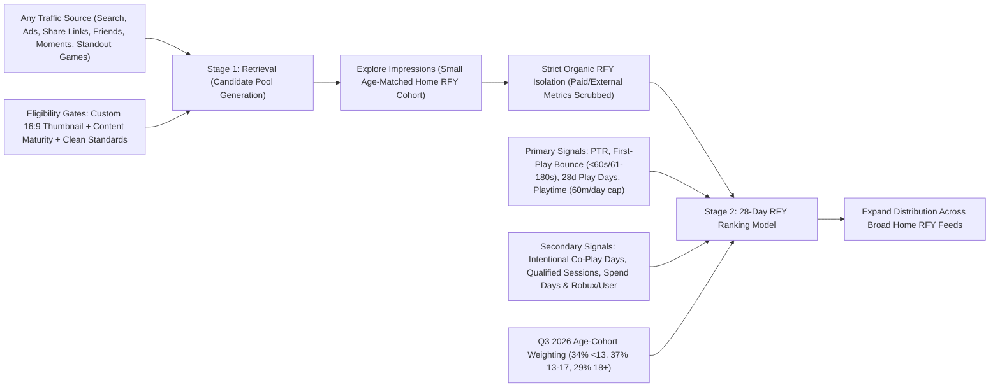
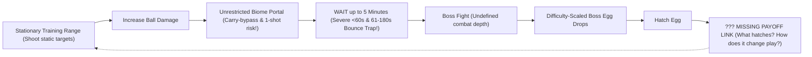
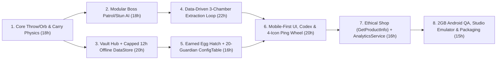

# Roblox Deep Market Research, Discovery Algorithm, Game Design & Commercial Feasibility Report

**Collection Date:** 2026-11-22  
**Primary Anchor Profile:** Solo Indie Developer (Zero / Small Budget) + Multi-Scenario Comparisons  
**Scope:** Independent Market Discovery (Blind Phase) → Critical Evaluation of `GameIdea.txt` → Alternative Concepts, Validation & Financial Feasibility

## Table of Contents

- [Deliverable A — Executive Summary](#deliverable-a-executive-summary)
- [Deliverable B — Roblox Market Report & Opportunities](#deliverable-b-roblox-market-report-opportunities)
- [Deliverable C — Competitive Analysis Database](#deliverable-c-competitive-analysis-database)
- [Deliverable D — Successful Game Feature Matrix](#deliverable-d-successful-game-feature-matrix)
- [Deliverable E — Roblox Discovery Playbook](#deliverable-e-roblox-discovery-playbook)
- [Deliverable F — Viral Game Case Studies](#deliverable-f-viral-game-case-studies)
- [Deliverable G — Player Retention & Monetization Framework](#deliverable-g-player-retention-monetization-framework)
- [Deliverable H — Preliminary Game Idea Evaluation](#deliverable-h-preliminary-game-idea-evaluation)
- [Deliverable I — Alternative Game Concepts](#deliverable-i-alternative-game-concepts)
- [Deliverable J — Concept Decision Matrix](#deliverable-j-concept-decision-matrix)
- [Deliverable K — Prototype Roadmap, Validation, Analytics & Risk Assessment](#deliverable-k-prototype-roadmap-validation-analytics-risk-assessment)
- [Deliverable L — Financial Feasibility Report](#deliverable-l-financial-feasibility-report)
- [Deliverable M — Launch and Growth Strategy](#deliverable-m-launch-and-growth-strategy)
- [Deliverable N — Founder Cheat Sheet & Final Strategic Recommendation](#deliverable-n-founder-cheat-sheet-final-strategic-recommendation)
- [Appendix: Verified Sources Registry](#appendix-verified-sources-registry)

---

# Deliverable A — Executive Summary

**Collection Date:** `2026-11-22`  
**Primary Anchor:** Solo Indie Developer (Zero / Small Budget, USD & PHP @ `₱63.75/USD`)  
**Methodology:** Independent market discovery (44 verified experiences, 41-mechanic matrix, 12 viral case studies, late-2026 platform documentation) conducted **strictly blind** to [GameIdea.txt](GameIdea.txt) first, followed by unbiased product evaluation, alternative concept design, sensitivity scoring, and Python-verified financial modeling.

---

## 1. The Late-2026 Roblox Market Reality (Five Defining Findings)

1. **Massive, Maturing, De-Concentrating—Yet Ruthlessly Competitive `[Officially confirmed]` (`S01`, `S23`):** As of Q3 2026 (reported Oct 29, 2026), Roblox operates at **138M DAUs**, **~34B quarterly hours engaged**, **$1.697B quarterly bookings**, and **~$1.7B trailing 12-month DevEx payouts** (cumulative >$5B). Top-10 game share dropped from ~30% to ~20%, and **40% of the weekly Top 100 Home RFY games (by impressions) were created in the prior 3 months**—proving new games break out constantly. Yet earnings remain sharply power-law skewed (Top 1,000 creators capture ~73% of payouts; DevEx median is ~$1,440/yr), and **>80% of Top 100 titles use AI tools**, flooding the market with cheap clones.
2. **The June 15, 2026 Discovery Overhaul Killed Clickbait & AFK Simulators `[Officially confirmed]` (`S03`, `S04`):** Roblox permanently retired **QPTR** and upgraded Home *"Recommended for You"* (RFY) to a **28-day rolling window** (`D1`, `D2–7`, `D8–28`) driven by **Play-Through Rate (PTR)**, a **negative First-Play Bounce Rate (`<60s` & `61–180s`)**, **28-day Play Days Per User**, **Playtime Per User (capped at 60 min/user/game/day)**, **Intentional Co-Play Days**, and **Q3 2026 Age-Cohort Weighting** (66% of age-checked DAUs are now 13+, and **29% global / 37% U.S. are 18+**, monetizing >50% higher).
3. **Cooperation & Mechanical Mastery Separate Survivors From 99.9% Collapses `[Strongly supported by evidence]` (`Deliverable D`, `S14`):** Across our 44-game verified database, **`cooperation` appears in 93.3% of Sustained titles vs. only 40.0% of Viral spikes**. Skill-first & co-op survival games (*Illegal Soccer* >40% peak retention; *Violence District* 18%–25%; *RIVALS* 110k–200k daily CCU; *99 Nights in the Forest* 120k–204k; *Dandy's World* 113k–191k) outlast meme-raiders and shallow clones (*Plants vs Brainrots* `-99.96%`, *Garden Horizons* `-99.99%` despite a 96% like ratio!). Furthermore, **7 of the top 10 2025–2026 viral breakouts** belong to an overlapping mega-scaler network (Do Big Studios, Splitting Point/Jandel, `misfitsbsthree` owning *both* *Steal An Egg* & *Throw Food For Animals*).
4. **New 2026 Monetization Upsides & Hard Legal Traps `[Officially confirmed]` (`S06`, `S07`, `S08`, `S12`):**
   - **Upsides:** Standard DevEx rose to **`$0.0038/R$`** (Sept 2025+), **U.S. 18+ R15-compliant DevEx rose +42.1% to `$0.0054/R$`** (June 2026+), **Subscriptions pay 100% creator share Month 2+**, **Creator Rewards** pay `5 R$/Active Spender` (≥10m, first 3 games/day) + `35%` Audience Expansion, and **US–PH Tax Treaty Article 13 (W-8BEN + BIR TIN) + Wise FX** lifts Philippine net bank take-home by **+23.9% (`₱20,488` vs. `₱16,534` per 100k R$)**!
   - **Traps:** **Paid Random Items** enforcement now bans Robux-linked eggs/crates *and* **paid Luck Boosts** across BE, NL, UK (`<18`), AU (`<18`), and **Brazil (`<18`/unverified since March 17, 2026)** unless strictly gated via server-side `PolicyService` with dynamic 100% odds UI. Meanwhile, **Jan 2026 mandatory Facial Age Estimation chat segregation** forces multiplayer games to rely on **non-verbal pings/emotes**.
5. **You Don't Need 10,000 CCU to Succeed Solo (`Deliverable L`):** At just **32.5 Avg CCU (`2,500 DAU`)**, a zero-ad solo developer nets **83,600 Earned Robux/mo (`$342` / `₱21,787` gross; ~`₱18,425` net PH take-home)**, paying back a `$100` bootstrap budget in under 10 days. At **~281 Avg CCU (`15,000 DAU`)**, gross DevEx reaches **`$3,373/mo` (`₱215,028/mo`; ~`₱181,860` net PH)**—while conservative paid-ad campaigns (`$150–$800/mo`) lose money (`0.41x–0.57x` ROAS) whenever run before retention is validated.

---

## 2. Critical Verdict on `GameIdea.txt` & Top-Ranked Strategic Path

> [!WARNING]
> **Verdict on [GameIdea.txt](GameIdea.txt): DO NOT BUILD AS WRITTEN (`4.22 / 10`, Rank `#7 / 7` across all 5 sensitivity profiles).**  
> Borrowing static pieces of *Steal An Egg* while dropping heist adrenaline and adding **5-minute boss wait timers**, **stationary target clicking**, **undefined egg payoffs**, **unrestricted carry-exploitable portals**, and a **multi-biome solo art treadmill** directly triggers every late-2026 RFY failure mode (`<60s` bounce, 3-minute killer loop, solo burnout, and Paid Random Items legal risk).

### Top Three Validated Concepts to Prototype (Weighted Decision Matrix — Deliverable J)

| Priority | Concept | Baseline Score | Best Sensitivity Rank | Solo MVP Effort | Core Hook & Why It Wins |
| :---: | :--- | :---: | :--- | :---: | :--- |
| **#1 Primary Prototype** | **C2: Egg Heist: Boss Vault** *(Reimagined `GameIdea.txt`)* | **8.43 / 10** | **#1 Baseline, #1 Profit, #1 Organic Growth** | 4–6 weeks (~145h) | **1–4p PvE Boss-Vault Extraction:** Throw Decoy/Freeze orbs to stun patrolling giant bosses, grab glowing eggs, push deeper or sprint to exit, hatch **100% earned** Hub Guardians (capped 12h offline income). Captures *Steal An Egg* + *99 Nights* demand with zero PvP griefing, zero wait timers, zero lootbox bans! |
| **#2 Ultra-Lean Backup** | **C3: Curve Clash: Duel Pads** *(Lowest-Cost Solo Pivot)* | **8.20 / 10** | **#1 Feasibility (`8.53`)** | **2–4 weeks (~102h)** | **Physical Lobby Duel Pads (1v1/2v2/Bot):** 90-second trick-shot curve-dodgeball battles with catch-counters, public win-streak halos, zero-P2W cosmetics, zero content treadmill, and high U.S. 18+ `$0.0054` DevEx lift. |
| **#3 Retention Leader** | **C4: 12-Minute Outpost** *(Emerging Co-Op Gap)* | **8.30 / 10** | **#1 Sustainability (`8.55`)** | 5–8 weeks | **Bite-Sized Co-Op Extraction:** 12-minute scavenge-fortify-defend runs with a high-drama Minute-8 *"Extract vs. Overdrive"* vote, 4-icon non-verbal pings, and meta-class unlocks. |

---

## 3. Direct Summary of the Five Priority Research Questions (`Research.txt`)

| Research Priority | Evidence-Backed Answer |
| :--- | :--- |
| **1. Discoverability** | Clear Stage 1 Retrieval via clean niche Share Links + Roblox Moments clips + Discord/Community Flash Mob (never buy broad ads first); win Stage 2 Ranking via authentic 15s auto-play Gameplay Video, 5-slot Thumbnail Personalization (>7d untouched), `<20%` `<60s` mobile bounce, 1-CCU viability, and 28-day Play Days + Intentional Co-Play. |
| **2. Unique Gameplay Hook** | Replace generic stationary shooting/waiting with a 3-second mute-readable kinetic verb: **throwing Freeze/Decoy utility orbs to outsmart a giant Boss and sprint out of a closing Vault carrying a glowing egg (`C2`)**, or **curving trick-shot dodgeballs on physical Duel Pads (`C3`)**. |
| **3. First Five Minutes** | Action in `<15s` via glowing floor beam (zero text walls); complete first boss vault heist & hatch Guardian #1 inside **90–120 seconds**; unlock Freeze Orb by **minute 3–4**; tease Chamber 2 rare mutations by **minute 5**—beating both `<60s` and `61–180s` bounce traps. |
| **4. Development Feasibility** | Cut multi-biomes, trading, paid-RNG legal compliance, and custom chat completely from MVP. Build **1 modular transforming Vault/Arena** driven by `ConfigTables` (~102–145 solo hours) and prove fun in a **10-day greybox prototype (Gate 1)** before investing in polish. |
| **5. Retention & Profitability** | Target **D1 ≥13%–16% (GA P75–P90)**, **D7 ≥2.5%–3.9%**, **Session ≥12m** via push-your-luck replayability + co-op roles + capped 12h offline Hub. Monetize via non-RNG passes, **100%-renewal Subscriptions**, R15 U.S. 18+ **`$0.0054` DevEx**, post-2k-MAU **Rewarded Videos**, and **W-8BEN Treaty Art. 13** (15% WHT). |

---

## 4. Recommended Immediate Next Steps (Next 30 Days)
1. **Days 1–3:** Run Experiment **E1** (3 mock 16:9 thumbnails + 1-sentence concept poll on Roblox Discords/TikTok comparing `C2` vs `C3`).
2. **Days 4–13:** Build the **10-Day Greybox Prototype of `C2: Egg Heist: Boss Vault`** (1 Chamber, 1 patrolling Boss, Decoy + Freeze Orbs, heavy-egg sprint, Extraction Pad—zero art polish or shop!).
3. **Days 14–16 (Gate 1):** Watch 15–20 testers (≥50% on mobile) play silently via screenshare. **Pass (`≥70%` voluntary 2nd heist)** → proceed to Days 17–30 MVP Hub/Codex/`ProfileStore`/`AnalyticsService` build. **Fail (`<45%` after 3-day tune)** → pivot cleanly to **7-day `C3: Curve Clash` Duel-Pad prototype** with zero sunk-cost regret!

---

# Deliverable B — Roblox Market Report & Opportunity Identification

**Collection Date:** `2026-11-22`  
**Research Scope:** Sections 3 & 12 of `Research.txt` — Late-2026 Macro Ecosystem, Genre Dynamics, Saturation Mapping, Seasonal Trends, and 10 Evidence-Backed Market Opportunities (conducted strictly independently prior to evaluating any preliminary concept).

---

## 1. Late-2026 Roblox Platform Macro Landscape

Between H2 2025 and November 2026, Roblox transitioned through two distinct market phases: an unprecedented viral inflection in **H2 2025** (propelled by synchronized live-event hits such as *Grow a Garden* at 22.38M CCU and *Steal a Brainrot* at 25.8M CCU, briefly lifting global concurrency to ~47.4M CCU and Q3 2025 DAUs to 151.5M) followed by **post-surge normalization, demographic maturation, and AI-accelerated supply growth in 2026** `[Officially confirmed]` `[Strongly supported by evidence]` (`S01`, `S02`, `S23`).

### 1.1 Official Financial, Operational & Creator Payout Metrics (FY 2025 – Q3 2026)

| Metric | Q3 2025 | Q4 2025 | FY 2025 | Q1 2026 | Q2 2026 | Q3 2026 (Reported Oct 29, 2026) | Evidence Tag |
| :--- | :--- | :--- | :--- | :--- | :--- | :--- | :--- |
| **Average DAUs** | 151.5M | 144M (+69% YoY) | Unknown | 132M (+35% YoY) | 123M (+10% YoY) | **138M** (+12% QoQ / -9% YoY) | `[Officially confirmed]` (`S01`, `S02`) |
| **Hours Engaged** | ~39–40B | 35B (+88% YoY) | 124B | 31B (+43% YoY) | 29B (+5% YoY) | **~34B** (+17% QoQ / -15% YoY) | `[Officially confirmed]` (`S01`, `S02`) |
| **Bookings** | ~$1.93B | $2.222B (+63% YoY) | $6.812B (+55% YoY) | ~$1.7B (+43% YoY) | $1.557B (+8% YoY) | **$1.697B** (-12% YoY; beat guidance) | `[Officially confirmed]` (`S01`, `S02`) |
| **GAAP Revenue** | ~$1.355B | $1.415B (+43% YoY) | $4.891B (+36% YoY) | ~$1.4B (+39% YoY) | $1.469B (+36% YoY) | **$1.572B** (+16% YoY) | `[Officially confirmed]` (`S01`, `S02`) |
| **DevEx Payouts** | $428M | $477M (+70% YoY) | >$1.5B | $423M | $363M | **$403M** (~24% of bookings) | `[Officially confirmed]` (`S01`, `S02`) |
| **Free Cash Flow** | Unknown | $307M (+155% YoY) | $1.8B Op CF | Unknown | $294M (+66% YoY) | **$364M** | `[Officially confirmed]` (`S01`, `S02`) |

**Key Creator Economy Structural Facts:**
- **Scale & Power-Law Concentration:** Cumulative DevEx payouts crossed **$5 billion** at RDC 2026 (Sept 2026), with trailing 12-month payouts near **$1.7 billion** (`$1.189B` across Q1–Q3 2026 alone) `[Officially confirmed]` (`S01`, `S05`). However, earnings remain intensely power-law skewed: the **Top 1,000 creators** average **$1.1M–$1.3M/year** (~73% of payouts), whereas median earnings across ~29,000–30,000 DevEx-qualified creators sit near **$1,440/year**, and ~85% of hobbyist developers earn `<$100/month` or `$0` `[Strongly supported by evidence]` (`S23`).
- **De-Concentration at the Top:** Management disclosed in Q2 2026 that the **Top 10 experiences dropped from ~30% to ~20% of total hours engaged** over three years, and in Q3 2026 **40% of the weekly Top 100 Home RFY games (by impressions)** were created within the preceding 3 months `[Officially confirmed]` (`S01`, `S02`). Market entry is structurally open—*but* holding share is harder than ever.
- **The AI Supply Shock:** In Q3 2026, **>80% of the Top 100 games** utilized AI tools, daily asset uploads tripled month-over-month, Roblox's prompt-to-game *Build* alpha generated >70,000 experiences from >500,000 users, and AI-native games (*Break and Steal an Egg*, *Huss Valley*) entered the Top 20 CCU `[Officially confirmed]` (`S01`). Cheap content supply means **asset volume is no longer a moat**; **systemic gameplay design, social co-play architecture, and economy integrity** are `[Reasonable inference]`.

### 1.2 Regional Monetization Skew, Demographics & Device Reality

| Region (Q3 2026) | DAUs | Share of Global DAUs | Q3 2026 ABPDAU | Monetization Multiplier vs. APAC | Notable Trend | Evidence Tag |
| :--- | ---: | ---: | ---: | ---: | :--- | :--- |
| **US & Canada** | 24M | 17.4% | **$38.52** | **7.2x** | ~30% daily penetration of US 13–17s; U.S. O18 is 37% of age-checked US DAU and monetizes >50% higher than U18. | `[Officially confirmed]` (`S01`) |
| **Europe** | 32M | 23.2% | **$11.20** | **2.1x** | Second-highest yield tier; Russia unblocked late June 2026 adding sign-up volume. | `[Officially confirmed]` (`S01`) |
| **Asia-Pacific (APAC)** | 42M | 30.4% | **$5.37** | **1.0x** | Largest DAU bloc; only disclosed region expanding ABPDAU YoY ($5.27 → $5.37); Japan +33%–67% YoY, India +37%–64% YoY. | `[Officially confirmed]` (`S01`) |
| **Rest of World (RoW)** | 40M | 29.0% | **~$5.00** (Q2: $4.88) | **~0.9x** | High volume growth (LATAM/MENA/Africa) fueling matchmaking liquidity & discovery velocity. | `[Officially confirmed]` (`S01`, `S02`) |

**Three Non-Negotiable Demographic & Hardware Constraints for Solo Developers:**
1. **Aging-Up Platform (66% Aged 13+):** Among age-checked DAUs (64% of global DAUs verified by Q3 2026), **34% are Under 13**, **37% are 13–17**, and **29% are 18+ (Adults)**—the fastest-growing cohort (+32% YoY DAUs in Q2 2026) `[Officially confirmed]` (`S01`, `S02`). Designing exclusively for passive under-10 clickers forfeits the fastest-growing, highest-monetizing, and **$0.0054 U.S. 18+ DevEx-eligible** segment `[Reasonable inference]`.
2. **Mandatory Age-Checked Chat Segregation (Jan 2026):** Global Facial Age Estimation / ID gating segregates free-text chat into brackets (`Roblox Kids 5–8`, `Roblox Select 9–15`, `16–17`, `18+`) `[Officially confirmed]` (`S09`). Multiplayer games that require typing in chat to coordinate break across mixed-age lobbies; **non-verbal pings, emotes, and visual cues are mandatory** `[Reasonable inference]`.
3. **80% Mobile Audience Reality:** Roughly **~80% of DAUs play on Mobile**, **~17% Desktop**, and **~3% Console** `[Strongly supported by evidence]` (`S23`). Any mechanic requiring precision desktop mouse aim, tiny buttons, or >2GB RAM crashes on low-end Android immediately loses up to four-fifths of organic Home RFY traffic `[Reasonable inference]`.

---

## 2. Genre Landscape, Lifecycle Waves & Preference Shifts (2024 → Late 2026)

### 2.1 Genre Categorization Matrix

| Market Tier | Genres & Archetypes | Representative Titles (Nov 2026) | Commercial Signal | Evidence Tag |
| :--- | :--- | :--- | :--- | :--- |
| **Most Popular Core Pillars** | Roleplay / Avatar Life-Sim; Anime Action RPG; Competitive Arena FPS; Social Deduction | *Brookhaven RP* (310k–500k+), *Adopt Me!* (230k–260k+), *Blox Fruits* (120k–330k+), *RIVALS* (110k–200k+), *MM2* (90k–210k+) | Multi-year compounding revenue; massive incumbent moats via content depth & sunk-cost trading. | `[Strongly supported by evidence]` (`S14`, `S15`, `S22`) |
| **Fastest-Growing & Viral Waves (2025–2026)** | Co-op Survival Roguelikes; Asymmetrical 1vMany Horror; Extraction / Base-Raiding Sim Hybrids; Chaotic Arcade Sports; Arcade Fishing | *Steal An Egg* (14.3M pk / 800k–1M+ active), *99 Nights in the Forest* (120k–204k), *Dandy's World* (113k–191k), *Fish It!* (65k–81k), *Violence District* (50k–70k), *Illegal Soccer* (33k–35k; >40% peak retention!) | Sharp bifurcation: co-op survival & arcade sports hold 10%–43% of peak CCU; meme-raiders spike 10x higher but decay 99.8%+. | `[Strongly supported by evidence]` (`S14`, `S15`, `S18`) |
| **Oversaturated ("Red Ocean")** | Generic Clicker/Pet/Training Simulators; Unlicensed Anime Tower Defense; Static Obbies; Meme/Brainrot Reskins | *Anime Defenders* (-99.95% to ~100–250 CCU), *Plants vs Brainrots* (-99.96%), *Garden Horizons* (-99.99% despite 96% like ratio), *Don't Wake the Brainrots!* (-99.99%) | Brutal CAC, immediate RFY suppression under the June 2026 28-day retention window, high IP/Policy risk. | `[Strongly supported by evidence]` (`S03`, `S14`, `S19`) |
| **Underserved ("Blue Ocean" Demand > Supply)** | Session-Based Co-op Roguelikes/Extraction; Physics-Comedy Arcade Sports; Deep Tactical Crafting/RPG Hybrids; Structured 13+/18+ Social Sims; 2D/Cozy/Async Strategy | *Illegal Soccer*, *The Forge*, *Volleyball Legends*, *Deepwoken*, *Theme Park Tycoon 2* | Higher CCU per quality title, lower clone density due to mechanical/systemic skill moats, strong O18 monetization fit. | `[Strongly supported by evidence]` (`S14`, `S22`) |

### 2.2 Seasonal & Event-Driven Dynamics (2025–2026)
- **Official Roblox Platform Events:** *The Hunt: Mega Edition* (Mar 2025), *The Hatch* (Jul 2025), *The Hunt: Roblox 20* (Sept 17–28, 2026), and *The Hollow* (Oct 22–Nov 2, 2026) demonstrated extraordinary reactivation elasticity—pushing even 15-to-18-year-old classics to **all-time CCU records** (*Work at a Pizza Place* hit 168,033 on Sept 17, 2026; *Murder Mystery 2* hit ~2.24M in late Oct 2026) `[Officially confirmed]` `[Strongly supported by evidence]` (`S05`, `S14`).
- **Developer-Run "Admin Abuse" Events:** Institutionalized after the Aug 23, 2025 *Admin Abuse War* (47.4M platform CCU), weekly Saturday developer spectacles trigger massive appointment-viewing spikes—but create **weekday "ghost town" conditioning**, economy hyperinflation, and solo-dev burnout `[Strongly supported by evidence]` `[Observational correlation]` (`S18`, `S25`).

### 2.3 Four Structural Shifts in Player Preferences (2024 → Late 2026)
1. **TikTok-ized Visual Legibility + Auto-Play Previews:** Home RFY auto-playing gameplay videos (up to **+39% playtime lift**) and **Roblox Moments** (native homepage short-form video tab with one-tap Join) reward mechanics whose appeal is visually obvious in **3 seconds on mute** `[Officially confirmed]` (`S04`, `S05`).
2. **Co-op Systemic Runs Beating Linear Simulators on Retention:** *99 Nights in the Forest* (120k–204k CCU), *Dandy's World* (113k–191k), *Violence District* (50k–70k), and *Forsaken* (50k–98k) systematically outperform 2025's meme simulators on 28-day retention and session length `[Strongly supported by evidence]` (`S14`, `S18`).
3. **Zero Tolerance for Predatory P2W & Bait-and-Switch:** Backlash against *Blox Fruits*' Dragon Tokens (Dec 2024), *Fisch*'s Do Big era (2024–2025, followed by WoozyNate's 1.27M-CCU comeback upon rolling back P2W), and *Pet Simulator 99!*'s steady decline from 733k → 31k–42k prove players actively migrate away from extractive loops when fairer alternatives (*Fish It!*, *RIVALS*, *Illegal Soccer*) exist `[Strongly supported by evidence]` (`S14`, `S25`).
4. **Rising Regulatory & Policy Compliance Floors:** Mandatory `PolicyService` Paid Random Items gating (BE, NL, UK `<18`, AU `<18`, and **Brazil `<18`/unverified effective March 17, 2026**), Content Maturity ratings, and `TextChatService` compliance raise the operational bar on gacha/egg mechanics `[Officially confirmed]` (`S08`, `S09`).

---

## 3. Market Entry Mode Comparison (Section 12)

Before selecting a niche, solo developers must understand the commercial trade-offs across the four entry strategies `[Reasonable inference]` grounded in `S01`, `S03`, `S14`, `S19`:

| Entry Strategy | Demand Certainty | Competitive Moat Required | Solo-Dev Feasibility | Discovery Path (Nov 2026 RFY) | Verdict for Solo Zero/Low-Budget Dev |
| :--- | :--- | :--- | :--- | :--- | :--- |
| **1. Popular Oversaturated Genre** *(Generic Clicker/Pet/Egg Sim, Anime TD)* | Very High | Massive LiveOps budget, studio network (Do Big/Splitting Point), or huge existing fanbase | **Low** (crushed by weekly update treadmill & ad costs) | Brutal: high bounce vs. entrenched leaders kills 28-day RFY expansion | **Avoid** unless bringing a radical mechanical twist |
| **2. Emerging High-Growth Genre** *(Co-op Survival Runs, Chaotic Arcade Sports, Physics Brawlers)* | High & Rising | Crisp core feel, fast match turnaround, distinct theme/hook | **High** (systems-driven replayability beats asset volume) | Strong: RFY age-cohort weighting & Moments clips accelerate early winners | **Primary Target** |
| **3. Small Underserved Niche** *(Cozy 2D/Puzzle, Hardcore Roguelite, Tactile Crafting Sim)* | Moderate (must validate!) | Craft excellence & authentic community loyalty | **Medium–High** (lower clone competition; *Standout Games* editorial path) | Curation (*Standout Games*), niche Discord/YouTube seeding, high O18 ARPPU | **Strong Secondary Target** (verify demand first!) |
| **4. Novel Hybrid Genre** *(Familiar Grammar + 1 Distinctive Twist)* | Validated via parent genre | Clear 1-sentence concept merging two proven loops without bloat | **Very High** (familiar onboarding cuts `<60s` bounce; twist differentiates!) | **Highest Solo ROI:** Inherits familiar PTR while earning viral Moments/TikTok curiosity | **Optimal Solo Entry Strategy** |

---

## 4. Ten Evidence-Backed Roblox Market Opportunities (Section 12)

> [!NOTE]
> **Demand-First Filter:** Low competition alone is never treated as an opportunity. Every opportunity below is anchored to **verified live 2026 demand signals** (CCU baselines, retention efficiency, demographic gaps, or newly unlocked platform capabilities) and scored `1–10` across all 10 Section 12 criteria (`Demand`, `Growth`, `Low Comp` [10=less crowded], `Solo Feasibility`, `Diff.`, `Retention`, `Monetize`, `Viral/Social`, `Low Content Load` [10=systems-driven], `Sustainability`).

### Opportunity Evaluation Summary Matrix

| # | Opportunity Concept Space | Demand | Growth | Low Comp | Solo Feas. | Diff. | Retention | Monetize | Viral / Social | Low Content Load | Sustain. | Avg |
| :-: | :--- | :-: | :-: | :-: | :-: | :-: | :-: | :-: | :-: | :-: | :-: | :-: |
| **O1** | **Short-Session Co-op Survival Extraction (10–20 Min Runs)** | 9 | 9 | 7 | 8 | 8 | 9 | 7 | 9 | 9 | 9 | **8.4** |
| **O2** | **Chaotic Physics Arcade Sports ("Sport + Absurd Twist")** | 8 | 9 | 8 | 8 | 9 | 8 | 7 | 10 | 9 | 8 | **8.4** |
| **O3** | **Tactile Skill-Minigame Cozy Collection (Non-Fishing)** | 9 | 8 | 7 | 8 | 8 | 8 | 7 | 7 | 7 | 8 | **7.7** |
| **O4** | **Asymmetrical Co-op Role Extraction (Non-Horror / Comedic)** | 8 | 8 | 8 | 7 | 9 | 8 | 7 | 9 | 8 | 8 | **8.0** |
| **O5** | **Cooperative Assembly-Line / Chaotic Job Roguelite (*Overcooked*-Style)** | 7 | 7 | 9 | 8 | 9 | 8 | 6 | 9 | 8 | 8 | **7.9** |
| **O6** | **Risk-Reward PvE Extraction-Tycoon Without Griefing (Opt-In Threat)** | 9 | 8 | 6 | 9 | 7 | 7 | 8 | 8 | 7 | 7 | **7.6** |
| **O7** | **Interactive Crafting / Forging Loop with Combinatorial Recipes** | 8 | 8 | 7 | 7 | 8 | 8 | 8 | 7 | 7 | 8 | **7.6** |
| **O8** | **Zero-P2W Skill-Based Projectile / Dodgeball Arena Duels** | 8 | 7 | 7 | 8 | 8 | 8 | 7 | 8 | 9 | 8 | **7.8** |
| **O9** | **18+ / Teen Structured Career & Heist Social Sandbox (Lite)** | 8 | 8 | 7 | 5 | 7 | 8 | 9 | 8 | 6 | 8 | **7.4** |
| **O10** | **Asynchronous Cozy Management + Synchronized World Events (Anti-Inflation)** | 8 | 6 | 6 | 9 | 7 | 7 | 8 | 7 | 7 | 6 | **7.1** |

---

### Detailed 9-Point Analysis of All 10 Opportunities

#### Opportunity 1: Short-Session Co-op Survival Extraction (10–20 Min Escalating Runs) `[Strongly supported by evidence]`
1. **Why the Opportunity Exists:** *99 Nights in the Forest* (120k–204k CCU) and *Dead Rails* (15k–35k CCU) proved huge demand for co-op survival runs, yet full 99-night runs demand 60–120+ minutes—creating a gap for **10–20 minute bite-sized mobile-friendly extraction runs** with crisp solo/duo scaling and zero chat-wall friction (`S14`, `S18`).
2. **Supporting Market Evidence:** *99 Nights* (30.61B visits), *Dandy's World* (113k–191k CCU), *Dead Rails* (6.67B visits); GameAnalytics 2026 P90 session length is 14.7 min (`S17`); June 2026 RFY rewards 28-day Play Days + Intentional Co-Play (`S03`).
3. **Target Audience:** 11–24 co-op mobile/PC friend squads and solo quick-match players seeking tense replayable runs.
4. **Direct & Indirect Competitors:** Direct: *99 Nights in the Forest*, *Dead Rails*, *DOORS*, *Dandy's World*. Indirect: *A Dusty Trip*, *Forsaken*.
5. **Proposed Differentiation:** Compressed 12-minute "extract or risk deeper wave" push-your-luck pacing, non-verbal ping wheel (solving Jan 2026 age-gated chat), and clean solo-to-4-player dynamic scaling.
6. **Major Risks:** Balancing enemy AI and difficulty curve so newcomers don't bounce in `<60s` while veterans still feel tension; ensuring empty/low-CCU servers allow instant solo/duo starts.
7. **MVP Requirements:** 1 compact procedural/modular arena-zone loop, 3 enemy archetypes, 3 starter classes/loadouts, push-your-luck extraction portal, meta-currency unlock shop, ping wheel.
8. **Expected Development Complexity:** **Medium** (systems-driven; low world-art burden).
9. **Pre-Commitment Validation:** 1-week greybox co-op run prototype tested with 20–30 Discord testers measuring completion rate, voluntary "play again" rate, and `<60s` comprehension.

#### Opportunity 2: Chaotic Physics Arcade Sports ("Familiar Sport + Absurd Mechanical Twist") `[Strongly supported by evidence]`
1. **Why the Opportunity Exists:** *Illegal Soccer* (May 2026, 33k–35k CCU, **>40% peak-to-baseline retention ratio**) and *Volleyball Legends* (34k–51k CCU, 95.17% rating) proved Roblox players crave fast, kinetic, non-P2W sports loops—yet most sports variants (dodgeball, bowling, basketball, curling, golf, tetherball) remain underserved with chaotic physics twists (`S14`, `S15`).
2. **Supporting Market Evidence:** *Illegal Soccer* holds the highest retention efficiency of any 2026 breakout in our 44-game dataset; *RIVALS* proved instant physical lobby matchmaking pads + cosmetic-only monetization thrive (`S14`).
3. **Target Audience:** 10–25 competitive/casual friend groups, TikTok/Roblox Moments clippers, mobile + PC cross-play players.
4. **Direct & Indirect Competitors:** Direct: *Illegal Soccer*, *Blue Lock: Rivals*, *Volleyball Legends*, *Blade Ball*. Indirect: *RIVALS*, *Cat Battles*.
5. **Proposed Differentiation:** Pair an ultra-readable sport (e.g., dodgeball / demolition golf / grapple basketball) with physics gadgets, instant 2-minute rounds, server-authoritative hits, and zero P2W stats.
6. **Major Risks:** Physics/network lag on mobile; matchmaker starvation if requiring large lobbies (mitigate via 1v1 / 2v2 / 3v3 dynamic pads + bot backfill).
7. **MVP Requirements:** 1 tight arena, 1 crisp ball/projectile physics controller, 4 chaotic gadgets/modifiers, instant physical queue pads, cosmetic shop.
8. **Expected Development Complexity:** **Medium** (core engineering centered on clean netcode/physics rather than huge maps).
9. **Pre-Commitment Validation:** 10-second gameplay clip test on TikTok/Shorts/DevForum + 1v1/2v2 playtest tracking average rounds played per session (target ≥4 rounds).

#### Opportunity 3: Tactile Skill-Minigame Cozy Collection (Beyond Fishing) `[Strongly supported by evidence]`
1. **Why the Opportunity Exists:** *Fisch* (40k–70k CCU, built originally by 1 solo dev) and *Fish It!* (65k–81k CCU) proved **100k+ concurrent players** want relaxing, tactile, skill-flavored collection loops—yet fishing is now dominated by two entrenched leaders, leaving adjacent tactile themes (deep-sea salvage/metal detecting, bug/fossil excavation, potion alchemy, star-catching, culinary foraging) wide open (`S14`).
2. **Supporting Market Evidence:** Combined fishing niche >110k–150k daily CCU; 90.84% rating on *Fisch* post-fair-monetization rollback proves intense appetite for trust-first cozy loops (`S14`, `S25`).
3. **Target Audience:** Cozy/casual players across all ages (strong female, teen, and mobile/tablet appeal), collectors, Bestiary completionists.
4. **Direct & Indirect Competitors:** Direct: *Fisch*, *Fish It!*, *Bee Swarm Simulator*. Indirect: *Grow a Garden*, *The Forge*.
5. **Proposed Differentiation:** Swap fishing for a fresh, universally intuitive tactile 2D/3D rhythm/timing minigame (e.g., fossil chiseling, relic magnet-salvaging, or monster-ball curving) + shared server weather totems + zero Paid Random Items risk (100% earned-currency collection).
6. **Major Risks:** Minigame feeling tedious on mobile touchscreens or lacking sufficient long-term Bestiary/tool depth.
7. **MVP Requirements:** 1 atmospheric hub island + 3 harvest zones, 1 super-juicy 5-second skill minigame, 40–60 collectible variants/mutations, 6 upgradeable tools, Bestiary index, dynamic weather timer.
8. **Expected Development Complexity:** **Low–Medium** (ideal solo scope; proved by WoozyNate's solo launch of *Fisch*).
9. **Pre-Commitment Validation:** Playtest the 5-second tactile minigame in isolation with 15 testers—if players don't instinctively want to repeat the action 20+ times without rewards, iterate before building zones.

#### Opportunity 4: Asymmetrical Co-op Role Extraction (Non-Horror / Comedic Heist or Sci-Fi) `[Strongly supported by evidence]`
1. **Why the Opportunity Exists:** Asymmetrical survival (*Forsaken* 50k–98k, *Violence District* 50k–70k, *Dandy's World* 113k–191k) is one of 2026's highest-retention genres, yet nearly 100% of active titles use dark slasher/mascot-horror themes—excluding younger `<13` cohorts (34% of DAU) and comedy/action fans (`S01`, `S14`).
2. **Supporting Market Evidence:** Combined asymmetrical genre exceeds **250k+ daily CCU** with 18%–25% peak retention ratios (`S14`); family-friendly Content Maturity ("Minimal/Mild") unlocks broader RFY inventory (`S08`, `S09`).
3. **Target Audience:** 9–18 friend squads and content creators who want DBD/*Dandy's World* chase-and-extract teamwork in a bright, comedic theme (e.g., museum heist vs. security robot, zoo breakout vs. zookeepers).
4. **Direct & Indirect Competitors:** Direct: *Dandy's World*, *Forsaken*, *Violence District*, *Piggy*. Indirect: *Murder Mystery 2*, *Jailbreak*.
5. **Proposed Differentiation:** Bright comedic theme ("Minimal/Mild" maturity = zero age-gating friction), slapstick stun gadgets, clear visual role badges (Distractor / Hacker / Carrier), and built-in non-verbal callouts.
6. **Major Risks:** Balancing 1v4/1v5 asymmetrical kits so neither side feels helpless; lobby wait-time drop-off at low CCU (must allow AI-bot Hunter fallback when CCU <10!).
7. **MVP Requirements:** 2 compact maps, 1 AI/player Hunter + 3 Survivor roles, 1 shared extraction objective, cosmetics/role unlock currency, AI-fill queue.
8. **Expected Development Complexity:** **Medium–High** (map navigation, asymmetric state machine, AI fallback).
9. **Pre-Commitment Validation:** Run 5v1 (and 2vAI) closed-alpha lobbies tracking match completion rate and voluntary rematch count.

#### Opportunity 5: Cooperative Assembly-Line / Chaotic Job Roguelite (*Overcooked*-Style) `[Observational correlation]` `[Reasonable inference]`
1. **Why the Opportunity Exists:** *Work at a Pizza Place* (2008) still draws 2.5k–8.6k CCU and hit 168k CCU in Sept 2026 because interdependent workplace chaos is timeless—yet almost no modern 2026 Roblox hit modernizes chaotic 2–4 player timed kitchen/factory/workshop shifts with roguelite upgrades and Roblox Moments physics comedy (`S14`).
2. **Supporting Market Evidence:** 93.3% of sustained Roblox games feature cooperation (Deliverable D); *Work at a Pizza Place* holds a 92.9% rating after 18.5 years (`S14`); strong match with RFY *Intentional Co-Play Days* (`S03`).
3. **Target Audience:** 10–24 friend groups, duos/couples, streamers, cozy-chaos audiences.
4. **Direct & Indirect Competitors:** Direct: *Work at a Pizza Place*, *Restaurant Tycoon 2*. Indirect: *Dead Rails*, *Natural Disaster Survival*.
5. **Proposed Differentiation:** Escalating 5-minute shifts with moving hazards/absurd customers, throwable ingredients/items across teammates, and persistent shop/cosmetic upgrades between shifts.
6. **Major Risks:** Griefing/trolling in public lobbies (requires anti-grief safeguards and solo/duo private queue support).
7. **MVP Requirements:** 1 interactive workshop/kitchen, 4 chained stations (prep → cook/craft → assemble → deliver), escalating order timer, throw-to-teammate physics, meta upgrade shop.
8. **Expected Development Complexity:** **Low–Medium** (compact single-room arena; huge emergent comedy per script line).
9. **Pre-Commitment Validation:** 2-player & 4-player playtest recording voice reactions and measuring average consecutive shifts played.

#### Opportunity 6: Risk-Reward PvE Extraction-Tycoon Without Toxic PvP Griefing `[Strongly supported by evidence]`
1. **Why the Opportunity Exists:** *Steal An Egg* (14.3M peak, 800k–1M+ active) and *Steal a Brainrot* (25.8M peak) proved enormous demand for **"sneak into danger → grab rare loot → sprint home → display for passive/offline income"**—yet players simultaneously hate public-server PvP griefing (which drove huge Private Server escape spend) and dislike-bomb unfair pay-to-steal gear (`S14`, `S18`).
2. **Supporting Market Evidence:** *Steal An Egg* (11.6B+ visits in 4 months) + *Climb For Animals Eggs* (98.6% rating, 102M visits in 2.5 months) prove the extraction-plus-base-income formula works even without toxic player-on-player robbing (`S14`).
3. **Target Audience:** 8–16 simulator/collector audience + casual mobile players who love heist tension without losing hours of progress to paid-gear trolls.
4. **Direct & Indirect Competitors:** Direct: *Steal An Egg*, *Climb For Animals Eggs*, *Throw Food For Animals*, *Don't Wake the Brainrots!*. Indirect: *Steal a Brainrot*, *Grow a Garden*.
5. **Proposed Differentiation:** Replace toxic player-stealing with **escalating PvE monster/trap heists** + **opt-in co-op raids** (help a friend distract a giant guardian to split double loot!) + bounded offline income + strictly earned-only loot eggs (100% Paid Random Items compliant globally).
6. **Major Risks:** Falling into generic simulator fatigue if extraction runs feel repetitive or lack mechanical dodging/timing depth; competing against Do Big Studios' massive LiveOps marketing.
7. **MVP Requirements:** Home display base with offline income cap (e.g., 8–12h), 3 escalating PvE heist zones with distinct guardian/hazard behaviors, movement/escape gadgets, 25–30 collectible displays, co-op distraction bonus.
8. **Expected Development Complexity:** **Low–Medium** (highly solo-feasible).
9. **Pre-Commitment Validation:** Thumbnail PTR test + 5-minute prototype tracking extraction attempts per session and D1 return via offline-income greeting.

#### Opportunity 7: Interactive Tactile Crafting / Forging Loop with Combinatorial Recipes `[Strongly supported by evidence]`
1. **Why the Opportunity Exists:** *The Forge* hit **1.05M peak CCU** and crossed **1B+ visits** (94.45% rating, 17k–34k sustained CCU) by turning static grinding into an interactive ore-combining blacksmithing minigame that spawned huge YouTube "best recipe" discovery traffic (`S14`). Adjacent combinatorial themes (potion brewing, mech/drone building, spell-book fusion, cooking alchemy) remain under-exploited.
2. **Supporting Market Evidence:** *The Forge* sustained 17k–34k CCU ~1 year post-peak with strong YouTube organic search demand (`S14`); combinatorial systems multiply content depth without linear world-building burn (`S18`).
3. **Target Audience:** 12–22 RPG/crafting enthusiasts, theorycrafters, wiki/YouTube build-guide audiences.
4. **Direct & Indirect Competitors:** Direct: *The Forge*, *Wacky Wizards*, *Bee Swarm Simulator*. Indirect: *Blox Fruits*, *Fisch*.
5. **Proposed Differentiation:** Clean 3-ingredient combinatorial crafting matrix (e.g., 15 base ingredients → 400+ emergent trait combinations) paired with an instant test/combat arena where crafted creations are immediately used.
6. **Major Risks:** Balancing combinatorial math so one broken meta recipe doesn't obsolete 95% of combinations; UI clutter on mobile.
7. **MVP Requirements:** Resource-gathering loop, 3-slot interactive crafting minigame, trait-inheritance engine, showcase/testing combat dummy + wave arena, recipe codex.
8. **Expected Development Complexity:** **Medium** (data-driven recipe table reduces art load).
9. **Pre-Commitment Validation:** Playtest crafting + testing loop with 20 testers to verify organic experimentation ("what happens if I combine X + Y?").

#### Opportunity 8: Zero-P2W Skill-Based Projectile / Dodgeball Arena Duels `[Strongly supported by evidence]`
1. **Why the Opportunity Exists:** *RIVALS* (110k–200k CCU, 93.6% rating, ~13 min avg session) proved instant physical Duel Pads + fast first-to-5 rounds + cosmetic monetization is Roblox's highest-durability formula, yet shooter precision still creates a mobile-vs-PC skill gulf. A **curveball / dodgeball / arena-throwable duel game** with generous mobile auto-lock/timing curves lowers mobile friction while keeping crisp 1v1–3v3 mastery (`S14`, `S23`).
2. **Supporting Market Evidence:** *RIVALS* (19.4B visits) + *Blade Ball* heritage + *Illegal Soccer* (>40% retention efficiency) + 80% mobile DAU base (`S14`, `S23`).
3. **Target Audience:** 11–24 competitive mobile & PC players, 1v1 friend challengers, Moments/TikTok trick-shot clippers.
4. **Direct & Indirect Competitors:** Direct: *RIVALS*, *Blade Ball*, *Death Ball*, *Cat Battles*. Indirect: *The Strongest Battlegrounds*, *Illegal Soccer*.
5. **Proposed Differentiation:** Physical lobby Duel Pads (1v1 / 2v2 / Boss Practice), curve/deflect/catch-counter throwable physics tuned specifically for mobile thumb controls, public win-streak halos, and pure cosmetic monetization (trails, ball skins, eliminations).
6. **Major Risks:** Server-client hitreg desync on high-ping mobile connections; newcomer crush-rate if matchmaking lacks beginner brackets or PvE warm-up bots.
7. **MVP Requirements:** 1 lobby with instant 1v1/2v2 Duel Pads + bot-duel practice pad, 3 compact arenas, 1 crisp throw/catch/curve controller, win-streak counter, cosmetic crate/direct shop.
8. **Expected Development Complexity:** **Medium** (lean art footprint; engineering focused on crisp feel & Server Authority hit validation).
9. **Pre-Commitment Validation:** 1v1 mobile + PC latency & feel playtest; target ≥5 matches played per session and >30% rematch click rate.

#### Opportunity 9: Structured 13+/18+ Career & Heist Social Sandbox (Lite) `[Strongly supported by evidence]`
1. **Why the Opportunity Exists:** Adults 18+ represent **29% of global / 37% of U.S. age-checked DAUs**, monetize **>50% higher than under-18s**, AND unlock the **`$0.0054/R$` U.S. 18+ DevEx tier (+42.1% payout per Robux)** effective June 8, 2026 (`S01`, `S06`). Yet *Brookhaven RP* targets casual kids and *Jailbreak* suffers 9-year feature bloat, leaving space for a compact, stylish, R15-compliant co-op heist/career sandbox (`S14`).
2. **Supporting Market Evidence:** Q3 2026 IR O18 growth (+32% YoY) + `$0.0054` U.S. 18+ DevEx tier + Newzoo/Dubit underserved 13+/18+ structured RP findings (`S01`, `S06`, `S22`).
3. **Target Audience:** 15–25+ teens & young adults (PC/Console/high-end Mobile) playing with Spatial Voice/Party squads.
4. **Direct & Indirect Competitors:** Direct: *Jailbreak*, *ER:LC*, *Brookhaven RP*, *Welcome to Bloxburg*. Indirect: *Deepwoken*, *Murder Mystery 2*.
5. **Proposed Differentiation:** Skip sprawling empty open worlds—build one dense, interactive downtown block with 3 tightly scripted multi-role co-op heists + clean apartment/vehicle flex and R15 compliance for `$0.0054` DevEx eligibility.
6. **Major Risks:** **High scope risk for a solo developer**; heavy server-concurrency dependency (RP hubs feel dead at <10 CCU).
7. **MVP Requirements:** 1 dense city block, 2 multi-step co-op heists, 1 rival security/police role, compact vehicle system, apartment cosmetic customization.
8. **Expected Development Complexity:** **High** (better suited to a 2–3 person team or post-validation expansion than a first zero-budget solo MVP).
9. **Pre-Commitment Validation:** Build a single standalone 4-player co-op heist instance first to validate core heist fun before building any persistent city sandbox.

#### Opportunity 10: Asynchronous Cozy Management + Bounded Synchronized Events (Anti-Inflation) `[Observational correlation]`
1. **Why the Opportunity Exists:** *Grow a Garden* collapsed from 22.38M → ~13k–25k CCU largely due to **duplication exploits, Sheckle hyperinflation, and P2W fatigue**, NOT because players stopped loving cozy offline-growing management loops (`S14`, `S18`). A tighter, inflation-proof cozy shop/aquarium/terrarium loop with deterministic progression and automated (non-manual) world events can capture sustainable mid-tier retention without burnout.
2. **Supporting Market Evidence:** *Grow a Garden* (36.03B visits, 90% rating, still 13k–25k CCU), *Bee Swarm Simulator* (40k–48k CCU, 95.6% rating, 1 update/yr), *Climb For Animals Eggs* (98.6% rating) (`S14`).
3. **Target Audience:** All-ages casual/cozy mobile players checking in 2–3 times daily for 10–15 minutes.
4. **Direct & Indirect Competitors:** Direct: *Grow a Garden*, *Bee Swarm Simulator*, *Theme Park Tycoon 2*. Indirect: *Adopt Me!*, *Fisch*.
5. **Proposed Differentiation:** Bounded non-exponential economy (strict currency sinks via prestige decor/crafting), **automated** hourly weather/festival cycles (no solo-dev Admin Abuse crunch), and collaborative server milestones instead of trading-dupe inflation.
6. **Major Risks:** High similarity to saturated idle-grow templates; *Garden Horizons* (96% rating, collapsed 99.99% to ~50–100 CCU) proves cosmetic polish alone fails without a compelling active hook (`S14`).
7. **MVP Requirements:** Personal interactive terrarium/shop plot with offline growth (capped 12h), 1 engaging active mini-task during online play, automated hourly rarity-modifier cycle, clean prestige/cosmetic sinks.
8. **Expected Development Complexity:** **Low** (very fast solo build).
9. **Pre-Commitment Validation:** Measure D1 and D7 organic check-in rates across 100 soft-launch players—specifically verifying whether players stay ≥10 minutes per session (required for Creator Rewards & RFY Playtime) rather than logging in for 30 seconds and bouncing.

---

# Deliverable C — Competitive Analysis Database (n = 44 Verified Experiences)

**Collection Date:** `2026-11-22`  
**Machine-Readable Dataset:** [games_database.csv](research/data/games_database.csv) (validated via [validate_research_data.py](research/scripts/validate_research_data.py))  
**Research Standard:** Strictly zero fabricated metrics. Momentary concurrent user (CCU) snapshots are separated from historical peaks and sustained late-2026 baselines; total lifetime visits are never conflated with current active health. Private Creator Hub telemetry not publicly disclosed by Roblox (exact per-game average session duration, exact 30-day visit deltas, retention curves) is explicitly marked **`Unknown`** unless corroborated by documented third-party estimates (`S11`, `S14`, `S15`).

---

## 1. Cohort Sampling Architecture

To avoid survivorship bias from studying only legacy billion-visit giants, the 44 deduplicated experiences span all **6 required market archetypes** from Section 3 of `Research.txt`:

| Category | Count | Share | Analytical Purpose |
| :--- | ---: | ---: | :--- |
| **1. Established market leaders** | 8 | 18.2% | Map enduring multi-year moats, live-ops standards, and monetization benchmarks. |
| **2. Recently viral games (30–365+ days)** | 10 | 22.7% | Dissect 2025–2026 viral velocity triggers, Admin Abuse peaks, and post-peak survival vs. collapse. |
| **3. Emerging high-growth games** | 7 | 15.9% | Identify rising 2026 momentum and elite peak-to-baseline retention efficiency across genres. |
| **4. Sustainable mid-sized games** | 7 | 15.9% | Prove indie/solo/niche commercial viability without chasing 1M+ CCU viral volatility. |
| **5. Games with declining popularity** | 6 | 13.6% | Diagnose structural decay modes (dupe inflation, P2W fatigue, clone saturation, meme decay, story end). |
| **6. Simple-mechanic disproportionate results** | 6 | 13.6% | Quantify highest visits-per-engineering-hour loops realistic for lean solo developers. |
| **Total Verified Experiences** | **44** | **100.0%** | **All 6 categories populated; 0 duplicates; 100% dated `2026-11-22`.** |

---

## 2. Category 1 — Established Market Leaders (8 Games)

### Quantitative Telemetry (`2026-11-22`)

| ID | Title & Developer | Release | Genre | Late-2026 CCU | Peak CCU (Date) | Visits | Like % | Favorites | Session Avg | Complexity |
| :--- | :--- | :--- | :--- | :--- | :--- | :--- | :-: | :--- | :--- | :--- |
| **G01** | **Brookhaven RP** *(Wolfpaq / Voldex)* | 2020-04-21 | Town & City / Open-World RP | ~310k–500k+ | 1,296,208 (Dec 2025) | ~89.69B | 85.91% | ~31.11M | Unknown | Medium |
| **G02** | **Blox Fruits** *(Gamer Robot Inc.)* | 2019-01-16 | Anime Action RPG / PvP | ~120k–330k+ | 2,781,531 (Dec 2024) | ~65.6B | 92.31% | ~20.2M | Unknown | High |
| **G03** | **Adopt Me!** *(Uplift Games)* | 2017-07-13 | Pet Collection / Trading / RP | ~230k–260k+ *(Oct pk 1.37M)* | 1,884,171 (Apr 2021) | ~45.47B | 86.4% | ~29.89M | Unknown | High |
| **G04** | **Murder Mystery 2** *(Nikilis)* | 2014-01-17 | Social Deduction / Survival | ~90k–210k+ | ~2,240,000 (Oct 2026) | ~32.35B | 90.79% | ~24.88M | Unknown | Low-Med |
| **G05** | **RIVALS** *(Nosniy Games)* | 2024-05-26 | Competitive Arena FPS | ~110k–200k+ *(30d pk 461.8k)* | 967,342 (Feb 2026) | ~19.4B | 93.6% | ~97.9M | ~12.7–13.5m *(est; off. Unk)* | High |
| **G06** | **The Strongest Battlegrounds** *(Yielding Arts)* | 2022-08-01 | Anime Battlegrounds PvP | ~40k–55k+ *(event ~177.5k)* | ~1,395,000 (Dec 2024) | ~19.68B | 83.7% | ~7.84M | Unknown | High |
| **G07** | **Dress To Impress** *(DTI Group)* | 2023-11-11 | Social Fashion Competition | ~50k–85k+ | 1,743,147 (Dec 2024) | ~11.37B | 90.5% | ~7.8M | Unknown | Med-High |
| **G08** | **DOORS** *(LSPLASH)* | 2022-08-10 | Co-op Procedural Horror | ~20k–50k+ *(event ~274k+)* | 381,720 (Jan 2023) | ~8.04B | 93.06% | ~8.4M | Unknown | High |

### Gameplay, Live-Ops & Commercial Profiles (Category 1)

| ID | Trajectory & Update Cadence | Monetization Stack | Core Loop & Progression | Social Mechanics & DSP |
| :--- | :--- | :--- | :--- | :--- |
| **G01** | Mature unrivaled plateau; weekly/bi-weekly Voldex content drops | Cosmetic/convenience passes (Estates, Vehicles, Music, PentHouse) + seasonal packs | Spawn → free house/car/outfit → open social RP; horizontal expression & secrets | Town sandbox, house perms, Spatial Voice. **DSP:** Zero-friction free hangout. |
| **G02** | Sawtooth plateau; episodic blockbuster updates (Update 30 Sep 2026) | High-ARPU Perm Fruits, 2x passes, Dark Blade, Notifier, rerolls, private servers | Island quests → collect/awaken fruits/weapons → bosses/raids → 3 Seas & bounty PvP | Crews, co-op Sea Events, fruit trading, open PvP. **DSP:** Definitive anime MMO treadmill. |
| **G03** | Resilient 9-yr leader; disciplined weekly updates | Limited legendary pets, Fly/Ride potions, VIP, houses/vehicles, Bucks, event passes | Pet/baby care tasks → Bucks → hatch eggs → Neon/Mega Neon crafting & trading | Massive anti-scam trade economy, family RP. **DSP:** Gold-standard weekly live-ops + pet bond. |
| **G04** | Resurgent 13-yr titan (new 2.24M peak Oct 2026); sparse seasonal updates | Seasonal Godly/Ancient weapon bundles, crate unboxing, Elite/Radio passes, coins | 12-player Murderer/Sheriff/Innocent 2–3 min rounds; Prestige X + Godly/Chroma trading | Bluffing, Spatial Voice, external value-list trading. **DSP:** Timeless 3-min loop + CS:GO trading. |
| **G05** | Compounding FPS leader; structured seasons (Season 4 Nov 2026) | Non-P2W Skin Cases, wraps/charms, Battle Passes, early-access weapon bundles | Step on lobby Duel Pads → first-to-5 1v1–5v5 rounds → Keys, Contracts, streaks, Ranked | Physical duel challenges, squads, crossplay. **DSP:** Cracked mobile/PC/console FPS feel + Duel Pads. |
| **G06** | Mature plateau + event spikes; periodic character drops (1–4 mo) | Early Access passes, Private Servers+ (admin/boss/build), kill sounds/emotes | Open FFA/duels → M1/dash/ability combos → charge cinematic Awakening finisher | FFA rivalries, duels, clan wars, creator sandboxes. **DSP:** Fluid non-P2W Battlegrounds benchmark. |
| **G07** | Post-viral durable mainstream (3rd anniv Nov 2026); high-velocity weekly/seasonal | VIP wardrobe, Custom Makeup, Speed, Item Limit, Cash packs, pose bundles | 5–6 min themed styling → runway walk → live 1–5 star peer voting; Star rank ladder | Peer voting, duo runway, TikTok outfit sharing, lore quests. **DSP:** High-fashion rigs + competitive runway. |
| **G08** | Episodic flagship (*The Hollow* Oct 2026); major multi-month floors/chapters | Revive tokens, Knobs, pre-run gear, event passes/skins, private servers | 1–4p elevator → 100 procedural rooms countering entity audio/visual tells; Modifiers & badges | Co-op closet/light sharing, Spatial Voice scares. **DSP:** Indie-grade horror craft & roguelite learning. |

---

## 3. Category 2 — Recently Viral Games (10 Games, Past 30–365+ Days)

### Quantitative Telemetry (`2026-11-22`)

| ID | Title & Developer | Release | Genre | Late-2026 CCU | Peak CCU (Date) | Visits | Like % | Trajectory | Complexity |
| :--- | :--- | :--- | :--- | :--- | :--- | :--- | :-: | :--- | :--- |
| **G09** | **Steal a Brainrot** *(BRAZILIAN SPYDER + Do Big)* | 2025-05-15 | Meme PvP Base-Raiding Tycoon | ~50k–53k | **25,800,000** (Oct 2025) | ~74.51B | 85.11% | Normalized -99.8% to strong tail | Low-Med |
| **G10** | **Steal An Egg** *(misfitsbsthree / Do Big affil.)* | 2026-07-24 | Extraction-Treadmill Pet Raider | **~800k–1M+ (pks)** | **14,300,000** (Sep 2026) | ~11.6–11.7B+ | 91.0% | Active late-2026 #1 apex | Low-Med |
| **G11** | **99 Nights in the Forest** *(Grandma's Fav. Games)* | 2025-03-03 | Co-op Survival Horror Roguelike | **~120k–204k** | **14,200,000** (2025) | ~30.61B | 90.51% | Sustainable top-tier juggernaut | Med-High |
| **G12** | **Plants vs Brainrots** *(Splitting Point / Jandel)* | 2025-07-31 | Meme TD / Idle Tycoon Hybrid | ~1.5k–3.1k | **8,650,000** (Oct 2025) | ~4.73B | 94.77% | Flash-in-the-pan collapse (-99.96%) | Low-Med |
| **G13** | **Fish It!** *(Fish Atelier)* | 2024-10-20 | Arcade Incremental Fishing RPG | **~65k–81k** | **2,710,000** (Dec 2025) | ~4.8B+ | 82.8% | Sustainable casual fishing leader | Low-Med |
| **G14** | **Throw Food For Animals** *(Goofy Chupacabra / misfitsbsthree)* | 2026-09-18 | Hyper-Casual Throw-Distance Sim | ~20k–200k+ (pks) | **2,448,726** (Fall 2026) | ~382M+ | 94.0% | Active 2-mo breakout (unproven 2027) | Low-Med |
| **G15** | **Dead Rails** *(RCM Games)* | 2025-01-01 | Co-op Physics Train Survival | ~15k–35k *(pk 64k)* | **1,476,198** (Apr 2025) | ~6.67B | 92.54% | Post-peak plateau (update burnout) | Medium |
| **G16** | **Forsaken** *(Forsaken Dev Team)* | 2024-07-27 | Asymmetrical 1vMany Horror | ~50k–54k *(wk 98k)* | **1,221,080** (Late 2025) | ~5.97B | 84.4% | Sustainable fandom-anchored hit | Med-High |
| **G17** | **Blue Lock: Rivals** *(Miro & Do Big / orig. Chrollo)* | 2024-11 | Anime 5v5 Sports + Gacha | ~10k–14k *(wk 66k)* | **1,097,082** (Mar 2025) | ~5.0B+ | 96.6% | Update-cyclical sports niche | Med-High |
| **G18** | **Ink Game** *(games i think)* | 2024-12 | Elimination Survival Minigames | Unknown *(active tail)* | **810,470** (Aug 2025) | ~3.4B | Unknown | Post-2025 viral wave tapering | Medium |

*(Favorites & Avg Session Duration are `Unknown` for G09–G18 except G15 Dead Rails Favorites ~6.20M; full 18-field records stored in [games_database.csv](research/data/games_database.csv).)*

### Gameplay, Monetization & Strategic Highlights (Category 2)
- **G09 (*Steal a Brainrot*):** Conveyor meme purchase → passive cash → lock base & raid rivals → Rebirth (19 tiers). Monetizes grief-avoidance via **Private Servers** + slap/luck/cash passes + weekly Admin Abuse.
- **G10 (*Steal An Egg*):** Treadmill speed training → snatch eggs from NPC nests/rival bases → hatch passive-income mutated pets → biome unlocks & Rebirths. Driven by Do Big affiliation + *Sammy Is Coming* crossover.
- **G11 (*99 Nights in the Forest*):** Daytime scavenge/craft → expand Campfire → defend against wolves/cultists/The Deer to Night 99 → earn/buy Diamonds for 20+ specialized classes. Built by veteran *Break In* trio.
- **G12 (*Plants vs Brainrots*):** Plant lane defense vs Brainrot waves → passive cash → Rebirth (+50% Luck). Proves even Jandel's portfolio collapses `-99.96%` when depth is shallow.
- **G13 (*Fish It!*):** Fast tap-bar arcade fishing → 8 rarity tiers + mutations → Rods/boats/islands. Captured massive mobile casual demand during *Fisch*'s monetization controversy.
- **G14 (*Throw Food For Animals*):** Pull-up bar Throw Power → fling food across distance biomes → capture quirky animals for offline base cash. Owned by `misfitsbsthree` (same owner as *Steal An Egg*!).
- **G15 (*Dead Rails*):** 3–4p co-op Western zombie train survival with slapstick 3D physics (shoving zombie corpses into boiler as fuel). Fair Treasury Bonds monetization; cooled due to indie team burnout.
- **G16 (*Forsaken*):** Classic Roblox mythos 1vMany chase horror + ARG puzzles. Sustained 50k–98k CCU despite severe internal ownership drama due to fandom/skin loyalty.
- **G17 (*Blue Lock: Rivals*):** 5v5 anime egoist soccer + Style/Flow gacha balanced by generous Saturday free Lucky Spin codes (96.6% rating).
- **G18 (*Ink Game*):** Multi-round survival elimination minigames (*Red Light*, *Glass Bridge*) riding global survival pop culture.

---

## 4. Category 3 — Emerging High-Growth Games (7 Games)

| ID | Title & Developer | Release | Genre | Late-2026 CCU | Peak CCU | Visits | Like % | Key Growth & Retention Signal | Complexity |
| :--- | :--- | :--- | :--- | :--- | :--- | :--- | :-: | :--- | :--- |
| **G19** | **The Forge** *(Peak Dev Studios)* | 2025-05-09 | Mining / Blacksmithing RPG | ~17k–34k | 1,051,531 | ~1.06B | 94.45% | Combinatorial ore-smithing minigame + YouTube build-recipe search pull | Med-High |
| **G20** | **Volleyball Legends** *(Volleyball Game Group)* | 2024-12-16 | Competitive 6v6 Anime Sports | ~34k–51k+ | 435,775 | ~4.03–4.15B | 95.17% | Outperforms soccer rivals on daily floor; minimal high-polish rivals | Med-High |
| **G21** | **Violence District** *(Cerealboii)* | 2024-10-30 | 5v1 Asymmetrical Horror | ~50k–70k+ | 277,693 | ~1.74B | 92.9% | Holds **18%–25% of peak CCU** via tactical ranged stun kits & weekly drops | Med-High |
| **G22** | **Climb For Animals Eggs** *(100% GRIND!)* | 2026-09-06 | Vertical Climb & Egg Tycoon | ~9.9k–20k | 166,946 | ~102M+ | **98.6%** | Smart late-2026 fusion (treadmill/egg offline tycoon + vertical climb) | Low-Med |
| **G23** | **Cat Battles** *(Cute Malt / Incubator)* | 2026-09 | Server-Auth Physics Sumo | ~1.7k–5.5k | 100,144 | ~128.6M | 73.27% | Roblox Creator Incubator physics showcase; early retention/gacha friction | Med-High |
| **G24** | **Illegal Soccer** *(Repotted)* | 2026-05-11 | Chaotic Armed Arcade Sports | **~33k–35k** | 81,522 | ~347M | 86.56% | **>40% peak-to-baseline CCU ratio** — elite zero-P2W cosmetic breakout | Medium |
| **G25** | **Dandy's World** *(BlushCrunch / Qwelver)* | 2024-01-25 | Co-op Mascot-Horror Extraction | **~113k–191k** | 866,577 | ~8.01B | Unknown | Compounding breakout (Nov 2026 1.0 surge); deep Distractor/Extractor roles | Med-High |

---

## 5. Category 4 — Sustainable Mid-Sized Games (7 Games)

| ID | Title & Developer | Release | Genre | Late-2026 CCU | Peak CCU (Date) | Visits | Like % | Longevity & Commercial Lesson | Complexity |
| :--- | :--- | :--- | :--- | :--- | :--- | :--- | :-: | :--- | :--- |
| **G26** | **Bee Swarm Simulator** *(Onett — Solo)* | 2018-03-21 | Resource / Swarm Sim | ~40k–48k+ | 264,505 (Dec 2025) | ~4.68B | **95.6%** | **Solo dev** sustaining 40k+ CCU for 8.5 yrs on ~1 update/yr via deep systems + fair monetization | Med-High |
| **G27** | **Tower of Hell** *(YXCeptional)* | 2018-06-18 | Procedural Obby | ~23k+ *(30d 49.3k)* | 170,829 (Sep 2020) | ~29.47B | 73.65% | Procedural randomization + zero checkpoints + paid server mutators = infinite replayability | Low-Med |
| **G28** | **Welcome to Bloxburg** *(Coeptus / Coffee Stain)* | 2014-11 *(F2P Jun 24)* | Architecture / Life Sim | ~11k–18k *(30d 41.9k)* | 592,451 (Jun 2025) | ~10.17B | 88.5% | ~23–25 min est. sessions; high willingness-to-pay for builder passes | High |
| **G29** | **Natural Disaster Survival** *(Stickmasterluke)* | 2011-12 | Physics Round Survival | ~8k–10.6k+ | 128,661 (Mar 2025) | ~4.56B | 90.78% | Zero-tutorial 2-min physics comedy survives 15+ yrs with near-zero live-ops | **Low** |
| **G30** | **Work at a Pizza Place** *(Dued1)* | 2008-03 | Co-op Job Sim / Town RP | ~2.5k–5k *(Oct 8.6k)* | **168,033 (Sep 2026)** | ~5.63B | 92.9% | Hit all-time CCU peak 18.5 yrs post-launch (*Roblox 20*); interdependent roles endure | Low-Med |
| **G31** | **Theme Park Tycoon 2** *(Den_S)* | 2012-01-02 | Sandbox Construction Tycoon | ~2.4k–3.5k *(pk 6k)* | 57,962 (Jul 2024) | ~1.63B | 89.0% | Deep authentic coaster engineering sustains loyal creative builders for 14+ yrs | High |
| **G32** | **Deepwoken** *(Monad Studios East)* | 2021-12 | Paid-Access Soulslike RPG | ~2.8k–5.3k | 62,422 (Dec 2022) | ~1.66B | 86.22% | **400 R$ Paid Access** + 1.66B visits proves high-ARPU 13+/18+ niches beat CCU vanity | High |

---

## 6. Category 5 — Games with Declining Popularity (6 Games)

| ID | Title & Developer | Release | Genre | Late-2026 CCU | Peak CCU (Date) | Peak Drop | Visits | Like % | Primary Verified Decay Root Cause |
| :--- | :--- | :--- | :--- | :--- | :--- | :-: | :--- | :-: | :--- |
| **G33** | **Grow a Garden** *(BMWLux / Splitting Point / Do Big)* | 2025-03-26 | Cozy Idle Farming Sim | ~13k–25k *(24h 68k)* | 22,375,597 (Aug 2025) | **-99.9%** | ~36.03B | 90.0% | Pet-duping economy crash, P2W friction, reskin burnout, Admin War normalization |
| **G34** | **Anime Defenders** *(Small World Games)* | 2024-04 | Anime Gacha TD | ~100–250 | 377,836 (Jul 2024) | **-99.95%** | ~3.44B | 96.7% | Punishing gacha RNG, anti-alt CAPTCHA backlash, red-ocean TD clones, unlicensed IP risk |
| **G35** | **Piggy** *(MiniToon)* | 2020-01-28 | Episodic Escape Horror | ~2k–7k+ | 533,409 (May 2020) | **-99.1%** | ~14.47B | 90.3% | Main storyline conclusion (Book 2 ended) + creator pivot to spin-offs |
| **G36** | **Jailbreak** *(Badimo)* | 2017-04-21 | Open-World Cops & Robbers | ~10k+ *(30d 25k)* | 530,399 (Apr 2020) | **-97.0%** | ~8.09B | 87.7% | Feature bloat, legacy gamepass saturation, cadence slowdown (stabilized via AIP/Seasons) |
| **G37** | **Pet Simulator 99!** *(BIG Games)* | 2023-11-30 | Pet Hatching / Trading Sim | ~31k–42k+ | 732,936 (Dec 2023) | **-95.0%** | ~2.72B | 94.7% | Acute P2W monetization fatigue, lottery pet alienation, AFK burnout, newer idle rivals |
| **G38** | **Toilet Tower Defense** *(Telanthric Dev)* | 2023-06 | Meme-IP Gacha TD | ~15k–40k *(Nov 66k)* | 522,376 (Mar 2024) | **-94.0%** | ~6.23B | 85.6% | Waning *Skibidi Toilet* meme shelf-life + 2025–2026 update droughts (partial Nov revival) |

---

## 7. Category 6 — Simple-Mechanic Disproportionate Results (6 Games)

| ID | Title & Developer | Release | Genre | Late-2026 CCU | Peak CCU (Date) | Visits | Like % | Why Results Outpaced Build Complexity | Complexity |
| :--- | :--- | :--- | :--- | :--- | :--- | :--- | :-: | :--- | :--- |
| **G39** | **Fisch** *(WoozyNate)* | 2024-10-05 | Cozy Fishing RPG | ~40k–70k+ | 1,273,618 (Oct 2025) | ~5.16B | 90.84% | **Solo-dev launch** built on 1 crisp 2D tension-bar minigame + clean stylized art + trust-first comeback | Low-Med |
| **G40** | **A Dusty Trip** *(Splitting Point)* | 2024-02-15 | Co-op Physics Driving | ~13k–18k+ | 572,612 (May 2024) | ~2.64B | 90.02% | Minimal procedural desert + weld-physics car parts generated infinite slapstick co-op clips | Low-Med |
| **G41** | **Don't Wake the Brainrots!** *(Slime Vine)* | 2025-08-08 | Stealth Snatch-and-Run | ~20–45 | 521,500 (Oct 2025) | ~412M+ | 82.5% | Single arena + proximity aggro AI hit 521k peak at meme zenith before collapsing -99.99% | **Low** |
| **G42** | **Sol's RNG** *(YGvw_Sol)* | 2023-12-02 | Pure Single-Button Idle | ~35k–40k+ | 193,800 (May 2024) | ~2.31B | 91.43% | Zero combat/levels—just Roll button + dazzling Aura VFX/music + group-join Auto-Roll hack | **Low** |
| **G43** | **Build A Plane** *(Budget Gaming)* | 2025-06-01 | Voxel Aircraft Builder | ~2.6k–4.6k+ | 186,394 (Aug 2025) | ~788M | 85.5% | Grid-snapping block physics + procedural flight corridor + offline cash = 788M visits on lean team | Low-Med |
| **G44** | **Climb and Jump Tower** *(Climbing World)* | 2025-04-01 | Vertical Landmark Climb | ~2.3k+ | 113,851 (Jun 2025) | ~1.14B | **97.25%** | Climb speed + freefall coin rain + standard pets = **1.14B visits** on ultra-lean 1–3 dev scope | **Low** |

---

## 8. Key Database Takeaways

1. **Lifetime Visits ≠ Live Commercial Health `[Officially confirmed / Observational correlation]`:** *Grow a Garden* (36.03B visits) and *Piggy* (14.47B visits) hold more lifetime visits than *Illegal Soccer* (347M) or *Violence District* (1.74B), yet the newer, tighter loops match or beat them in active late-2026 CCU and peak-retention ratio.
2. **Approval Ratios Don't Guarantee Survival `[Strongly supported by evidence]`:** *Anime Defenders* (96.7%), *Pet Simulator 99!* (94.7%), and *Plants vs Brainrots* (94.77%) all sit above 94% positive ratings while suffering 95%–99.96% CCU drops—whereas *Tower of Hell* (73.65%) sustains 23k–49k CCU eight years post-launch.
3. **Solo-Scale Leverage Is Real—With One Catch `[Strongly supported by evidence]`:** *Bee Swarm Simulator* (Onett), *Fisch* (WoozyNate), *Sol's RNG* (YGvw_Sol), *Natural Disaster Survival* (Stickmasterluke), and *Climb and Jump Tower* prove 1–3 developers can reach 1B–5B+ visits—*provided* they build **high-leverage core mechanics** rather than trying to out-asset 50-person RPG studios.

---

# Deliverable D — Successful Game Feature Matrix

**Collection Date:** `2026-11-22`  
**Backed By:** [feature_matrix.csv](research/data/feature_matrix.csv) (`44` verified Roblox games × `41` mechanics from Section 4 of `Research.txt`, validated & computed programmatically by [validate_research_data.py](research/scripts/validate_research_data.py)).

---

## 1. Python-Computed 41-Mechanic Prevalence Matrix (`n = 44`)

Cohorts compared below:
- **Overall (`n = 44`)**: All 44 verified Roblox experiences across all 6 categories.
- **Viral (`n = 10`)**: `Recently viral games` (2025–2026 explosive breakouts).
- **Sustained (`n = 15`)**: `Established market leaders` (8) + `Sustainable mid-sized games` (7).
- **Simple-Hit (`n = 6`)**: `Simple-mechanic disproportionate results`.

| Rank | Mechanic | Group | Count (`n=44`) | Overall % | Viral % | Sustained % | Simple-Hit % | Solo Dev Cost |
| :-: | :--- | :--- | ---: | ---: | ---: | ---: | ---: | :--- |
| 1 | `social_recognition` | Engagement | 44 | **100.0%** | 100.0% | 100.0% | 100.0% | Low |
| 2 | `visible_player_progression` | Engagement | 42 | **95.5%** | 100.0% | 86.7% | 100.0% | Low |
| 3 | `timed_events` | Engagement | 39 | **88.6%** | 90.0% | 86.7% | 83.3% | Low–Med |
| 4 | `leaderboards` | Progression | 37 | **84.1%** | 100.0% | 60.0% | 100.0% | Low |
| 5 | `limited_time_content` | Engagement | 37 | **84.1%** | 90.0% | 73.3% | 83.3% | Medium |
| 6 | `collection_mechanics` | Core | 30 | **68.2%** | 70.0% | 40.0% | 66.7% | Low–Med |
| 7 | `cooperation` | Core | 30 | **68.2%** | 40.0% | **93.3%** | 33.3% | Medium |
| 8 | `rarity_systems` | Progression | 30 | **68.2%** | 80.0% | 40.0% | 83.3% | Low |
| 9 | `achievements` | Progression | 29 | **65.9%** | 50.0% | **86.7%** | 50.0% | Low |
| 10 | `randomized_rewards` | Core | 29 | **65.9%** | 80.0% | 46.7% | 83.3% | Low *(High Legal!)* |
| 11 | `collection_completion` | Engagement | 28 | **63.6%** | 70.0% | 40.0% | 50.0% | Low |
| 12 | `equipment_upgrades` | Progression | 28 | **63.6%** | 70.0% | 40.0% | 83.3% | Low–Med |
| 13 | `rare_item_discoveries` | Engagement | 26 | **59.1%** | 70.0% | 40.0% | 66.7% | Low |
| 14 | `area_biome_unlocks` | Progression | 22 | **50.0%** | 60.0% | 33.3% | 66.7% | High *(Art Treadmill)* |
| 15 | `cooperative_objectives` | Engagement | 22 | **50.0%** | 40.0% | 40.0% | 33.3% | Medium |
| 16 | `daily_weekly_quests` | Progression | 22 | **50.0%** | 40.0% | 40.0% | 33.3% | Low |
| 17 | `random_events` | Engagement | 22 | **50.0%** | 70.0% | 46.7% | 50.0% | Low–Med |
| 18 | `combat` | Core | 21 | **47.7%** | 70.0% | 40.0% | 16.7% | Med–High |
| 19 | `levels_xp` | Progression | 20 | **45.5%** | 40.0% | 53.3% | 16.7% | Low |
| 20 | `base_building` | Core | 19 | **43.2%** | 60.0% | 46.7% | 50.0% | Med–High |
| 21 | `competition` | Core | 19 | **43.2%** | 50.0% | 46.7% | 0.0% | Medium |
| 22 | `multiple_currencies` | Progression | 19 | **43.2%** | 30.0% | **66.7%** | 16.7% | Low–Med |
| 23 | `daily_rewards` | Engagement | 18 | **40.9%** | 20.0% | 40.0% | 33.3% | Low |
| 24 | `meaningful_competition` | Engagement | 18 | **40.9%** | 50.0% | 46.7% | 0.0% | Medium |
| 25 | `server_wide_announcements` | Engagement | 17 | **38.6%** | **50.0%** | 13.3% | 50.0% | Very Low |
| 26 | `exploration` | Core | 15 | **34.1%** | 30.0% | 33.3% | 50.0% | High |
| 27 | `boss_battles` | Core | 13 | **29.5%** | 30.0% | 33.3% | **0.0%** | Med–High |
| 28 | `idle_passive_progression` | Core | 13 | **29.5%** | **50.0%** | 13.3% | 50.0% | Low |
| 29 | `resource_gathering` | Core | 13 | **29.5%** | 30.0% | 20.0% | 50.0% | Low–Med |
| 30 | `survival` | Core | 13 | **29.5%** | 40.0% | 26.7% | 33.3% | Medium |
| 31 | `trading` | Core | 11 | **25.0%** | **0.0%** | **33.3%** | 16.7% | High *(Anti-Dupe)* |
| 32 | `clicking_repetitive` | Core | 10 | **22.7%** | 30.0% | 13.3% | 33.3% | Very Low |
| 33 | `damage_scaling` | Progression | 10 | **22.7%** | 30.0% | 20.0% | **0.0%** | Low |
| 34 | `pets_companions` | Progression | 9 | **20.5%** | 20.0% | 20.0% | 16.7% | Medium |
| 35 | `tycoon_mechanics` | Core | 9 | **20.5%** | **40.0%** | 6.7% | 33.3% | Low–Med |
| 36 | `rebirths_prestige` | Progression | 8 | **18.2%** | **40.0%** | 13.3% | **0.0%** | Low |
| 37 | `egg_hatching` | Progression | 7 | **15.9%** | 10.0% | 13.3% | 16.7% | Med *(Legal Gate)* |
| 38 | `offline_progression` | Engagement | 7 | **15.9%** | **40.0%** | **0.0%** | 16.7% | Low |
| 39 | `skill_trees` | Progression | 6 | **13.6%** | 0.0% | **26.7%** | 0.0% | Medium |
| 40 | `training_attribute_grinding` | Core | 6 | **13.6%** | 20.0% | 13.3% | 16.7% | Low |
| 41 | `stealing_raiding` | Core | 4 | **9.1%** | 20.0% | **0.0%** | 16.7% | Medium |

---

## 2. Diagnostic Answers to All 8 Section 4 Strategic Questions

### 1. Which features appear most frequently? `[Observational correlation]`
The top 5 mechanics across all 44 experiences are **pure visibility and live-ops scaffolding** rather than specific gameplay verbs:
1. **`social_recognition` (100.0%)** — Every single successful game makes status, rank, outfits, bases, wins, or rare items visible to other players in shared spaces.
2. **`visible_player_progression` (95.5%)** — Progress manifests physically in the 3D world (growing base, rarer weapons/auras, taller climb, expanded campfire) rather than buried inside text menus.
3. **`timed_events` (88.6%)** & **`limited_time_content` (84.1%)** — Synchronized events and rotating catalogs create shared return appointments.
4. **`leaderboards` (84.1%)** — Low-cost social comparison anchors.

### 2. Which features are associated with rapid viral growth? `[Observational correlation]`
Comparing `Viral %` against `Sustained %` exposes the exact **2025–2026 Viral Spike Blueprint**:
- **`offline_progression` (40.0% Viral vs. 0.0% Sustained)** — *"Your garden/animals earn while you're offline!"* drives explosive D1 check-ins (`Grow a Garden`, `Steal An Egg`, `Throw Food For Animals`, `Plants vs Brainrots`).
- **`server_wide_announcements` (50.0% Viral vs. 13.3% Sustained)** & **`random_events` (70.0% Viral vs. 46.7% Sustained)** — Weather mutations, global secret catches, and Admin Abuse spectacles generate instant clip-worthy peaks.
- **`randomized_rewards` (80.0% Viral vs. 46.7% Sustained)** & **`rarity_systems` (80.0% vs. 40.0%)** — Lottery-style anticipation sparks TikTok/YouTube reaction screams.
- **`idle_passive_progression` (50.0% vs. 13.3%)**, **`tycoon_mechanics` (40.0% vs. 6.7%)**, **`rebirths_prestige` (40.0% vs. 13.3%)**, and **`stealing_raiding` (20.0% vs. 0.0%)** — Ultra-fast dopamine acceleration, frequently accompanied by steep post-peak contractions (`-99.8%` to `-99.96%`).

### 3. Which features appear associated with sustained multi-year success? `[Strongly supported by evidence]` `[Observational correlation]`
The **Sustained** cohort (`Established Leaders` + `Sustainable Mid-Sized`, `n = 15`) separates dramatically from transient spikes on five axes:
- **`cooperation` (93.3% Sustained vs. 40.0% Viral!)** — The single strongest structural differentiator in the entire 44-game dataset. Directly aligns with Roblox's official June 2026 **Intentional Co-Play Days** RFY ranking signal (`S03`).
- **`achievements` (86.7% Sustained vs. 50.0% Viral)** — Structured mastery milestones extending gameplay across months without needing exponential power creep.
- **`multiple_currencies` (66.7% vs. 30.0%)** & **`levels_xp` (53.3% vs. 40.0%)** — Layered economies separating soft grind currency from prestige/cosmetic/meta currency to prevent rapid hyperinflation.
- **`trading` (33.3% Sustained vs. 0.0% Viral)** & **`skill_trees` (26.7% vs. 0.0%)** — Mature community economies and deep build specialization (*Adopt Me!*, *MM2*, *Blox Fruits*, *Bee Swarm*, *Deepwoken*) create huge switching costs (note: trading carries severe anti-dupe engineering risk for solo devs).

### 4. Which features are becoming oversaturated? `[Strongly supported by evidence]`
- **`clicking_repetitive` (22.7%)**, **`training_attribute_grinding` (13.6%)**, and **`egg_hatching` (15.9%)**: Notice how *rare* pure training-and-egg-hatching actually is among late-2026 top performers—and of the 7 egg-hatching games in the database, two (*Grow a Garden*, *Pet Simulator 99!*) are actively **declining**, two (*Adopt Me!*, *Bee Swarm*) are 8–9 year entrenched incumbents, and the breakout (*Steal An Egg*) is backed by Do Big Studios' mega-LiveOps network (`S14`, `S24`).
- **Generic `randomized_rewards` tied to Robux:** Not only mechanically saturated, but now aggressively gated by global **Paid Random Items** laws (`PolicyService` bans across BE, NL, UK `<18`, AU `<18`, and Brazil `<18`/unverified since March 17, 2026) (`S08`).
- **Pure `rebirths_prestige` loops** without skill/social depth (*Plants vs Brainrots* collapsed `-99.96%` despite Rebirth luck multipliers).

### 5. Which features work especially well together (High-Synergy Combos)? `[Strongly supported by evidence]` `[Reasonable inference]`
1. **Co-op Survival (`cooperation` + `survival` + `cooperative_objectives`) + Meta Class Unlocks (`equipment_upgrades` + `achievements`)**: *99 Nights in the Forest* (120k–204k CCU), *Dandy's World* (113k–191k), *Dead Rails*, *DOORS*. High session length, elite 28-day retention, low content treadmill.
2. **Instant Physical Matchmaking (`meaningful_competition` + `social_recognition`) + Pure Cosmetics (`collection_mechanics` + `daily_weekly_quests`)**: *RIVALS* (110k–200k), *Illegal Soccer* (>40% peak retention!), *Volleyball Legends* (95.17% rating).
3. **Active Tactile Minigame (`resource_gathering`) + Deep Bestiary (`collection_completion` + `rare_item_discoveries`) + Shared World Events (`random_events` + `server_wide_announcements`)**: *Fisch* (40k–70k), *Fish It!* (65k–81k).
4. **Risk-Reward Extraction (`survival`/`stealing_raiding`) + Visible Base Display (`base_building` + `visible_player_progression`) + Bounded Async Income (`offline_progression`)**: *Steal An Egg*, *Climb For Animals Eggs* (98.6% rating).

### 6. Which features are common table stakes that do NOT differentiate? `[Reasonable inference]`
- **`leaderboards` (84.1%)**, **`daily_rewards` (40.9%)**, **`daily_weekly_quests` (50.0%)**, **`levels_xp` (45.5%)**, and generic **`rarity_systems` (68.2%)**: Players expect them as hygiene defaults, but adding a daily login popup or Common→Mythic color gradient will never convince a player to stay past minute 3 if the core verb is dull.

### 7. Which features are expensive to develop relative to their solo-dev ROI? `[Developer-reported experience]` `[Reasonable inference]`
- **`area_biome_unlocks` (50.0%) & `exploration` (34.1%)**: Hand-crafting large sequential biomes/maps creates a brutal **Content Treadmill**—players consume weeks of solo map building in 20 minutes (`S18`, `S27`).
- **`trading` (25.0%)**: Requires bulletproof atomic server transactions, `PolicyService` `IsPaidItemTradingAllowed` compliance, anti-scam UI, and anti-dupe security—one race-condition dupe destroys the entire economy (*Grow a Garden*, *Pet Sim 99*, *MM2*) (`S08`, `S11`).
- **`boss_battles` (29.5%; 0.0% of Simple-Hits!)**: Well-crafted bosses require complex state machines, telegraphed VFX/animations, scaling HP across variable server sizes, and exploit-proof hitboxes—yet contribute zero differentiation if reduced to standing still and clicking a damage sponge (`S14`).

### 8. Which features deliver disproportionate value for a solo/small development team? `[Strongly supported by evidence]` `[Reasonable inference]`
1. **`visible_player_progression` + `social_recognition`** (Low cost, 95.5%–100% prevalence): Overhead titles, win-streak halos, glowing crafted gear, or visible base pedestals cost hours to script and drive constant social aspiration.
2. **`random_events` + `server_wide_announcements`** (Low cost, 50%–70% viral prevalence): Automated server-wide weather shifts, hazard mutators, or rare-drop banners multiply replayability and clip-sharing across existing maps with zero new 3D terrain.
3. **`cooperation` + `cooperative_objectives`** (Medium cost, **93.3% Sustained prevalence**): Designing a loop where 2–4 friends organically help or rescue each other directly boosts Roblox's official **Intentional Co-Play Days** RFY signal (`S03`) and turns players into content for one another.
4. **Procedural / Modifier-Driven Replayability** (*Tower of Hell*, *Natural Disaster Survival*, *DOORS*, *Dead Rails*): Swapping stage orders, run modifiers, or physics hazards scales playtime exponentially without hand-building new worlds.
5. **Bounded `offline_progression`** (Very Low cost): Simple timestamp-delta calculation (`os.time() - lastLogout`, capped at 8–12h) creates a gentle, youth-safe D1 return greeting with ~20 lines of Luau.

---

## 3. Correlation vs. Causation Audit (Critical Methodological Guardrail)

Section 4 of `Research.txt` warns against confusing feature frequency with causal success. Five confounding factors explain why common features appear in our 44-game dataset without automatically *causing* success `[Reasonable inference]` `[Strongly supported by evidence]`:

1. **Reverse Causality (Scale Pays for Features):** Established giants (*Adopt Me!*, *Blox Fruits*, *Brookhaven*) feature weekly `limited_time_content` (84.1%), `multiple_currencies` (66.7% sustained), and complex `trading` (33.3%) *because* multi-million-dollar DevEx revenue funded 30–100 person LiveOps teams *after* an initial lean loop succeeded—not because launching with 5 currencies caused breakout success (`S24`).
2. **Studio Network & Portfolio Confounding:** In the Viral cohort, `offline_progression` (40%), `tycoon_mechanics` (40%), and `stealing_raiding` (20%) heavily cluster inside **Do Big Studios / Splitting Point / `misfitsbsthree`** titles (*Steal a Brainrot*, *Steal An Egg*, *Grow a Garden*, *Plants vs Brainrots*, *Throw Food For Animals*). Their explosive peaks were heavily amplified by cross-promotion, existing multi-million followings, and coordinated Admin Abuse spectacles—not merely the mechanics in isolation (`S14`, `S24`).
3. **Survivorship Bias on Simple Mechanics:** *Sol's RNG* and *Climb and Jump Tower* prove low-cost loops *can* clear 1B+ visits, while *Garden Horizons* (96% rating, `-99.99%` collapse) and thousands of 0-CCU DevForum template clones (`~2.5%` D1 retention) prove identical mechanics fail >99% of the time without first-mover novelty, crisp execution, or distribution (`S14`, `S27`).
4. **Era & Platform Algorithm Shift:** Legacy mechanics like AFK `idle_passive_progression` worked far better under Roblox's pre-July-2025 Premium Payouts (EBP) and pre-June-2026 7-day discovery window. Today's **60-minute/day RFY playtime cap** and **Active Spender first-3-games Creator Rewards** directly weaken pure AFK loops (`S03`, `S07`).
5. **Metric Confounding (Peak CCU vs. Retention):** Features correlated with massive **peak CCU** (`server_wide_announcements`, `stealing_raiding`, `rebirths_prestige`, `offline_progression`) show **much higher post-peak decay** than features correlated with **durable 28-day retention** (`cooperation`, `achievements`, `meaningful_competition`, `skill_trees`).

---

# Deliverable E — Roblox Discovery Playbook (Verified November 2026)

**Collection Date:** `2026-11-22`  
**Research Scope:** Section 5 of `Research.txt` — Official Roblox Recommendation Architecture, All 9 Discovery Surfaces, Latest Terminology Verification, 19-Signal 6-Point Audit, Cold-Start Mechanics, and Phase-by-Phase Discovery Optimization Playbook (`S01`–`S05`, `S10`, `S11`, `S19`, `S27`).

---

## 1. Late-2026 Discovery Architecture Overview

Between March 2025 and October 2026, Roblox completely modernized its content distribution engine `[Officially confirmed]` (`S01`, `S03`, `S04`). Outdated pre-June-2026 guides still cite **QPTR** and **7-day retention windows**; both are **obsolete**. Modern Home **"Recommended for You" (RFY)** runs a **two-stage Retrieval → Ranking pipeline** evaluated across a **28-day rolling funnel** (`Day 1`, `Days 2–7`, `Days 8–28`), augmented in Q3 2026 by **age-cohort weighting**, **auto-playing gameplay videos** (up to **+39% RFY playtime lift**), and the native **Roblox Moments** short-form video tab `[Officially confirmed]` (`S01`, `S03`, `S04`, `S05`).

### Verified Official Terminology Changes (Pre-June 2026 vs. November 2026) `[Officially confirmed]`

| Legacy Term (Outdated) | Current Official Term (Nov 2026) | Verified Change & Operational Meaning | Source |
| :--- | :--- | :--- | :--- |
| **Qualified Play-Through Rate (QPTR)** | **DEPRECATED & REMOVED** → Split into **PTR** + **First-Play Bounce Rate** | Removed **June 15, 2026**. Bundling click appeal and bounce hid whether thumbnails or first-minute onboarding failed. | `S03` |
| *(Inside QPTR)* | **Play-Through Rate (PTR)** | % of Home RFY viewers launching and staying at least a few seconds. *(Oct 12, 2026 telemetry fix captured more impressions, slightly lowering raw displayed PTR universally without affecting rankings.)* | `S03`, `S04` |
| *(Inside QPTR)* | **First-Play Bounce Rate** | **Negative ranking signal** tracking immediate exits across **`<60s`** (`RFYDuration0To60`) and **`61–180s`** (`RFYDuration61To180`). | `S03`, `S11` |
| **7-Day Evaluation Window** | **28-Day Rolling Window (`D1` / `D2–7` / `D8–28`)** | Rolled out Apr–Jun 2026. Blends immediate early cohorts with 28-day retention so new games don't wait 28 days while sticky games win long-term. | `S02`, `S03` |
| **Raw Session Length** | **Playtime Per User (60-Min/Day Cap)** | Capped at **60 minutes per user, per game, per day** in RFY Ranking, neutralizing overnight AFK farms. | `S04` |
| **Connections (Jul 2025 – Apr 2026)** | **Friends** (and **Trusted Friends**) | Formally reverted back to "Friends" in **April 2026**. | `S04` |
| **Today's Picks** | **Standout Games** | Evolved/rebranded in **March 2026** with a monthly-reviewed official creator nomination form. | `S04` |
| **Engagement-Based Payouts (EBP) / Affiliates** | **Creator Rewards** (**Daily Engagement** + **Audience Expansion**) | Replaced EBP/Affiliates July 2025 (5 R$/Active Spender ≥10m in first 3 games + 35% of first $100 via Share Links). | `S07` |

---

## 2. All 9 Verified Discovery Surfaces (November 2026)

1. **Home Recommendations ("Recommended for You" / RFY) `[Officially confirmed]` (`S03`, `S04`):** Dominant discovery surface. Two-stage ML pipeline (Retrieval accepts *all* traffic; Ranking strictly isolates *organic RFY* cohorts). Supports up to 5 active 16:9 thumbnails via **Thumbnail Personalization** (with Mid-2025 *Winning Thumbnail Memory*) and mid-2026 **Auto-Playing Gameplay Videos** (`Place Settings → Videos`, desktop hover / mobile scroll pause; real footage only—no CGI/text overlays/voiceovers; falls back to static 16:9 on Console/VR).
2. **Charts & Editorial Curation `[Officially confirmed]` (`S04`):** Segmented by core Genre/Subgenre filters across *Top Playing Now* (live CCU), *Top Trending* (short-window velocity surge; exact formula `[Unknown]`), *Up-and-Coming* (newer/smaller breakout traction; exact cutoffs `[Unknown]`), *Top Earning* (Robux spend volume), *Top Rated* (satisfaction), *Top Revisited* (repeat days), and **Standout Games** (human-curated Home showcase accepting direct indie nominations).
3. **Semantic Search Results `[Officially confirmed]` (`S04`):** Multilingual natural-language intent search blending experiences, items, communities, and profiles. Ranked by (1) personal history/account info, (2) semantic relevance (title, front-loaded first 1–2 sentences of description, genre/subgenre), and (3) technical quality/crash rate and engagement. Metadata indexing can lag up to ~14 days `[Developer-reported experience]`; erratic title changes and keyword stuffing harm visibility.
4. **Sponsored Experiences (Ads Manager) `[Officially confirmed]` (`S04`, `S10`):** Sponsored tiles are blended natively directly inside the Home RFY feed (with deduplication spacing) and unified with Search inventory. Supports objective-based automated bidding (*Acquire New Users*, *Plays & Retention*, *Earnings Objective / ROAS*). Funded via USD card (18+) or irreversible **Ad Credits** (`1 Credit = $1.00 = 285 R$`, min 10 credits). Paid users seed Retrieval but are excluded from organic RFY Ranking.
5. **Friend-Related Discovery & Roblox Party `[Officially confirmed]` (`S04`, `S05`):** *Friends Playing* rows, profile direct joins, **Roblox Party** (up to 6 friends traveling together via `Player.PartyId`), `SocialService:PromptGameInvite()` with `LaunchData`, private servers, and **reserved servers** (patched into **Intentional Co-Play** credit on **December 11, 2025**).
6. **Personalized Recommendations ("More Like This" & Genre Taxonomy) `[Officially confirmed]` (`S04`):** Algorithmic *Recommended Experiences* carousels on Experience Details Pages driven by overlapping player vectors. Paired with the strict **1 Primary Genre + 1 Optional Subgenre** taxonomy (3-month change cooldown + automated/human audits).
7. **Experience Details Pages (EDP) `[Officially confirmed]` (`S04`):** High-intent conversion page supporting up to **10 decoupled 16:9 images/videos**, mandatory **Content Maturity** label, front-loaded description, Store/Game Passes, and **Experience Events & Updates** (up to 10 scheduled events with 5 custom thumbnails and **Notify Me** opt-in alerts).
8. **External Traffic, Deep Linking & Share Links `[Officially confirmed]` (`S04`, `S07`):** Trackable `Creations > Share Links` and `SocialService:PromptLinkSharing` with `LaunchData` routing. Attribution reports clicks, D7 retention, 7-day playtime, and 30-day revenue per link—and unlocks **35% Audience Expansion Rewards** on the first $100 spent over 60 days by attributed new or ≥60-day reactivated users (requires ≥100 avg DAU).
9. **Roblox Moments (Native Short-Form Video Feed) `[Officially confirmed]` (`S01`, `S05`):** Launched beta at RDC 2025; expanded as a **native homepage tab** across most of the U.S. by Q3 2026. 13+ users capture/trim 30-second gameplay clips (backed by **Video Captures API**, **Upload API**, and **Recommendations API**) featuring **one-tap instant Join** directly into the experience—eliminating mobile browser redirect drop-off from TikTok/Shorts.

---

## 3. Complete 6-Point Audit of All 19 Discovery Signals

*(Baseline Creator Hub Dashboard unlock requires **>10 DAU and 10 play hours for 7 consecutive days** `[Officially confirmed]`. Exact proprietary ML weight coefficients remain `[Unknown]`.)*

| # | Signal | 1. Definition | 2. Recognition Status | 3. Where Measured | 4. Discovery Impact | 5. Practical Improvement Tactics | 6. Common Misconceptions |
| :-: | :--- | :--- | :--- | :--- | :--- | :--- | :--- |
| **1** | **QPTR (Deprecated) → PTR** | % of Home RFY viewers launching and staying a few seconds (replaced QPTR Jun 15, 2026). | `[Officially confirmed]` **Most Important Signal** | `Acquisition > Home Recommendations` | Top-of-funnel RFY gatekeeper; low PTR starves impressions. | 2–5 distinct 16:9 thumbnails via Personalization (>7d untouched); authentic auto-play Gameplay Video. | QPTR is retired; Oct 12, 2026 telemetry fix lowered raw displayed PTR globally without hurting rank. |
| **2** | **Impression-to-Play Conversion** | Ratio of total plays ÷ impressions across Home, Search, Charts, Ads, EDP. | `[Officially confirmed]` Tracking pillar (PTR on RFY) | `Acquisition` (by traffic source & device) | Governs RFY velocity, Ads CPP efficiency, Search conversion. | Audit separately by Mobile vs PC; ensure mobile title truncation readability; clean 10-slot EDP gallery. | Conversion naturally compresses as RFY expands from tiny seed fans to broad Home traffic. |
| **3** | **Thumbnail & Icon Performance** | Click/play appeal of 16:9 Home tiles (up to 5), 1:1 Icons (`512×512`), and Gameplay Videos. | `[Officially confirmed]` Custom 16:9 thumbnail is a **hard eligibility gate** | `Places > Thumbnails` (Home vs EDP tabs) & `Videos` | Primary lever on PTR and pre-click expectation accuracy (+39% playtime lift from authentic video). | Single bold focal subject, bright contrast, honest gameplay depiction, never reset tests daily. | CGI trailers & text overlays violate Gameplay Video rules; frequent thumbnail resets hurt ML learning. |
| **4** | **Session Duration / Playtime** | Average organic playtime/user, **capped at 60 min/user/game/day** in RFY. | `[Officially confirmed]` **Most Important Signal** | `Engagement` & `Acquisition > Home Recommendations` | Core RFY Ranking pillar & Top Trending velocity driver. | Layered loops (2m hook → 12m milestone → 30m goal); remove lobby waits & loading dead-time. | Overnight AFK chambers no longer farm infinite RFY Playtime due to the strict 60m/day cap. |
| **5** | **First-Session Experience (FTUE)** | Load time, spawn clarity, first 10–60s action, and initial reward completion. | `[Strongly supported by evidence]` Operational driver of Bounce & D1 | `Funnels` (`LogOnboardingFunnelStepEvent`) & Bounce Rate | Decisive cliff: poor games lose 30%–50% in first 10–30s, choking RFY scale. | Core action in `<10s`; glowing visual guidance; zero text walls/paywall popups; `StreamingEnabled`. | Players will NOT sit through a 2-minute lore cutscene to reach a great mid-game. |
| **6** | **Early Abandonment / First-Play Bounce Rate** | **Negative signal**: % of RFY newcomers leaving in **`<60s`** or **`61–180s`**. | `[Officially confirmed]` **Most Important Signal** (Jun 15, 2026) | `Acquisition > Home Recommendations` & Open Cloud (`RFYDuration0To60/61To180`) | Explicit clickbait, crash, and FTUE quality brake that rapidly cuts RFY impressions. | Match thumbnail to spawn screen; fix `<2GB` Android join crashes; kill empty waiting lobbies. | Bounce isn't only clickbait—a 25-second mobile load crash logs identically as a `<60s` bounce. |
| **7** | **D1, D7, D30 Retention** | % of D0 new-user cohort returning on exact Day 1, Day 7, Day 30. | `[Officially confirmed]` Core KPI aligned with 28-day RFY | `Retention` & `Benchmarks` (Similar Experiences P50–P90) | Highest long-term leverage on sustained organic impressions. | Separate D1 fixes (onboarding/async greeting) from D7/D30 fixes (co-op roles, systemic variety, events). | Moving to 28-day RFY does NOT make new games wait 28 days—horizons blend D1 → D2–7 → D8–28. |
| **8** | **Repeat Play Days (28-Day)** | Average unique calendar days RFY users return across `D1`, `D2–7`, `D8–28`. | `[Officially confirmed]` **Most Important Signal** (28-day window) | `Acquisition > Home Recommendations` (`Play days per user`) | Primary habit-formation signal & driver of *Top Revisited*. | Rotating quests, bounded offline rewards, scheduled Experience Events, multi-day goals. | One 4-hour Saturday marathon = `1 Play Day` + `60m` capped credit; four 20m days = `4 Play Days` + `80m` credit! |
| **9** | **Intentional Co-Play** | Avg unique days users play with friends via joins, invites, Parties, Private & **Reserved Servers**. | `[Officially confirmed]` **Other Important Signal** | `Acquisition > Home Recommendations` (`Intentional co-play days`) | Dual multiplier: boosts RFY Ranking AND fuels organic Friend-join acquisition. | Support `Player.PartyId`; trigger `SocialService:PromptGameInvite` at lobby/post-win peaks; non-verbal pings. | Reserved servers DO count for Intentional Co-Play (patched Dec 11, 2025); random strangers do NOT. |
| **10** | **Player Spending Behavior** | **Spend Days Per User** (unique spend days) & **Robux Spent Per User** (organic RFY cohort). | `[Officially confirmed]` **Other Important Signals** | `Acquisition > Home Recommendations` & `Monetization` | Rewards repeat ethical value; weighted by age-cohort (U.S. 18+ spends >50% more). | Layered price tiers (starter, cosmetics, QoL passes, subscriptions) delivered *after* core fun. | Aggressive 30-second P2W popups kill Bounce Rate & Play Days, net-hurting 28-day RFY. |
| **11** | **Payer Conversion** | % of DAU completing ≥1 Robux purchase (plus Active Spender `$9.99+`/60d). | `[Officially confirmed]` Core Monetization KPI | `Monetization` & `Benchmarks` | Drives Spend Days, Top Earning chart, and Ads Manager Earnings ROAS scaling. | Dynamic `GetProductInfo()` + Regional Pricing; clear previewed Starter Pack after minute 5; mobile-friendly shop UI. | One mega-whale cannot carry cohort Spend Days if 99.9% of players bounce or never spend. |
| **12** | **Player Satisfaction** | Public Like/Dislike ratio, Ratings, written feedback, `PromptFeedbackSubmissionAsync`. | `[Officially confirmed]` Direct on *Top Rated*; indirect on RFY | `Audience > Feedback` | Shapes human click trust (PTR) and flags bugs/P2W backlash early. | Read weekly Feedback logs; prompt rating after joyful milestone; never bait-and-switch passes. | Dropping to 78% does NOT trigger an automatic RFY shadowban; 96% like ratio alone doesn't prevent churn (*Garden Horizons*). |
| **13** | **Game Stability & Performance** | Client Crash Rate, Client RAM/OOM (Error 292), P10 FPS, Server 60 FPS Heartbeat. | `[Officially confirmed]` Direct Search/Discovery quality input | `Monitoring > Performance` (`<2GB` Android alert) & `Crashes` | High crash rates degrade Search & spike `<60s` mobile bounces across 80% mobile base. | Test on real 2–3GB Android phone; enable `StreamingEnabled`; audit OOM treemaps & P10 FPS. | A brief 2-hour buggy patch spike does NOT permanently blacklist a game if hotfixed promptly. |
| **14** | **Device Compatibility** | Ergonomics & stability across Mobile, Tablet, Desktop, Console, VR. | `[Officially confirmed]` Per-device analytics & *Standout Games* gate | Device filters across all Analytics tabs | Mobile = ~80% of DAU; ignoring touch controls forfeits 4/5 of addressable RFY inventory. | Mobile-first thumb UI, native gamepad navigation, crisp static 16:9 fallback for Console/VR. | Turning on Mobile/Console without testing hurts per-device Bounce Rate rather than adding free traffic. |
| **15** | **Social Engagement** | Friend joins, Parties, co-op mechanics, trading, Moments clips, Communities. | `[Officially confirmed]` (via Co-Play/Friends) & `[Strongly supported by evidence]` | `Acquisition` (Friends/Social) & Co-Play metric | Multiplies RFY, Friends Playing, and Roblox Moments clip circulation simultaneously. | Build 2–6p interdependent roles; integrate **Video Captures API** for auto-highlights; add quick pings for age-gated chat. | 50 silent strangers grinding independently in one server = near-zero Intentional Co-Play. |
| **16** | **Update Frequency** | Cadence of content updates, balance patches, and Experience Events. | `[Officially confirmed]` **Indirect** catalyst only | `Engagement > Events & Updates` & Version markers | High-value updates lift Play Days, D7/D28, Spend Days, and *Top Trending* velocity. | Pair meaningful bi-weekly/monthly systemic drops with scheduled Experience Events (`Notify Me`). | Publishing empty micro-edits daily does NOT "trick" the algorithm—staff explicitly debunked this. |
| **17** | **Audience Relevance / Cohort Matching** | Alignment with **age-cohort weighting** (Q3 2026), primary/subgenre, language, device. | `[Officially confirmed]` Confirmed Q3 2026 Shareholder Letter | `Audience` & `Benchmarks` (`Similar Players`) | Enables niche/13+/18+ games to scale deeply within target age groups (O18 = 37% US verified DAU). | Tag accurate Genre/Subgenre (3-month lock); match Thumbnail Personalization to target age; avoid noisy off-target ads. | Games do NOT have to target 9-year-olds to scale—18+ is fastest-growing and monetizes >50% higher. |
| **18** | **New Player Acquisition** | Volume & velocity of first-time entrants across all surfaces. | `[Officially confirmed]` Feeds Retrieval & Audience Expansion | `Acquisition` & `Share Links` | Clears Stage 1 Retrieval, fuels *Top Trending*/*Up-and-Coming*, and trains lookalike models. | Validate FTUE/D1 on small cohorts *before* scaling ads or influencer pushes; always attach Share Links. | Buying massive Day-1 traffic cannot force RFY expansion if organic retention fails. |
| **19** | **Traffic Source Quality** | Intent, authenticity, and demographic alignment by channel (Organic vs Ads vs External vs Bots). | `[Officially confirmed]` Strictly segmented & bot-filtered | `Acquisition` (by Source) | Clean niche cohorts seed stronger "similar player" Retrieval matches; bots are stripped/sanctioned. | Judge true algorithmic health strictly inside `Home Recommendations`, never blended Overview during ad bursts. | Giveaway/forced-teleport/untargeted ad clicks poison cohort diagnostics and risk ToS penalties. |

---

## 4. The Cold-Start Problem: Confirmed Facts vs. Developer Hypotheses

| Cold-Start Question | Confirmed Platform Facts `[Officially confirmed]` | Developer Consensus / Hypotheses | Actionable Solo-Dev Takeaway |
| :--- | :--- | :--- | :--- |
| **Does Roblox test new games with small audiences?** | **Yes.** Eligible games (custom 16:9 thumbnail + Content Maturity rating + clean Standards) that gather a small active baseline from *any* source clear Stage 1 Retrieval and receive small exploration impressions on Home RFY evaluated on **per-player averages** (`S03`, `S04`). | Exact exploration batch size & graduation confidence thresholds remain `[Unknown]`. | Never publish a raw broken prototype publicly; polish the first 60 seconds before clearing Retrieval. |
| **How does initial traffic affect future recommendations?** | Any source (Ads, Search, Friends, Share Links, Moments, Standout Games) feeds **Stage 1 Retrieval**, but external/paid players are **excluded from Stage 2 Ranking** (`S04`). | `[Reasonable inference]` Who plays initially shapes the behavioral "similar players" graph deciding *which* organic Home cohorts get your first test impressions. | Seed initial 100–500 players from tightly matched genre communities (Discord/TikTok/Shorts), NOT untargeted giveaways. |
| **Do paid ads trigger organic discovery?** | Ads help clear Retrieval without hurting or directly inflating organic RFY Ranking (`S04`). Official incrementality studies show median **+14% sessions & +10% D7** (`S10`). | `[Developer-reported experience]` Broad, poorly targeted ads sent into unvalidated games cause "post-ad slumps" by burning irreversible Ad Credits (`285 R$/credit`) on high-bounce users (`S27`). | Treat small Ads Manager runs (`$10–$25/day`, 3–5d) strictly as a **diagnostic seed** after Alpha/Beta FTUE fixes. |
| **Is a specific CCU threshold required?** | **No hard-coded CCU threshold exists** (`S04`). Practical feature floors: **>10 DAU & 10 play hrs for 7d** unlocks full Analytics; **100+ avg DAU** unlocks Audience Expansion (`S04`, `S07`). | `[Developer-reported experience]` Below ~15–30 CCU, multiplayer lobbies feel empty—causing `<60s` bounces that starve RFY statistically. | Design every solo MVP to be **100% fun solo or with 2 players** (instant solo/bot-fill fallback!) so low CCU never causes empty-lobby bounces. |
| **Do you need high monetization for RFY?** | **No.** Retention & playtime come first; monetization is normalized per user (`S04`). | `[Reasonable inference]` Because *Spend Days* & *Robux Spent* are active secondary signals, completely unmonetized games cede a ranking lever to equally retentive monetized rivals. | Launch with 3–5 clean, ethical, non-P2W passes/cosmetics from Day 1—never wait until "later" to add basic fair value. |
| **New vs. Established discovery dynamics?** | **Highly meritocratic at top-of-funnel:** **40% of weekly Top 100 RFY games (by impressions)** in Q3 2026 were created within the prior **3 months** (`S01`). | `[Strongly supported by evidence]` *Top Playing Now* & *Top Earning* stay incumbent-heavy, while RFY, *Up-and-Coming*, *Standout Games*, and *Moments* are the true indie ramps. | Aim squarely at Home RFY (`PTR` + low `<60s` bounce + 28d `Play Days`) + *Moments* + *Standout Games* nomination. |

---

## 5. Phase-by-Phase Discovery Optimization Framework (Policy-Compliant)

> [!CAUTION]
> **Strict Policy Compliance Boundaries (`S04`, `S08`, `S09`):** Never use bots, fake CCU/favorites, forced cross-game teleports, deceptive clickbait thumbnails, CGI/text-overlay Home Videos, or keyword-stuffed titles. All violate Community Standards and mechanically self-destruct under `First-Play Bounce Rate`.

| Development Phase | Mandatory Discovery Actions | Primary Metric Gate |
| :--- | :--- | :--- |
| **1. Pre-Production** | Choose an **instantly legible 3-second visual hook** (readable on mute for *Moments* & Auto-Play Video); design **1–4p solo-viable co-op** (supports *Intentional Co-Play* + survives 1 CCU); lock accurate Primary Genre + Subgenre (3-month cooldown); ensure R15 avatar compatibility (unlocks `$0.0054` U.S. 18+ DevEx). | Clear 1-sentence pitch & 3-second visual readability test. |
| **2. Prototype & Closed Alpha** | Use Early Tester / private playtests (never publish raw to Public); instrument `LogOnboardingFunnelStepEvent` (Steps 1–5); optimize mobile `<2GB` Android RAM (`StreamingEnabled`); build non-verbal ping wheel (Jan 2026 age-gated chat). | Core action reached in `<15s`; zero critical client crashes; testers voluntarily replay. |
| **3. Soft Launch (Diagnostic)** | Upload **3–5 conceptually distinct custom 16:9 thumbnails** (Home tab) + crisp `512×512` icon + authentic 15s unedited **Gameplay Video** (`Place Settings → Videos`); complete Content Maturity Questionnaire & `PolicyService` compliance; seed 200–500 players via targeted Discord/TikTok Share Links + optional `$50–$100` Ads Manager diagnostic (let 24–48h learning phase & 7d thumbnail personalization run untouched!). | `<60s` Bounce controlled; Avg Session ≥10–12m; D1 ≥13%–16% (beats GameAnalytics P75–P90). |
| **4. Full Launch (Momentum)** | Coordinate a **Flash Mob Launch** (Discord + Roblox Community + Share Links + scheduled **Experience Event** with `Notify Me`); enable **Video Captures API** auto-prompts on clutch/rare moments for **Roblox Moments**; submit novel/polished builds to official **Standout Games** nomination form. | Organic `Home Recommendations` impressions accelerating independently of paid/external seed. |
| **5. Post-Launch Live-Ops** | Protect 28-day `Play Days Per User` (`D2–7`, `D8–28`) via bi-weekly/monthly systemic modifiers & scheduled Experience Events; integrate `Player.PartyId` & contextual post-win friend invites; audit `Acquisition > Home Recommendations` weekly and run controlled A/B tests via Creator Hub **Configs & Experiments**. | D7 ≥3.9% (P90), D30 ≥2.0% (P90), rising *Intentional Co-Play Days* & healthy *Spend Days*. |

---

# Deliverable F — Viral Game Case Studies & Survivorship Bias Audit

**Collection Date:** `2026-11-22`  
**Research Scope:** Section 6 of `Research.txt` — 12 Forensic 16-Point Viral Case Studies across 2025–2026 Breakouts, Empirical Pattern Verification, 10 Failed Copycat Collapses, Viral-vs-Sustainable 5-Tier Matrix, and Survivorship Bias / Studio Consolidation Audit (`S14`–`S16`, `S18`, `S24`, `S25`, `S27`, `S29`).

---

## 1. Twelve Forensic Case Studies (All 16 Section 6 Dimensions)

### Case Study 1: Steal a Brainrot (`Place ID: 109983668079237`)
*Peak CCU: **~25.8M** (Oct 11, 2025 — all-time single-game record) | Nov 2026 CCU: **~50K–53K** | Visits: **~74.51B** | Rating: **~85.11%*** `[Strongly supported by evidence]` (`S14`, `S23`)
- **1-Sentence Pitch:** A chaotic meme-economy base-building tycoon where players buy viral "Brainrot" characters off a central conveyor for passive cash while raiding rival bases—and defending their own—in real-time PvP theft loops.
- **Unique Hook:** Weaponized social betrayal ("steal someone else's ultra-rare unit straight out of their base") fused with Gen-Alpha absurdist meme iconography and live developer "Admin Abuse" chaos.
- **Initial Acquisition:** Created by SpyderSammy & `do_small` (*BRAZILIAN SPYDER*, May 2025) and scaled operationally with **Do Big Studios**; exploded via TikTok/Shorts memes, Home RFY, and the public Jandel vs. Sammy **August 23, 2025 Admin War**.
- **Core Loop / First 30s / First 5m:** Spawn beside empty starter base facing a loud live conveyor (0–30s) → buy starter units, watch Cash/sec tick up, grab slap gear, attempt first heist on a distracted neighbor's unlocked base (1–5m) → Rebirth (up to 19 tiers) for permanent multipliers.
- **Immediate Gratification & Long-Term Goals:** Instant Cash/sec pops + adrenaline of snatching a rival's rare pedestal unit; long-term chasing mutated/event Brainrots, Rebirths, and OP slap/defense gear.
- **Return, Invite & Creator Drivers:** Weekly Saturday Admin Abuse events; friends coordinate distraction raids (1 slaps, 1 steals) or split **Private Servers**; creators milk endless *"I Stole a Secret Brainrot from a Toxic Rich Player!"* heist drama.
- **Shareable Moments & Momentum:** Last-second base-lock escapes carrying mythic loot; Aug 23 Admin War invasions; cross-game guest appearances (*Sammy Is Coming* in *Steal An Egg*).
- **Monetization & Complexity:** **Monetizes grief-avoidance via heavy Private Server subscriptions** + 2x Cash/Luck/slap/trolling passes + Robux Lucky Blocks. Low-to-medium initial build complexity; massive LiveOps/scaling overhead via Do Big.
- **Sustainability Verdict:** **Hybrid — Event-Inflated Peak with Durable Mid-Tier Tail.** Down `-99.8%` from 25.8M zenith, yet ~50K–53K daily CCU and 74.5B visits prove the PvP steal + Private Server loop retains a solid habitual floor.

### Case Study 2: Grow a Garden (`Place ID: 126884695634066`)
*Peak CCU: **~22.38M** (Aug 23, 2025) | Nov 2026 CCU: **~13K–25K** (24h pk ~68K) | Visits: **~36.03B** | Rating: **~90.0%*** `[Strongly supported by evidence]` (`S14`, `S25`)
- **1-Sentence Pitch:** A cozy retro idle-farming simulator where players buy rotating seeds, grow giant weather-mutated crops *even while offline*, and sell harvests for Sheckles.
- **Unique Hook:** **"Your garden grows while you're offline!"** paired with a globally synchronized **5-minute Seed Shop restock timer** and towering weather mutations.
- **Initial Acquisition:** Prototyped in ~3 days by 16-year-old solo dev **BMWLux** (Mar 2025), then acquired/co-owned by **Jandel (Splitting Point Studios)** with **Do Big Studios** minority backing; Jandel's fanbase, Discord restock-alert bots, and Saturday Admin Abuse scaled it to 22.38M CCU.
- **Core Loop / First 30s / First 5m:** Clutter-free plot with glowing path to Seed Shop (0–30s) → plant seeds, harvest first oversized crops, witness first 5-minute shop restock timer flashing rare stock (1–5m) → reinvest in sprinklers, gear, pets.
- **Immediate Gratification & Long-Term Goals:** Tactile giant fruit blooms + weather-mutation jackpots; chasing prismatic seeds, billion-Sheckle multi-mutations, and meta garden pets.
- **Return, Invite & Creator Drivers:** Offline growth guarantees an instant reward on every login; global 5-min restock bots; flexing giant crops on side-by-side neighbor plots; family-friendly mutation reveal streams & Admin War countdowns.
- **Shareable Moments & Momentum:** Waking up to a skyscraper-sized mutated fruit dwarfing the server; Jandel's Green Bean army vs. Sammy's Admin War. Weekly Saturday updates eventually drew reskin-fatigue complaints.
- **Monetization & Complexity:** Convenience sprinklers, plot boosts, pet eggs, Robux seed shortcuts. Exceptionally low initial MVP complexity (3-day solo build), later hit hard by pet-duping economy hyperinflation.
- **Sustainability Verdict:** **Normalized Post-Viral Decline (`-99.9%` from peak).** Still a lucrative ~13K–25K CCU floor, but proves dupe-induced Sheckle hyperinflation and repetitive weekly reskins rapidly erode hype-inflated peaks.

### Case Study 3: Steal An Egg (`Place ID: 107778070777162`)
*Peak CCU: **~14.3M** (Sep 19, 2026) | Nov 2026 CCU: **~800K–1M+ (peaks)** | Visits: **~11.6B–11.7B+** | Rating: **~91.0%*** `[Strongly supported by evidence]` (`S14`, `S16`, `S25`)
- **1-Sentence Pitch:** Late-2026's #1 viral breakout fusing treadmill speed-training, high-stakes egg heists from NPC-guarded nests and rival bases, and passive-income mutated pet hatching.
- **Unique Hook:** Combines *Steal a Brainrot*'s raiding adrenaline with classic egg hatching + a viral group-name title hook (*"Steal An Egg, By and Collect Rare Pets"*).
- **Initial Acquisition:** Launched Jul 24–25, 2026 by **ben (`misfitsbsthree`)** and **Brockodile**, affiliated with **Do Big Studios**; scaled explosively via Do Big LiveOps, TikTok/Shorts clips, and crossover Admin Abuse (*Sammy Is Coming*).
- **Core Loop / First 30s / First 5m:** Immediate treadmill speed pump + visible egg nests steps from home pen (0–30s) → grab first egg, outrun guardian, hatch income-generating pet in pen, raid deeper zone or neighbor (1–5m) → upgrade pens/tools/biomes & Rebirth.
- **Immediate Gratification & Long-Term Goals:** Instant treadmill ticks + crisp egg-crack size/rarity mutations + passive Cash/sec; chasing Mythic/Secret/Laboratory event pets and biome tiers.
- **Return, Invite & Creator Drivers:** Weekly Admin Abuse drops (Dr. Scramble's Lab Eggs), passive pet income, coordinated friend guard distractions, massive active Nov 2026 search demand for creators.
- **Shareable Moments & Momentum:** Barely outrunning a giant NPC boss or bat-wielding rival carrying a Mythic egg; Sep 19 14.3M CCU peak; creator portfolio synergy (`misfitsbsthree` launched *Throw Food For Animals* the day before the 14.3M peak!).
- **Monetization & Complexity:** Speed/auto-train passes, 2x Luck & premium Mythic egg packs, PvP steal/defense gear (bats/pickaxes/pens), Rebirth skips. Low-to-moderate core engineering; industrial Do Big-affiliated LiveOps scaling.
- **Sustainability Verdict:** **Unproven Late-2026 Mega-Viral Apex.** Extraordinary 800K–1M+ active peak CCU at 4 months old, yet 2025 precedent (*Steal a Brainrot*, *Grow a Garden*) strongly cautions expecting sharp 2027 normalization once novelty shifts.

### Case Study 4: 99 Nights in the Forest (`Place ID: 79546208627805`)
*Peak CCU: **~14.2M** (2025) | Nov 2026 CCU: **~120K–204K** | Visits: **~30.61B** | Rating: **~90.51%*** `[Strongly supported by evidence]` (`S14`, `S16`, `S25`)
- **1-Sentence Pitch:** A tense co-op survival-horror base-defense roguelike where squads scavenge by day, fuel a campfire sanctuary, and survive 99 escalating nights stalked by an iconic bipedal Deer.
- **Unique Hook:** *Don't Starve* campfire urgency + viral mascot horror (**The Deer**) + a brutal, YouTube-ready endurance number right in the title (*"Can we survive 99 nights?"*).
- **Initial Acquisition:** Veteran NZ trio **Cracky4, ForyxeV, Viridial** (*Break In / Break In 2* pedigree) seeded strong March 2025 launch velocity that exploded into YouTube "99 Nights" challenge playlists.
- **Core Loop / First 30s / First 5m:** Spawn around flickering campfire in dark forest with urgent prompt to gather wood before Night 1 (0–30s) → survive chaotic first night, expand campfire radius, spot The Deer (1–5m) → craft, trade, push toward Night 99, earn Diamonds for 20+ specialized Classes.
- **Immediate Gratification & Long-Term Goals:** Expanding safe-zone light, chest loot, ticking Night counter; mastering 99-night clears, lore rescues, and unlocking 600-Diamond 5-star classes (Cyborg, Big Game Hunter, Pyromaniac).
- **Return, Invite & Creator Drivers:** *"One more run"* roguelike mastery + 20+ class roles (Medic, Scavenger, Hunter, Camper) requiring friend squads + natural long-form 30-min YouTube challenge framing.
- **Shareable Moments & Momentum:** Campfire dying on Night 50+ as The Deer closes in; clutch Medic saves; steady seasonal class & lore drops without meme dependency.
- **Monetization & Complexity:** Fair earnable-or-buyable **Diamond** meta-currency for elite classes + seasonal packs. Moderate-high indie engineering executed cleanly by a 3-founder core team.
- **Sustainability Verdict:** **Highly Sustainable Evergreen Juggernaut.** Holding **120K–204K daily CCU** >20 months post-launch proves systemic co-op survival + class meta-progression crushes meme fads on 28-day retention.

### Case Study 5: Throw Food For Animals (`Place ID: 120219252362013`)
*Peak CCU: **~2.45M** (Fall 2026) | Nov 2026 CCU: **~20K–200K+ (peaks)** | Visits: **~382M+** | Rating: **~94.0%*** `[Strongly supported by evidence]` (`S14`, `S25`)
- **1-Sentence Pitch:** A hyper-casual late-2026 simulator where players train Throw Power on pull-up bars, hurl food across a distance meter into absurd biomes to capture quirky animals, and farm offline base income.
- **Unique Hook:** Slapstick physical comedy ("yeet food across giant biomes") bolted onto 2026's proven offline-pet-tycoon + Saturday Admin Abuse engine.
- **Initial Acquisition:** Released Sep 18, 2026 by *Goofy Chupacabra* — owned by **`misfitsbsthree`** (the exact owner of *Steal An Egg*!), leveraging portfolio timing, hitmaker templates, and bright TikTok throw-distance clips.
- **Core Loop / First 30s / First 5m:** Quick pull-up reps beside launch line → fling starter food, watch distance meter climb, capture first goofy animal (0–30s) → fill base slots for passive cash, unlock deeper biomes (1–5m).
- **Immediate Gratification & Long-Term Goals:** Satisfying projectile arcs + climbing distance meters + instant animal index entries; completing dozens of biomes and mutated/seasonal animal collections.
- **Return, Invite & Creator Drivers:** Offline animal income greeting + Saturday Admin Abuse (2x cash/free rare throws); casual distance flexing; family-friendly 15–60s Shorts comedy.
- **Shareable Moments & Momentum:** Mega-powered throws soaring across biomes for Mythical spawns; weekly Saturday biome/event drops (*Spooky Animals*).
- **Monetization & Complexity:** Luck/WalkSpeed/2x Cash passes, extra slots, auto-throw, VIP, instant food/pets. Low-to-moderate engineering reusing modular 2026 simulator tooling.
- **Sustainability Verdict:** **Unproven Early Breakout (High 2027 Decay Risk).** Exceptional 94% rating at 2 months old, but linear train-throw-collect lacks PvP/co-op skill expression once biome novelty fades.

### Case Study 6: Dead Rails (`Place ID: 116495829188952`)
*Peak CCU: **~1.48M** (Apr 19, 2025) | Nov 2026 CCU: **~15K–35K** (recent pk ~64K) | Visits: **~6.67B** | Rating: **~92.54%*** `[Strongly supported by evidence]` (`S14`, `S25`)
- **1-Sentence Pitch:** A 3–4 player co-op Western zombie roguelike where squads fuel, fortify, and drive a physics-interactive steam train down procedural tracks while raiding deadly landmarks.
- **Unique Hook:** Emergent sandbox physics comedy inside survival—dragging armor plates onto the cab and **shoving zombie corpses directly into the boiler as fuel**.
- **Initial Acquisition:** Launched Jan 1, 2025 by **RiccoMiller** (*The Night Shift Experience* pedigree) & `thememermonkey` (RCM Games); exploded organically via chaotic TikTok/YouTube co-op clips.
- **Core Loop / First 30s / First 5m:** Load coal into idling armored locomotive at frontier depot and roll out (0–30s) → chaotic first town raid before nightfall spawns werewolves/storms (1–5m) → raid banks/Tesla Labs → earn Treasury Bonds for Classes & Trains.
- **Immediate Gratification & Long-Term Goals:** Tactile weld-physics looting, ragdoll slapstick, narrow escapes; unlocking all Class/Train Mastery builds (Miner, Doctor, Ironclad, Conductor).
- **Return, Invite & Creator Drivers:** Distinct class/train synergies + procedural landmarks; punishing solo vs. hilarious 3–4p friend role division; *Lethal Company*-grade emergent creator stories.
- **Shareable Moments & Momentum:** Accidentally driving off stranding teammates in a werewolf town; welding absurd fortresses onto the train. Momentum slowed mid-2025/2026 due to visible **small-team live-ops burnout**.
- **Monetization & Complexity:** Fair earn/buy Treasury Bonds + mid-run co-op revives (widely praised as low-P2W). Moderate indie engineering with clean retro visuals.
- **Sustainability Verdict:** **Sustainable Mid-Tier Plateau (Burnout-Capped).** Cooled to 15K–35K CCU primarily due to solo/duo update fatigue and *99 Nights* competition—not mechanical weakness.

### Case Study 7: Plants vs Brainrots (`Place ID: 127742093697776`)
*Peak CCU: **~8.65M** (Oct 11, 2025) | Nov 2026 CCU: **~1.5K–3.1K** | Visits: **~4.73B** | Rating: **~94.77%*** `[Strongly supported by evidence]` (`S14`, `S25`)
- **1-Sentence Pitch:** A 2025 trend-mashup combining *Plants vs. Zombies* lane defense with passive-income Italian Brainrot collection and Rebirth multipliers.
- **Unique Hook:** Collided mid-2025's two biggest cultural fads (*Grow a Garden* seeds + *Steal a Brainrot* memes) inside instantly readable lane defense.
- **Initial Acquisition:** Launched Jul/Aug 2025 by **Splitting Point / Jandel**, leveraging massive portfolio cross-promotion at exact meme zenith + weekly Admin Abuse drops.
- **Core Loop / First 30s / First 5m:** Plant starter flora firing at comedic Brainrots immediately (0–30s) → unlock flashier plants, chase mutations, preview first Rebirth (+50% Luck) (1–5m).
- **Immediate Gratification & Long-Term Goals:** Fast early wave clears & bright reveals; shallow late-game reduced to repetitive Rebirth resets.
- **Return, Invite & Creator Drivers:** Relied almost exclusively on weekly Admin Abuse spectacles and fleeting meme search volume; weak structural co-op pull.
- **Shareable Moments & Momentum:** Oct 11 8.65M spike & absurd meme bosses; collapsed abruptly once meme fever rotated and Admin Abuse slowed.
- **Monetization & Complexity:** Aggressive short-term luck/cash boosts & FOMO meme bundles; lean template reuse inside Splitting Point's pipeline.
- **Sustainability Verdict:** **Textbook Flash-in-the-Pan Collapse (`-99.96%`).** Proves even Jandel's mega-distribution + a **94.77% like ratio** cannot prevent extinction when core tactical/social depth is missing.

### Case Study 8: Fish It! (`Place ID: 121864768012064`)
*Peak CCU: **~2.71M** (Dec 7, 2025) | Nov 2026 CCU: **~65K–81K** | Visits: **~4.8B+** | Rating: **~82.8%*** `[Strongly supported by evidence]` (`S14`, `S29`)
- **1-Sentence Pitch:** A mobile-optimized arcade incremental fishing RPG that removed punishing line-snap friction for rapid rarity-chasing across expanding ocean/sky islands.
- **Unique Hook:** *"All the dopamine of Fisch with zero frustrating line-snaps"*—fast tap-to-fill arcade catches, crisp mobile UX, and passive level-based luck scaling.
- **Initial Acquisition:** Launched Oct 2024 by **Fish Atelier**, compounding explosively through late 2025 (2.71M peak Dec 2025) by capturing players alienated by *Fisch*'s Do Big monetization backlash and casual mobile audiences.
- **Core Loop / First 30s / First 5m:** Spawn beside bright water with starter rod, fast guaranteed tap-bar catch (0–30s) → sell for early rod/bait upgrades and first boat hop (1–5m) → chase 8 rarity tiers + Bloodmoon/Sandy mutations across islands.
- **Immediate Gratification & Long-Term Goals:** Zero-failure dopamine pops + colorful banners; hunting 1-in-1M Secret/Forgotten fish and endgame quest rods (Ghostfinn/Elemental).
- **Return, Invite & Creator Drivers:** Long-tail rarity hunt + frequent sky/jungle island updates; chill hangout grinding servers; rod tier lists & *"1-in-1,000,000 Secret Fish!"* reaction videos.
- **Shareable Moments & Momentum:** Server-wide Secret fish announcements; relentless island/rod cadence by a lean studio prioritizing mobile FPS.
- **Monetization & Complexity:** Luck potions, storage upgrades, AFK/convenience passes, cosmetic rod skins. Lean-to-moderate engineering focused on snappy UI over heavy physics.
- **Sustainability Verdict:** **Sustainable Top-Tier Incremental Hit.** Holding ~65K–81K daily CCU a year post-peak proves *Fish It!* permanently won the mobile/casual half of the Roblox fishing market.

### Case Study 9: Fisch (`Place ID: 16732694052`)
*Peak CCU: **~1.27M** (Oct 18, 2025) | Nov 2026 CCU: **~40K–70K+** | Visits: **~5.16B** | Rating: **~90.84%*** `[Strongly supported by evidence]` (`S14`, `S24`, `S29`)
- **1-Sentence Pitch:** An atmospheric *Stardew Valley*-inspired open-world fishing RPG created by a solo developer that pioneered cozy Roblox fishing, survived a corporate P2W backlash, and roared back past 1.27M CCU upon regaining independence.
- **Unique Hook:** Tactile 2D sliding tension-bar skill minigame + atmospheric exploration/lore puzzles + the rare real-world community redemption arc (*"WoozyNate took the game back!"*).
- **Initial Acquisition:** Solo Canadian dev **WoozyNate** (Oct 2024) via organic cozy TikTok/YouTube; acquired by Do Big (Nov 2024 → monetization backlash); regained by WoozyNate (Sep 2025 → historic 1.27M homecoming peak Oct 18, 2025).
- **Core Loop / First 30s / First 5m:** Serene stylized dock → cast rod and conquer tactile 2D tension bar (0–30s) → sell at Moosewood, inspect Bestiary weight/rarity tags, spot distant islands (1–5m) → rods, enchantments, weather totems, hidden puzzles.
- **Immediate Gratification & Long-Term Goals:** Skillful mastery conquering wildly thrashing tension bars; massive regional Bestiaries & hidden lore zones.
- **Return, Invite & Creator Drivers:** Dynamic weather/mutation events; friends pool currency to summon server-wide weather totems; massive documentary/redemption coverage + official 2026 Roblox dev spotlight.
- **Shareable Moments & Momentum:** Reeling in a storm leviathan; Oct 18, 2025 independence celebration; rolling back P2W restored 90.84% approval and fierce creator loyalty.
- **Monetization & Complexity:** Landmark natural experiment: Do Big's aggressive P2W luck/currency/bobbers caused player flight, whereas fair progression & cosmetics rebuilt massive durable CCU. Launched by **1 solo developer** on a clean 2D UI minigame + stylized islands.
- **Sustainability Verdict:** **Sustainable Evergreen Cozy Pillar.** 40K–70K+ CCU two years post-launch proves trust-first monetization and solo tactile craft build real brand moats.

### Case Study 10: Forsaken (`Place ID: 18687417158`)
*Peak CCU: **~1.22M** (Late 2025) | Nov 2026 CCU: **~50K–54K** (wkly ~98K) | Visits: **~5.97B** | Rating: **~84.4%*** `[Strongly supported by evidence]` (`S14`, `S15`)
- **1-Sentence Pitch:** A skill-based asymmetrical 1vMany survival horror game casting classic Roblox lore icons (Noob, Shedletsky, Guest 1337) inside an evolving dark ARG prison.
- **Unique Hook:** *Dead by Daylight* chase-loop skill fused with nostalgic classic Roblox mythos, bespoke soundtracks, and cryptic ARG lore puzzles.
- **Initial Acquisition:** Launched Jul 2024; exploded across 2025 via TikTok/YouTube fandom edits, chase montages, and ARG theorycrafting communities.
- **Core Loop / First 30s / First 5m:** Moody classic-character lobby → fast queue into horror map → first high-tension chase/loop encounter and survivor rescue/stun (0–5m) → unlock Survivors, Killers, and mythos skins.
- **Immediate Gratification & Long-Term Goals:** Clutch killer stuns & jukes; mastering asymmetric kits, collecting lore skins, decoding ongoing ARG mysteries.
- **Return, Invite & Creator Drivers:** Infinite human-vs-human PvP mind games; frantic friend rescue teamwork; fanart/cosplay/ARG theory YouTube subculture.
- **Shareable Moments & Momentum:** 1-second timer escapes; secret ARG discoveries; survived turbulent internal ownership/lawsuit drama (SoulDrivenLove → Hytoko & Basil) without losing core fandom.
- **Monetization & Complexity:** Horizontal character unlocks & coveted fandom skins (non-P2W). Moderate-high indie engineering (asymmetric kits, music, animations, map loops).
- **Sustainability Verdict:** **Sustainable Fandom-Anchored Hit.** 50K–98K CCU despite governance turbulence proves strong character identity & skill PvP create extraordinary retention armor.

### Case Study 11: RIVALS (`Place ID: 17625359962`)
*Peak CCU: **~967,342** (Feb 14, 2026) | Nov 2026 CCU: **~110K–200K+** (30d ~461K) | Visits: **~19.4B** | Rating: **~93.6%** | Est. Session: **~12.7–13.5m*** `[Strongly supported by evidence]` (`S14`, `S15`)
- **1-Sentence Pitch:** Roblox's gold-standard competitive arena FPS built around instant physical lobby Duel Pads, rapid first-to-5 1v1–5v5 matches, crossplay gunfeel, and zero-P2W cosmetics.
- **Unique Hook:** Zero matchmaking menu bloat—physically step onto lobby **Duel Pads** for hyper-crisp cross-platform (PC/Mobile/Xbox/PS5) duels in seconds.
- **Initial Acquisition:** Launched May 2024 by **Nosniy Games**; **compounded over 21 months** to its all-time peak (967K CCU Feb 2026), winning Roblox Innovation Awards *Best Shooter*.
- **Core Loop / First 30s / First 5m:** Sleek weapon inspect → step onto nearby 1v1 Duel Pad inside 30s → finish tense 5-round duel, earn Keys/Contract credit, rematch immediately (1–5m) → unlock weapons, climb Ranked, protect win streaks.
- **Immediate Gratification & Long-Term Goals:** Razor-sharp hitmarkers, 20–40s rounds, floating lobby win-streak counters; Ranked ladders, Contracts, mythical weapon wraps.
- **Return, Invite & Creator Drivers:** Pure aim/movement mastery; *"1v1 me right now!"* friend challenges; endless *"Protecting My 500 Win Streak"* YouTube wager content.
- **Shareable Moments & Momentum:** 1v3 match-point clutches; snapping huge lobby streaks; disciplined AAA Seasons (Season 4 Nov 2026) + aggressive anti-cheat bans.
- **Monetization & Complexity:** Gold-standard non-P2W Seasonal Skin Cases, wraps, Battle Passes, early-access bundles. High specialist engineering (FPS hitreg, crossplay controls, anti-cheat).
- **Sustainability Verdict:** **Gold-Standard Compounding Evergreen.** Peaking 21 months post-launch and holding 110K–200K daily CCU proves craft-first non-P2W skill loops are Roblox's most durable commercial asset.

### Case Study 12: Blue Lock: Rivals (`Place ID: 18668065416`)
*Peak CCU: **~1.10M** (Mar 29, 2025) | Nov 2026 CCU: **~10K–14K** (wkly ~66K) | Visits: **~5B+** | Rating: **~96.6%*** `[Strongly supported by evidence]` (`S14`, `S25`)
- **1-Sentence Pitch:** A high-octane 5v5 anime soccer game turning football into a flashy egoist fighting game paired with a Style & Flow gacha ability roller.
- **Unique Hook:** Anime-powered curve shots, volleys, and passive Flow buffs in positional 5v5 matches, balanced by generous Saturday free Lucky Spin codes.
- **Initial Acquisition:** Founded by hitbox dev **Chrollo**, scaled by **Miro** & **Do Big Studios** on the global *Blue Lock* anime wave (1.10M peak Mar 2025).
- **Core Loop / First 30s / First 5m:** Free starter spins → step straight onto 5v5 pitch firing flashy shot abilities (0–5m) → earn Yen/Spins → roll World Class/Master Styles & Flows → ranked play.
- **Immediate Gratification & Long-Term Goals:** Cinematic shot cutscenes + Saturday free code spins; optimizing World Class Style + Flow builds and positional mastery.
- **Return, Invite & Creator Drivers:** Weekly Saturday character drops + free codes; 5v5 passing/Goalkeeper friend squads; Saturday tier-list & "100 Lucky Spins" videos.
- **Shareable Moments & Momentum:** Last-second anime curve winners; rolling 0.x% Master Styles live. Steady Saturday cadence offset rising sports competition (*Volleyball Legends*, *Illegal Soccer*).
- **Monetization & Complexity:** Lucky Spins (with pity), extra slots, VIP—buffered by generous free codes sustaining an elite 96.6% rating. Moderate-high ball physics/hitbox/VFX engineering.
- **Sustainability Verdict:** **Sustainable Update-Cyclical Sports Niche.** Off-peak cooled to 10K–14K amid sports competition, but ~66K weekly peaks and 96.6% approval prove strong loyal retention.

---

## 2. Empirical Check: The 10 Viral Traits Across All 12 Case Studies

| Viral Trait (Section 6) | Present in 12 Cases | Empirical Nuance |
| :--- | :---: | :--- |
| **1. Easily understandable 1-sentence concept** | **12 / 12 (100%)** | Non-negotiable gate; every single hit passes the 5-second title/thumbnail test. |
| **2. Familiar mechanic + 1 distinctive twist** | **12 / 12 (100%)** | Zero pure reinventions—all mutate a proven grammar (farming + offline; soccer + guns/anime; PvP tycoon + stealing). |
| **3. Low barrier to entry (<30s core action)** | **11 / 12 (92%)** | Only *Forsaken* has a minor asymmetric learning curve; all others deliver instant action in <30s. |
| **4. Short reward cycles (<2–5 min)** | **12 / 12 (100%)** | First cash tick, catch, night survived, or duel round closes inside 30–180 seconds. |
| **5. Visible progression in 3D space** | **12 / 12 (100%)** | Giant crops, glowing base pets, floating win streaks, upgraded campfire, custom rods/skins. |
| **6. Rare / surprising events** | **10 / 12 (83%)** | Weather mutations, Admin Abuse, secret 1-in-1M fish, rare spawns, night modifiers. |
| **7. Social conflict OR cooperation** | **11 / 12 (92%)** | Only *Throw Food For Animals* leans mostly solo-flex—which is precisely why its 2027 sustainability is highest-risk. |
| **8. Strong replayability** | **8 / 12 (67%)** | **Primary separator of survivors vs. collapses!** The 4 shallowest loops (*Plants vs Brainrots*, *Grow a Garden*, *Throw Food*, *Steal a Brainrot* non-event) suffered sharpest decay. |
| **9. Visually recognizable content (on mute)** | **12 / 12 (100%)** | Critical for TikTok, YouTube Shorts, Roblox Moments, and Home Auto-Play Videos. |
| **10. Naturally generates entertaining videos** | **12 / 12 (100%)** | Theft chases, giant crops, shoving zombies in train furnaces, 1v1 streak snaps, Deer jump-scares. |

---

## 3. Failed Lookalikes & Copycat Collapses (`2025–2026` Verified Evidence)

| Failed Clone / Lookalike | Copied Archetype | Peak CCU (Date) | Nov 2026 CCU | Peak Collapse | Root Cause of Collapse (`S14`, `S27`) |
| :--- | :--- | :--- | :--- | :-: | :--- |
| **Garden Horizons** (`130594398886540`) | *Grow a Garden* | **>1,400,000** (Mar 2026) | **~50–100** | **-99.99%** | High polish (**96% like ratio!**) arriving 11 mo late with zero structural moat or Jandel-scale LiveOps. |
| **Plants vs Brainrots** (`127742093697776`) | *Grow a Garden* + *Brainrot* | **~8,650,000** (Oct 2025) | **~1.5K–3.1K** | **-99.96%** | Even Jandel's own portfolio couldn't save a shallow Rebirth mashup once meme fever passed (**94.77% rating!**). |
| **Don't Wake the Brainrots!** (`118915549367482`) | *Steal a Brainrot* stealth | **~521,500** (Oct 2025) | **~20–45** | **-99.99%** | Shallow 10-slot gimmick with zero depth after Brainrot trend rotated. |
| **Pets RNG! / PETS GO!** | *Sol's RNG* | **~475,993** (Oct 2024) | **~240–340** | **-99.93%** | Failed to pull sunk-cost collectors away from pioneer *Sol's RNG* (still 35K–40K CCU!). |
| **Raise Animals** | Pet-raising sim wave | **~169,037** (Nov 2025) | **<50 (archived)** | **-99.97%** | Portfolio rotation/abandonment by hit-chasing studio. |
| **Dead Spells** | *Dead Rails* fantasy | **~11,658** (May 2025) | **~300–600** | **-96%** | Captured <0.8% of *Dead Rails* peak; reskin without superior physics comedy. |
| **Dead Ocean** | *Dead Rails* nautical | **~3,969** (Mar 2025) | **Flatlined** | **>-99%** | Captured <0.3% of *Dead Rails* peak; late derivative reskin. |
| **Steal a Labubu / Pet / Fish** | *Steal a Brainrot* clones | Tens of thousands (mid-2025) | **Near-zero** | **>-99%** | Commodity meme name-swaps expiring instantaneously with TikTok micro-trends. |
| **Hade's RNG** | *Sol's RNG* clone | Unknown | **Delisted** | **-100%** | Repeated resets/closures; zero differentiation against sunk-cost incumbent. |
| **DevForum Template Graveyard** | Thousands of simulator/obby/RNG clones | **<10–50** | **0 CCU** (48h) | **-100%** | `[Developer-reported experience]` ~2.5% D1 retention, <5 min sessions, zero RFY retrieval. |

> [!IMPORTANT]
> **The Approval-Ratio Illusion `[Strongly supported by evidence]`:** *Garden Horizons* (**96.0% likes**, `-99.99%` collapse) and *Plants vs Brainrots* (**94.77% likes**, `-99.96%` collapse) scored *higher* public upvote percentages than durable juggernauts *Forsaken* (84.4%, 50K–98K CCU), *Fish It!* (82.8%, 65K–81K CCU), and *Illegal Soccer* (86.56%, 33K–35K CCU). Upvotes measure **first-session pleasantness**, NOT **28-day Play Days Per User** `[Reasonable inference]`.

---

## 4. Viral vs. Sustainable 5-Tier Separation Matrix

| Sustainability Tier | Representative Titles | Peak CCU | Nov 2026 CCU | Baseline / Peak Ratio | Core Structural Engine (`S14`, `S18`) |
| :--- | :--- | :--- | :--- | :-: | :--- |
| **Tier A: High-Retention Skill & Co-op** | *Illegal Soccer*, *Violence District*, *Sol's RNG*, *RIVALS*, *Volleyball Legends* | 81.5K–967K | 33K–200K+ | **7.8% – 42.9%** | Intrinsic PvP/co-op mastery, zero-P2W trust, fast rounds, or category-pioneer sunk-cost status. |
| **Tier B: Durable RPG, Horror & Co-op** | *Fisch*, *Forsaken*, *Fish It!*, *A Dusty Trip*, *The Forge*, *Dead Rails*, *99 Nights* | 572K–14.2M | 13K–204K | **0.85% – 5.5%** *(massive absolute floors)* | Deep multi-week meta progression (20+ classes, combinatorial smithing, Bestiary, lore fandom). |
| **Tier C: Event-Inflated Fads → Steady Tail** | *Steal a Brainrot*, *Grow a Garden* | 22.3M–25.8M | 13K–53K | **0.10% – 0.21%** | Multi-million peaks artificially packed into Saturday Admin War events; residual tail leans on offline growth & Private Servers. |
| **Tier D: Active Late-2026 Wave (Unproven)** | *Steal An Egg*, *Throw Food For Animals*, *Climb For Animals Eggs*, *Cat Battles* | 100K–14.3M | 1.7K–1M+ | **1.7% – 12%+** *(early <4 mo)* | Currently riding Fall 2026 momentum + studio networks; true sustainability unreadable until Q2 2027. |
| **Tier E: Flash-in-the-Pan Collapses** | *Plants vs Brainrots*, *Don't Wake the Brainrots!*, *Garden Horizons*, *Anime Defenders* | 169K–8.65M | 20–3.1K | **<0.01% – 0.04%** | Meme dependency, shallow Rebirth/gacha treadmills, aggressive short-term monetization, or late cloning. |

---

## 5. Survivorship Bias & External Advantage Audit

External observers frequently misread 2025–2026 mega-hits as proof that any solo developer can copy a simple simulator loop and hit 1M+ CCU organically. Four verified realities shatter this illusion `[Strongly supported by evidence]` (`S14`, `S18`, `S24`):

1. **Hidden Ownership Concentration (7 of Top 10 Viral Hits):**
   - **Do Big Studios (`dobig.com`):** Connected to *Steal a Brainrot* (25.8M), *Steal An Egg* (14.3M), *Grow a Garden* (22.3M minority), *Blue Lock: Rivals* (1.10M), and formerly *Fisch*.
   - **Splitting Point Studios (Jandel):** Co-owns/operates *Grow a Garden*, *Plants vs Brainrots* (8.65M), *A Dusty Trip* (572K), *Wacky Wizards*, *Steep Steps*.
   - **`misfitsbsthree` (ben):** Owns **BOTH** of Fall 2026's mega-breakouts—*Steal An Egg* AND *Throw Food For Animals* (launched literally 1 day before *Steal An Egg*'s 14.3M peak!).
   - **Veteran Pedigree & Institutional M&A:** *99 Nights* came from *Break In* veterans (Cracky4/ForyxeV); *Dead Rails* from *Night Shift* vet (RiccoMiller); *Cat Battles* from Roblox's **Creator Incubator**; **Voldex** acquired *Brookhaven* (170M+ monthly portfolio). Modern Roblox M&A is **"game sales, not studio sales"**—acquirers buy validated indie prototypes and inject industrial LiveOps (`S24`).
2. **Pre-Built Multi-Million Audiences & Creator Crossovers:** When Jandel or SpyderSammy stages an Admin War or guest crossover (*Sammy Is Coming* inside *Steal An Egg*), they trigger millions of free concurrent logins without paying Ads Manager auctions.
3. **Capital & Influencer Barriers:** Sponsoring one top-tier Roblox YouTuber costs **`$20,000+`**, full studio multiplayer budgets run **`$50,000–$300,000+`** plus 30%–50% UA spend, and corporate builds often require Top-250 grossing status just to break even (`S18`).
4. **The Solo Developer's Real Edge:** A solo developer **cannot** out-spend Do Big Studios in a head-to-head generic simulator LiveOps war. Solo developers win the way **Onett** (*Bee Swarm*), **WoozyNate** (*Fisch*), **Repotted** (*Illegal Soccer*), and **Stickmasterluke** (*Natural Disaster Survival*) won: **high-leverage original mechanics, trust-first non-P2W monetization, low-content-treadmill systemic replayability, and authentic organic Moments/TikTok virality** `[Reasonable inference]`.

---

# Deliverable G — Player Retention, Gameplay Loops, Social Growth & Monetization Framework

**Collection Date:** `2026-11-22`  
**Research Scope:** Sections 7, 8, 9 & Section 10 (Qualitative Policy, Ethics & Legal Compliance) of `Research.txt` (`S01`–`S09`, `S17`–`S21`, `S25`, `S27`). *(Quantitative USD/PHP Financial Modeling appears in Deliverable L.)*

---

## Part 1 — Player Psychology, Verified 2026 Benchmarks & Ethical Retention (Section 7)

### 1.1 Verified 2026 Roblox Retention & Engagement Benchmarks
Because Roblox experiences have **zero install friction**, baseline retention is structurally lower than mobile F2P benchmarks. While Roblox Creator Hub computes private daily **P50–P90** peer bands dynamically (`Similar Experiences` vs. `Genre`), the strongest public empirical dataset is **GameAnalytics' *2026 Roblox Benchmark Report*** (Sept 2026, 500+ scaled titles ≥1M MAU) `[Strongly supported by evidence]` (`S17`):

| Metric | P25 (Weak) | P50 (Median) | P75 (Strong) | P90 (Top 10%) | P99 (Top 1%) | Evidence Tag |
| :--- | :---: | :---: | :---: | :---: | :---: | :--- |
| **Day 1 (D1) Retention** | 8.4% | **10.3%** | 12.9% | **15.9%** | **22.2%** | `[Strongly supported by evidence]` (`S17`) |
| **Day 7 (D7) Retention** | 1.0% | **1.6%** | 2.5% | **3.9%** | **9.1%** | `[Strongly supported by evidence]` (`S17`) |
| **Day 30 (D30) Retention** | 0.3% | **0.5%** | 0.9% | **2.0%** | **4.7%** | `[Strongly supported by evidence]` (`S17`) |
| **Avg Game Session Length** | ~7.5–8.0m | **9.8 min** | 12.0 min | **14.7 min** | **21.1 min** | `[Strongly supported by evidence]` (`S17`) |
| **Per-Game Daily Sessions** | Unknown | **1.56 / day** | Unknown | **3.22 / day** | **8.3 / day** | `[Strongly supported by evidence]` (`S17`) |
| **Platform Payer Conversion** | — | **~3.8%** *(platform avg)* | — | — | — | `[Strongly supported by evidence]` (`S17`) |
| **Per-Game Stickiness (DAU/MAU)** | Unknown | Unknown *(platform ~20–22%)* | Unknown | Unknown | Unknown | `[Unknown]` (`S17`, `S23`) |

> [!WARNING]
> **Methodological Audit:** Third-party SEO blogs (e.g., `bloxg.com`) circulate claims of 30%–35% "average" Roblox D1 retention. Those exceed GameAnalytics' **Top 1% (P99 = 22.2% D1)** of 1M+ MAU games and must NOT be treated as platform medians (`S17`, `S29`).

### 1.2 Healthy Engagement vs. Manipulative Dark Patterns (Youth-Safe Design)
With **~71% of age-checked DAUs under 18** (`34%` `<13`, `37%` `13–17`, `29%` `18+` in Q3 2026) (`S01`), FTC Section 5 petitions, UK Children's Code ("Best Interests of the Child"), and Jan 2026 mandatory age-checked chat segregation (`S09`, `S21`), sustainable solo design anchors on **Self-Determination Theory (PENS: Competence, Autonomy, Relatedness)** (`S20`), Goal-Setting Theory, Collection Completion, Endowment Effect, and Zeigarnik Progress Visibility:

| Design Pillar | Healthy Youth-Safe Implementation | Manipulative Dark Pattern (High Churn & Legal Risk) |
| :--- | :--- | :--- |
| **Core Motivation (SDT)** | Skill/tactical mastery (*Competence*), viable loadout choices (*Autonomy*), non-verbal co-op teamwork (*Relatedness*). | Zero-agency click walls or forced solo AFK timers (already neutralized by Roblox's 60m/day RFY cap). |
| **Reward Schedules & Pity** | Deterministic core progression (crafting/quests) + *gameplay-only* RNG cosmetics/variants with transparent odds and non-Robux crafting pity. | Paid loot-box pity counters flashing *"Only 3 more paid rolls for Mythic!"* (documented near-miss compulsion dark pattern, `S20`) or disguised Robux spin wheels. |
| **Return Hooks & Scarcity** | Gentle bounded offline progress (*"Your workshop earned coins overnight"*), forgiving cumulative check-ins, predictable rotating catalogs that return later. | Punitive streak wipes (*"Pay 99 R$ to save your 30-day streak"*), fake resetting countdown timers, 5-min school-hour FOMO traps. |
| **Social Dynamics** | Opt-in co-op, non-verbal ping wheels (works across Jan 2026 age-gated chat walls!), dual-confirmation trades, safe private servers. | Unprotected base griefing paired with paid "revenge/shield" passes exploiting younger kids' distress. |

### 1.3 Player Motivation Across All 9 Timescales (With Analytics Mapping)

| Timescale | Design Question | Retention Anchor | Analytics Verification (`AnalyticsService` / Hub) |
| :--- | :--- | :--- | :--- |
| **1. First 10s** | *Does it load fast & match the thumbnail?* | `StreamingEnabled`, instant visual match to 16:9 tile, zero popups, clean mobile touch controls. | `Performance > Client` (Join RAM/FPS), `<60s` Bounce (`RFYDuration0To60`). |
| **2. First 30s** | *What do I click/do right now?* | Glowing diegetic guide/arrow to interactive core verb within 5s; zero dialogue walls (Dubit 30s cliff, `S19`). | `LogOnboardingFunnelStepEvent` Step 1 (Join) → Step 2 (First Action). |
| **3. First 1 min** | *Does the core action feel genuinely fun?* | Close **1 full micro-loop** (`Action → Tactile Juice → Reward`) inside 60s; forgiving starter fail state. | `<60s` First-Play Bounce Rate; Onboarding Step 3 (First Reward). |
| **4. First 5 min** | *Do I understand progression & earn Upgrade #1?* | Deliver first meaningful gear/class/ability upgrade by minute 3–5; contextual just-in-time tooltips only. | `61–180s` Bounce (`RFYDuration61To180`); New User 5-Min First-Session Retention. |
| **5. First 15 min** | *Is there real variety/tension beyond the tutorial?* | First mini-climax (boss/extraction/round win/random weather event) + visual tease of next tier. | `Engagement` Avg Session Length (beat P50 `9.8m`, target P90 `14.7m`). |
| **6. First 1 hour** | *Is this worth adopting as a main game?* | Unlock second gameplay dimension (loadout synergy, co-op modifier, horizontal customization) + unfinished Zeigarnik goal. | Playtime Per User approaching 60m RFY daily cap; Custom Event core-loop repeats. |
| **7. Next Day (D1)** | *Why re-open this over 10 other Home games?* | Bounded offline greeting, short next-unlock horizon, friend invite prompt, max-1/day opt-in Experience Notification. | `Retention` D1 (target ≥13%–16% P75–P90); RFY `Day 1 Play Days`. |
| **8. Next Week (D7)** | *Does it still surprise me & are friends playing?* | Weekly/bi-weekly systemic modifier or scheduled Experience Event, co-op squad goals, build experimentation. | `Retention` D7 (target ≥3.9% P90); RFY `Days 2–7 Play Days` & `Intentional Co-Play`. |
| **9. Next Month (D28–30)** | *Is this part of my social gaming identity?* | Skill mastery / emergent replayability, seasonal resets/leaderboards, prestige cosmetics, community *Moments*. | `Retention` D30 (target ≥2.0% P90); RFY `Days 8–28 Play Days`. |

### 1.4 Twelve Primary Quit Reasons & Practical Countermeasures
1. **Mobile/Loading Lag & OOM Crashes** (`<60s` bounce) → Test on 2–3GB Android, enable `StreamingEnabled`, keep spawn lightweight.
2. **Clickbait Premise Mismatch** (`<60s` bounce) → Match 16:9 thumbnails & Home Gameplay Video strictly to real minute-1 gameplay.
3. **Spawn Confusion / Text-Wall Tutorials** (`10s–2m` drop) → Replace text boxes with diegetic arrows/highlights (`<15 words`/prompt).
4. **Slow Time-to-First-Reward** (`<5m` session) → Close first `Action → Reward → Upgrade` loop within 60–90 seconds.
5. **Unfair Early Punishment** (`1m–10m` exit) → Telegraph hazards clearly; zero-wait respawns; forgiving starter runs.
6. **Waiting Dead-Time / Empty Timers** (`2m–15m` exit) → **Never force players to sit idle waiting for a countdown**; provide instant opt-in runs or meaningful active tasks at all times!
7. **Shallow Loop Monotony** (`D1 OK, D7 collapses`) → Layer tactical decisions, modular loadouts, and emergent physics/modifiers.
8. **Pay-to-Win / Predatory Paywalls** (dislike bombing, non-payer D7 drop) → Keep core gameplay & combat 100% earnable; monetize convenience/cosmetics.
9. **Griefing & Unprotected Loss** (rage quits) → Opt-in PvP/risk zones, fair loss ceilings, anti-scam dual-confirmation trades.
10. **Economy Hyperinflation** (rising Avg Wallet Balance, veteran hoarding) → Bound exponential multipliers; build permanent percentage/cosmetic sinks.
11. **Social Isolation / Empty Lobbies / Chat Walls** (low Co-Play) → Solo-viable scaling + non-verbal ping wheels + native `Player.PartyId` support.
12. **Content Exhaustion & FOMO Burnout** (steep D8–28 cliff) → Systems-driven replayability + automated rotating events over manual crunch.

---

## Part 2 — Gameplay Loops & Progression Architecture (Section 8)

### 2.1 Eight Nested Loop Layers
Successful sustained titles interlock eight timescales cleanly: **(1) Moment-to-moment** (3–15s tactile verb: throw/dodge/catch/swing) → **(2) Short-term reward** (30s–3m currency/loot pop) → **(3) Session loop** (10–20m run/match/boss climax) → **(4) Long-term progression** (classes, gear crafting, Bestiary, prestige) → **(5) Social loop** (co-op roles, friend streaks, trading/flexing) → **(6) Collection loop** (visual codex/silhouettes) → **(7) Monetization loop** (ethical passes, skins, skips, subscriptions) → **(8) Live-service loop** (automated rotating modifiers + bi-weekly/monthly systemic updates).

### 2.2 Canonical & 2025–2026 Hybrid Loop Comparison (Solo-Dev Fit)

| Loop Archetype | Representative Titles | Retention Profile | Solo-Dev Content Treadmill Risk | Verdict for Solo Dev |
| :--- | :--- | :--- | :--- | :--- |
| **1. Train → Fight → Earn → Upgrade** | Classic Anime/Weapon/Strength Sims | High initial D1; rapid D7–D30 drop when zones stall | **Very High** (constant new worlds/bosses + stat inflation) | Weak unless upgraded with active skill combat & systemic modifiers |
| **2. Collect → Sell → Upgrade** | Mining / Bee / Fishing Sims (*Fisch*, *Fish It!*) | Strong D1–D7 if core verb feels tactile | **Medium** (moderate if driven by rich Bestiary + weather modifiers) | **Viable** if core gathering minigame is genuinely fun |
| **3. Hatch → Discover → Improve** | *Pet Sim 99*, RNG rollers | High anticipation; fragile post-hype | **High Legal + Asset Risk** (`PolicyService` regional bans + constant pet art) | Avoid as Robux-backed core; usable only as purely earned secondary loop |
| **4. Build → Defend → Expand** | Tycoons, Tower Defense | Strong Endowment Effect; linear tycoons hit completion cliff | **Medium** (TD/modular defense replays well; linear button-tycoons exhaust fast) | Viable with wave/modifier replayability |
| **5. Explore → Fight → Loot → Unlock** | Open-World RPGs (*Blox Fruits*, *Deepwoken*) | Elite D30 ceiling; steep onboarding risk | **Extreme (Solo Burnout Trap)** — players eat 6 months of hand-built maps in 1 weekend | **Avoid** as solo MVP |
| **6. Compete → Rank → Earn → Improve** | *RIVALS*, *Illegal Soccer*, *Volleyball Legends* | **Elite D30 & peak-retention ratio (10%–43%)** | **Low Treadmill** (players *are* the content!) | **Top Solo Fit** (must include solo/bot warm-up for low CCU) |
| **7. [2025–26] Offline Farming + Synced Events** | *Grow a Garden* | Explosive viral D1; prone to dupe/inflation decay | **Low initial build, High economy-balance risk** | Strong D1 hook *when added as a secondary bounded async layer* |
| **8. [2025–26] Steal/Raid Tycoon + Rebirth** | *Steal a Brainrot*, *Steal An Egg* | Massive viral acquisition; fragile organic D30 without Admin Abuse | **Low initial build, High LiveOps/griefing-mod risk** | Better converted into **PvE heist-extraction** (zero griefing toxicity) |
| **9. [2025–26] Co-Op Survival Runs + Meta Classes** | *99 Nights*, *Dead Rails*, *Dandy's World*, *DOORS* | **2026 Overall Leader on Session Length & 28d Retention** | **Elite Solo Fit (Systems-Driven)** — 1 new class/modifier multiplies all runs! | **#1 Strategic Recommendation for Solo/Small Devs** |

### 2.3 Balancing the Six Core Progression Tensions
1. **Active vs. Idle:** Pair an active 10–15 minute core run/match with a **lightweight capped offline reward (8–12h max)**—winning D1 habit check-ins without violating the 60-min/day RFY cap or creating AFK zombie servers.
2. **Mechanical Skill vs. Numerical Stats:** Target **"Mastery-Amplified Progression"** (*Dead Rails*, *99 Nights*, *Fisch*)—accessible early controls for mobile `<13`s paired with genuine dodging/timing/build tactics that reward `13+`/`18+` players.
3. **Random vs. Predictable Rewards:** Keep **core power progression deterministic** (clear crafting/quest unlocks) and reserve **unpaid gameplay RNG** for exciting visual variants, weather mutations, or run modifiers (100% exempt from Paid Random Items bans).
4. **Casual Accessibility vs. Depth:** Simple 2-button mobile core verb → combinatorial loadout/class/modifier depth revealed gradually after minute 5.
5. **Solo vs. Social:** Every run must launch cleanly with **1 player** (protecting cold-start servers) while granting tangible synergistic fun (role combos, revives, shared loot multipliers) for **2–4 players**.
6. **Immediate vs. Long-Term Goals:** Never let a player finish a 3-minute cycle without seeing both a 2-minute micro-purchase AND a 3-day prestige/class goal visually on screen.

---

## Part 3 — Social Mechanics & Organic Viral Spread (Section 9)

### 3.1 Genuine Social Interaction vs. Hollow Invite Spam
Because Roblox's Jan 2026 mandatory Facial Age Estimation segregated text chat (`5–8`, `9–15`, `16–17`, `18+`) (`S09`) while June 2026 RFY elevated **Intentional Co-Play Days** (`S03`), social mechanics must create **mechanical interdependence that works without typing**:
- **High-Leverage Genuine Social Mechanics:** Interdependent co-op roles (distractor/healer/breaker), contextual non-verbal ping wheel (*"Help!"*, *"Boss Ready!"*, *"Extract Now!"*, *"Nice Shot!"*), native **Roblox Party** (`Player.PartyId`) squad preservation into reserved servers, capped Friend Co-Op bonus (+10% per friend, max 3), shared server-wide cooperative milestones, and public lobby showcase flex (win-streak halos, trophy displays).
- **Hollow Mechanics to Avoid:** Forced *"Invite 5 Friends to Unlock Core Feature"* spam prompts on spawn (spikes `<60s` bounce and fails to produce repeat Intentional Co-Play Days).

### 3.2 The 2025–2026 "Admin Abuse" Phenomenon — What Solo Devs Should & Shouldn't Copy
- **What Happened (`S18`, `S25`):** Live developer-hosted spectacles (peaking at 47.4M global CCU during the Aug 23, 2025 Jandel vs. Sammy *Admin Abuse War*) drove enormous synchronized appointment spikes and millions of free TikTok clips via 15x luck drops, custom skyboxes, and boss spawns.
- **Why It Backfires for Solo Devs:** Creates weekday "ghost towns" (players stop playing normally outside Saturday windows), destroys economy integrity via hyperinflation, and causes catastrophic solo burnout.
- **The Sustainable Solo Adaptation:** Build **100% automated, scheduled Server-Wide Systemic Events** (e.g., hourly 5-minute *Meteor Storm / Golden Wave / Overdrive Boss* cycles + predictable weekend **Experience Events** with opt-in `Notify Me`) that deliver shared spectacle and clippable excitement across all time zones with **zero manual admin crunch and bounded non-inflationary rewards** `[Reasonable inference]`.

### 3.3 Engineering Shareable Gameplay Across All 8 Organic Channels
- **Native #1 Priority (2026): Roblox Moments** (`Video Captures API` + one-tap Join, zero mobile browser loss) → programmatically suggest saving a 30-second clip right after clutch 1-HP wins, rare mutations, or hilarious ragdoll knockouts (`S05`).
- **Off-Platform Top-of-Funnel: TikTok & YouTube Shorts** → engineer mechanics readable in **3 seconds on mute** (unexpected ragdoll physics, giant visual drops, clutch dodges, absurd weapon/ball ricochets); route traffic via **Creator Hub Share Links** (earning D7 attribution + 35% Audience Expansion share at ≥100 DAU) into both **Discord** (`13+` playtesters/launch flash mob) and **Roblox Communities** (all ages including `<13`!).
- **Mid-Funnel Retention: YouTube Long-Form & Twitch** → structure clear self-contained challenge hooks (*"Surviving Wave 20 Solo"*, *"100 Win Streak Duel"*, *"Crafting the Strongest Combo"*).

---

## Part 4 — Nov 2026 Monetization Ecosystem & Paid Random Items Legal Compliance (Section 10 Qualitative)

### 4.1 Verified Late-2026 Payout & Platform Rules `[Officially confirmed]` (`S06`, `S07`, `S10`)

| Policy / Program | Verified Nov 2026 Terms | Strategic Takeaway for Solo Dev |
| :--- | :--- | :--- |
| **DevEx Three-Tier Rates** | **Standard:** **`$0.0038/R$`** (Sept 5, 2025+; `$114` per 30k R$ min). **U.S. 18+ Qualifying Tier:** **`$0.0054/R$`** (+42.1%, June 8, 2026+; `$162` per 30k R$, requires R15-compliant experiences + verified U.S. 18+ spend on passes/dev products/subs/private servers). **Legacy:** `$0.0035/R$` (<Sept 5, 2025). Limit: 1 cashout/month, Tipalti portal, ID verified. | **Always build with R15 / articulated avatars** and invoke `Player:PromptAgeCheck()` where natural—capturing even 20%–25% U.S. 18+ spend lifts blended cash-out payout materially! |
| **Marketplace & Experience Cuts** | Game Passes & Dev Products: **70% creator / 30% Roblox** (3–7d hold). **In-Experience Subscriptions:** **70% Mo 1 / 100% Mo 2+ renewals (0% Roblox cut!)**. Avatar UGC in-experience: **70%** if self-made (30% creator + 40% experience; 30d hold). Paid Access fiat: 50% (`$9.99`) / 60% (`$29.99`) / 70% (`$49.99`). | Month 2+ **0% fee Subscriptions** are massively underutilized by indies—a fair `$2.99/mo` or `199 R$/mo` VIP/Cosmetic Club compounds LTV cleanly! |
| **Roblox Plus & Private Servers** | Launched Apr 30, 2026 (`$4.99/mo`, phasing out Premium). Grants **1 free private server/game** (revised Sep 24, 2026); creators earn up to **100 R$/mo** per Plus user logging ≥60 cumulative minutes in their paid private server. | Enable reasonably priced Private Servers (e.g., 50–100 R$) for co-op friend squads to capture automatic Roblox Plus creator compensation. |
| **Managed Pricing** | Automated Regional Pricing (max 70% discount; hard **30% floor**) & Price Optimization (needs ≥60k tx/30d). **Mandatory dynamic `MarketplaceService:GetProductInfo()`** pricing labels + `GetUsersPriceLevelsAsync` anti-arbitrage. | Enable Regional Pricing immediately on launch to boost conversion across 82% international DAU without losing US/EU margin. |
| **Creator Rewards** | Replaced EBP/Affiliates (Jul 24, 2025). **Daily Engagement:** **5 R$** per Active Spender (≥`$9.99`/60d) playing ≥10m in their first 3 games/day. **Audience Expansion:** **35% share of first `$100`** spent anywhere on Roblox over 60d via Share Links (≥100 avg DAU, 60d hold). | Engineering ≥10-minute sessions and Share Link external marketing unlocks zero-friction platform-funded revenue! |
| **Rewarded Video & Immersive Ads** | Eligible at 13+, ID-verified, 2FA, **≥2,000 monthly unique visitors**, approved Maturity Questionnaire. 6–30s opt-in Rewarded Videos tied strictly to Developer Products (never raw Robux). Secondary benchmarks: ~`$4–$7.50+` video CPM, **15%–40% incremental lift** across ~80% non-payers (`S18`, `S26`). Exact rev-share % `[Unknown]`. | High-ROI layer for solo devs once passing 2,000 MAU—place strictly in safe rest states (post-run bonus, optional revive, lobby spin). Skip cluttered static billboards. |

### 4.2 Revenue Models Quick-Comparison Matrix (`S06`, `S07`, `S10`, `S17`)

| Model | Dev Complexity | Revenue Potential | Retention Effect | Youth-Safety / Risk | Solo-MVP Priority |
| :--- | :--- | :--- | :--- | :--- | :--- |
| **Game Passes (QoL / Permanent)** | Low | High (Core foundation) | Positive (sunk investment) | Safe if non-P2W (slots, cosmetics, 2x earn, VIP) | **Day-1 Essential** |
| **Developer Products (Consumables)** | Medium (`ProcessReceipt`) | Very High (Top-5% spenders) | Neutral/Positive if optional | High risk if tied to random rolls or P2W paywalls | **Day-1 Essential (Non-RNG)** |
| **In-Experience Subscriptions** | Med–High | High (**100% Mo 2+ share!**) | Strongly Positive | Safe if additive VIP/cosmetic allowance | **Month-2 Expansion** |
| **Cosmetic / Avatar UGC In-Game** | Med–High (3D art) | Med–High | Positive | **Gold-Standard Ethical** (30d hold) | **Post-Validation** |
| **Private Servers (+ Roblox Plus)** | Very Low | Low–Medium | Positive | Very Safe | **Day-1 Essential** |
| **Creator Rewards** | Very Low (Share Links) | Low–Medium (F2P bonus) | Strongly Positive | **Zero Friction** | **Day-1 Automatic** |
| **Rewarded Video Ads** | Low–Medium | Low–Medium (+15–40% lift) | Neutral/Positive | Safe if strictly opt-in rest states (needs 2k MAU) | **Post-2k MAU** |
| **Season / Battle Passes** | High (ongoing art/UI) | High | Very High (+15–25% D7/D30) | Safe if fairly completable without forced skips | **Month 2–3 Live-Ops** |

### 4.3 Paid Random Items & Egg Hatching Legal Compliance (CRITICAL — Nov 2026) `[Officially confirmed]` (`S08`)

> [!CAUTION]
> **The Hidden Egg-Economy Legal Trap:** Under official Nov 2026 Roblox policy, **Paid Random Items** covers NOT ONLY direct Robux eggs/crates, but **ALSO**:
> 1. **Any egg/crate bought with an in-game soft currency (Coins/Gems) if that currency can ALSO be purchased with Robux**; AND
> 2. **Any paid probability modifier (2x Luck Game Pass, Luck Potions, rate-up scrolls)** applied to earned-currency eggs!
> 3. **Paid timer-skips** on randomized drops can also trigger compliance enforcement.

**Mandatory 2026 Compliance Requirements:**
- **Active Regulated Jurisdictions (`ArePaidRandomItemsRestricted = true`):** **Belgium**, **Netherlands**, **United Kingdom (`<18`)**, **Australia (`<18`)**, and **Brazil (`<18` and unverified `18+` via Digital ECA effective March 17, 2026)**, plus strict statutory odds disclosure in **South Korea** (`S08`).
- **Exact Numerical Odds:** Must display exact percentages summing to **exactly 100%** *before* purchase, dynamically recalculating in real time whenever a Luck Boost or pity modifier is active, with **zero "nothing/empty" outcomes** (`S08`).
- **Server-Side Fail-Closed `PolicyService` Gate:** Must query `PolicyService:GetPolicyInfoForPlayerAsync(player)` on the **server** (`ArePaidRandomItemsRestricted` and `IsPaidItemTradingAllowed`), failing closed (`restricted = true`) on errors, tested via Studio's **Player Emulator** across BE/NL/UK/AU/BR before launch (`S08`). Omission from the **Content Maturity & Compliance Questionnaire** risks account/experience suspension or automatic country-wide blocks!

**Recommended Solo-Dev Compliant Egg/Collection Architecture (Pattern A — Strict Dual-Currency Isolation):**
Keep randomized eggs/drops **100% gameplay-earned only** (using a currency that can **NEVER** be purchased with Robux, with **ZERO** paid Luck Boosts!). Monetize cleanly via **non-random Game Passes** (inventory slots, cosmetics, movement/QoL conveniences, direct-purchase showcase packs, Subscriptions, and safe-state Rewarded Videos). This delivers **0% Paid Random Items legal friction**, identical gameplay across 100% of countries (including UK, Brazil, Australia, BE, NL), and bullet-proof youth-safety trust `[Officially confirmed]` `[Reasonable inference]`.

---

# Deliverable H — Preliminary Game Idea Critical Evaluation (`GameIdea.txt`)

**Collection Date:** `2026-11-22`  
**Research Scope:** Section 13 of `Research.txt` — Unbiased post-research evaluation of [GameIdea.txt](GameIdea.txt) held strictly against the independently collected late-2026 market, discovery, compliance, and feature-matrix evidence in Deliverables B–G.

> [!CAUTION]
> **Headline Verdict — DO NOT BUILD `GameIdea.txt` AS WRITTEN (Decision Matrix Score: `4.22 / 10`, Rank `#7 / 7` across all 5 weighting scenarios).**  
> As currently drafted, `GameIdea.txt` removes the exact high-adrenaline heist/chase hook that made *Steal An Egg* viral while retaining the most oversaturated, high-bounce, content-heavy simulator mechanics (`5-minute forced wait`, `stationary target clicking`, `multi-biome art treadmill`, `undefined egg payoff`). However, its underlying **kinetic kernel** (*throwable ball physics + boss encounters + collectible eggs*) is **salvageable if radically reimagined** into a fast-action PvE Boss-Vault extraction loop (`C2: Egg Heist: Boss Vault`, scored `8.43/10`) or stripped down to a pure physics-duel arcade game (`C3: Curve Clash`, `8.20/10`).

---

## 1. Inferred Gameplay Loop & Missing Progression Link Audit

Evaluating [GameIdea.txt](GameIdea.txt) exposes both a **broken structural connection** and three severe **late-2026 RFY bounce traps**:

### Critical Structural Omissions Identified in `GameIdea.txt`
1. **Unresolved Egg Payoff (`???`):** `GameIdea.txt` never defines *what* hatches from boss eggs or *how* hatched outputs feed back into combat, training, movement, or social play. If hatched pets merely grant a flat `+X% ball damage` stat multiplier, the entire egg system collapses into an indistinguishable clone of *Pet Simulator 99!* (which declined `-95%` from peak CCU amid genre fatigue, `S14`) while adding 3D pet modeling overhead and Paid Random Items legal risk (`S08`).
2. **Stripped-Out *Steal An Egg* Core Hook:** *Steal An Egg* (14.3M peak CCU, 800k–1M+ active in Nov 2026, `S14`) exploded because of **high-stakes stealth/sprint extraction chases** (snatching eggs from guarded nests or rival players while dodging hits and sprinting home to passive-income pens) amplified by **Do Big Studios' industrial LiveOps & `misfitsbsthree`'s portfolio** (`S14`, `S24`). Replacing *heist-and-escape tension* with *stationary target shooting + 5-minute boss waiting* removes the exact TikTok/Roblox Moments viral engine!
3. **Zero Cold-Start / Low-CCU Survival Plan:** A shared 5-minute boss arena breaks at `1–3 CCU` (either unkillable damage sponge or lonely empty room) during a solo developer's critical soft-launch phase.

---

## 2. Deep-Dive Evaluation of All 5 Preliminary Mechanics

### 2.1 Boss Spawning Every Five Minutes `[Officially confirmed]` `[Reasonable inference]`
- **Does waiting increase anticipation or cause player abandonment?** In late-2026 Roblox—where zero-install switching lets players quit in 10 seconds and Roblox's **June 15, 2026 RFY overhaul directly penalizes `<60s` and `61–180s` First-Play Bounce Rate** (`S03`)—a 5-minute mandatory wait is a **severe abandonment bomb**. If a newcomer spawns 20 seconds after a boss dies, facing a `4:40` countdown triggers immediate exit before experiencing the core hook. *(Anticipation timers only work for bonus **side spectacles** like Grow a Garden's 5-min Seed Shop or hourly world storms—never as a gate blocking the game's primary verb!)*
- **What should players do while waiting?** Waiting should **never** be mandatory to engage the main loop. If a server-wide mega-boss timer exists at all, it must be an *optional bonus event* layered on top of continuous, player-triggered action.
- **Would player-triggered bosses work better?** **Overwhelmingly YES.** Stepping onto a physical **Boss Summon Pad / Vault Gate** (analogous to *RIVALS*' instant lobby Duel Pads or *DOORS*' 10-second elevator countdown) guarantees every newcomer fights or heists a boss within **30 seconds of joining**, slashing `<60s` bounce.
- **Shared, instanced, or continuous?** **Instanced / Dynamic-Scaling 1–4 Player Runs** (using reserved servers—which officially credit **Intentional Co-Play Days** since Dec 11, 2025, `S03`) outperform static shared arenas by preventing high-level players from one-shotting bosses before newcomers can tag them.
- **How could bosses create social interaction?** Give bosses telegraphed attacks that reward **2–4 player non-verbal roles** (one player throws a Decoy/Freeze orb to stagger the boss while teammates crack its shield or revive downed allies—working smoothly across Jan 2026 age-gated chat walls, `S09`).
- **Low-population server behavior:** Player-triggered bosses with `HP = BaseHP × (1 + 0.65 × (PartySize - 1))` play identically at `1 CCU` or `100,000 CCU`.

### 2.2 Stationary Throwable Ball Combat `[Strongly supported by evidence]` `[Reasonable inference]`
- **Is the mechanic sufficiently engaging?** **No.** In our 44-game dataset, `clicking_repetitive` appears in only `22.7%` of top titles and `training_attribute_grinding` in just `13.6%` (`Deliverable D`). Static stationary shooting turns Roblox's expressive 3D avatar movement into a flat 2018 clicker UI.
- **Does stationary shooting become repetitive?** Within **60–90 seconds**, risking the classic `r/robloxgamedev` **"3-minute killer"** failure mode (`<5m` session length, `~2.5%` D1 retention, `S27`).
- **Would aiming, movement, dodging, or timing improve gameplay?** **Dramatically.** Adding fluid running/dashing, telegraphed boss AoE dodging, **curved trick-shot arcs**, **timing-bar power throws** (echoing *Fisch*'s tactile bar), or **ricochet deflects** transforms a passive click into a clippable skill verb readable in 3 seconds on Roblox Moments and Home Auto-Play Videos (`S04`, `S05`).
- **Should training differ from actual combat?** **Remove sterile training entirely**—or replace it with a **30-second optional moving-target arcade challenge** (combo multipliers for hitting moving rings/weak spots) so players earn real mechanical aim/curve mastery instead of mindlessly holding click.
- **Mobile accessibility (~80% of Roblox DAU, `S23`):** Stationary mouse aiming actually feels *clunky* on mobile touchscreens compared to left-thumb movement + right-thumb **hold-to-aim / release-to-throw with generous magnetic curve assist** (validated by *RIVALS* & *Illegal Soccer*).
- **Mastery ceiling:** Stationary clicking has a **zero skill ceiling** (pure numeric stat check); active dodge-and-curve combat unlocks genuine Competence (SDT, `S20`) and keeps 13+/18+ players returning across the 28-day RFY window.

### 2.3 Training Ranges `[Observational correlation]` `[Reasonable inference]`
- **Is repetitive attribute grinding enjoyable?** Only when embedded in a fast escalating loop with instant spatial feedback (e.g., *Steal An Egg* treadmills immediately unlock faster heist escapes across visible zones). Isolated personal shooting ranges separate players socially (hurting **Intentional Co-Play Days**) and feel like homework before the real game begins.
- **How quickly do players get bored?** In isolated stationary ranges with no hazards or social friction, novelty expires inside **2–4 minutes**.
- **Active challenges vs. passive progression vs. both?** **Replace raw click-grinding with active gameplay rewards + bounded passive/offline workshop upgrades.** Earning upgrade power *by actually fighting/heisting bosses* (plus lightweight 8–12h offline passive progress at your hub) eliminates tedious filler grind while preserving D1 check-in hooks.
- **Meaningful choices:** Replacing a single linear "Ball Damage" number with **3–4 distinct throwable orb archetypes** (Heavy Breaker, Curve Boomerang, Freeze Stunner, Bounce Splitter) creates Autonomy (SDT) and tactical replayability without linear stat inflation.
- **Clear reason to improve attributes:** Players only care about upgrading stats when they feel an exciting, visible threshold (e.g., cracking a Boss Vault's armored shield or surviving Wave 5) rather than watching an arbitrary damage counter tick from `124` to `125`.

### 2.4 Egg Rewards and Hatching `[Officially confirmed]` `[Strongly supported by evidence]`
- **Are egg systems still compelling in late 2026?** **Selectively—only as a secondary delivery wrapper, NOT as a standalone differentiator.** In our 44-game dataset, `egg_hatching` appears in only **`15.9%` (7/44)** of leading titles, and two of those (*Pet Simulator 99!* `-95%`, *Grow a Garden* `-99.9%`) are actively declining (`Deliverable D`, `S14`). *Steal An Egg* and *Climb For Animals Eggs* succeeded because of **extraction/climbing framing + offline pet base income + studio distribution**, not because egg-cracking UI itself is novel.
- **What should hatch from the eggs & what practical gameplay purpose should they serve?** Instead of generic floating stat-stick cubes, hatched items should grant **tangible mechanical abilities OR visible physical base value**: (a) **Active Orb Modifiers / Gadgets** (e.g., Frost Core turns throws into slowing ice balls; Magnet Core pulls dropped loot), OR (b) **Vault Guardians / Collectors** displayed physically in a customizable player hub generating bounded offline currency & unlocking heist utility.
- **How can collections remain meaningful?** Use a **visual silhouette Codex/Bestiary** (`collection_completion` = 63.6% overall prevalence) with mutation variants (e.g., Cracked, Golden, Storm-Charged) and deterministic crafting/fusion so duplicate hatches always advance a visible goal.
- **Responsible & legally compliant implementation (`S08`):** To avoid **Paid Random Items** country bans (BE, NL, UK `<18`, AU `<18`, and **Brazil `<18`/unverified effective March 17, 2026**) and dynamic 100%-odds UI overhead, make boss eggs **100% gameplay-earned only—NEVER sell egg currency for Robux and NEVER sell Paid Luck Boost Game Passes**! Monetize non-random cosmetics, hub pedestal slots, revives, and VIP Club subscriptions instead.

### 2.5 Biomes and Portals `[Strongly supported by evidence]` `[Reasonable inference]`
- **Does biome progression provide sufficient motivation?** Moderate short-term curiosity—players enjoy unlocking new visual themes (`area_biome_unlocks` = 50% overall)—but static biomes suffer severe **content exhaustion** once players walk through the final portal.
- **Is unrestricted biome access an advantage or disadvantage?** **A major progression-breaking disadvantage** unless heavily engineered around. Allowing a 10-damage newcomer to enter an Endgame Portal creates two fatal failure modes:
  1. **Instant Carry-Bypass Exploit:** High-level players or friends carry a Day-1 newbie into the Endgame Boss arena; if eggs drop for all participants, the newbie skips 100% of early progression in minute 2 and quits from boredom by minute 15. *(Mitigation if kept: personal damage-contribution thresholds + boss solo/tier mastery gates.)*
  2. **Newbie One-Shot Frustration:** Uninformed newcomers wander into Portal #5, get instantly deleted or deal `0.01%` HP damage, assume the game is broken/P2W, and quit inside `61–180s`.
- **Would recommended damage numbers alone suffice?** **No.** Roughly **34% of verified DAUs are under 13** (`S01`) and ignore text numbers; players walk into the coolest-looking glowing portal regardless of a `"Rec. 5,000 DMG"` text sign.
- **Making each zone meaningfully different & solo art cost:** Building 6–10 unique 3D biomes + unique bosses is an **expensive art treadmill** (`High` solo cost). Instead of separate static maps, a solo developer should use **1 modular arena/vault whose lighting, hazards, and modifiers dynamically transform by Threat Tier** (e.g., Lava Floor, Low-Gravity Storm, Darkness Fog, Double Boss)—giving 5x the mechanical variety at 1/5th the 3D modeling workload!

---

## 3. Overall Concept Assessment (Section 13 Checklist)

| Evaluation Question | Verdict | Evidence-Based Reasoning |
| :--- | :---: | :--- |
| **1. Strong, easily communicated hook?** | **No** | *"Shoot targets stationary, wait 5 mins for a boss, hatch eggs"* lacks a single punchy visual hook readable in 3 seconds on mute. |
| **2. Coherent gameplay loop?** | **No (Broken)** | Missing mechanical connection between hatched egg outputs and combat/training; forced 5-min wait stalls pacing. |
| **3. Sufficiently differentiated?** | **No** | Blends tired 2020–2023 simulator clichés without a fresh active skill twist or high-stakes extraction loop. |
| **4. Meaningful long-term objective?** | **No** | Pure numeric damage climb across static portals exhausts quickly and invites hyperinflation. |
| **5. Reasons to invite friends?** | **Weak** | Private solo training ranges + unscaled shared bosses fail to generate **Intentional Co-Play Days** (`S03`). |
| **6. Naturally creates shareable moments?** | **No** | Stationary target shooting produces zero TikTok/Roblox Moments drama, comedy, or clutch tension. |
| **7. Could sustain an active player base?** | **Unlikely** | High `<60s` bounce from wait timers + weak D7–D28 retention would choke off June 2026 Home RFY scaling. |
| **8. Realistic for a solo dev?** | **Poor ROI** | Multi-biome + multi-boss art load is heavy relative to low expected retention/discovery return. |
| **9. Do existing games already do this better?** | **Yes** | *Steal An Egg* (800k–1M+ CCU), *Throw Food For Animals*, *Climb For Animals Eggs* (98.6% rating), and *Bee Swarm* already dominate adjacent loops with tighter hooks and/or studio LiveOps. |

---

## 4. Feature Evaluation Table (Keep / Modify / Remove / Test)

| Existing Mechanic | Intended Purpose | Supporting Market Evidence | Potential Strengths | Potential Weaknesses | Impl. Complexity | Retention Contribution | Recommendation | Suggested Alternative |
| :--- | :--- | :--- | :--- | :--- | :--- | :--- | :---: | :--- |
| **5-Min Boss Spawn Timer** | Build server anticipation & schedule boss drops | June 2026 RFY penalizes `<60s` & `61–180s` bounce (`S03`); *RIVALS*/*DOORS* win via instant start (`S14`). | Simple server loop; creates occasional crowd gather. | Forces newcomers to sit idle up to 4:59; breaks at 1–3 CCU; spikes early bounce. | Low | **Negative** (Early Churn) | **REMOVE** | **Instant Player-Triggered Boss/Vault Pads** (1–4p dynamic scaling); reserve timers strictly for *optional* bonus hourly world mutators. |
| **Stationary Throwable Ball Combat** | Accessible core combat & training verb | `clicking_repetitive` (22.7%) & `training` (13.6%) underperform kinetic skill/co-op loops (`Deliverable D`); 80% mobile DAU (`S23`). | Easy to script; zero camera complexity. | Tedious "3-minute killer"; zero mastery ceiling; unclippable on Roblox Moments. | Low | **Very Low** | **MODIFY** | **Active Move-Dodge-Curve Throwable Physics** (mobile thumb auto-curve assist + utility orbs: Decoy, Freeze, Boomerang, Breaker). |
| **Private Training Ranges** | Let players grind ball damage between bosses | Isolated solo grinding yields zero *Intentional Co-Play* (`S03`) and separates players from social recognition. | Clear early stat feedback; easy solo scripting. | Feels like boring filler chore; isolates players; encourages AFK clicking (capped at 60m/day in RFY). | Low | **Low** | **REMOVE** | **Active Combat/Heist Mastery + Optional 30s Moving-Target Arcade Challenge** (or bounded 12h offline Hub upgrade passive income). |
| **Boss-Dropped Eggs & Hatching** | Aspirational rare reward & collection loop | `egg_hatching` = 15.9% overall (`Deliverable D`); Robux-linked eggs/Luck triggers strict 2026 `PolicyService` bans (`S08`). | Universally legible reward symbol; strong reveal anticipation. | Saturated cliché; **missing payoff loop** in `GameIdea.txt`; severe legal risk if linked to Robux currency/Luck. | Medium *(High if paid RNG)* | **Medium** *(only if payoff exists)* | **MODIFY / TEST** | **100% Gameplay-Earned Vault/Boss Eggs** (zero Robux-to-egg/Luck!) hatching into **functional active Orb Abilities or Hub Income Guardians** with Codex completion. |
| **Multiple Unique Biomes** | Visual progression & world exploration | `area_biome_unlocks` = 50% overall, but high art treadmill traps solo devs (`S18`, `S27`). | High visual novelty on screenshots. | Massive 3D art/QA workload; players finish 5 biomes in 2 hours and churn. | **High** | Medium (Short-term) | **REMOVE** *(from MVP)* | **1 Modular Arena / Boss Vault with Procedural/Tiered Lighting & Hazard Modifiers** (Frost, Storm, Magma, Gravity, Double-Boss) — 5x replayability at 1/5th art cost. |
| **Unrestricted Portals + Rec. Damage** | Give players freedom & challenge choice | 34% of DAUs are `<13` (`S01`); unrestricted endgame access invites carry-exploits & newbie one-shot quits. | Signals ambition ("cool endgame portal ahead"). | Enables Day-1 friend carry-skipping; causes clueless newbie insta-deaths & bounce. | Low | **Negative** (Breaks pacing) | **MODIFY** | **Soft-Gated Tier Unlocks** (clear Tier `N` once OR unlock via Vault Key crafted in Tier `N-1`) with visible locked preview pedestals to preserve curiosity without carry-breaks. |
| **Steal An Egg Inspiration** | Tap massive late-2026 viral momentum | *Steal An Egg* hit 14.3M peak CCU (`S14`), **BUT** is Do Big-affiliated and relies on heist/chase adrenaline, not stationary clicking (`S24`). | Proven massive 2026 player demand for egg-extraction fantasy. | Borrowing only static parts loses the viral hook; copying PvP theft directly invites griefing rage-quits & Do Big competition. | Medium | **High** *(if heist tension kept)* | **TEST (Reimagine)** | **PvE Co-Op Boss-Vault Extraction (`C2`)**: keep the thrilling *"stun boss → grab egg → sprint to extraction"* rush while eliminating toxic PvP base-robbing! |

---

# Deliverable I — Alternative Game Concepts (6 Market-Backed Concepts × 20 Specs)

**Collection Date:** `2026-11-22`  
**Research Scope:** Section 14 of `Research.txt` — Six original, solo-feasible Roblox game concepts grounded directly in late-2026 market evidence (covering all 5 mandatory archetypes plus 1 underserved cozy-crafting wildcard). Every concept is engineered from day one for:
- **1-CCU Cold-Start Viability** (100% fun solo or with bot/dynamic scaling — never empty-lobby dead)
- **80% Mobile Ergonomics** (`<2GB` Android RAM budget, thumb-friendly 2-button controls)
- **Jan 2026 Age-Gated Chat Resilience** (visual signifiers & non-verbal ping wheels)
- **March 2026 Paid Random Items Safety** (zero Robux-bought RNG or Paid Luck Boosts → globally playable in UK/AU/BR/BE/NL without legal friction)
- **R15 Avatar Compliance** (eligible for the **`$0.0054/R$` U.S. 18+ DevEx tier**)

---

## Concept Architectural Snapshot

| ID | Working Title | Section 14 Archetype | Core Genre Hybrid | 1-CCU Viable? | Est. Solo MVP Build | Baseline Score (Deliv. J) |
| :--- | :--- | :--- | :--- | :---: | :---: | :---: |
| **C1** | **Orbstrike: Boss Rush** | Improved Existing Concept | Arcade Dodgeball Boss Rush + Active Orb-Eggs | Yes (1–4p scaling) | 5–7 weeks | `6.95 / 10` (#6) |
| **C2** | **Egg Heist: Boss Vault** | Significantly Reimagined Concept | PvE Co-Op Boss Extraction + Utility Orbs + Offline Vault Hub | Yes (1–4p scaling) | 4–6 weeks | **`8.43 / 10` (#1)** |
| **C3** | **Curve Clash: Duel Pads** | Simplified Low-Cost Solo Alt | Physical Duel-Pad Trick-Shot Dodgeball PvP + Bot Pad | Yes (AI Duel Bot) | **2–4 weeks** | `8.20 / 10` (#3; **#1 Feasibility**) |
| **C4** | **12-Minute Outpost** | Emerging Market Opportunity | Bite-Sized Co-Op Survival Extraction Roguelike | Yes (1–4p scaling) | 5–8 weeks | `8.30 / 10` (#2; **#1 Sustainability**) |
| **C5** | **Chaos Kitchen: Throw & Serve** | Strong Viral & Social Potential | *Overcooked*-Style Physics Throw Co-Op Roguelite | Yes (1–4p scaling) | 4–6 weeks | `7.98 / 10` (#4; **#2 Organic Growth**) |
| **C6** | **Relic Forge: Magnet Salvage** | Bonus Cozy-Crafting Wildcard | 5s Tension-Bar Magnet Salvage + 3-Relic Combinatorial Forging | Yes (Solo/Social Hub) | 4–6 weeks | `7.85 / 10` (#5) |

---

## Concept C1 — *Orbstrike: Boss Rush* (Improved Version of `GameIdea.txt`)

1. **Working Title:** *Orbstrike: Boss Rush*
2. **One-Sentence Pitch:** Throw, curve, and dodge through instant player-triggered co-op boss arenas where boss-dropped elemental Orb-Eggs hatch into active trick-shot ball abilities and autonomous attack wingmen.
3. **Target Audience:** 10–18 arcade action, simulator-graduate, and boss-rush players across mobile and PC.
4. **Market Opportunity:** Upgrades the familiar boss-and-egg grammar into kinetic arcade action without 5-minute dead waits or multi-biome bloat.
5. **Main Gameplay Hook:** Instant-trigger boss arenas where hatched elemental Orb-Eggs physically change *how* your ball flies (Boomerang, Chain-Lightning Ricochet, Gravity Vortex, Split-Shot).
6. **Core Gameplay Loop:** Step onto Boss Summon Pad (instant 1–4p start) → move, dodge telegraphed AoEs, and throw curved charged orbs at boss weak spots → shatter boss → collect **100% gameplay-earned** elemental Orb-Egg → hatch into active ball ability/wingman → challenge higher Threat Tier with dynamic arena mutators.
7. **First Five Minutes of Gameplay:** Spawn facing a glowing Tier-1 Training Dummy that shatters in 3 curved throws (0–25s) → step straight onto the Tier-1 Slime Golem Summon Pad (30s) → dodge 2 clear red floor slams, defeat boss (2m) → crack earned Ember Orb-Egg immediately equipping a flaming Ricochet Ball (3m) → test Ricochet on Tier-2 Boss or optional 30-second Moving-Target Arcade Challenge (4–5m).
8. **Progression System:** Threat Tiers 1–10 inside 1 modular transforming arena (lighting/hazards shift per tier); Orb-Core Codex (24 active abilities + mutations); mastery badges unlocking orb fusion slots.
9. **Social Mechanics:** 1–4 player co-op Boss Summon Pads (HP scales dynamically), synced elemental combos (Frost + Lightning = Shatter burst), non-verbal ping wheel (*"Stagger!"*, *"Revive!"*), shared lobby leaderboard statues.
10. **Viral Growth Mechanisms:** Flashy multi-bounce ricochet boss-finish clips auto-captured via **Video Captures API** for Roblox Moments; friend co-op carry/combo invites (`Player.PartyId`).
11. **Retention Strategy:** Rotating daily Arena Mutators (Low Gravity, Double Boss, Rapid Charge), visual Orb Codex silhouettes, weekly Threat Tier boss-speedrun leaderboards.
12. **Monetization Opportunities:** Strictly non-RNG: extra Orb Loadout Slots pass, cosmetic Orb Trails & Shatter VFX, 2x Mastery Shards pass, mid-fight Co-Op Revive Dev Product, Private Servers (Roblox Plus eligible).
13. **Primary Competitors:** *Blade Ball*, *Death Ball*, *Boss Fighting Stages*, *Blox Fruits* raids.
14. **Competitive Differentiation:** Replaces click-spamming stat sponges with mobile-friendly active dodging and trick-shot ball physics where hatched eggs unlock *mechanics*, not passive damage multipliers.
15. **MVP Features:** 1 modular transforming arena, 3 distinct telegraphed bosses + 4 arena mutators, active curve-throw + dodge controller, 12 hatchable active Orb-Cores (earned-only), 1–4p Summon Pad, Codex UI.
16. **Estimated Development Complexity:** **Medium** (core engineering spent on responsive boss state machines, telegraphs, and projectile hitreg).
17. **Content Production Requirements:** **Moderate** — 1 modular arena avoids multi-biome bloat, though players eventually crave new boss archetypes every 3–4 weeks.
18. **Major Risks:** Boss AI feeling repetitive after 10 clears; projectile hitreg desync on high-ping mobile devices; lower viral comedy hook than extraction or chaos loops.
19. **Assumptions Requiring Validation:** That mobile players enjoy dodging + aiming curves simultaneously, and that active Orb abilities feel meaningfully distinct.
20. **Proposed Prototype Experiments:** Build 1 greybox boss + 3 active Orb abilities in 10 days; measure `<60s` bounce, clear rate, and voluntary rematch count across 25 Discord/mobile testers.

---

## Concept C2 — *Egg Heist: Boss Vault* (Significantly Reimagined Version of `GameIdea.txt`) — **Baseline #1 Ranked**

1. **Working Title:** *Egg Heist: Boss Vault*
2. **One-Sentence Pitch:** A 1–4 player PvE boss-heist extraction roguelike where you dodge patrolling mega-bosses, launch stun-orbs to crack their vault, snatch rare glowing eggs, and sprint to the exit before the vault collapses.
3. **Target Audience:** 9–20 casual-to-core mobile & PC players who love *Steal An Egg*'s heist thrill and *99 Nights* / *Dead Rails* co-op runs—without toxic public-server PvP griefing.
4. **Market Opportunity:** Captures the convergence of late-2026's #1 viral hit (*Steal An Egg*, 14.3M peak, `S14`) and 2026's highest-retention breakout genre (co-op survival extraction: *99 Nights* 120k–204k CCU, *Dandy's World* 113k–191k, `S14`), solving the #1 complaint of "Steal a..." games (griefing rage-quits).
5. **Main Gameplay Hook:** **Push-your-luck PvE Boss Heist** — hurl utility orbs (Decoy, Freeze, Boomerang, Grapple) to outsmart a patrolling giant Boss, grab heavy glowing eggs that slow your sprint, and decide whether to extract safely OR push one vault chamber deeper for Mythic mutated eggs!
6. **Core Gameplay Loop:** Grab utility orb loadout in personal Vault Hub → step into instant 1–4p Vault Elevator (0-second wait!) → sneak/dodge patrolling Boss & traps → throw utility orbs to distract/stun Boss and crack Egg Pedestals → carry heavy glowing egg(s) back to Extraction Pad (or risk Chamber 2/3 for multiplied rarity!) → hatch **100% earned** Vault Guardians displaying physically in your Hub → collect bounded 12-hour offline Vault Cash to upgrade orb gadgets & hub decor.
7. **First Five Minutes of Gameplay:** Spawn inside bright personal Vault Hub overlooking the giant glowing Boss Vault door (0–10s) → follow floor beam to pick up free **Decoy Orb** and enter Chamber 1 (15s) → toss Decoy Orb to lure lumbering Vault Guardian aside, grab glowing Rare Egg, sprint through closing laser gate onto Extraction Pad (45–90s!) → egg cracks in Hub into a cute glowing *Ember Beetle* generating coins on pedestal (2m) → equip **Freeze Orb** and launch Chamber 1→2 double-depth heist (3–5m).
8. **Progression System:** Chamber Depth tiers (Chambers 1–5 with procedural trap/boss mutators); 6 throwable Utility Orb gadgets + upgrades; **Vault Guardian Codex** (sizes + visual mutations: Cracked, Golden, Storm-Charged); customizable personal Vault Hub display pedestals with capped 12h offline income.
9. **Social Mechanics:** **Zero-chat-needed co-op heist roles** (Distractor lures boss with Decoy Orb, Stunner lands Freeze Orb, Carrier hauls heavy Mythic Egg, Reviver rescues downed allies) supported by a 4-icon non-verbal Ping Wheel (`"Distract!"`, `"Freeze Now!"`, `"Extract!"`, `"Help!"`), native `Player.PartyId` elevator squads, +10% friend haul bonus (capped 3 friends), and visitable neighbor Vault Hubs for flexing rare hatches.
10. **Viral Growth Mechanisms:** Built-in **15-second Roblox Moments gold**—sprinting for the closing extraction gate at 1 HP carrying a towering Golden Mythic Egg while a giant boss lunges behind you and a friend saves you with a clutch Freeze Orb! Auto-prompt **Video Captures API** on close-call extractions; *"Solo Depth-5 Vault Heist!"* YouTube/TikTok challenge hooks.
11. **Retention Strategy:** Overlapping retention horizons: immediate 90-second heist loop (`<60s` bounce killer) → 10–15m multi-chamber greedy runs (P90 session length & Creator Rewards 10m bar) → **bounded 12h offline Vault income** (gentle non-punitive D1 check-in!) → automated hourly **Vault Storm** mutation modifiers & weekly Experience Events (`D7–D28 Play Days`).
12. **Monetization Opportunities:** **100% Paid Random Items Exempt** (eggs are strictly gameplay-extracted, ZERO Robux currency conversion, ZERO paid Luck Boosts!). Ethical, high-converting stack: Extra Vault Display Pedestal Passes (`+4/+8 slots`), Extra Orb Utility Belt Slot, Cosmetic Orb Skins/Trails & Hub Themes, Mid-Heist Emergency Revive / Safe-Drop Insurance (1x per run Dev Product), **$2.99/mo (or 199 R$/mo) Vault VIP Club Subscription (100% creator share Month 2+!)**, Private Servers (Roblox Plus eligible), and post-2k MAU safe-state **Rewarded Video** ("Watch ad to double Hub offline collection once/day").
13. **Primary Competitors:** *Steal An Egg*, *99 Nights in the Forest*, *Dandy's World*, *Don't Wake the Brainrots!*, *Dead Rails*.
14. **Competitive Differentiation:** Delivers the adrenaline rush of *Steal An Egg* + tactical teamwork of *Dandy's World* + kinetic throwable orbs—with **zero toxic PvP stealing**, **zero 5-minute waiting timers**, **zero multi-biome art bloat**, and **zero Paid Random Items country blocks**.
15. **MVP Features:** Personal Vault Hub (8 display pedestals + capped 12h offline income), instant 1–4p Vault Elevator, 3 modular Chambers with dynamic lighting/trap swaps, 2 distinct patrolling Boss AIs, 3 throwable Utility Orbs (Decoy, Freeze, Dash-Bomb), heavy-egg carry/extraction mechanic, 20 earned Guardian hatches + 3 visual mutations, 4-icon non-verbal Ping Wheel.
16. **Estimated Development Complexity:** **Low–Medium** (modular square vault chambers, simple sight-cone/sound-aggro boss AI, clean projectile throws, straightforward pedestal DataStore via `ProfileStore`).
17. **Content Production Requirements:** **Low (Systems-Driven)** — Adding 1 new Utility Orb, 1 new Trap Mutator, or 1 new Boss AI immediately multiplies replayability across all existing Vault Chambers without building sprawling new worlds.
18. **Major Risks:** Boss patrol AI getting stuck on geometry or feeling too easy/cheesable; offline Hub income inflating economy if uncapped (mitigated by strict 12h cap + cosmetic/gadget sinks); competing for search share against *Steal An Egg* (mitigated by crisp original visual branding & co-op Vault identity).
19. **Assumptions Requiring Validation:** (a) Players find PvE boss chases tense and funny without player-vs-player stealing; (b) Carrying a speed-reducing glowing egg creates real push-your-luck excitement; (c) 12h capped offline Vault income boosts D1 return without reducing active session length below 10 min.
20. **Proposed Prototype Experiments:** **10-Day Vertical Slice Test** — 1 Hub, 1 Chamber, 1 Boss, Decoy + Freeze Orb, 3 Eggs. Measure `<60s` onboarding completion (target >70%), voluntary 2nd heist start rate (target >60%), avg session length (target ≥10m), and clip-worthiness during 20–30 live Discord playtester runs.

---

## Concept C3 — *Curve Clash: Duel Pads* (Simplified, Low-Development-Cost Solo Alternative) — **#1 Feasibility Priority**

1. **Working Title:** *Curve Clash: Duel Pads*
2. **One-Sentence Pitch:** Step onto instant physical lobby Duel Pads for 90-second trick-shot dodgeball battles with wild physics curves, clutch deflects, and public win-streak halos.
3. **Target Audience:** 11–24 competitive mobile, PC, and console players (*RIVALS*, *Blade Ball*, *Illegal Soccer* demographics—including strong U.S. 18+ spenders eligible for **`$0.0054/R$` DevEx**!).
4. **Market Opportunity:** Combines *RIVALS*' proven instant Duel-Pad architecture (110k–200k CCU, 19.4B visits) and *Illegal Soccer*'s elite `>40%` peak-to-baseline retention with **mobile-friendly curved projectile combat** that eliminates mobile-vs-PC hitscan aiming disadvantages.
5. **Main Gameplay Hook:** Zero-menu physical **Duel Pads** (1v1, 2v2, and an instant **Bot Practice Pad** for 1-CCU cold start) + satisfying swipe/thumb curved throws and last-millisecond **Parry-Catch Counters**.
6. **Core Gameplay Loop:** Spawn in compact stylized court lobby → walk onto glowing 1v1 / 2v2 / AI-Bot Duel Pad (5-second countdown) → fast first-to-5-points arena duel curving/bouncing/catching dodgeballs → earn Trophies, Keys, and visible floating Win-Streak Halo → unlock cosmetic ball skins, curve trails, KO explosions, and climb Ranked divisions.
7. **First Five Minutes of Gameplay:** Spawn right beside an active 1v1 Bot Warm-Up Pad & live player Duel Pads (0–10s) → play a snappy 45-second first-to-3 warm-up duel learning Throw, Curve, and Catch-Counter (10–60s) → win starter Keys & step onto a live 1v1 or 2v2 Duel Pad (1–3m) → finish full competitive duel and immediately hit Rematch or buy first cosmetic Trail (3–5m).
8. **Progression System:** Daily/Weekly Skill Contracts (e.g., *"Land 5 Curve KOs"*, *"Catch 3 Balls"*), public Win-Streak Halo tiers (5/10/25/50+ flames), seasonal Ranked Divisions, and purely cosmetic Ball/Trail/Finisher catalog.
9. **Social Mechanics:** Visible lobby rivalries (*"1v1 me on Pad 2!"*), spectating high-streak duels from elevated court bleachers, 2v2 friend squads (`Player.PartyId`), non-verbal quick-taunt/GG emotes, and seasonal friend-only leaderboards.
10. **Viral Growth Mechanisms:** *"Snapping a 100 Win-Streak with an Insane Curve Shot!"* YouTube/TikTok/Moments clips; auto-trigger **Video Captures API** on match-point deflect KOs; ultra-clean 3-second mute readability for Home Auto-Play Videos.
11. **Retention Strategy:** Pure intrinsic mechanical skill ceiling (highest D30 retention cohort in our 44-game dataset!), win-streak loss aversion, rotating weekly Arena Mutators (Multi-Ball, Bouncy Walls, Low Gravity), and seasonal Ranked resets.
12. **Monetization Opportunities:** **100% Zero-P2W Ethical Cosmetic Stack** (protects 90%+ rating like *RIVALS* & *Illegal Soccer*): Direct-Purchase Ball Skins/Trails/KO Finishers (avoiding lootbox regional bans completely!), Seasonal Cosmetic Pass (earnable + premium track), Private Tournament Servers (Roblox Plus eligible), VIP Club Subscription (100% Mo 2+ share), and high U.S. 18+ `$0.0054` DevEx lift.
13. **Primary Competitors:** *RIVALS*, *Blade Ball*, *Death Ball*, *Illegal Soccer*, *Cat Battles*.
14. **Competitive Differentiation:** Faster to master on mobile than FPS shooters (*RIVALS*), more spatial/tactical positioning than auto-homing single-button deflection (*Blade Ball*), and built cleanly for R15 Server Authority.
15. **MVP Features:** 1 compact court lobby with 4 Duel Pads (1v1, 2v2, Bot Pad, Mutator Pad), 3 minimalist arenas (Standard, Pillar Bounce, Shrinking Floor), 1 server-authoritative Throw/Curve/Catch controller, Win-Streak Halo display, Daily Contracts, 15 direct-buy cosmetic items.
16. **Estimated Development Complexity:** **Very Low–Low (Fastest Solo MVP: 2–4 Weeks!)** — Minimal 3D asset load; 90% of effort goes into making the single throw/curve/catch mechanic feel *incredible*.
17. **Content Production Requirements:** **Near-Zero Treadmill** — Players *are* the content; solo dev maintains balance, cosmetic drops, and occasional arena mutators.
18. **Major Risks:** High-ping mobile catch-timing frustration (mitigate via generous server lag-compensation windows + client visual prediction); matchmaking skill gap crushing newbies (mitigate via ELO-light lobby pads + rewarding Bot Duel Contracts); lower casual `<10` appeal than pet/egg games.
19. **Assumptions Requiring Validation:** That curve-throwing + catch-parrying feels responsive across 80–150ms mobile ping, and that newcomers win/enjoy enough early matches to trigger voluntary rematches.
20. **Proposed Prototype Experiments:** **7-Day Combat Feel Sprint** — 1 arena + 1 Bot + 1v1 pad. Test on both PC and a budget Android phone with 20 testers; gate on ≥5 matches per session and >40% rematch rate.

---

## Concept C4 — *12-Minute Outpost* (Emerging Market Opportunity Concept) — **#1 Sustainability Priority**

1. **Working Title:** *12-Minute Outpost*
2. **One-Sentence Pitch:** A bite-sized 12-minute co-op survival extraction roguelike where 1–4 friends fortify a mobile beacon, throw physics gadgets to hold off escalating waves, and vote whether to extract safely or risk Overdrive.
3. **Target Audience:** 11–24 mobile & PC co-op squads who love *99 Nights in the Forest* and *Dead Rails* but want complete, thrilling runs inside a 10–15 minute break.
4. **Market Opportunity:** Directly addresses **Opportunity 1 (8.4/10)** — 2026's highest-retention genre (*99 Nights* 120k–204k CCU, *Dandy's World* 113k–191k) underserved in the 10–15 minute mobile session sweet spot (`GameAnalytics P90 = 14.7 min`, Creator Rewards `≥10 min`).
5. **Main Gameplay Hook:** **The Minute-8 Extraction Vote** — after surviving 4 tight 2-minute day/night cycles, the drop-pod opens: extract now keeping 100% loot, OR trigger a frantic 4-minute **Overdrive Storm** for 3x Meta-Shards and boss relics (if everyone wipes, you lose the run bonus!).
6. **Core Gameplay Loop:** Pick Class in compact Hub → launch 1–4p Outpost Run (0-wait solo or party) → 60s Scavenge & Fortify (drag/weld scrap barricades + gather fuel) → 60s Wave Defense using throwable physics gadgets & class skills → repeat 4 escalating waves → Minute-8 Extract-or-Overdrive Vote → spend Meta-Shards unlocking Classes, Gadgets & Perks.
7. **First Five Minutes of Gameplay:** Spawn beside glowing Beacon Pod with instant Class select (Starter *Scout* auto-equipped) → press Deploy (10s) → Day 1 starts: chop 3 glowing scrap crates and snap 2 barricades onto Beacon perimeter (15–70s) → Night 1 hits: toss Knockback Orb into swarming critters while Beacon turret assists (70–130s) → collect Shards, upgrade Beacon shield, brace for Night 2 Stalker (2–5m).
8. **Progression System:** 8–12 distinct unlockable/upgradeable Classes (Medic, Welder, Baiter, Cryo-Thrower, Scrapper), modular Class Perk slots, Outpost Mastery milestones, and procedural Run Modifiers (`Blood Moon`, `Low-Gravity Scrap`, `Double Stalker`).
9. **Social Mechanics:** Deep role interdependence without typing via 4-icon Ping Wheel (`"Fuel Beacon!"`, `"Revive Me!"`, `"Extract!"`, `"Overdrive!"`), seamless `Player.PartyId` lobbies, shared barricade building, cooperative revives.
10. **Viral Growth Mechanisms:** High-drama *"We Voted Overdrive With 1 Barricade Left!"* Moments & YouTube challenge runs; emergent ragdoll knockback comedy; naturally drives friend-squad **Intentional Co-Play Days**.
11. **Retention Strategy:** Highest 28-day retention architecture on late-2026 Roblox—combinatorial `Classes × Run Modifiers × Squad Roles` creates infinite fresh runs with minimal new map art.
12. **Monetization Opportunities:** Proven *99 Nights / Dead Rails* fair stack: dual earn-or-buy Meta-Shards unlocking specialized Classes (100% earnable organically), Mid-Run Squad Revive Dev Product, Cosmetic Beacon/Gadget Skins, Private Servers, VIP Pass/Subscription. Zero Paid Random Items risk!
13. **Primary Competitors:** *99 Nights in the Forest*, *Dead Rails*, *Dandy's World*, *DOORS*.
14. **Competitive Differentiation:** Respects players' time with guaranteed 8–12 minute complete narrative arcs instead of 90-minute marathons, plus zero chat-wall friction for cross-age squads.
15. **MVP Features:** 1 compact procedural Outpost clearing, Beacon fuel/shield system, snap-placeable barricades, 3 enemy archetypes + 1 Overdrive Mini-Boss, 4 starter Classes, Minute-8 Extract/Overdrive vote, Ping Wheel.
16. **Estimated Development Complexity:** **Medium** (enemy pathfinding, barricade snapping, 4 class kits, run state machine; solo build ~5–8 weeks).
17. **Content Production Requirements:** **Very Low Post-Launch** — Dropping 1 new Class or 2 Run Modifiers per month multiplies combinatorial replayability across all runs.
18. **Major Risks:** Slightly heavier MVP engineering scope than `C3` or `C2`; early Night-1 difficulty spikes causing mobile newcomer quits if not carefully tuned; pathfinding lag if enemy counts aren't pooled/capped.
19. **Assumptions Requiring Validation:** That 12-minute runs feel tense and complete (not rushed), and that solo players enjoy Night 1–4 as much as 4-player squads.
20. **Proposed Prototype Experiments:** Build 1 playable 6-minute mini-run (2 waves + Overdrive vote) with 2 classes; test solo vs. 3-player squads with 25 testers measuring run completion, Overdrive vote rate (target >40%), and rematch rate.

---

## Concept C5 — *Chaos Kitchen: Throw & Serve* (Strong Organic Viral & Social Potential) — **#2 Organic Growth Priority**

1. **Working Title:** *Chaos Kitchen: Throw & Serve*
2. **One-Sentence Pitch:** An *Overcooked*-style 1–4 player chaotic physics kitchen roguelite where you hurl sizzling ingredients across moving traps to teammates, fend off absurd VIP customers, and upgrade a shared diner.
3. **Target Audience:** All-ages (`8–24`) friend squads, couples/duos, casual mobile players, and TikTok/Moments comedy clippers.
4. **Market Opportunity:** Modernizes *Work at a Pizza Place*'s immortal co-op workplace comedy (92.9% rating, 168k Sep 2026 peak, `S14`) into a fast, roguelite-escalating physics thrower—a near-empty blue ocean on 2026 Roblox (**Opportunity 5: 7.9/10**).
5. **Main Gameplay Hook:** **Full-Physics Food Throwing & Catching** — fling steaks, pizzas, and fire extinguishers across conveyor hazards straight into frying pans or teammates' hands while kitchen disasters escalate!
6. **Core Gameplay Loop:** Enter 1–4p Diner Shift (4-minute timer) → read big visual icon order bubbles (zero reading/chat required!) → chop, throw, cook, plate, and toss finished dishes onto the pass before patience bars explode → survive comedic mid-shift hazards (grease slicks, food critic, runaway rats) → earn Tips → pick 1 of 3 roguelite Shift Perks or upgrade persistent Diner decor/equipment.
7. **First Five Minutes of Gameplay:** Spawn inside bright mini-kitchen with glowing Chop Board & Fryer (0–10s) → grab burger patty, fling it across counter straight into sizzling pan (instant hilarious physics pop!), plate & serve Customer #1 (15–45s) → complete chaotic Shift 1 earning Tips and unlocking Throw-Boost Gloves (1–5m).
8. **Progression System:** Persistent Diner upgrades (faster stoves, throw-assist catch mitts, diner themes), shift star ratings, recipe/VIP customer index, endless Rush-Hour leaderboard.
9. **Social Mechanics:** Peak **Intentional Co-Play** comedy—teammates accidentally lighting pans on fire, cross-kitchen Hail Mary throws, zero text-chat reliance (pure visual food icons + funny chef emotes), native `Player.PartyId` squads.
10. **Viral Growth Mechanisms:** **Unrivaled 3-second mute clip appeal** for Roblox Moments, TikTok, and Shorts; automatic **Video Captures API** highlight trigger whenever a dish lands in a pan from >25 studs away or a kitchen fire breaks out! Prime candidate for official **Standout Games** editorial Home nomination (`S04`).
11. **Retention Strategy:** Rotating daily Kitchen Layouts & Hazard Mutators (Moving Floor, Ice Kitchen, Giant VIP Rush), cooperative star chasing with friends, persistent Diner customization.
12. **Monetization Opportunities:** Strictly family-friendly ethical cosmetics & flair: Chef Outfits/Hats/Aprons, Diner Visual Themes, Funny Throwable Emote Props, VIP Diner Club Subscription, optional Rush-Hour Retry/Tip-Doubler Rewarded Video.
13. **Primary Competitors:** *Work at a Pizza Place*, *Restaurant Tycoon 2*.
14. **Competitive Differentiation:** Fast, hilarious, physics-driven active action rather than slow tycoon waiting or static station clicking.
15. **MVP Features:** 1 compact physics kitchen, 4 stations (Chop, Cook, Plate, Extinguish), 3 simple recipes, magnetic throw-to-pan/teammate physics, 3 kitchen hazards, visual order HUD, solo/co-op dynamic order pacing.
16. **Estimated Development Complexity:** **Low–Medium** (single small room; compact prop/recipe system; solo build ~4–6 weeks).
17. **Content Production Requirements:** **Low** — New recipes and floor-hazard modifiers remix the same compact room endlessly.
18. **Major Risks:** Public-lobby griefers intentionally throwing food on the floor (mitigate via auto-respawn ingredients + vote-kick/anti-troll physics + solo/friends-only instant shift); lower ARPPU ceiling than progression RPGs/extraction games.
19. **Assumptions Requiring Validation:** That solo players enjoy 1-player Rush Shifts cleanly, and that mobile touch-throwing into pans/teammates feels joyful rather than finicky.
20. **Proposed Prototype Experiments:** Build 1 kitchen + 1 burger recipe + throw-into-pan physics in 7 days; test solo vs. 2–4p squads tracking laugh/clip moments, shift completions, and mobile throw accuracy.

---

## Concept C6 — *Relic Forge: Magnet Salvage* (Bonus Underserved Cozy-Crafting Wildcard)

1. **Working Title:** *Relic Forge: Magnet Salvage*
2. **One-Sentence Pitch:** A cozy, trust-first salvage & combinatorial forging RPG where you haul sunken relics via a crisp 5-second magnet tension-bar minigame and smelt 3-relic combos into glowing custom tools.
3. **Target Audience:** Cozy collectors, Bestiary completionists, and RPG recipe-crafters across mobile and PC (capturing *Fisch* + *The Forge* crossover demand).
4. **Market Opportunity:** Bridges *Fisch*/*Fish It!* (110k–150k+ combined daily CCU) and *The Forge* (1.05M peak, 94.45% rating, huge YouTube *"best recipe"* search traffic) without entering the red-ocean fishing niche (**Opportunities 3 & 7**).
5. **Main Gameplay Hook:** **5-Second Tactile Magnet-Lock Salvage + 3-Slot Combinatorial Forging** (fusing 3 salvaged relics passes their visual glow, trait, and power into thousands of emergent custom tools!).
6. **Core Gameplay Loop:** Cast electromagnetic grapple off atmospheric salvage pier → beat crisp 5-second active tension-bar pull (gentle mobile ergonomics) → log relic/mutation in visual Salvage Codex → either sell for Scrap OR combine 3 relics at the Anvil into a custom traited Magnet/Tool → unlock deeper salvage tides and summon shared server Tide Events.
7. **First Five Minutes of Gameplay:** Spawn steps from shimmering sunken ruins with Starter Magnet equipped → cast and land first crisp tension-bar haul (0–25s) → smelt first 3 salvaged relics into a glowing *Copper-Volt Magnet* at the pier Anvil (1–3m) → haul first Rare Storm-Charged Relic during an automated Tide Shift (3–5m).
8. **Progression System:** 60+ Salvage Codex relics × 5 tide mutations, 3-relic combinatorial trait forging table (15 base traits → 400+ emergent tool builds), salvage pier upgrades, shared Tide Totem crafting.
9. **Social Mechanics:** Cozy shared-dock hanging out, pooling currency to activate server-wide **Golden Tide** weather events, flexing glowing forged tools, YouTube/Discord *"Secret Forge Recipe"* community discovery.
10. **Viral Growth Mechanisms:** High organic YouTube/TikTok searchability (*"Top 5 Broken Relic Forge Recipes!"*), server-wide rare-salvage announcements, calm wholesome indie goodwill (*Fisch* playbook).
11. **Retention Strategy:** Deep Bestiary completion + combinatorial recipe experimentation + automated hourly Tide Modifiers + zero P2W backlash risk.
12. **Monetization Opportunities:** 100% Paid Random Items exempt: Storage/Loadout Expansion Passes, Cosmetic Magnet/Anvil Skins & Pier Decor, Shared Server Tide-Summon Totem (deterministic server-wide event, non-RNG!), VIP Club Subscription, Rewarded Video battery refills.
13. **Primary Competitors:** *Fisch*, *Fish It!*, *The Forge*, *Bee Swarm Simulator*.
14. **Competitive Differentiation:** Fresh sunken-relic salvage theme + deep combinatorial 3-slot tool crafting missing from standard fishing sims.
15. **MVP Features:** 1 stylish salvage bay with 3 depth zones, 1 super-crisp 5s tension-bar minigame, 30 starter relics + 3 mutations, 3-slot Anvil trait-combiner, Salvage Codex UI, automated hourly Tide Cycle.
16. **Estimated Development Complexity:** **Low–Medium** (proved solo-buildable by WoozyNate's *Fisch* launch; data-driven trait table keeps art scope light; ~4–6 weeks).
17. **Content Production Requirements:** **Low–Moderate** — Data-table traits & new relic meshes expand combinatorial builds far faster than hand-crafted open worlds.
18. **Major Risks:** Calmer gameplay has lower instant viral-clip velocity on Moments than chaos/heist loops; tension-bar feel must be tuned impeccably on mobile touchscreens.
19. **Assumptions Requiring Validation:** That players find the 5-second magnet pull intrinsically satisfying across 30+ repeats and actively experiment with 3-relic forging combinations.
20. **Proposed Prototype Experiments:** Build isolated magnet tension-bar + 3-slot forging anvil in 7 days; test with 20 cozy/sim players measuring casts-per-session (target ≥25) and custom forging experiments (target ≥3 unique crafts in 10 min).

---

# Deliverable J — Concept Decision Matrix & Sensitivity Analysis

**Collection Date:** `2026-11-22`  
**Machine-Readable Input:** [decision_matrix.json](research/data/decision_matrix.json)  
**Verified Scoring Engine:** [decision_matrix.py](research/scripts/decision_matrix.py) (unit-tested in [test_decision_matrix.py](research/tests/test_decision_matrix.py))

---

## 1. Baseline Weighted Scoring Matrix (Section 15 Exact Weights = 100%)

**Evaluation Weights:** Demand `15%` · Retention `15%` · Feasibility `15%` · Core Appeal `10%` · Organic Discovery `10%` · Viral/Social `10%` · Differentiation `10%` · Monetization `10%` · Sustainability `5%` (**Total = `100%`**).  
**Primary Anchor:** Solo developer with zero/limited budget targeting late-2026 Roblox Home RFY (`PTR`, `First-Play Bounce Rate`, `28-day Play Days`, `Intentional Co-Play`, `Age-Cohort Weighting`).

| Rank | Concept | Dem (15%) | Ret (15%) | Feas (15%) | App (10%) | Disc (10%) | Vir (10%) | Diff (10%) | Mon (10%) | Sust (5%) | **Weighted Score** | Confidence |
| :-: | :--- | :-: | :-: | :-: | :-: | :-: | :-: | :-: | :-: | :-: | ---: | :---: |
| **#1** | **C2: Egg Heist: Boss Vault** *(Reimagined PvE Extraction)* | 9.0 | 8.5 | 8.0 | 8.5 | 8.5 | 9.0 | 8.0 | 8.0 | 8.0 | **8.43 / 10** | **High** |
| **#2** | **C4: 12-Minute Outpost** *(Co-Op Extraction Roguelike)* | 9.0 | 9.0 | 7.0 | 8.5 | 8.0 | 8.5 | 8.0 | 8.0 | 9.0 | **8.30 / 10** | Med–High |
| **#3** | **C3: Curve Clash: Duel Pads** *(Ultra-Lean Solo Arcade)* | 8.0 | 8.0 | **9.5** | 8.5 | 8.0 | 8.0 | 7.5 | 7.5 | 8.5 | **8.20 / 10** | **High** |
| **#4** | **C5: Chaos Kitchen: Throw & Serve** *(Co-Op Physics)* | 7.5 | 7.5 | 8.0 | 8.5 | 8.0 | **9.5** | **9.0** | 6.5 | 7.5 | **7.98 / 10** | Medium |
| **#5** | **C6: Relic Forge: Magnet Salvage** *(Cozy + Crafting)* | 8.0 | 8.0 | 8.0 | 7.5 | 7.5 | 7.0 | 8.5 | 8.0 | 8.0 | **7.85 / 10** | Medium |
| **#6** | **C1: Orbstrike: Boss Rush** *(Improved `GameIdea.txt`)* | 7.0 | 7.0 | 6.5 | 7.5 | 7.0 | 6.5 | 7.0 | 7.5 | 6.5 | **6.95 / 10** | Med–High |
| **#7** | **C0: Preliminary Concept (`GameIdea.txt` As Written)** | 6.0 | 3.5 | 4.5 | 3.5 | 4.0 | 3.5 | 3.0 | 5.5 | 3.5 | **4.22 / 10** | **High** |

---

## 2. Evidence & Confidence Breakdown (Evidence-Supported vs. Speculative)

| Concept | Evidence-Backed Strengths `[Strongly supported by evidence]` | Speculative Assumptions Requiring Prototype Proof `[Reasonable inference]` / `[Speculative hypothesis]` |
| :--- | :--- | :--- |
| **C2: Egg Heist: Boss Vault (`8.43`)** | Verified dual market demand (*Steal An Egg* 14.3M peak + *99 Nights*/*Dandy's World* 113k–204k sustained CCU, `S14`); bounded offline income boosts D1 (`S18`); 100% exempt from March 2026 Paid Random Items bans (`S08`). | Whether PvE Boss chases sustain the same viral adrenaline as *Steal An Egg*'s PvP base-raiding without toxic player stealing. |
| **C4: 12-Minute Outpost (`8.30`)** | Co-op survival is 2026's #1 retention & session-length archetype (`S14`, `S18`); 93.3% of sustained games feature cooperation (`Deliverable D`); 12-min arc fits GameAnalytics P90 (`14.7m`) & Creator Rewards (`≥10m`). | Whether a solo developer can nail enemy pathfinding + 4-class balance within 5–8 weeks without scope creep. |
| **C3: Curve Clash: Duel Pads (`8.20`)** | *RIVALS* (110k–200k CCU) + *Illegal Soccer* (>40% peak retention!) prove instant physical Duel Pads + zero-P2W cosmetics + skill mastery build multi-year durability with near-zero content treadmill (`S14`); captures U.S. 18+ `$0.0054` DevEx (`S06`). | Whether curved dodgeball throws + catch-counters feel crisp and lag-tolerant on 80% mobile touchscreens. |
| **C5: Chaos Kitchen (`7.98`)** | *Work at a Pizza Place* (92.9% rating, 168k Sep 2026 peak) confirms workplace co-op comedy demand (`S14`); visual food icons completely bypass Jan 2026 age-gated chat walls (`S09`). | Demand ceiling & monetization ARPPU for a modern *Overcooked*-style Roblox title are unproven (no direct modern 100k+ CCU benchmark yet). |
| **C6: Relic Forge (`7.85`)** | *Fisch* (solo-built, 40k–70k CCU) + *The Forge* (1.05M peak, 94.45% rating) prove massive cozy-tension-bar + combinatorial-crafting demand (`S14`). | Whether magnet-salvage attracts the same organic thumbnail PTR as fishing/blacksmithing. |
| **C1: Orbstrike (`6.95`)** | Instant Boss Pads fix `GameIdea.txt`'s bounce trap; earned active Orb-Eggs solve the missing payoff loop. | Lower viral comedy/social clip pull than heist (`C2`), chaos (`C5`), or duel streaks (`C3`). |
| **C0: `GameIdea.txt` (`4.22`)** | High confidence in weaknesses: 5-min wait timers trigger `<60s`/`61–180s` bounce (`S03`), stationary clicking fails D7–D28 retention (`S27`), multi-biomes burn out solo devs (`S18`), Robux eggs/luck trigger regional bans (`S08`). | None — market evidence strongly disfavors shipping unchanged. |

---

## 3. Python-Verified 5-Profile Sensitivity Analysis

Re-weighting criteria across four real-world strategic priorities tests whether the top recommendations hold up under changing solo constraints (computed programmatically by [decision_matrix.py](research/scripts/decision_matrix.py)):

- **Feasibility Priority:** `35%` Feasibility (solo speed-to-ship & minimal maintenance)
- **Profitability Priority:** `30%` Monetization + `15%` Demand + `15%` Retention
- **Organic Growth Priority:** `25%` Discovery + `25%` Viral/Social (zero-ad-budget virality)
- **Sustainability Priority:** `25%` Retention + `25%` Long-Term Sustainability (28-day RFY durability)

| Concept | Baseline (Section 15) | Feasibility Priority | Profitability Priority | Organic Growth Priority | Sustainability Priority |
| :--- | ---: | ---: | ---: | ---: | ---: |
| **C2: Egg Heist: Boss Vault (Reimagined PvE Extraction)** | **#1 (8.43)** | #2 (8.30) | **#1 (8.32)** | **#1 (8.58)** | #2 (8.33) |
| **C4: 12-Minute Outpost (Bite-Sized Co-Op Extraction)** | #2 (8.30) | #3 (7.97) | #2 (8.30) | #3 (8.33) | **#1 (8.55)** |
| **C3: Curve Clash: Duel Pads (Ultra-Lean Solo Arcade)** | #3 (8.20) | **#1 (8.53)** | #3 (8.00) | #4 (8.20) | #3 (8.22) |
| **C5: Chaos Kitchen: Throw & Serve (Co-Op Physics Comedy)** | #4 (7.98) | #4 (7.90) | #5 (7.58) | #2 (8.35) | #5 (7.83) |
| **C6: Relic Forge: Magnet Salvage (Cozy Skill + Crafting)** | #5 (7.85) | #5 (7.88) | #4 (7.95) | #5 (7.60) | #4 (7.95) |
| **C1: Orbstrike: Boss Rush (Improved `GameIdea.txt`)** | #6 (6.95) | #6 (6.88) | #6 (7.08) | #6 (6.85) | #6 (6.85) |
| **Preliminary Concept (`GameIdea.txt` As Written)** | **#7 (4.22)** | **#7 (4.33)** | **#7 (4.55)** | **#7 (3.95)** | **#7 (3.93)** |

### Key Sensitivity Insights
1. **`C2: Egg Heist: Boss Vault` Is the Most Robust All-Around Winner:** Ranks **#1** in Baseline (`8.43`), Profitability (`8.32`), and Organic Growth (`8.58`), and never falls below **#2** under Feasibility (`8.30`) or Sustainability (`8.33`)—while naturally honoring the user's original creative spark (throwable orbs + bosses + eggs + *Steal An Egg* energy) in a commercially sound 2026 form!
2. **`C3: Curve Clash: Duel Pads` Dominates Pure Solo Speed-to-Market:** Jumps to **#1 (`8.53`)** when **Development Feasibility** is prioritized (2–4 week MVP, zero content treadmill, Bot Duel Pad handles 1-CCU cold start, high U.S. 18+ `$0.0054` DevEx exposure).
3. **`C4: 12-Minute Outpost` Dominates Long-Term Sustainability:** Takes **#1 (`8.55`)** when maximizing 28-day retention and multi-year durability—making it the premier **second-game / expansion target** if the solo dev prefers deeper PvE survival over heist extraction.
4. **Incremental Fixes Are Not Enough:** Simply patching `GameIdea.txt` (`C1`, `#6` everywhere at `6.85–7.08`) lags far behind reimagining the loop (`C2`, `8.43`), while shipping `GameIdea.txt` unchanged (`C0`, `#7` everywhere at `3.93–4.55`) is strictly dominated across every priority.

---

## 4. Strategic Recommendation for Validation (Not Blind Production!)

> [!IMPORTANT]
> **Recommended Next Step — Validate Before Committing:** Do **NOT** jump straight into 3-month full production on *any* concept. Run fast, low-cost **10-day greybox validation prototypes** (detailed in Deliverable K) starting with **Primary Prototype #1: `C2: Egg Heist: Boss Vault`** (highest all-around score, strongest viral + profit + creative-fit synergy). Keep **Backup Prototype #2: `C3: Curve Clash: Duel Pads`** ready as an ultra-lean 7-day pivot if `C2`'s PvE heist loop fails its Gate 1/Gate 2 playtest benchmarks (or if the developer prefers a pure skill-PvP zero-content-treadmill model over PvE extraction).

---

# Deliverable K — Prototype Roadmap, Market Validation, Analytics & Risk Assessment

**Collection Date:** `2026-11-22`  
**Research Scope:** Sections 16, 17, 18, and 19 of `Research.txt` — Anchored primarily to a **Solo Zero/Small-Budget Developer** (with Limited-Budget Duo and Small-Team comparisons), targeting Primary Validation Concept **`C2: Egg Heist: Boss Vault`** and Ultra-Lean Backup Concept **`C3: Curve Clash: Duel Pads`**.

---

## Part K1 — Minimum Viable Product & Solo Development Strategy (Section 16)

### 1.1 Resource Scenario Profiles

| Resource Tier | Team & Weekly Capacity | Upfront Cash Budget (USD / PHP @ `₱63.75`) | Recommended Concept Fit | Target MVP Window |
| :--- | :--- | :--- | :--- | :--- |
| **Scenario A (Primary Anchor): Solo Bootstrap** | 1 dev (~15–25 hrs/wk) | `$50 – $200` (`₱3,188 – ₱12,750`) | **`C2: Egg Heist`** (primary) OR **`C3: Curve Clash`** (fastest 2–4w) | 4–6 weeks (`C2`) / 2–4 weeks (`C3`) |
| **Scenario B: Limited-Budget Solo / Duo** | 1–2 devs (~35–50 hrs/wk) | `$300 – $900` (`₱19,125 – ₱57,375`) | **`C2: Egg Heist`** or **`C4: 12-Minute Outpost`** | 4–6 weeks |
| **Scenario C: Small Funded / Reinvesting Team** | 2–3 devs (~80–120 hrs/wk) | `$1,200 – $3,000+` (`₱76,500 – ₱191,250+`) | **`C2`** or **`C4`** with full seasonal live-ops | 3–5 weeks |

### 1.2 Four-Tier Feature Scope Discipline (Primary Concept `C2: Egg Heist: Boss Vault`)

| Scope Bucket | Features Included | Why Here (Anti-Bloat Guardrail) |
| :--- | :--- | :--- |
| **1. Prototype Essentials** *(Smallest playable hook — ~35–45 solo hrs)* | 1 greybox Vault Chamber; 1 patrolling Boss AI (sight/sound aggro + lunge telegraph); 2 throwable Utility Orbs (Decoy + Freeze); 1 heavy glowing Egg pickup (movement slowdown + extraction pad); basic 1–4p scaling. | Proves the **exact unique hook** (*"distract/stun boss → grab egg → sprint home"*) before building UI, art, or monetization. |
| **2. Public MVP Essentials** *(Soft-launch ready — ~110–145 total solo hrs)* | Personal Vault Hub (8 pedestals + **capped 12h offline income**); instant 1–4p Vault Elevator; 3 modular Chambers (lighting/trap swaps); 2 Boss AIs; 3 Utility Orbs (Decoy, Freeze, Dash-Bomb); 20 **100% earned-only** Guardians + 3 visual mutations; Codex UI; 4-icon non-verbal Ping Wheel; `ProfileStore` DataStore session-locking; `AnalyticsService` FTUE/Economy/Custom events; `PolicyService` safety check + Content Maturity Questionnaire; 4 ethical non-RNG passes/products + Private Servers; R15 avatars; 3–5 custom 16:9 thumbnails + 15s Gameplay Video. | Everything needed to pass Home RFY gates (`PTR`, low `<60s` bounce, 28-day Play Days, Intentional Co-Play, mobile `<2GB` RAM) and validate retention + monetization cleanly. |
| **3. Post-Launch Improvements** *(Only AFTER Gate 4 D1/D7 validation!)* | Chambers 4–5 + automated hourly **Vault Storm** mutator events; 3 new Utility Orbs; **Vault VIP Club Subscription** (100% Mo 2+ share!); **Rewarded Video Ads** (once ≥2,000 MAU); Roblox Moments **Video Captures API** auto-prompts; Experience Events (`Notify Me`); daily rotating quests & seasonal leaderboards. | High-leverage retention & monetization multipliers that should NOT delay initial concept proof. |
| **4. Features to AVOID Entirely** *(Solo Burnout & Failure Traps)* | **Peer-to-peer Trading** (severe anti-dupe + `IsPaidItemTradingAllowed` burden); **Robux-bought Egg Currency or Paid Luck Boosts** (triggers global Paid Random Items country bans in UK/AU/BR/BE/NL); **5+ Hand-Crafted Open Biomes** (art treadmill); **5-Minute Mandatory Boss Wait Timers** (`<60s` bounce killer); **Unlicensed Anime/Brand IP** (DMCA termination risk); **Custom Text Chat** (`TextChatService` compliance). | Every single omitted feature corresponds directly to a verified failure cascade in Section 19 (`S08`, `S09`, `S27`). |

### 1.3 Developer-Hour Estimates, Dependencies & Reusable Modular Systems (`C2` Solo MVP)

| System Module | Solo Dev Hours (`C2`) | Solo Dev Hours (`C3` Backup) | Reusable Data-Driven Architecture (Cuts Future Update Cost by ~70%) |
| :--- | :---: | :---: | :--- |
| Core Physics / Projectile & Carry Controller | 18h | 22h | Single config table `OrbConfigs.luau` (`arc`, `radius`, `effectType`, `cooldown`) — adding a new orb takes ~2 hours, not a rewrite. |
| Boss / Bot AI & Telegraph Framework | 18h | 10h | Behavior state-machine reading `BossConfigs.luau` (`patrolSpeed`, `aggroRadius`, `stunDuration`, `telegraphVfx`). |
| Modular Arena / Chamber & Mutator Generator | 22h | 12h | Swappable lighting presets + modular obstacle prefabs + `MutatorConfigs.luau` (`LowGravity`, `Darkness`, `DoubleBoss`, `LaserSweep`). |
| `ProfileStore` Persistence + Offline Income | 20h | 10h | Atomic session-locked save schema (`UpdateAsync`, kick-on-load-fail, `os.time()` delta capped at `43,200s` = 12h). |
| Earned Collection / Codex / Cosmetics | 16h | 12h | Shared `CollectionConfigs.luau` driving both 3D display pedestals and Codex silhouettes automatically. |
| Mobile-First UI, Onboarding Beams & Ping Wheel | 20h | 14h | Responsive `UIScale` layouts tested in `StudioDeviceSimulatorService`; diegetic floor beams replace text tutorials. |
| Monetization, `AnalyticsService` & Compliance | 16h | 12h | Server-side `ProcessReceipt`, dynamic `GetProductInfo()`, `PolicyService` fail-closed helper, `AnalyticsService` wrapper. |
| Performance QA (`<2GB` Android) & Packaging | 15h | 10h | `StreamingEnabled`, particle caps, 5 × 16:9 thumbnails, 15s raw gameplay video, Content Maturity Questionnaire. |
| **Total Public MVP Effort** | **~145 hrs** | **~102 hrs** | **~6–8 weeks part-time (`C2`) or ~4–5 weeks (`C3`) solo!** |

### 1.4 Illustrative Solo Roadmaps (2-Week, 1-Month, 3-Month)
- **2-Week Roadmap (Validation Prototype — ~40 hrs):**
  - *Week 1:* Core throwable Decoy/Freeze physics + heavy-egg movement slowdown + 1 greybox Vault Chamber + 1 patrolling Boss AI (`C2`) — *or* 1 court + Throw/Curve/Catch + AI Bot Pad (`C3`).
  - *Week 2:* Instant Extraction Pad + 3 starter hatched Guardians + `LogOnboardingFunnelStepEvent` + Closed Alpha qualitative playtest with 20–30 Discord/mobile testers → **Gate 1 / Gate 2 Go-or-Pivot Decision**.
- **1-Month Roadmap (Public Soft-Launch MVP — ~100–145 hrs cumulative):**
  - *Week 3:* Personal Vault Hub + capped 12h offline income (`ProfileStore`) + Chambers 2–3 + Boss AI #2 + 20 earned Guardians + Codex UI + 4-icon Ping Wheel.
  - *Week 4:* Ethical non-RNG shop (`GetProductInfo()` + Regional Pricing + Private Servers), mobile `<2GB` RAM polish, 5 custom 16:9 thumbnails + 15s auto-play Gameplay Video, Content Maturity rating → **Public Soft Launch** (`$50–$100` diagnostic test + TikTok/Moments Share Links).
- **3-Month Roadmap (Post-Validation Scale — Only If Gate 4 Passes!):**
  - *Month 2:* Fix top onboarding/bounce bottlenecks via Creator Hub **Configs & Experiments**; ship automated hourly **Vault Storm** mutator events, **Vault VIP Club Subscription** (100% Mo 2+ share!), and **Video Captures API** for Roblox Moments; submit to **Standout Games** curation.
  - *Month 3:* Enable opt-in **Rewarded Video Ads** (once ≥2,000 MAU); release Chambers 4–5 + 2 new Utility Orbs + scheduled weekend **Experience Events**; reinvest 4%–10% net DevEx into Ads Manager **Earnings Objective** + CPM clipping only if ROAS/RFY lift is verified.

### 1.5 Surviving Low CCU & Limited Solo Update Capacity
1. **1-CCU Proof Loop:** Vault runs launch cleanly for **1 player** (scaling boss speed/egg value cleanly for 1–4 players); `C3` includes an instant **AI Bot Duel Pad** so zero newcomers ever stare at an empty lobby.
2. **Automated Live-Ops:** Schedule hourly systemic mutators (`Vault Storm`, `Golden Egg Surge`) in code + queue up to 10 upcoming **Experience Events** in Creator Hub so the game feels alive 24/7 while the solo dev sleeps or studies/works.
3. **Bi-Weekly Modular Drops:** Instead of exhausting weekly new worlds, ship 1 config-driven Utility Orb, Boss Mutator, or Cosmetic Pack every 2 weeks (`~4–6 hours` dev time).

---

## Part K2 — Prototype Testing & Market Validation Framework (Section 17)

### 2.1 Qualitative Playtesting vs. Statistically Meaningful Quantitative Testing
- **Qualitative Playtesting (`n = 5–25` observed sessions):** Used *before* public launch to uncover UX confusion, broken mobile thumbs, dull physics, and comprehension cliffs. Watch live Discord screenshares **without speaking or helping**—if 4 of 10 testers hesitate for >10 seconds on spawn, you already have a confirmed FTUE blocker without needing 1,000 players!
- **Quantitative Testing (`n = 300–1,000+` real organic/diagnostic players):** Required for **PTR, `<60s` Bounce Rate, D1/D7 retention, and Payer Conversion**. At `n = 50`, a `12%` D1 retention has a massive `±9%` 95% confidence interval (`3%–21%`—statistically noisy); at `n = 400–600` over 3–5 days, D1 tightens to `±3%`—clean enough for Go/Fix/Kill decisions `[Reasonable inference]`.
- **Pre-Scale Measurable Metrics (Works at `n = 15–50`):** Time-to-First-Action (`<15s`), Onboarding Step 1→3 Completion (`%`), Voluntary 2nd-Run Start Rate (`%`), Mobile FPS/Crash Rate, Unprompted *"Can I play again?"* reactions, and 3-Second Thumbnail/Clip Click Intent.

### 2.2 Eleven Low-Cost Validation Experiments (All 9 Required Fields Each)

| # | Target Validation Area | 1. Hypothesis | 2. Prototype Req. | 3. Audience & 4. Sample / Limits | 5. Data to Collect | 6. Success Criteria | 7. Failure Criteria | 8. Interpretation & 9. Next Action |
| :-: | :--- | :--- | :--- | :--- | :--- | :--- | :--- | :--- |
| **E1** | **Concept Appeal** | Players click & comment enthusiastically on *"PvE Boss Vault Egg Heist with Stun Orbs"* over generic simulator hooks. | 3 mock 16:9 thumbnails + 15s greybox clip (no backend needed!). | Roblox Discords, `r/robloxgamedev`, TikTok/Shorts (`n = 500–2,000` views / 30+ poll votes; biased toward hobbyists). | Poll preference %, TikTok avg watch time, comments asking *"Game name?"* | >60% poll win vs generic sim; ≥10 organic *"Game link?"* comments. | Zero curiosity comments; viewers confuse it with a generic *Steal An Egg* clone. | Strong pull → build 10-day greybox; Weak pull → sharpen visual hook or test `C3` clip. |
| **E2** | **Gameplay Hook** | Dodging a boss, throwing a Freeze Orb, grabbing a glowing egg, and sprinting out creates immediate visceral excitement. | 10-day greybox (1 Chamber, 1 Boss, 2 Orbs, 1 Egg, zero shop/hub art). | 15–25 Discord/friend testers (include ≥50% mobile; small non-random bias). | Live screenshare emotional reactions; voluntary 2nd heist rate; verbalized fun rating (1–10). | ≥70% start a 2nd heist unprompted; ≥7.5/10 fun; audible panic/laughs. | Testers call boss boring/unfair; <40% want a 2nd run. | Core verb works → build Hub/MVP; Fails → tune speed/AI/orbs 3 days, re-test, else pivot to `C3`. |
| **E3** | **Thumbnail Effectiveness** | High-contrast action framing (*hero sprinting from giant Boss holding glowing Mythic Egg*) beats static pet-grid thumbnails. | 3–5 distinct 16:9 tiles uploaded to Creator Hub Thumbnail Personalization. | Soft-launch Home RFY / `$30–$50` diagnostic Ads test (`n = 5,000+` impressions; learning phase 48h). | CTR (Ads), PTR (Home RFY), `<60s` Bounce Rate per creative variant. | Ads CTR ≥2.0%–3.5%; strong RFY PTR without spiking `<60s` bounce. | CTR <0.8% OR high CTR paired with >45% `<60s` bounce (mismatch!). | Winner locked (>7d untouched); Mismatch → align spawn screen visually to winning tile. |
| **E4** | **Onboarding Clarity** | Diegetic floor beam + zero text walls gets newcomers to their first extracted egg within 90 seconds. | Full FTUE instrumented with `LogOnboardingFunnelStepEvent` Steps 1–5. | 10 silent observed screenshares + first 300 soft-launch joins (`n = 300`). | Step-by-step drop-off %; Time-to-First-Orb-Throw; `<60s` Bounce (`RFYDuration0To60`). | ≥80% reach Step 2 (`<15s`); ≥55% complete first extraction (`<120s`); low `<60s` bounce. | >35% drop before Step 2 or >45% `<60s` bounce. | Pinpoint exact cliff step, simplify spawn geometry/mobile buttons, re-test via Creator Hub Experiments. |
| **E5** | **Combat / Throw Enjoyment** | Moving + throwing curved utility orbs feels crisp and fair on both 60Hz mobile touchscreens and PC mouse. | Mobile touch aim-assist + PC throw controller on real 2–3GB Android & PC. | 15 mobile + 10 PC testers (`n = 25`; latency variation 40–180ms). | Orb hit accuracy %, miss frustration comments, Client P10 FPS & crash count. | ≥65% mobile throw accuracy; ≥30 FPS P10 on budget Android; 0 crashes. | Mobile players miss >50% throws or report cramped thumb buttons / Error 292 OOM. | Tune generous magnetic auto-curve assist & shrink texture memory before public launch. |
| **E6** | **Progression Speed** | Delivering Upgrade #1 (Freeze Orb) inside 3–4 minutes keeps newcomers past the `61–180s` bounce window. | Economy telemetry via `LogEconomyEvent` + `LogFunnelStepEvent` (Upgrade 1–3). | First 300–500 soft-launch players (`n = 400`). | Median timestamp of Upgrade #1 & #2; `61–180s` Bounce; Avg Session Length. | Median Upgrade #1 in 2.5–4.5 min; Avg Session ≥10–12 min (beats GA P50 `9.8m`). | Players grind >8 min for first unlock OR max out MVP in 12 min. | Rebalance early Vault cash costs via `Configs & Experiments` A/B test. |
| **E7** | **Reward Desirability** | Players value hatching functional/glowing Vault Guardians and pushing deeper for rare mutations (Cracked/Golden/Storm). | 20 earned Guardians + Codex silhouettes + 3 Chamber depth tiers. | Soft-launch cohort (`n = 300+`). | % of players hatching ≥2 eggs; % attempting Chamber 2+; Codex open events (`LogCustomEvent`). | ≥60% hatch ≥2 eggs; ≥45% attempt Chamber 2+; players inspect Codex repeatedly. | Players ignore hatched Guardians or stop after 1 egg. | Boost visual glow/size contrast & Hub pedestal visibility; add functional Guardian passive perks. |
| **E8** | **Replayability** | Push-your-luck depth decisions + 4 Chamber Mutators drive multi-run sessions without new maps. | Soft-launch build tracking runs per session (`LogCustomEvent`). | Soft-launch cohort (`n = 400+` over 5 days). | Runs completed per DAU; Avg Session Length; % choosing "Push Deeper" vs early extract. | ≥3.5 runs/session; Avg Session ≥12–15 min; 30%–65% Push-Deeper split (real tension!). | ≤1.5 runs/session OR 95% always take one trivial option. | Tighten risk-reward multiplier on deeper chambers & add dynamic Boss enrage cue. |
| **E9** | **Social Interaction** | 2–4p co-op role synergy + 4-icon Ping Wheel drives organic friend invites and *Intentional Co-Play Days*. | Party Elevator (`Player.PartyId`), Ping Wheel, contextual post-win `PromptGameInvite`. | Soft-launch + Discord squad nights (`n = 300+`). | Co-op run share %, Ping usage/run, Invite prompt conversion %, RFY `Intentional Co-Play Days`. | ≥35% of runs are 2–4p; players actively use Pings; measurable Co-Play Days climbing. | <10% co-op runs; solo players ignore teammates entirely. | Boost co-op distraction stagger bonus & +10% friend haul banner; surface invite button after close-call wins. |
| **E10** | **Willingness to Return** | Bounded 12h offline Vault income + Codex goals lift organic D1 & D7 above GameAnalytics 2026 P75–P90 medians. | Full 7-day soft-launch cohort (`n = 500+` unique D0 users). | Organic + diagnostic soft-launch cohort (segmented strictly by Acquisition Source!). | Creator Hub `Retention` D1, D7, RFY `Play Days Per User` (D1 & D2–7). | **D1 ≥13%–16%+** (GA P75–P90); **D7 ≥2.5%–3.9%+** (GA P75–P90); beats Similar Experiences P50. | **D1 <8.4%** (below GA P25) or **D7 <1.5%** after 1 FTUE fix cycle. | Pass → unlock monetization & scaling; Fail → diagnose D0 quit reason or execute Gate 5 Pivot. |
| **E11** | **Monetization Interest** | Ethical non-RNG passes (Extra Pedestals, Utility Belt Slot, Cosmetic Orbs, Revive) convert payers cleanly without hurting likes. | Dynamic `GetProductInfo()` shop + Regional Pricing live during soft launch. | Soft-launch cohort (`n = 500–1,000+` players; small sample high ARPPU variance). | Payer Conversion %, ARPDAU (net R$), top-selling SKUs, Like/Dislike ratio. | **CVR ≥2.0%–3.5%+**; Like Ratio **≥85%+**; zero P2W complaints in `Audience > Feedback`. | CVR <0.8% OR Like Ratio drops <75% with P2W complaints. | Low CVR → improve perceived cosmetic/convenience value & add post-minute-5 Starter Pack; P2W complaints → cut/rebalance offending item immediately. |

### 2.3 Six Explicit Decision Gates (Zero Sunk-Cost Fallacy)

| Gate | Timing & Sample | Pass → **Continue** | Yellow → **Revise / Cut** | Red → **Pivot (`C3`) or Discontinue** |
| :--- | :--- | :--- | :--- | :--- |
| **Gate 1: Hook Proof** | Day 10 (`n = 20` playtesters) | ≥70% start Run #2 unprompted; ≥7.5/10 fun. | 45%–69% rematch → **Revise Core Loop** (tune orb speed, boss pressure, 3-day sprint). | <45% rematch after 1 revision → **Pivot immediately to Backup `C3: Curve Clash`** (only 10 days spent!). |
| **Gate 2: Mobile & FTUE** | Week 4 (`n = 200` beta joins) | ≥75% clear Step 2 `<15s`; 0 critical crashes; mobile FPS ≥30. | High drop at 1 specific step → **Fix Onboarding Step** & re-test before spending ads. | Persistent `<2GB` OOM crashes or unreadable mobile loop → **Strip assets / simplify controls** before launch. |
| **Gate 3: Packaging (PTR)** | Soft Launch Day 5 (`n = 5k+` impr.) | Ads CTR ≥2% & healthy RFY PTR with low `<60s` bounce. | Strong D1 (≥13%) but CTR <1% → **Change Hook / Redo Thumbnails & Video ONLY**. | Both CTR <0.8% AND D1 <8% → Stop ads; core premise lacks market pull. |
| **Gate 4: Retention Gate** | Soft Launch Day 14 (`n = 500+` D0) | **D1 ≥13%+**, **D7 ≥2.5%+**, Avg Session **≥11m**, organic RFY climbing. | D1 ≥12% but D7 <2% → **Add mid-term depth / cut underperforming filler features** (run 14-day iteration). | **D1 <8.4% & Session <6m** after 2 targeted fix cycles → **Kill Ads & Pivot to `C3` (or Discontinue)**. |
| **Gate 5: Unit Economics** | Month 2 (`n = 2,000+` MAU) | CVR ≥2.5%, Like ≥85%, Net DevEx > operating costs, organic RFY compounding. | High retention, CVR <1.5% → **Revise Ethical Shop** (add VIP Club Subscription, cosmetic bundles, Rewarded Video). | Retention decaying & negative ROAS after monetization pass → **Place in low-maintenance mode / move to next prototype**. |
| **Gate 6: Live-Ops Scale** | Month 3+ | Sustaining ≥2,500 DAU (~32+ CCU), D7 ≥3.9%, profitable ROAS (≥100% or blended RFY lift). | Flat plateau at 500–2,000 DAU → **Maintain bi-weekly automated events**, harvest steady passive DevEx, begin Prototype #2. | Severe decay (<200 DAU) despite 2 major updates → **Discontinue active expansion** (never chase sunk costs!). |

---

## Part K3 — Analytics & Performance Instrumentation (Section 18)

### 3.1 Verified Nov 2026 `AnalyticsService` Limits & Critical Caveat `[Officially confirmed]` (`S11`)
- **Server-Side Only (`Script`) in Live Published Places:** Ignored in `LocalScript` and Roblox Studio local tests.
- **Hard Quotas:** Rate limit = **`120 + (20 × CCU)` req/min**; max **3 string custom fields** (`Enum.AnalyticsCustomFieldKeys.CustomField01..03`, max **8,000 unique value combinations**); max **5 currencies**, **20 transaction types**, **100 item SKUs** (`LogEconomyEvent`); max **10 funnels**, steps 1–100 (`LogFunnelStepEvent`); max **100 custom events** (`LogCustomEvent`); `LogJourneyEvent` (2–10 stages, 1–10 nodes).
- **CRITICAL API CAVEAT:** `AnalyticsService:LogProgressionEvent()` exists in Luau, **but does NOT currently populate any native Creator Hub dashboard chart** (`S11`). Use `LogFunnelStepEvent` (linear tiers), `LogJourneyEvent` (branching heist paths), and `LogCustomEvent` (Explore tab calculated formulas) for all progression analytics!

### 3.2 Complete 19-Metric Reference Framework (20 Itemized Rows)

| # | Metric | Exact Formula | Measurement Surface | Verified Benchmark vs. Provisional Target | Root Causes of Poor Performance & Corrective Actions |
| :-: | :--- | :--- | :--- | :--- | :--- |
| **1** | **Impression-to-Play Conv.** | `Plays ÷ Impressions × 100` | `Acquisition` (by Source/Device) | Ads CTR ~1.2% avg / 3–5%+ strong (`S27`); universal rate `Unknown` | Weak focal subject or tiny mobile title → run 3–5 distinct 16:9 thumbnails via Personalization. |
| **2** | **PTR (Play-Through Rate)** | `RFY Plays ÷ RFY Impressions × 100` | `Acquisition > Home Recs` | Dynamic genre P50–P90 in Creator Hub; universal cutoff `Unknown` | Unclear 3s hook → upload authentic 15s auto-play Gameplay Video (+39% lift, `S04`); never reset thumbnail tests daily. |
| **3** | **QPTR (Deprecated)** | *(Retired June 15, 2026)* | Removed (`S03`) | Do NOT track — replaced by **PTR + First-Play Bounce Rate** | Migrate legacy dashboards cleanly to PTR + `<60s`/`61–180s` Bounce. |
| **4** | **Onboarding Completion** | `Users Step N ÷ Users Step 1 × 100` | `Funnels` (`LogOnboardingFunnelStepEvent`) | Platform avg `Unknown`; *Provisional Solo Target:* **≥55%–65%** to Step 4 | Text walls, spawn confusion, or mobile button overlap → diegetic arrows, core action `<15s`, Studio Device Simulator QA. |
| **5** | **First-Play Bounce Rate** | `Exits (<60s or 61–180s) ÷ First-Time Joins × 100` | `Acquisition > Home Recs` & Open Cloud (`RFYDuration0To60/61To180`) | Poor FTUE hits >40% (`S19`, `S27`); *Provisional Target:* **<20% (`<60s`)** | Clickbait mismatch, `<2GB` Android OOM crash, empty lobby, or wait timers → `StreamingEnabled`, instant action pad, match thumbnail to spawn. |
| **6** | **Avg Session Duration** | `Total Playtime (min) ÷ Total Sessions` | `Engagement` | **Verified GA 2026:** P50 **`9.8m`**, P90 **`14.7m`**, P99 **`21.1m`** (`S17`) | Shallow loop or frustrating difficulty cliff → layer 90s micro-loop into 10–15m multi-chamber run; tune first clear forgiveness. |
| **7** | **Day 1 Retention (D1)** | `D0 Users Active D+1 ÷ D0 New Users × 100` | `Retention` & `Benchmarks` | **Verified GA 2026:** P25 `8.4%`, P50 **`10.3%`**, P75 `12.9%`, P90 **`15.9%`**, P99 `22.2%` (`S17`) | No unfinished goal or broken D0 fun → add bounded 12h offline Hub reward + clear next-tier unlock tease. |
| **8** | **Day 7 Retention (D7)** | `D0 Users Active D+7 ÷ D0 New Users × 100` | `Retention` & `Benchmarks` | **Verified GA 2026:** P25 `1.0%`, P50 **`1.6%`**, P75 `2.5%`, P90 **`3.9%`**, P99 `9.1%` (`S17`) | Content exhausted by Day 3 or lonely solo grind → add procedural chamber mutators, co-op roles, scheduled Experience Events. |
| **9** | **Day 30 Retention (D30)** | `D0 Users Active D+30 ÷ D0 New Users × 100` | `Retention` & `Benchmarks` | **Verified GA 2026:** P25 `0.3%`, P50 **`0.5%`**, P75 `0.9%`, P90 **`2.0%`**, P99 `4.7%` (`S17`) | Inflation/endgame dead end → add combinatorial gear/skill depth, seasonal prestige cosmetics, bi-weekly systemic drops. |
| **10** | **DAU** | Unique user accounts active/UTC day | `Overview`, `Engagement` | Unlock Analytics >10 DAU/7d; Audience Expansion ≥100 DAU (`S04`, `S07`) | Cold-start starvation → TikTok/Moments Share Links + Discord Flash Mob + *Standout Games* nomination. |
| **11** | **MAU & Stickiness** | Unique 30d users; `DAU ÷ MAU × 100` | `Overview`, `Engagement` | Platform overall ~20–22%; per-game bands `Unknown` (`S17`, `S23`) | Infrequent return habits → weekly Experience Events + bounded offline Hub greetings. |
| **12** | **CCU (Concurrent Users)** | Live active users simultaneously (`≈ DAU × Sessions × Min ÷ 1440`) | `Real-Time` & Public API | Highly skewed; Solo Moderate target ~30–100 Avg CCU (`Deliverable L`) | Low CCU breaking multiplayer → design 1-player dynamic scaling / AI Bot Pad so 1 CCU plays great. |
| **13** | **Repeat Play Days (28d)** | Avg unique calendar play days across `D1`, `D2–7`, `D8–28` | `Acquisition > Home Recs` | Dynamic genre benchmarks (`Unknown` public cutoff; top RFY pillar, `S03`) | Players exhaust game in 1 marathon day → pace daily quests, rotating mutators, gentle cumulative rewards. |
| **14** | **Progression Milestones** | `Users Completing Milestone M ÷ Starting M × 100` | `Funnels`, `Journeys`, `Explore` *(NOT `LogProgressionEvent`!)* | Experience-specific (`Unknown` universal) | Steep stall between Chamber 1 & 2 → inspect Economy Wallet Balance & lower Tier-2 difficulty wall. |
| **15** | **Payer Conversion (CVR)** | `Daily/Monthly Payers ÷ Active Users × 100` | `Monetization` & `Benchmarks` | **Verified GA 2026:** ~**`3.8%`** platform avg; `1%–5%` secondary (`S17`, `S27`) | Poor perceived value, missing Regional Pricing, or buried shop → enable Managed Pricing + clear Starter Pack post-minute-5. |
| **16** | **ARPPU** | `Net Robux Revenue ÷ Paying Users` | `Monetization` & `Benchmarks` | Median <`$1/day` vs Top 5% `$20+/day`; 19m+ hits reach `$20–$30+` (`S17`) | Only cheap 25 R$ passes available → offer fair layered tiers (cosmetics, pedestal slots, VIP Subscription, bundles). |
| **17** | **ARPDAU** | `Net Robux Revenue ÷ DAU` (`= CVR × ARPPU`) | `Monetization` & `Benchmarks` | Sub-dollar median; Simulator/RPG 50th–90th ~8.75–65 Gross R$ (`S27`) | Low session depth or low CVR → grow session length past 12–15m first (GameAnalytics proves ARPPU scales with session length!). |
| **18** | **PAC / CPP & CAC** | `CPP = Ad Spend ÷ Attributed Plays`; `CAC = Ad Spend ÷ New Payers` | **Ads Manager** (`Performance`) | Maximize Plays `$0.007–$0.02` (`S10`); targeted `$0.15–$0.45` (`S27`) | High CPP from weak creative or editing during 24–48h learning phase → test 3–5 bright 16:9 tiles & leave campaigns untouched 48h. |
| **19** | **Player LTV** | `≈ ARPDAU × Expected Active Lifetime Days` | Custom `Explore` / Open Cloud / Ads ROAS | Must strictly exceed `CAC` (`LTV per Play > CPP`) | Buying ads when LTV < CPP burns capital → kill ads immediately & fix D1/D7 retention first. |
| **20** | **Intentional Co-Play** | Avg unique days played intentionally with friends (joins/invites/Parties/Reserved Servers) | `Acquisition > Home Recs` | Dynamic peer bands (`Unknown` public cutoff; official RFY signal, `S03`) | Solo-only loop or age-gated chat friction → support `Player.PartyId`, add 4-icon Ping Wheel, post-win `PromptGameInvite`. |

### 3.3 Ten-Action Luau `AnalyticsService` Event Schema (Ready for Day-1 Implementation)

| # | Player Action | Official Luau Method | Event / Step Payload (Respecting 3-Field & Rate Caps) |
| :-: | :--- | :--- | :--- |
| **1** | **Joining the game** | `LogOnboardingFunnelStepEvent` | `(player, 1, "Join_Hub_Loaded", { CustomField01 = deviceType })` |
| **2** | **Starting gameplay** | `LogOnboardingFunnelStepEvent` | `(player, 2, "Entered_First_Vault_Run")` |
| **3** | **Completing onboarding** | `LogOnboardingFunnelStepEvent` | `(player, 5, "Completed_First_Extraction_And_Hatch")` |
| **4** | **Receiving first reward** | `LogOnboardingFunnelStepEvent` + `LogEconomyEvent` | Step `3` `"Claimed_First_Egg_Cash"` + `LogEconomyEvent(..., Source, "VaultCash", amt, bal, "Onboarding")` |
| **5** | **Completing training / drill** | `LogCustomEvent` | `(player, "UtilityOrb_Throw_Hit", 1, { CustomField01 = orbType })` *(batched at end of run to protect `120+20*CCU` rate cap!)* |
| **6** | **Participating in boss vault** | `LogFunnelStepEvent` + `LogJourneyEvent` | Funnel `"Vault_Run_Loop"` (Step 1 Start → 2 Grab Egg → 3 Extract/Depth2 → 4 Win/Wipe); Journey nodes `"Solo"` vs `"Coop"` |
| **7** | **Hatching an egg** | `LogCustomEvent` + `LogEconomyEvent` | `LogCustomEvent(player, "Egg_Hatched", 1, { CustomField01 = rarityTier, CustomField02 = mutation })` |
| **8** | **Unlocking progression milestone** | `LogFunnelStepEvent` | Funnel `"Chamber_Unlock_Progression"` (Step 1..5 = Chamber Tiers; replaces non-charted `LogProgressionEvent`!) |
| **9** | **Returning for another session** | `LogCustomEvent` + Native `Retention` | `(player, "Offline_Vault_Claimed", hoursAway, { CustomField01 = sessionBucket })` |
| **10** | **Making optional purchase** | `LogEconomyEvent` + Native `Monetization` | Fire strictly **after** `ProcessReceipt` succeeds: `(player, Sink/Source, currency, amt, bal, "IAP", itemSku)` |

**Stage-by-Stage Metric Priority:**
- *Prototype / Alpha:* Onboarding Step 1→3, Voluntary Run #2 rate, `<2GB` Android FPS/Crashes.
- *Soft Launch:* `<60s` & `61–180s` Bounce Rate, PTR, Avg Session Length, D1 & D7 Retention (segmented by Acquisition Source).
- *Growth & Live-Ops:* 28-Day Repeat Play Days, Intentional Co-Play Days, Economy Wallet Balance (inflation check), CVR/ARPDAU/ROAS, Server OOM/60 FPS Heartbeat.

---

## Part K4 — Failure Analysis, 19-Risk Matrix & 6-Month Pre-Mortem (Section 19)

### 4.1 Complete 19-Category Failure Risk Matrix

| # | Risk Category | Likelihood | Impact | Early Warning Signs | Preventive Measures | Mitigation Strategy |
| :-: | :--- | :---: | :---: | :--- | :--- | :--- |
| **1** | Market saturation / generic clones | Very High | High | Low PTR despite ads; `61–180s` bounce spike | Pick a differentiated hybrid (`C2`/`C3`/`C4`), never copy pure clicker templates | Pivot visual hook or inject distinct tactical twist before scaling |
| **2** | Lack of differentiation | High | High | Testers ask *"Isn't this just Steal An Egg?"* | Test 1-sentence pitch & 3-second mute clip (Experiment E1) pre-build | Highlight PvE co-op stun-orb heist or Duel-Pad curve physics prominently |
| **3** | Poor onboarding (`>40%` 60s drop) | Very High | **Critical** | Funnel Step 1→2 cliff; high `RFYDuration0To60` | Spawn right in front of action (`<15s`); diegetic beams; zero text walls | Watch 10 silent screenshares; A/B test spawn fixes via Creator Hub Experiments |
| **4** | Weak / broken gameplay loops | High | **Critical** | Avg Session `<5–6m`; `"3-minute killer"` | Greybox core verb first (Gate 1); ensure 90s first-reward loop | Strip waiting timers; amplify hitstop/audio/visual feedback |
| **5** | Insufficient D1 / D7 retention | High | **Critical** | D1 `<8.4%`, D7 `<1.5%`, weak 28d Play Days | Layer bounded 12h offline Hub + procedural mutators + co-op roles | Pause all UA; run 14-day retention sprint or trigger Gate 4 Pivot |
| **6** | Excessive grinding / waiting dead-time | Med–High | High | Mid-funnel stall; Economy sink > source | Zero mandatory boss wait timers; instant Vault Elevator / Duel Pads | Cut early upgrade costs 30%–50%; add active micro-rewards |
| **7** | Scope creep & solo dev burnout | **Very High** | High | Missed milestones; growing `Errors` backlog | Hard cap MVP at ~100–145 hrs; data-driven configs; 1 modular arena | Ruthlessly cut non-essential biomes/systems; ship vertical slice fast |
| **8** | Poor / predatory monetization | Med–High | High | Like ratio drops `<80%`; non-payer D7 crash | Ethical non-P2W passes/cosmetics/subs; never nerf bought items | Roll back backlash item immediately (*Fisch* redemption blueprint) |
| **9** | Low discoverability / cold start | Very High | High | Zero RFY impressions; `<10 DAU` lock | Build 1-CCU viable game; seed Discord/TikTok/Moments Share Links + *Standout Games* | Execute coordinated Flash Mob launch + `$50–$100` targeted Ads diagnostic |
| **10** | Unsustainable ad spend burn | High | **Critical** | Paid D1 <50% of organic; ROAS `<0.6x` | **Never** convert bulk Robux to irreversible Ad Credits pre-retention; fund `$0.0054` accounts via USD card! | Halt Ads Manager immediately upon Kill trigger; fix retention first |
| **11** | Content exhaustion / update treadmill | High | High | Veteran D30 decay; rising Avg Wallet Balance | Systems-driven replayability (mutators/classes/PvP), NOT linear worlds | Add rotating Challenge Modifiers & seasonal cosmetic prestige sinks |
| **12** | Exploits, RemoteEvent hacks & duping | High | **Critical** | Economy Top Source anomaly; Server CPU spike | Server-authoritative validation; **skip Trading in MVP**; Server Authority physics | Patch vulnerable RemoteEvent, add server rate-limiters, ban/reset exploiters |
| **13** | Low-end mobile RAM crashes / FPS lag | **Very High** | **Critical** | `<2GB` Android `>5%` crash alert; Error 292; low P10 FPS | Test on real 2–3GB Android; enable `StreamingEnabled`; cap particles/meshes | Strip heavy textures/unanchored parts; fix character-respawn connection leaks |
| **14** | Server leaks / DataStore `304` data wipes | Med–High | **Critical** | Heartbeat `<60 FPS`; RAM climbing toward `6.4GB+100MB×N`; `304` errors | Use `ProfileStore` (`UpdateAsync` + session-locking); **kick if load fails** (never overwrite blank!) | Audit OOM JSON treemaps; bind `DataModel.ServerLowMemoryWarning`; throttle autosaves to 3–5m |
| **15** | Economy hyperinflation | High | High | Rising Avg Wallet Balance in `Economy` tab | Cap offline income (12h); bound multipliers; permanent prestige/cosmetic sinks | Introduce high-tier cosmetic/hub crafting sinks; never run uncontrolled 15x admin drops |
| **16** | IP / Copyright / DMCA takedowns | High *(if derivative)* | **Catastrophic** | Rights Manager notice / instant 0 CCU delist | **100% original characters, creatures, audio & titles** (or official License Manager) | Never ship derivative anime/Sanrio/brand likenesses |
| **17** | Policy / Paid Random Items violations | High | **Critical** | Sudden UK/AU/BR/BE/NL or `<13` DAU cliff | **Zero Robux-bought RNG or Paid Luck Boosts**; `PolicyService` fail-closed; `TextChatService`; Maturity Questionnaire | Test all 5 regulated regions in Studio Player Emulator before every update |
| **18** | Solo maintenance & live-ops overload | **Very High** | High | Engine-update regressions; shrinking update cadence | Config-driven content tables; automated hourly events; pre-queued Experience Events | Contract part-time QA/community mod once DevEx crosses `$500+/mo` |
| **19** | Chasing fleeting meme trends too late | High | Med–High | Rapid Search/PTR decay; D7 `<1%` | Build timeless core verb (heist/dodgeball/survival) under original IP—never anchor MVP to one meme | Keep topical references strictly as optional swappable seasonal skins |

### 4.2 Top Five Most Consequential Risks Specifically for Solo Indie Developers
1. **First-60-Second Onboarding + `<2GB` Mobile Crash Cliff (`Categories 3 + 13`):** 80% of Roblox plays on mobile (`S23`), and June 2026 RFY immediately throttles games with elevated `<60s` Bounce Rate (`S03`). One unoptimized PC-tested spawn kills organic distribution globally.
2. **Premature Ad Credit Burn (`Category 10`):** Converting hard-earned cash or Robux into irreversible Ad Credits (`285 R$/credit`) *before* verifying D1 ≥13% and Session ≥10m turns a solo bootstrap budget into instant loss while poisoning cohort diagnostics (`S10`, `S27`).
3. **Scope Creep & Solo Content-Treadmill Burnout (`Categories 7 + 11 + 18`):** Spending 6 months hand-building 6 biomes and 12 custom bosses in isolation only to watch players finish everything in 45 minutes destroys solo morale (`S18`, `S27`).
4. **Developer-Caused DataStore Wipes & Exploit Economy Collapse (`Categories 12 + 14`):** A single naive `SetAsync` blank-table save bug or client-trusted RemoteEvent wipes player trust overnight (`S11`, `S27`).
5. **Paid Random Items / Regional Compliance Blindspots (`Category 17`):** Casually adding a "Buy Coins" pack or "2x Egg Luck" pass alongside boss eggs accidentally triggers UK/AU/Brazil/BE/NL legal blocks (`S08`).

### 4.3 Six-Month Post-Launch Pre-Mortem Analysis
> *Exercise: It is May 2027—six months after launch—and our solo Roblox game sits flatlined at 4 CCU with `$12/month` in DevEx. Why did it die, and what exact choices in November 2026 would have saved it?*

**The Most Plausible Failure Cascade:**
1. **Month 1 — Quiet Scope Creep:** Tempted by `GameIdea.txt`'s original vision, the solo dev delayed testing for 10 weeks to build 4 biomes, 4 bosses, and a fancy trading plaza instead of shipping a 10-day greybox prototype.
2. **Month 2 — The Silent Mobile Bounce:** Tested almost exclusively on a desktop PC, the game launched publicly without `StreamingEnabled` tuning and kept a 3-minute boss respawn timer. Mobile `<2GB` Android players hit 18 FPS or stared at a countdown clock, spiking `RFYDuration0To60` First-Play Bounce Rate to **48%**.
3. **Month 3 — The Ad Credit Panic:** Seeing only 9 CCU, the dev panicked and converted `$250` (`₱15,938`) into irreversible Ads Manager credits without fixing FTUE. Broad paid players bounced in 3 minutes (D1 = `5.8%`), organic Home RFY stayed dead, and the entire marketing budget evaporated.
4. **Month 4 — The Compliance & Economy Shock:** Hoping to monetize the remaining 40 regulars, the dev added a "2x Boss Egg Luck" pass + Robux Coin packs—accidentally triggering Paid Random Items compliance without `PolicyService` gating, causing an automatic regional/under-18 visibility block across UK, Australia, and Brazil!
5. **Months 5–6 — Burnout Abandonment:** Exhausted by 18-hour bug-fix weekends with near-zero return, updates stopped—and remaining regulars drifted away within 10 days.

**How Our Blueprint Prevents Every Link in That Chain:**
- **10-Day Greybox Gate 1** kills scope creep before Week 2 ends.
- **Zero wait timers + real 2GB Android QA** cuts `<60s` mobile bounce from 48% to <20%.
- **Strict Gate 4 Retention Hold** forbids scaling paid ads until organic/seed D1 ≥13% and Session ≥10m.
- **Zero Robux-linked RNG or Paid Luck** guarantees permanent immunity from global Paid Random Items country blocks.
- **Systems-driven mutators + automated hourly events** cut solo post-launch upkeep to ~6–10 hours/week!

---

# Deliverable L — Financial Feasibility Report (USD & PHP Modeling)

**Collection Date:** `2026-11-22`  
**Machine-Readable Parameters:** [financial_assumptions.json](research/data/financial_assumptions.json)  
**Verified Calculation Engine:** [financial_model.py](research/scripts/financial_model.py) (unit-tested in [test_financial_model.py](research/tests/test_financial_model.py))

> [!IMPORTANT]
> **Methodological Integrity Rules Enforced:**
> 1. **Zero CCU-to-Revenue Guesswork:** Revenue is **never** fabricated directly from concurrent player counts. Instead, monthly gross Robux derives strictly from `MAU × Monthly Payer Conversion × Monthly ARPPU`, while **Implied Avg CCU** derives cleanly from `DAU × Sessions/Day × Avg Session Minutes ÷ 1,440`.
> 2. **Strict Separation of Gross Spend vs. Withdrawable Cash:** Player-spent Robux undergoes Roblox's **30% Marketplace cut**, converts at verified late-2026 **DevEx rates** (`$0.0038` standard / `$0.0054` U.S. 18+ tier), and—for Philippine developers—faces **U.S. Royalty Withholding Tax (15% with treaty vs. 30% without)** plus **FX transfer spreads**.

---

## 1. Verified Late-2026 Platform Rates, FX & Mathematical Formulas

### 1.1 Dated Platform & Exchange Rate Inputs (`2026-11-22`) `[Officially confirmed]` `[Strongly supported by evidence]`

| Parameter | Verified Value (`2026-11-22`) | Source & Legal Context |
| :--- | :--- | :--- |
| **Marketplace / Experience Platform Cut** | **30%** (Creator keeps **70%**) | Game Passes, Dev Products, Paid Private Servers; Subscriptions keep **100% Month 2+** (`S07`). |
| **Standard DevEx Rate** | **`$0.0038` per Earned Robux** (`$114` / 30k R$ min) | Effective **Sept 5, 2025** (+8.5% over legacy `$0.0035`); 1 cashout/month via Tipalti (`S06`). |
| **U.S. 18+ Qualifying DevEx Rate** | **`$0.0054` per Earned Robux** (`$162` / 30k R$ min) | Effective **June 8, 2026** (+42.1% vs standard) for age-verified U.S. 18+ spend in **R15-compliant** experiences (`S06`). |
| **Creator Rewards (Daily Engagement)** | **5 Robux** / Active Spender (`≥$9.99`/60d) playing ≥10m in first 3 games/day | Launched July 24, 2025; modeled conservatively at `3–12 R$/DAU/month` (`S07`). |
| **USD → PHP Exchange Rate (`2026-11-22`)** | **`₱63.75 / $1.00 USD`** *(modeling midpoint)* | **BSP Reference Rate (Nov 20, 2026):** `₱63.6960`; **BAP/PDS close:** `₱63.81`; **Wise/XE mid-market:** `₱63.65–₱63.85` (`S13`, `S26`). |
| **Roblox Ads Manager Ad Credit Parity** | **`1 Ad Credit = $1.00 USD = 285 Robux`** | Min 10 credits (`2,850 R$`), **irreversible**; U.S. 18+ `$0.0054` Robux consumed first (`S10`). |

### 1.2 Explicit Modeling Formulas (`financial_model.py`)
- $\text{Implied Avg CCU} = \frac{\text{DAU} \times \text{Sessions/Day} \times \text{Avg Session Minutes}}{1{,}440}$
- $\text{MAU} = \text{DAU} \times \text{MAU-to-DAU Ratio}$ *(reflecting ~26%–32% monthly stickiness)*
- $\text{Monthly Gross Player Robux} = \text{MAU} \times \text{Monthly Payer Conversion} \times \text{Monthly ARPPU (R\$)}$
- $\text{Monthly Earned Developer Robux} = (\text{Gross Robux} \times 0.70) + (\text{DAU} \times \text{Monthly Creator Rewards R\$/DAU})$
- $\text{Effective DevEx Rate} = (\$0.0038 \times (1 - s_{18+})) + (\$0.0054 \times s_{18+})$ *(where $s_{18+}$ is qualifying U.S. 18+ spend share)*
- $\text{Gross Developer Earnings (USD)} = \text{Monthly Earned Robux} \times \text{Effective DevEx Rate}$
- $\text{Monthly Operating Profit (USD)} = \text{Gross Developer Earnings (USD)} - (\text{Monthly Ad Spend} + \text{Monthly Maintenance})$
- $\text{Break-Even DAU} = \lceil \text{Monthly Operating Cost} \div (\text{Dev Earnings USD} \div \text{DAU}) \rceil$
- $\text{Ad ROAS} = \text{Dev Earnings USD} \div \text{Monthly Ad Spend USD}$
- $\text{Upfront Cost Recovery (Months)} = \text{Upfront Dev Cost USD} \div \text{Monthly Operating Profit USD}$

---

## 2. Python-Computed 9-Scenario Financial Feasibility Matrix (USD & PHP)

All figures below were computed programmatically by [financial_model.py](research/scripts/financial_model.py) using [financial_assumptions.json](research/data/financial_assumptions.json) (`FX = ₱63.75/USD`, dated `2026-11-22`). **Dev Earnings** represent gross withdrawable DevEx before U.S. royalty tax withholding (detailed in Section 3 below).

| Resource Profile | Scenario | DAU | Implied Avg CCU | Gross Robux/mo | Earned Robux/mo | Gross DevEx (USD/mo) | Gross DevEx (PHP/mo) | Operating Profit (USD/mo) | Operating Profit (PHP/mo) | Break-Even DAU | Ad ROAS | Payback (mo) |
| :--- | :--- | ---: | ---: | ---: | ---: | ---: | ---: | ---: | ---: | ---: | ---: | ---: |
| **Solo Bootstrap** *(Anchor: $100 upfront, $0 ads, $10–$25 maint)* | **Conservative** | 300 | 2.7 | 4,514 | 4,060 | $16.08 | ₱1,024.97 | **$6.08** | **₱387.47** | 187 | Organic | 16.5 |
| **Solo Bootstrap** *(Primary Anchor)* | **Moderate** | 2,500 | 32.5 | 98,000 | 83,600 | **$341.76** | **₱21,787.00** | **$331.76** | **₱21,149.50** | 74 | Organic | **0.3** |
| **Solo Bootstrap** *(Primary Anchor)* | **Optimistic** | 15,000 | 281.2 | 967,680 | 812,376 | **$3,372.99** | **₱215,027.80** | **$3,347.99** | **₱213,434.05** | 112 | Organic | **<0.1** |
| **Polished Solo / Duo** *($600 upfront, $150/mo ads, $40–$100 maint)* | **Conservative** | 800 | 8.6 | 17,389 | 15,372 | $62.10 | ₱3,959.10 | **-$127.90** | **-₱8,153.40** | 2,448 | **0.41x** | N/A *(Loss)* |
| **Polished Solo / Duo** *(Limited Budget)* | **Moderate** | 6,000 | 86.7 | 279,300 | 237,510 | **$978.54** | **₱62,382.00** | **$788.54** | **₱50,269.50** | 1,165 | 6.52x | **0.8** |
| **Polished Solo / Duo** *(Limited Budget)* | **Optimistic** | 35,000 | 738.9 | 2,620,800 | 2,184,560 | **$9,175.15** | **₱584,915.94** | **$8,925.15** | **₱568,978.44** | 954 | 61.17x | **0.1** |
| **Reinvesting Team** *(2–3 Devs: $2.5k upfront, $800/mo ads, $400–$600 maint)* | **Conservative** | 4,000 | 50.0 | 129,024 | 112,317 | $459.15 | ₱29,270.88 | **-$740.85** | **-₱47,229.12** | 10,455 | **0.57x** | N/A *(Loss)* |
| **Reinvesting Team** *(2–3 Devs)* | **Moderate** | 25,000 | 428.0 | 1,530,000 | 1,283,500 | **$5,370.16** | **₱342,347.96** | **$4,170.16** | **₱265,847.96** | 5,587 | 6.71x | **0.6** |
| **Reinvesting Team** *(2–3 Devs)* | **Optimistic** | 100,000 | 2,361.1 | 9,300,000 | 7,710,000 | **$32,752.08** | **₱2,087,945.10** | **$31,352.08** | **₱1,998,695.10** | 4,275 | 40.94x | **0.1** |

### Key Modeling Takeaways for a Solo Developer
1. **You Do NOT Need 10,000 CCU to Build a Meaningful Income:** At just **32.5 Avg CCU (`2,500 DAU`)**, a zero-ad solo developer clears **83,600 Earned Robux/month (`$342` / `₱21,787` gross)**—exceeding Roblox's 30,000 R$ DevEx threshold every single month and recovering `$100` in upfront costs in under 10 days. At **~281 Avg CCU (`15,000 DAU`)**, gross DevEx reaches **`$3,373/month` (`₱215,028/month`)**!
2. **The 30,000 R$ DevEx Cashout Threshold Reality:** In the **Solo Conservative** tier (`300 DAU` / `2.7 Avg CCU`), `4,060 Earned Robux/month` means waiting **~7.4 months** to reach the 30,000 R$ minimum cashout (`$114` gross). Solo devs must plan for zero cash withdrawals during Months 1–3 of early growth.
3. **Paid-Ad Burn Exposure Is Brutal at Small Scale:** Notice that BOTH paid-budget **Conservative** scenarios (`$150/mo` ads at 800 DAU → **`-₱8,153/mo`** loss, `0.41x` ROAS; `$800/mo` ads at 4,000 DAU → **`-₱47,229/mo`** loss, `0.57x` ROAS) bleed cash immediately—mathematically confirming why Gate 4 prohibits scaling paid ads until organic retention & conversion are proven!
4. **Rewarded Video & Subscription Upside (Not Counted Above):** Adding Month 2+ **0%-fee Subscriptions** (`S07`) and post-2,000-MAU **Rewarded Video Ads** (reported 15%–40% incremental lift across non-payers, `S26`) provides meaningful pure-margin upside above these conservative projections.

---

## 3. Philippine Solo Developer Net Take-Home & Tax/FX Optimization (`2026-11-22`)

Because Roblox classifies DevEx payouts as **royalties** (issuing **Form 1042-S** to non-U.S. creators via Tipalti), two administrative decisions alone swing a Philippine solo developer's real bank take-home by **+23.9% more pesos per Robux** `[Officially confirmed]` `[Strongly supported by evidence]` (`S06`, `S12`, `S13`, `S26`):

| Cashout Configuration (Per 100,000 Earned Robux) | Gross USD | U.S. Royalty WHT | FX Channel (`₱63.75` Mid) | **Net Bank Take-Home (USD / PHP)** | Net PHP / 1 R$ |
| :--- | :---: | :---: | :--- | :---: | :---: |
| **Unoptimized Default** *(Standard `$0.0038`, No Treaty, Tipalti PHP FX -2.5%)* | `$380.00` | **30%** (Default) | Tipalti (`₱62.16`) | `$266.00` / **`₱16,534`** | `₱0.1653` |
| **Optimized PH Solo** *(Standard `$0.0038`, W-8BEN + BIR TIN Treaty Art. 13, Wise USD→PHP -0.5%)* | `$380.00` | **15%** (US–PH Art. 13) | Wise (`₱63.43`) | `$323.00` / **`₱20,488`** | **`₱0.2049`** |
| **Optimized PH Solo — U.S. 18+ Tier** *(`$0.0054`, W-8BEN Treaty Art. 13, Wise USD→PHP -0.5%)* | `$540.00` | **15%** (US–PH Art. 13) | Wise (`₱63.43`) | `$459.00` / **`₱29,115`** | **`₱0.2912`** |

*(Excludes minor fixed wire/ACH fees `~$1–$5` and local Philippine BIR income tax filing obligations; consult a PH CPA regarding foreign tax credits on Form 1042-S.)*

**Applied to Solo Bootstrap Anchor (Net PH Bank Take-Home after 15% Treaty WHT + Wise FX):**
- **Moderate (`2,500 DAU`, 83.6k R$):** Gross `₱21,787` → **Net Take-Home ~`₱18,425 / month`** (`~$290.50` net).
- **Optimistic (`15,000 DAU`, 812.4k R$):** Gross `₱215,028` → **Net Take-Home ~`₱181,860 / month`** (`~$2,867` net).

> [!CAUTION]
> **Critical Ad Credit Arbitrage Trap (`S06`, `S10`):** Converting Robux into Ad Credits (`1 Ad Credit = $1.00 = 285 R$`) **consumes `$0.0054` U.S. 18+ Earned Robux FIRST**! Converting 285 R$ of `$0.0054` Robux burns **`$1.539` gross (`$1.308` post-15% tax) to buy `$1.00` of ads—destroying 30.8% net value**. If your game earns U.S. 18+ Robux, **always fund Roblox Ads Manager via USD credit/debit card**, never via Robux Ad Credit conversion! *(Conversely, converting pure `$0.0038` Standard Robux values 285 R$ at `$0.9206` post-15% PH tax, slightly beating cashing out and re-depositing.)*

---

## 4. Itemized Solo Indie Launch Budgets (USD & PHP @ `₱63.75`)

Roblox Studio, Blender, Audacity, and game server hosting cost **`$0`** `[Officially confirmed]`. Realistic freelance commission ranges (DevForum, Talent Hub, HiddenDevs, `S28`) produce three launch tiers:

| Budget Tier | Total USD | Total PHP (`@ ₱63.75`) | Recommended Itemized Allocation |
| :--- | :--- | :--- | :--- |
| **1. Ultra-Lean Bootstrap** *(Recommended Anchor!)* | **`$50 – $200`** | **`₱3,188 – ₱12,750`** | DIY Studio/Blender/UI (`$0`) + 1–2 pro Icon/16:9 Thumbnails (`$20–$60`) + free/minimal SFX (`$0–$15`) + focused `$30–$125` weekend Ads diagnostic test + organic TikTok/Moments devlogs. |
| **2. Polished Solo / Duo** | **`$300 – $900`** | **`₱19,125 – ₱57,375`** | Complete 5-slot GFX A/B pack (`$60–$120`) + polished UI templates (`$50–$150`) + custom SFX/BGM (`$50–$130`) + key hero 3D models (`$50–$150`) + `$100–$350` structured launch test. |
| **3. Commercial Indie Studio** | **`$1,200 – $3,000+`** | **`₱76,500 – ₱191,250+`** | Pro GFX + trailer (`$150–$350`) + scripted UI (`$150–$300`) + custom world/UGC assets (`$300–$800`) + audio (`$100–$250`) + `$500–$1,300+` Ads Manager + micro-creator CPM clipping. |

---

# Deliverable M — Launch, Packaging & User Acquisition Strategy

**Collection Date:** `2026-11-22`  
**Research Scope:** Section 11 of `Research.txt` — End-to-End 6-Stage Release Pipeline, Late-2026 Packaging & Thumbnail Personalization Science, 3 Budget-Tier Launch Playbooks, and Quantitative Go/Fix/Kill Ad-Spend Governance (`S03`–`S05`, `S07`, `S10`, `S17`, `S27`).

---

## 1. End-to-End Six-Stage Launch & Live-Ops Pipeline

| Stage | Access Mode & Objective | Mandatory Execution & Quality Gates (`S04`, `S08`, `S11`) |
| :--- | :--- | :--- |
| **1. Pre-Launch (QA & Seeding)** | Private / Early Tester access. Start posting raw 15s physics/mechanic devlog clips on TikTok/Shorts 2–3 weeks early. | Multi-client test (`StudioTestService`, 4–8 clients); lag audit (`Network Simulator`); mobile/console check (`StudioDeviceSimulatorService` + real 2–3GB Android); `ProfileStore` session-locking + `ProcessReceipt` test; `PolicyService` Player Emulator check (BE/NL/UK/AU/BR); `AnalyticsService` Steps 1–5; Content Maturity Questionnaire; 3–5 custom 16:9 thumbnails + `512×512` icon + 15s raw Gameplay Video. |
| **2. Closed Alpha** | Whitelisted 15–30 testers via Discord / Roblox Community. | Watch **10 silent live screenshares** (zero hints!) to expose every spawn/mobile hesitation in the first 60s; validate Gate 1 Hook Proof (`≥70%` voluntary 2nd run). |
| **3. Public Beta** | Open Beta (or optional 25–50 R$ Paid Access for serious feedback) clearly labeled in description. | Stress-test server memory (`<50%` of `6.4GB + 100MB×MaxPlayers`) and DataStore budgets; fix top 3 `Funnels` Step 1→3 drop-offs & top client errors before spending a single dollar on UA. |
| **4. Soft Launch (Diagnostic)** | Public + small isolated diagnostic cohort (Share Links + optional `$50–$100` Ads test over 3–5d). | Enable 5-slot **Thumbnail Personalization** (untouched `>7 days`!); let Ads Manager complete its **24–48h Learning Phase** untouched; audit `Acquisition > Home Recommendations` strictly separately from paid traffic; evaluate against Gate 4 (D1 ≥13%, Session ≥11m). |
| **5. Full Launch ("Flash Mob")** | Synchronized public push concentrating initial concurrency into a tight 15-minute window. | Trigger Discord `@everyone`, Roblox Community shout, scheduled **Experience Event** (`Notify Me`), creator/TikTok Share Links, and **Roblox Moments** Video Captures API; stand by for 2-hour launch hotfixes; submit polished build to **Standout Games** curation form. |
| **6. Sustainable Live-Ops** | Predictable bi-weekly systemic updates (1 new Orb/Mutator/Cosmetic) + automated hourly events. | Keep up to 10 upcoming **Experience Events** queued; send **Experience Notifications** sparingly (`≤1/user/day`, major updates only to avoid spam throttling); run A/B tests via Creator Hub **Configs & Experiments**; monitor `Economy` Average Wallet Balance weekly. |

---

## 2. Packaging, Branding & Thumbnail Testing Science (Nov 2026)

### 2.1 High-Conversion Asset Standards `[Officially confirmed]` `[Developer-reported experience]` (`S04`, `S27`)
- **Game Name Stability:** Keep the core brand title short, punchy, and **permanent** (e.g., *Egg Heist: Boss Vault* or *Curve Clash*)—Roblox Search explicitly warns that changing core titles destroys search indexing and returning-player recall. Use brief bracket tags (`[NEW ORB]`, `[STORM EVENT]`) solely to signal live freshness.
- **Square Icon (`512×512` min):** Must read clearly when shrunk to `128×128` mobile grids—use **one giant expressive focal object/character + stark contrasting background**; zero tiny text! *(Roblox lacks native automated Icon A/B testing, so inspect icon pop visually against live Home/Search neighbors using preview mockups before publishing.)*
- **Mandatory Custom 16:9 Thumbnails (`1920×1080`):** Hard eligibility gate for Home RFY (`S04`). Upload **3–5 conceptually distinct variants** under `Places > Thumbnails > Home Page` (decoupled from the 10-slot Experience Details Page gallery!):
  - *Variant A (Core Tension):* Hero mid-sprint holding glowing Mythic Egg while giant Boss lunges behind.
  - *Variant B (Mechanic Hook):* Close-up glowing Freeze Orb mid-throw freezing Boss mid-swing.
  - *Variant C (Social Co-Op):* 3 friends celebrating/hauling giant mutated eggs on Extraction Pad.
  - *Variant D (Reward Aspiration):* Bright personal Vault Hub glowing with towering Golden Guardians.
- **Thumbnail Personalization Discipline:** Thanks to Roblox's Mid-2025 **Winning Thumbnail Memory**, adding a fresh variant no longer wipes winners—**NEVER reset or wipe tests daily**; let every test stabilize **≥7 full days** so cohort routing (especially across age brackets) converges (`S04`).
- **Auto-Playing Gameplay Videos (`Place Settings → Videos`):** Tested by Roblox at up to **+39% RFY playtime lift** (`S04`). Record **12–15 seconds of crisp, real, unedited core gameplay** showing the visual hook in the first **2 seconds** (NO cinematic trailers, NO voiceovers, NO lyric music, NO promotional text overlays—all violate guidelines!). Keep crisp static 16:9 fallbacks for Console/VR.
- **Front-Loaded Descriptions:** Put the clearest 1–2 sentence core-loop summary and natural genre terms at the very top (powers Semantic Search indexing without keyword stuffing).

### 2.2 Interpreting Conversion vs. Bounce Diagnostics (Anti-Clickbait Rule)
Always read **CTR / PTR** and **First-Play Bounce Rate (`<60s` / `61–180s`)** strictly as a pair:
- **High CTR/PTR + Low `<60s` Bounce:** Genuine product-packaging fit → scale!
- **High CTR/PTR + High `<60s` Bounce (`>35%–40%`):** **Expectation mismatch (unintentional clickbait) OR mobile join lag** → your thumbnail overpromises action that takes too long to reach on spawn, or mobile clients are crashing.
- **Low CTR (`<1%`) + Strong D1 (`≥13%`) & Session (`≥12m`):** Hidden gem trapped behind weak packaging → stop feature dev for 48 hours and overhaul thumbnails/icon/Gameplay Video!

---

## 3. Three Budget-Tier User Acquisition Playbooks

### Tier 1: Zero-Budget Solo Developer (`$0` / `₱0` Ad Spend) — *Primary Bootstrap Playbook*
1. **Native Roblox Moments First (Zero Redirect Loss):** Integrate Roblox's **Video Captures API** to suggest saving 30s clips on clutch 1-HP boss escapes or insane curve KOs, and post 1–2 punchy daily highlight clips natively to **Roblox Moments** (one-tap instant Join directly into the game, `S05`).
2. **Short-Form Devlogs & Chaos Clips (TikTok / YouTube Shorts / Reels):** Film 15–25s vertical videos with **2-second visual hooks** (*"I added a Freeze Orb that traps a 40-foot Boss mid-air..."*, *"Watch what happens when my friend steals the boss's Golden Egg!"*). Always attach a tracked **Creator Hub Share Link** (giving D7 retention attribution per video AND unlocking **35% Audience Expansion Rewards** once ≥100 avg DAU, `S07`).
3. **Dual-Age Community Hub (Avoid the `<13` Discord Blindspot!):** Build a **Discord server** for `13+` playtesters, bug reports, and launch coordination **AND** an official **Roblox Community (Group)** + **Experience Events (`Notify Me`)** to capture Roblox's **34% under-13 DAU** who cannot legally use Discord (`S01`, `S09`).
4. **Coordinated "Flash Mob" Launch Drop:** Never open publicly to 0 players. Rally 50–150 Discord/Community testers into a single Friday/Saturday launch window (first 15 minutes) to create instant populated servers and cleanly clear Home RFY **Stage 1 Retrieval**.
5. **Official *Standout Games* Editorial Nomination:** Submit your polished, original non-clone build via Roblox's official monthly-reviewed **Standout Games** nomination form for zero-cost Home editorial placement (`S04`).

### Tier 2: Limited-Budget Solo / Duo (`$50 – $300` | `₱3,188 – ₱19,125`)
1. **Split Budget into Two Gates (Never Dump All on Day 1!):**
   - **Sprint 1 (`$50–$100` Diagnostic Test):** Run **`$15–$25/day` for 3–4 days** via **Roblox Ads Manager** (`Plays` / `Acquire New Users` objective, funded via **USD card** if earning `$0.0054` U.S. 18+ Robux!). Leave completely untouched through the **24–48h Learning Phase**.
   - **Pause & Diagnose (Days 5–10):** Audit `Analytics > Acquisition > Home Recommendations` (ignoring blended Overview noise!) and `Funnels`. Fix the top 2 FTUE bounce cliffs and drop losing thumbnail variants.
   - **Sprint 2 (`$100–$200` Validated Weekend Surge):** Concentrate remaining spend into a **Friday–Sunday launch/update window** synced with a scheduled **Experience Event** + optional `$50–$100` micro-creator/clipping test (`$0.90–$1.50` CPM with `$150` video cap) once D1 ≥13% and Session ≥10m are verified!

### Tier 3: Reinvesting Small Team (`$1,000+` / Revenue-Funded Growth Loop)
1. **Ads Manager Earnings Objective (ROAS Scaling):** Transition from raw Plays to **Earnings Objective**, monitoring **ROAS & Estimated ROAS** alongside Roblox's verified incrementality lift (`+14%` sessions / `+10%` D7, `S10`).
2. **Disciplined 20%–30% Step Scaling:** Reinvest **4%–10% of net monthly DevEx** (higher only when attributed ROAS ≥100% or verified organic RFY halo makes blended LTV > CPP). Never jump daily budgets `10x` overnight (breaks auto-bidding CPMs)—step budgets up `20%–30%` max synced to bi-weekly weekend updates.
3. **Multi-Channel Creator Flywheel:** Pair **Performance Clipping Campaigns** (`$0.90–$1.50` CPM on TikTok/Shorts/Reels with FTC `#ad` disclosures) with **Roblox Creator Affiliate Share Links** (paying external YouTubers up to 50% platform share on new-user spend for 6 months, `S07`) and structured YouTube challenge outreach (*"Can You Beat Depth-5 Solo?"*).

---

## 4. Quantitative Ad-Spend Go / Fix / Kill / Scale Governance Matrix

Evaluate strictly **after** completing a 3–5 day diagnostic run (past the 24–48h Learning Phase), anchored to GameAnalytics' 2026 Roblox benchmarks (`S17`) and Creator Hub `Similar Experiences` percentile bands (`S11`):

| Decision State | Quantitative Trigger Thresholds | Root Diagnosis | Mandatory Action |
| :--- | :--- | :--- | :--- |
| **KILL / STOP ADS** | `D1 < 8.4%` (below GA P25) **OR** `Avg Session < 6.0m` **OR** severe `<60s` Bounce **OR** `CPP >> Estimated 30d LTV` with zero organic RFY lift | Core loop, FTUE, or mobile stability is broken; paid ads are pure cash burn. | **Pause all Ads Manager spend immediately.** Fix onboarding/mobile OOM or pivot concept before spending another dollar. |
| **FIX PACKAGING ONLY** | Ads `CTR < 0.8%–1.0%` or high CPP (`>$0.60`), **BUT** entrants deliver `D1 ≥ 13%–16%` & `Session ≥ 10–12m` | Strong game trapped behind weak icon, unclear title, or cluttered thumbnails. | **Hold ad scale.** Commission/redesign 3–5 crisp 16:9 thumbnails + authentic 15s Gameplay Video; test untouched ≥7 days. |
| **FIX FUNNEL / SHOP (HOLD)** | Healthy `CTR ≥ 1.2%+` & `D1 ≥ 10.3%–12.9%`, **BUT** `D7 < 1.6%–2.5%` **OR** `ROAS < 60%` (`CVR < 1.5%`) | Good initial hook, but weak mid-term loop or under-optimized shop value. | **Cap spend to small test only.** Add mutators/co-op goals (for D7) or enable Regional Pricing + post-minute-5 Starter Pack + VIP Sub (for CVR). |
| **GO (CONTROLLED TEST)** | `CTR ≥ 1.2%–2.0%+`, low `<60s` bounce, `D1 ≥ 13%–16%` (P75–P90), `D7 ≥ 2.5%–3.9%`, `Session ≥ 12m`, organic RFY rising | Validated retention engine ready for monetization & ROAS optimization. | Run 7–14 day controlled tests (`$15–$50/day`), activate Earnings Objective + Roblox Moments + creator Share Links. |
| **SCALE (REINVEST)** | `D1 ≥ 16%–22%+` (P90–P99), `D7 ≥ 3.9%+`, `D30 ≥ 2.0%+`, `Session ≥ 15m+`, rising Co-Play, **Attributed ROAS ≥ 100%** (or ≥75% w/ verified organic RFY halo) | Proven profitable growth flywheel compounding 28-day organic Home RFY. | Reinvest **4%–10%+ of net earnings**, stepping daily budgets `+20%–30%` max on weekend update drops + CPM clipping. |

---

# Deliverable N — Founder Cheat Sheet & Final Strategic Recommendation

**Collection Date:** `2026-11-22`  
**Research Scope:** Deliverable N (7 Concise Reference Lists) + Section 22 (Direct Evidence-Based Answers to All 12 Final Strategic Questions).

---

## Part 1 — Founder Cheat Sheet

### 1. Ten Most Important Market Findings (Late 2026)
1. **QPTR Is Dead — Long Live PTR + 28-Day RFY (`S03`):** On June 15, 2026, Roblox retired QPTR, introduced **Play-Through Rate (PTR)** + negative **First-Play Bounce Rate (`<60s` & `61–180s`)**, expanded RFY to **28 days**, and capped daily RFY playtime at **60 min/user/game/day**.
2. **Cooperation Separates Survivors From Flashes (`Deliverable D`):** Across 44 verified games, **`cooperation` appears in 93.3% of Sustained games vs. 40.0% of Viral spikes**—directly mirroring RFY's *Intentional Co-Play Days* signal.
3. **Top-of-Funnel Discovery Is Open (`S01`):** **40% of the weekly Top 100 Home RFY experiences (by impressions)** in Q3 2026 were created within the prior 3 months, while Top-10 concentration fell from ~30% to ~20%.
4. **7 of Top 10 Viral Hits Belong to Mega-Scaler Networks (`S14`, `S24`):** Do Big Studios, Splitting Point (Jandel), and `misfitsbsthree` (owner of *both* *Steal An Egg* & *Throw Food For Animals*) engineered most 2025–2026 multi-million CCU spikes—never compare solo expectations against studio-backed Admin Wars.
5. **High Like Ratios Do Not Prevent Extinction (`S14`):** *Garden Horizons* (**96.0% likes**, `-99.99%` collapse) and *Plants vs Brainrots* (**94.77% likes**, `-99.96%` collapse) died because upvotes measure minute-1 pleasantness, not 28-day Play Days.
6. **Roblox Is 80% Mobile & 66% Aged 13+ (`S01`, `S23`):** **29% of global / 37% of U.S. age-checked DAUs are 18+**, monetize >50% higher, and qualify for **`$0.0054/R$` DevEx (+42.1% over `$0.0038`)** in R15 experiences!
7. **Jan 2026 Age-Checked Chat Segregation Changed Multiplayer (`S09`):** Free-text chat is locked inside separate age tiers (`5–8`, `9–15`, `16–17`, `18+`); cross-age co-op requires non-verbal pings, emotes, and visual icons.
8. **Paid Random Items Law Tightened Across 5+ Major Markets (`S08`):** Robux-linked eggs/crates *and* **paid Luck Boosts** trigger mandatory `PolicyService` blocks in BE, NL, UK `<18`, AU `<18`, and **Brazil `<18`/unverified (Mar 17, 2026)**.
9. **Modest CCU Yields Real Solo Income (`Deliverable L`):** Just **32.5 Avg CCU (`2,500 DAU`)** yields `~83.6k R$/mo` (`$342` / `₱21.8k` gross); **~281 Avg CCU (`15,000 DAU`)** yields `$3,373` / `₱215k` gross (`~₱182k` net PH take-home!).
10. **W-8BEN Treaty Art. 13 + Wise Saves +23.9% Net Pesos (`S12`, `S13`, `S26`):** Claiming 15% U.S. royalty withholding with a Philippine BIR TIN and avoiding Tipalti's 1.9%–3.0% FX spread jumps net cashout per 100k Standard R$ from `₱16,534` → `₱20,488` (`₱29,115` at U.S. 18+ tier).

### 2. Ten High-Value Solo Game Design Principles
1. **Action in `<15 Seconds`:** Put a glowing floor beam straight to the core verb on spawn—zero walls of text, zero starter paywall popups.
2. **Zero Mandatory Waiting Timers:** Players trigger boss runs/matches instantly (`Vault Elevator` / `Duel Pads`); use timers strictly for optional bonus world events.
3. **1-CCU Proof Architecture:** Dynamically scale difficulty (or include an AI Bot Duel Pad) so your game feels complete even when 1 player is online.
4. **3-Second Mute Readability:** Every core action must look funny, dramatic, or impressive in a 3-second silent clip (*Roblox Moments* & Home Auto-Play Videos).
5. **Systems Multiply Content; Biomes Exhaust You:** Invest in modular `ConfigTables` (orbs, classes, traps, mutators) inside 1 transforming arena rather than hand-crafting 6 linear worlds.
6. **Non-Verbal Co-Op First:** Design a 4-icon Ping Wheel + visual role synergies so a 10-year-old and a 19-year-old coordinate cleanly across Jan 2026 chat walls.
7. **Mastery-Amplified Accessibility:** 2-button mobile thumb controls with generous auto-curve assist (`<13` friendly) + dodging/timing/push-your-luck depth (`13+/18+` sticky).
8. **Capped Asynchronous D1 Hook:** A 20-line timestamp delta granting **8–12h capped offline Hub progress** drives gentle, non-punitive D1 check-ins without AFK farming.
9. **100% Gameplay-Earned RNG Isolation:** Never sell egg currency for Robux or Paid Luck Passes—eliminate 100% of global Paid Random Items legal friction.
10. **Trust-First Ethical Monetization:** Sell extra Hub slots, cosmetics, optional mid-run revives, **100%-renewal VIP Subscriptions**, and safe-state Rewarded Videos—never nerf bought items.

### 3. Ten Fatal Mistakes to Avoid
1. **Building 3–6 months in isolation** before testing a 10-day greybox prototype on real players.
2. **Buying irreversible Ads Manager Credits (`285 R$/credit`)** before validating D1 ≥13% and Session ≥10m.
3. **Converting `$0.0054` U.S. 18+ Earned Robux into Ad Credits** (Roblox consumes `$0.0054` balances first, destroying 30.8% net value vs. paying via USD card!).
4. **Testing only on Desktop PC** and shipping `<2GB` Android RAM crashes (`Error 292`) to an 80% mobile audience.
5. **Using naive `SetAsync` DataStore saves** that overwrite player progress with blank tables on transient load errors (use `ProfileStore` + kick-on-load-fail!).
6. **Adding Peer-to-Peer Trading in an MVP** (invites race-condition duping hyperinflation + `IsPaidItemTradingAllowed` compliance traps).
7. **Relying on `AnalyticsService:LogProgressionEvent()`** (exists in Luau, produces **zero native Creator Hub charts** as of Nov 2026!).
8. **Resetting Thumbnail Personalization every 24–48 hours** or uploading CGI trailers/text overlays to Home Gameplay Videos.
9. **Using unlicensed Anime/Sanrio/Brand IP** in the Roblox License Manager era (catastrophic instant DMCA wipe).
10. **Running manual twice-weekly Admin Abuse spectacles solo** (causes weekday ghost towns, economy hyperinflation, and rapid developer burnout).

### 4. Ten Actionable Discovery Optimization Strategies (Nov 2026)
1. Upload **3–5 conceptually distinct 16:9 custom thumbnails** on `Places > Thumbnails > Home Page` and leave untouched `>7 days`.
2. Record a **12–15s authentic, unedited Gameplay Video** (`Place Settings → Videos`, hook in first 2 seconds) for up to **+39% RFY playtime lift**.
3. Instrument `LogOnboardingFunnelStepEvent` (Steps 1–5) and crush `<60s` First-Play Bounce Rate (`RFYDuration0To60`) below 20%.
4. Integrate **Video Captures API** auto-prompts on clutch escapes/KOs to fuel native **Roblox Moments** (one-tap instant Join).
5. Use **Creator Hub Share Links** on every TikTok/Shorts/Discord post (D7 attribution + **35% Audience Expansion share** at ≥100 DAU).
6. Support native **Roblox Party (`Player.PartyId`)** into reserved servers (officially credited toward **Intentional Co-Play Days** since Dec 11, 2025).
7. Build R15-compliant avatars + invoke `Player:PromptAgeCheck()` where natural to align with Q3 2026 **Age-Cohort Weighting** and `$0.0054` U.S. 18+ DevEx.
8. Queue automated **Experience Events** (`Notify Me`) + keep core game title stable (use concise bracket tags `[NEW ORB]` only).
9. Submit polished, original non-clone MVPs to Roblox's official **Standout Games** editorial nomination form (zero-cost Home slot).
10. Always judge organic algorithmic health strictly inside `Analytics > Acquisition > Home Recommendations`, never blended Overview metrics during ad tests.

### 5. Most Promising Market Opportunities (Top 4 Ranked)
1. **Short-Session Co-Op Survival / PvE Boss Extraction (`10–15 min` runs — `O1` & `O6`)**
2. **Chaotic Physics Arcade Sports & Mobile-Friendly Duel Pads (`O2` & `O8`)**
3. **Co-Op Assembly-Line Physics Comedy (*Overcooked*-style — `O5`)**
4. **Tactile Skill-Minigame Cozy Collection + Combinatorial Forging (`O3` & `O7`)**

### 6. Recommended Prototype Concepts
- **Primary Prototype #1:** **`C2: Egg Heist: Boss Vault`** (`8.43 / 10` — #1 Baseline, #1 Profitability, #1 Organic Growth).
- **Ultra-Lean Backup #2:** **`C3: Curve Clash: Duel Pads`** (`8.20 / 10` — #1 Feasibility at `8.53`, 2–4 week MVP, zero content treadmill).
- **Long-Term Alternative #3:** **`C4: 12-Minute Outpost`** (`8.30 / 10` — #1 Sustainability at `8.55`).

### 7. Immediate Practical Next Steps
1. Run 3-day Thumbnail/Concept Poll (`E1`) comparing `C2` vs. `C3`.
2. Ship 10-day greybox prototype of `C2` (1 Chamber, 1 Boss, Decoy/Freeze Orbs, Heavy Egg Extraction).
3. Observe 15–20 silent mobile/PC playtesters at Day 14 (**Gate 1**: ≥70% voluntary Run #2 → build MVP; <45% → pivot cleanly to 7-day `C3` prototype).

---

## Part 2 — Section 22: Final Strategic Recommendation (Direct Answers to All 12 Questions)

### 1. What types of Roblox games currently have the strongest evidence of commercial opportunity?
**Session-based co-op survival/extraction runs** (*99 Nights in the Forest* 120k–204k CCU, *Dandy's World* 113k–191k, *Dead Rails* 6.67B visits), **kinetic non-P2W competitive/arcade sports & duels** (*RIVALS* 110k–200k, *Illegal Soccer* >40% peak retention, *Volleyball Legends* 95.17% rating), **tactile cozy collection/combinatorial crafting RPGs** (*Fisch* 40k–70k, *Fish It!* 65k–81k, *The Forge* 94.45% rating), and **heist-extraction hybrids** (*Steal An Egg* 800k–1M+ active peaks)—particularly when adapted to **10–15 minute mobile-friendly sessions** and **R15 13+/18+ polish** (`S01`, `S14`, `S17`).

### 2. What common features appear to contribute most to successful Roblox games?
In our 44-game verified matrix (`Deliverable D`), **visibility & recognition** (`social_recognition` 100%, `visible_player_progression` 95.5%), **synchronized events** (`timed_events` 88.6%), and above all **`cooperation` (93.3% of Sustained games vs. 40.0% of Viral spikes)** plus **`achievements` (86.7% Sustained)** and **`multiple_currencies` (66.7% Sustained)** separate durable commercial businesses from fleeting spikes.

### 3. What separates temporarily viral games from sustainable games?
Temporarily viral games (*Plants vs Brainrots* `-99.96%`, *Don't Wake the Brainrots!* `-99.99%`, *Garden Horizons* `-99.99%`) rely on **ephemeral meme wrappers, shallow Rebirth/click loops, unchecked inflation, and manual Admin Abuse spikes** that leave weekday ghost towns. Sustainable games (*RIVALS*, *99 Nights*, *Illegal Soccer*, *Fisch*, *Bee Swarm*, *Violence District*) build **intrinsic skill mastery or cooperative role interdependence, systems-driven replayability (classes/mutators/PvP), bounded anti-inflation economies, and trust-first non-P2W monetization** (`S14`, `S18`).

### 4. How can a new developer improve the likelihood of organic Roblox discovery?
Respect Roblox's **June 15, 2026 Two-Stage RFY pipeline** (`S03`, `S04`): (a) seed Stage 1 Retrieval cleanly via targeted niche **Share Links**, native **Roblox Moments** clips, a coordinated **Discord + Roblox Community Flash Mob**, and an official **Standout Games** nomination; (b) win Stage 2 Ranking strictly on organic RFY cohorts by shipping an authentic 15s auto-play **Gameplay Video**, 3–5 untouched **Thumbnail Personalization** variants (`>7 days`), `<15s` onboarding eliminating `<60s` mobile bounce, 1-CCU viability, and native `Player.PartyId` + non-verbal pings driving **28-day Play Days** and **Intentional Co-Play Days**.

### 5. Which mechanics provide the greatest potential value relative to development effort?
1. **Modular `ConfigTable` Run Mutators & Automated Hourly Events** (multiplies replayability across 1 arena at ~10% of multi-biome cost).
2. **Physical Lobby Start Pads / Instant Elevators** (zero matchmaking bloat, instant `<15s` action).
3. **4-Icon Non-Verbal Co-Op Ping Wheel + Friend Haul Bonus** (unlocks *Intentional Co-Play* across Jan 2026 age-gated chat).
4. **Capped 12-Hour Offline Hub Progress** (~20 lines of Luau timestamp math driving clean D1 return).
5. **Visible 3D Status Flex** (win-streak halos, glowing Hub pedestals, Codex silhouettes — 95.5%–100% prevalence at low build cost).

### 6. What market opportunities appear underserved?
Four verified demand-backed gaps stand out (`Deliverable B`): (1) **10–15 minute bite-sized co-op survival/boss extraction runs** tailored for mobile (`O1`/`O6`), (2) **chaotic physics arcade sports & mobile-friendly curved projectile duels** (`O2`/`O8`), (3) **non-horror / comedic co-op workplace & role-extraction games** (`O4`/`O5`), and (4) **non-fishing tactile cozy salvage + combinatorial 3-item forging** (`O3`/`O7`).

### 7. Is the preliminary game idea (`GameIdea.txt`) worth pursuing, modifying, or replacing?
**Replace/Radically Reimagine — DO NOT pursue as written (`4.22 / 10`, Rank `#7 / 7`).** Five core elements—the 5-minute boss wait timer, stationary target shooting, isolated training ranges, undefined egg payoff, and unrestricted multi-biome portals—actively collide with late-2026 RFY bounce penalties, solo art limits, and Paid Random Items law. **Keep only the creative spark** (throwable orbs + giant bosses + collectible eggs) and transform it into **`C2: Egg Heist: Boss Vault`** (`8.43 / 10`), or replace it outright with ultra-lean **`C3: Curve Clash: Duel Pads`** (`8.20 / 10`).

### 8. What should the project's primary gameplay hook be?
**For Primary Concept `C2`:** *"Hurl Decoy and Freeze Orbs to outsmart patrolling giant Vault Bosses, snatch heavy glowing Eggs that slow your sprint, and vote whether to extract safely or dive one chamber deeper for Mythic mutations—without toxic PvP stealing."*  
It is readable in **3 seconds on mute**, works cleanly at **1 CCU or 4-player co-op**, and gives hatched eggs an unmistakable visual + bounded-offline Hub payoff.

### 9. Which game concept should be prototyped first, and why?
Prototype **`C2: Egg Heist: Boss Vault`** first (**10-day greybox sprint**), keeping **`C3: Curve Clash: Duel Pads`** as the immediate backup pivot. `C2` achieves the highest overall score (**`8.43 / 10`**), ranks **#1** in Baseline, Profitability (`8.32`), and Organic Growth (`8.58`), never drops below **#2** in Feasibility (`8.30`) or Sustainability (`8.33`), directly leverages 2026's two hottest verified demand curves (*Steal An Egg* + *99 Nights* co-op extraction), and aligns naturally with the developer's creative interest in throwable balls, bosses, and eggs.

### 10. How can its commercial potential be tested with minimal financial investment?
Total pre-commitment validation cost: **`$50 – $100` (`₱3,188 – ₱6,375`)** across 3 staged gates:
1. **`$0` Concept & Clip Test (Days 1–3):** Post 3 mock 16:9 thumbnails + 15s prototype clips to Roblox Discords/TikTok (`E1`).
2. **`$0` 10-Day Greybox Screenshare Alpha (Days 4–16):** Observe 15–25 testers (≥50% mobile) silently; enforce **Gate 1** (`≥70%` voluntary 2nd heist).
3. **`$50–$100` Controlled Soft-Launch Diagnostic (Week 4–5):** Seed 400–600 real users via Share Links + a `$15–$25/day` 3–4 day Ads Manager diagnostic (untouched 48h learning phase) alongside 3–5 Thumbnail Personalization variants (`>7 days`) to measure real `<60s` bounce, Avg Session, D1/D7, and early non-RNG shop CVR (`E3`–`E11`).

### 11. What evidence would justify committing to full development & scaling?
Commit to Month 2–3 live-ops expansion and paid UA reinvestment **ONLY** when soft-launch organic/diagnostic telemetry (`n ≥ 500` unique D0 players) clears **Gate 4**:
- **`<60s` First-Play Bounce Rate:** Controlled (`<20%–25%`), zero critical `<2GB` Android OOM crashes (`<5%` crash threshold).
- **Average Session Length:** **≥11–12+ minutes** (beating GameAnalytics P50 `9.8m` and Creator Rewards `10m` threshold).
- **Day 1 Retention:** **≥13%–16%+** (GameAnalytics P75–P90, beating Creator Hub `Similar Experiences` P50).
- **Day 7 Retention:** **≥2.5%–3.9%+** (GameAnalytics P75–P90) with rising organic `Home Recommendations` impressions.
- **Monetization & Sentiment:** Ethical non-RNG **CVR ≥2.0%–3.0%+** with public **Like Ratio ≥85%+**.

### 12. What should the developer accomplish within the next 30 days?

| Week | Concrete Solo Execution Milestones | Hard Output / Gate |
| :--- | :--- | :--- |
| **Days 1–3** | Lock R15 project scaffold; create 3 mock 16:9 thumbnails (`C2` vs. `C3`); run Experiment `E1` community poll; register Philippine **BIR TIN / W-8BEN** paperwork checklist for future 15% DevEx treaty rate. | Validated concept direction + clean project repo. |
| **Days 4–10** | Build **10-Day Greybox Prototype of `C2`** (1 modular Chamber, 1 patrolling/telegraphed Boss AI, Decoy & Freeze utility orbs with mobile thumb curve-assist, heavy-egg carry slowdown, Extraction Pad, 1–4p HP scaling). | Playable greybox vertical slice (0% wasted art polish). |
| **Days 11–16** | Instrument `AnalyticsService:LogOnboardingFunnelStepEvent` (Steps 1–5); run **Closed Alpha (`n = 20` silent screenshares, ≥50% real mobile phones)**; pass **Gate 1 (`≥70%` Run #2 rate)** *(or execute immediate 7-day pivot to `C3`!)*. | **Gate 1 Go/Pivot Verdict** + fixed top 3 UX/mobile bugs. |
| **Days 17–24** | Build **MVP Core**: Personal Vault Hub (8 pedestals + **capped 12h offline income** via `ProfileStore` session-locking), Chambers 2–3 + Boss #2 + 4 Chamber Mutators, 20 **100% earned-only** Vault Guardians + Codex, 4-icon non-verbal Ping Wheel, `Player.PartyId` elevator. | Feature-complete Public MVP build. |
| **Days 25–30** | Wire dynamic `GetProductInfo()` ethical shop (4 non-RNG passes/products + Regional Pricing + Private Servers), server-side `PolicyService` fail-closed check (verify BE/NL/UK/AU/BR in Studio Player Emulator), Content Maturity Questionnaire, `<2GB` Android RAM audit, **3–5 custom 16:9 thumbnails + 15s raw Gameplay Video**, Discord + Roblox Community + Share Links → **Launch Public Beta / Soft Launch!** | Live Soft-Launch telemetry collecting Gate 3 & Gate 4 data! |

---

## Appendix: Verified Sources Registry

| ID | Tier | Publisher | Title | Published | Collected | Reference |
| --- | --- | --- | --- | --- | --- | --- |
| S01 | Primary | Roblox Investor Relations (ir.roblox.com / sec.gov / q4cdn.com) | Roblox Corporation Q3 2026 Shareholder Letter & Financial Results (138M DAU, $1.697B Bookings, $403M DevEx, RFY Age-Cohort Weighting, 40% Top-100 RFY Freshness) | 2026-10-29 | 2026-11-22 | ir.roblox.com — Q3 2026 Earnings Release & Shareholder Letter |
| S02 | Primary | Roblox Investor Relations (ir.roblox.com / sec.gov) | Roblox Corporation Q1–Q2 2026 & FY 2025 Financial Results (28-Day RFY Rollout, Age-Checked DAU Demographics, DevEx Trajectory) | 2026-07-30 | 2026-11-22 | ir.roblox.com — FY 2025 & Q1–Q2 2026 Shareholder Letters |
| S03 | Primary | Roblox Staff (devforum.roblox.com) | Recommended For You Algorithm Improvements That Better Value Long-Term Retention (QPTR Deprecation, PTR, First Play Bounce Rate, 28-Day Window) | 2026-06-15 | 2026-11-22 | devforum.roblox.com — Official Discovery Staff Announcement (updated Aug 2026) |
| S04 | Primary | Roblox Creator Hub & DevForum Staff (create.roblox.com / devforum.roblox.com) | Improved Discovery Measurement in Creator Analytics & Home Recommendations / Thumbnail Personalization / Gameplay Videos / Standout Games Docs | 2026-10-12 | 2026-11-22 | create.roblox.com/docs/production/promotion — Discovery, RFY, Thumbnails, Videos, Standout Games (Mar–Oct 2026) |
| S05 | Primary | Roblox Corporation (corp.roblox.com / roblox.com) | RDC 2025 & RDC 2026 Official Announcements (Roblox Moments, Server Authority, Standalone Apps, Build Alpha, $5B Cumulative DevEx, The Hunt: Roblox 20, The Hollow) | 2026-09 | 2026-11-22 | corp.roblox.com — RDC 2025/2026 Keynotes & Official Platform Events Blog |
| S06 | Primary | Roblox Corporation (create.roblox.com / devforum.roblox.com) | Developer Exchange (DevEx) Documentation & Three-Tier Rate Schedule ($0.0035 Legacy, $0.0038 Standard Sept 5 2025+, $0.0054 U.S. 18+ June 8 2026+) | 2026-06-08 | 2026-11-22 | create.roblox.com/docs/production/earning-on-roblox — DevEx Rates, Eligibility & Tipalti Tax Forms |
| S07 | Primary | Roblox Corporation (create.roblox.com / devforum.roblox.com) | Creator Rewards Program (Daily Engagement 5 R$/Active Spender & Audience Expansion 35% Share), Subscriptions (70%/100%), Roblox Plus & Managed Pricing | 2026-09-24 | 2026-11-22 | create.roblox.com/docs/production/monetization — Creator Rewards, Subscriptions, Roblox Plus, Managed Pricing |
| S08 | Primary | Roblox Corporation (create.roblox.com / devforum.roblox.com) | Paid Random Items Policy, Probability Disclosures, PolicyService API & Regional Restrictions (BE/NL/UK/AU & Brazil Digital ECA Mar 17 2026) | 2026-03-17 | 2026-11-22 | create.roblox.com/docs/production/monetization — Paid Random Items, PolicyService & Content Maturity Questionnaire |
| S09 | Primary | Roblox Corporation (corp.roblox.com / create.roblox.com) | Mandatory Facial Age Estimation, Age-Segregated Chat (Kids 5-8 / Select 9-15 / 16-17 / 18+), TextChatService Migration & License Manager | 2026-01 | 2026-11-22 | corp.roblox.com & create.roblox.com — Safety, Age-Checked Chat, Rights Manager & License Manager |
| S10 | Primary | Roblox Corporation (create.roblox.com / devforum.roblox.com) | Roblox Ads Manager, Ad Credits (1 Credit = $1 = 285 R$), Earnings Objective ROAS, Incrementality Studies (+14% Sessions / +10% D7) & User Ads Sunset | 2026-08 | 2026-11-22 | create.roblox.com/docs/production/promotion/ads-manager — Sponsored Experiences, Rewarded Videos & Immersive Ads |
| S11 | Primary | Roblox Corporation (create.roblox.com / devforum.roblox.com) | AnalyticsService Luau API Reference, Creator Hub Analytics Dashboards, Open Cloud Analytics/Benchmarks API, Performance/OOM & DataStore Limits | 2026-10 | 2026-11-22 | create.roblox.com/docs/production/analytics — AnalyticsService, Funnels, Journeys, Economy, Performance & DataStore Observability |
| S12 | Primary | Internal Revenue Service (irs.gov) & Bureau of Internal Revenue (bir.gov.ph) | U.S.–Philippines Income Tax Treaty (Article 13 — Royalties 15% WHT) & IRS Form W-8BEN / 1042-S Rules | Active Treaty | 2026-11-22 | irs.gov — U.S.–Philippines Income Tax Treaty Article 13 & Form W-8BEN Instructions |
| S13 | Primary | Bangko Sentral ng Pilipinas / BAP (via taxcalculator.com.ph & philnews.ph) | Bangko Sentral ng Pilipinas (BSP) Official Reference Exchange Rate Bulletin (PHP 63.6960/USD) & BAP/PDS Close (PHP 63.81/USD) | 2026-11-20 | 2026-11-22 | BSP Reference Rate Bulletin Nov 20, 2026 (cross-checked with Wise/XE mid-market PHP 63.65–63.85) |
| S14 | Secondary | Rolimon's (rolimons.com) | Rolimon's Game Analytics Live & Historical CCU / Visits / Ratings Tracker | 2026-11-22 | 2026-11-22 | rolimons.com/games — Live & Peak CCU, Visits, Approval Ratios across 44 tracked titles |
| S15 | Secondary | RoMonitor Stats (romonitorstats.com) & RoPeaks (ropeaks.com) | RoMonitor Stats & RoPeaks Live Roblox Telemetry Platform | 2026-11-22 | 2026-11-22 | romonitorstats.com & ropeaks.com — Live CCU, Charts, Visits, Session Estimates |
| S16 | Secondary | RivalDucks / PlaytimeStats / LiveCounts (rivalducks.com, playtimestats.com, livecounts.nl) | RivalDucks, PlaytimeStats & LiveCounts Secondary Roblox CCU Trackers | 2026-11-22 | 2026-11-22 | rivalducks.com & playtimestats.com — Cross-referenced Oct–Nov 2026 peak & daily CCU snapshots |
| S17 | Secondary | GameAnalytics (gameanalytics.com) | The 2025 & 2026 Roblox Benchmark Reports (500+ Scaled Experiences >=1M MAU: D1/D7/D30, Session Length, Payer Conversion, Spend Polarization) | 2026-09 | 2026-11-22 | gameanalytics.com — 2025 (Aug 2025) & 2026 (Sep 2026) Roblox Benchmark Reports |
| S18 | Secondary | Naavik (naavik.co) & GameDiscoverCo (gamediscover.co) | Roblox Ecosystem Monetization, Co-Op Survival Shift, UA Budgets & Non-Paying Audience (~80%) Analyses | 2025–2026 | 2026-11-22 | naavik.co & gamediscover.co — Roblox UGC Economy, Admin Abuse War & Survival Run Analyses |
| S19 | Secondary | Dubit (dubit.io) | Roblox Discovery, 30-Second FTUE Window, Agile MAP Prototyping & Simulator Saturation Studies | 2025–2026 | 2026-11-22 | dubit.io — Roblox Onboarding & Discovery Whitepapers |
| S20 | Secondary | Ryan, Rigby & Przybylski (selfdeterminationtheory.org) / Newcastle University (ncl.ac.uk) | The Motivational Pull of Video Games: Self-Determination Theory (PENS) & Youth Dark Patterns / Pity System Research | 2006–2026 | 2026-11-22 | selfdeterminationtheory.org & ncl.ac.uk — PENS Framework & Youth Game Monetization Ethics |
| S21 | Secondary | Fairplay, The Guardian, Fortune, Australian eSafety Commissioner | Youth Safety, FTC Petitions, UK Children's Code & State AG Monetization Scrutiny Coverage | 2025–2026 | 2026-11-22 | fairplayforkids.org, theguardian.com, esafety.gov.au — Roblox Youth Protection & Dark Pattern Regulation |
| S22 | Secondary | Newzoo (newzoo.com) | Newzoo Roblox Market & Monthly Top-10 Visit Rankings (2025–2026) | 2025–2026 | 2026-11-22 | newzoo.com — Roblox Genre Demand, Top-10 Consistency & Supply Gap Analyses |
| S23 | Secondary | PocketGamer.biz / Business of Apps / Digiday / Search Engine Land | PocketGamer.biz, Business of Apps, Digiday & Search Engine Land — Roblox 80% Mobile Split, DevEx Concentration & 25.8M/47.4M CCU Records | 2025–2026 | 2026-11-22 | pocketgamer.biz, businessofapps.com, searchengineland.com — Payout Power-Law & Mobile Platform Data |
| S24 | Secondary | GamesIndustry.biz / Business Wire / Do Big Studios / Voldex | GamesIndustry.biz, Business Wire, Voldex & Do Big Studios M&A / Portfolio Disclosures | 2025–2026 | 2026-11-22 | gamesindustry.biz, businesswire.com, dobig.com, voldex.com — Brookhaven Buyout & Game-Sales M&A Consolidation |
| S25 | Secondary | PC Gamer / IGN / Eurogamer / GamesRadar / VG247 / Wikipedia | Gaming Press Verification (PC Gamer, IGN, Eurogamer, GamesRadar, VG247, Dot Esports, Calcalistech, Wikipedia) | 2025–2026 | 2026-11-22 | pcgamer.com, ign.com, eurogamer.net, wikipedia.org — Case Study Timelines, BMWLux Prototype & Incident Reporting |
| S26 | Secondary | Wise (wise.com) / XE (xe.com) / GameBiz Consulting (gamebizconsulting.com) | Wise & XE Live USD-to-PHP Mid-Market FX Verification & Rewarded Video Ad Consulting Benchmarks | 2026-11-22 | 2026-11-22 | wise.com, xe.com (PHP 63.65–63.85/USD), gamebizconsulting.com ($4–$7.50+ Rewarded Video CPM) |
| S27 | Supplementary | Roblox Developer Forum Community (devforum.roblox.com) | Roblox Developer Forum Community Post-Mortems (Ads Manager Burn, DataStore 304/SetAsync Wipes, Mobile Memory Leaks, Clone Failure Rates) | 2024–2026 | 2026-11-22 | devforum.roblox.com — Flagged [Developer-reported experience] unless staff-corroborated |
| S28 | Supplementary | Reddit (reddit.com/r/robloxgamedev) & HiddenDevs / Talent Hub | Reddit r/robloxgamedev & HiddenDevs / Talent Hub Commission Rates & Solo Developer Burnout Post-Mortems | 2024–2026 | 2026-11-22 | reddit.com/r/robloxgamedev — Flagged [Developer-reported experience] (freelance GFX/UI/SFX pricing & launch post-mortems) |
| S29 | Supplementary | Fandom / Fischipedia / ProGameGuides / Beebom / Sportskeeda | Game Wikis & Community Guides (Fandom, Fischipedia, ProGameGuides, Beebom, Sportskeeda, Timesaver.gg, BloxG) | 2025–2026 | 2026-11-22 | fandom.com, fischipedia.org, progameguides.com — Mechanics/update/code verification (unverified blog retention claims explicitly audited) |
