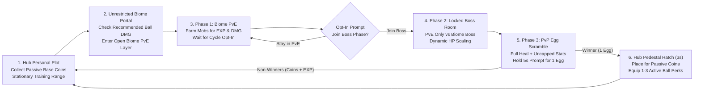
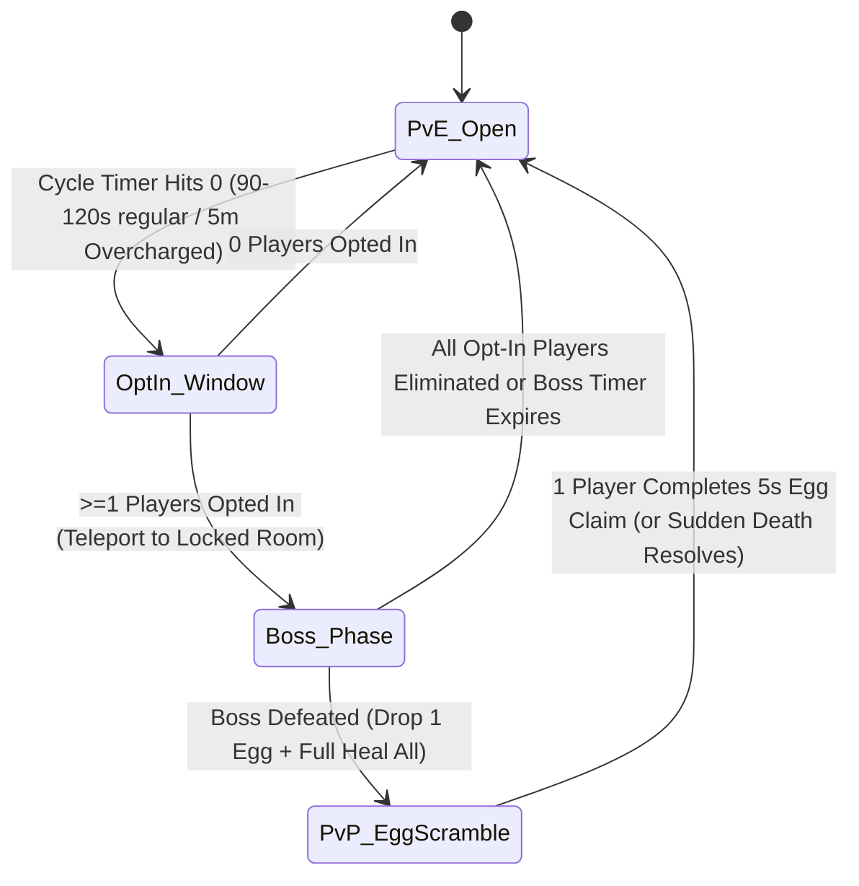
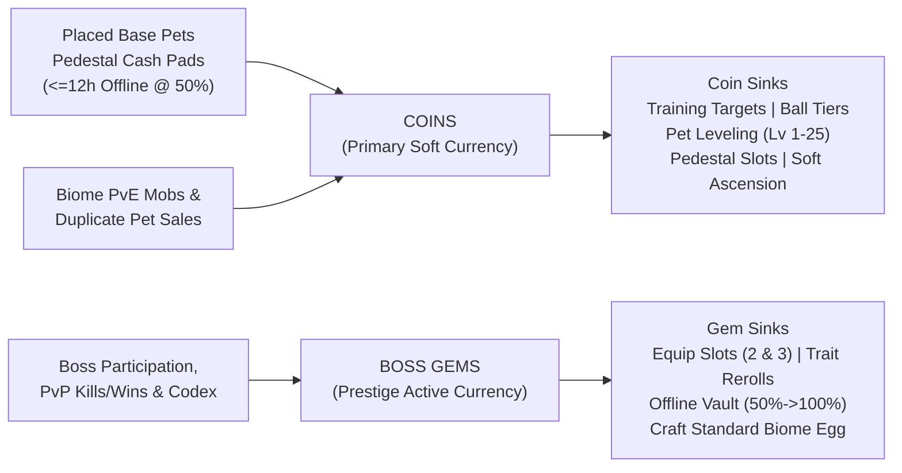

# Game Design Document — Evolved `GameIdea.txt` (Working Title: *Ball Brawl: Boss Eggs*)

**Document Status:** Aligned Design Specification (`v1.1` — Full Dual-Currency & Income-Generating Pet Economy)  
**Source Concept:** [archive/GameIdea.txt](archive/GameIdea.txt) (Refined via interactive design alignment)  
**Target Platform:** Roblox (Cross-platform: Mobile-first ergonomics + PC/Console)  
**Core Genre:** Training & Pet-Income Tycoon × High-Stakes 3-Phase PvE / Boss / PvP Egg Scramble

---

## 1. Executive Summary & Design Pillars

### 1.1 High-Concept Pitch
Train your throwable ball at your personal base range, step through **unrestricted Biome Portals** into open PvE hunting grounds, opt into **locked Boss Arenas** to take down massive Biome Bosses, and immediately turn on fellow fighters in an **uncapped, single-life PvP Egg Scramble**—where only **one** player can hold the 5-second claim prompt to win the Boss Egg, hatch it on their Hub Base pedestal for passive Coins, and equip its Creature for **Active Ball Perks**.

### 1.2 Core Design Pillars
1. **Faithful Evolution of `GameIdea.txt`:** Retains every signature ingredient—stationary personal Training Range, throwable ball damage scaling, unrestricted Biome Portals with Recommended Damage signs, timed 5-minute boss hype, boss-dropped eggs, hatching, and *Steal an Egg* base display & 5-second egg-claim tension—while closing every structural pacing and payoff gap.
2. **Three-Phase Arena Escalation (`PvE → Boss → PvP`):** Open PvE farming ensures zero locked-door waiting, Boss Phase builds shared tension, and an instant full-heal PvP Scramble creates high-adrenaline, winner-takes-all drama over a single Boss Egg.
3. **Dual Egg Payoff Loop:** Hatched creatures are never dead trophies—they generate **passive Coins** on visible Base Pedestals (funding Training & Ball upgrades) *and* equip into `1–3` Active Slots to give your throwable ball mechanical **Combat Perks**.
4. **Power Fantasy Without Base Griefing:** Uncapped raw stats in Arena PvP reward grinding and bold portal choices, while Personal Bases in the Hub Plaza remain **100% PvE-safe** (flexing & passive income without offline base-raiding misery).
5. **1-CCU to Full-Server Viability:** Separate PvE layers, instanced Boss/PvP rooms, and mild dynamic boss HP scaling (`+35%` per extra opt-in player) guarantee smooth solo play during soft launch and explosive scrambles in full lobbies.

---

## 2. Core Gameplay Loop & First 5 Minutes

### 2.1 End-to-End Gameplay Loop



### 2.2 First 5 Minutes Onboarding Flow
- **0–30s (Instant Hatch & Cash Pad Dopamine):** Player spawns on their own **Personal Plot** in the Shared Hub Plaza with a **Free Minute-0 Starter Egg** waiting on Pedestal #1. Pressing **Hatch** triggers a crisp **3-second reveal** into the *Training Pup* (`5 Coins/s`, `+5% Training Gain`), immediately lighting up its glowing **Pedestal Cash Pad**. Stepping over the pad sweeps their first Coins with burst VFX—teaching the pet-income loop in 30 seconds flat.
- **30–75s (First Power-Up):** A visual floor guide leads the player onto their **Stationary Training Range** firing pad. Shooting stationary and moving targets ticks up **Ball Damage** and **Throw Speed**, and their first Cash Pad sweep buys Target Tier 2 right away.
- **1:15–2:45 (First Portal & PvE Farming):** Player walks through **Portal 1 (Emerald Meadow — Rec. 15 Ball DMG)** into the open PvE layer with their *Training Pup* actively following beside them (without pausing its pedestal Coin income!), fights agile meadow mobs while moving/dodging freely, levels up **Max HP**, and sees the live Boss Opt-In countdown.
- **2:45–4:30 (First Boss & PvP Scramble):** Opt-in prompt triggers. Player enters the locked Boss Room, defeats the **Mossback Golem**, gets a **Full Heal**, and experiences the heart-pounding **5-second hold-to-claim** PvP Egg Scramble. Winning grants the Biome Boss Egg immediately; even non-winners earn **Coins + EXP + Boss Gems** (progressing toward crafting a standard Biome Egg or unlocking Pet Traits/Slots).
- **4:30–5:00 (Second Hatch & Loop Closure):** Returning to their Plot, the player sweeps their stacked Pedestal Cash Pads, places their new Biome Egg on Pedestal #2, levels up their pet with Coins, and prepares to push into higher damage tiers or Portal 2.

---

## 3. Three-Phase Biome Arena Architecture

Each Biome consists of two distinct server-side spaces within the same Roblox server (instant CFrame teleportation—zero cross-server loading screens):
1. **Open Biome PvE Layer:** Always accessible through the Biome Portal. Players can freely enter, leave, and farm mobs at all times. PvP damage is permanently **OFF**.
2. **Locked Boss / PvP Arena Room:** An isolated combat chamber per biome that hosts the active Boss Phase and PvP Phase. Once Boss Phase starts, **no additional players can enter** until the PvP Phase ends and the room resets.

### 3.1 Phase State Machine



### 3.2 Detailed Phase Rules

| Phase | Entry / Exit | Combat Rules | Win / Transition Condition |
| :--- | :--- | :--- | :--- |
| **Phase 1: PvE Layer** | Always open via Biome Portal; players may leave to Hub anytime. | PvE only (no player-vs-player damage). Active mob spawns drop EXP and biome-scaled Ball Damage gains. | When the biome's PvE timer completes, a 15-second **Opt-In Modal** appears to all players in that biome (`Join Boss` vs `Stay in PvE`), displaying how many players are queued and the highest visible Power Rating in the queue. |
| **Phase 2: Boss Phase** | **Locked.** Only opted-in players are teleported into the Biome Boss Room. Decliners remain uninterrupted in the Open PvE Layer. | PvE only (friendly fire OFF). Boss uses telegraphed melee/AoE attacks. Dying removes you from the room back to the Open PvE Layer. | Defeating the Boss immediately spawns **1 glowing Boss Egg** in the arena center, restores all surviving fighters to **100% Max HP**, grants a 3-second countdown/grace positioning window, and triggers Phase 3. |
| **Phase 3: PvP Egg Scramble** | **Locked** until concluded. | **PvP ON — Uncapped Raw Stats + Single-Life Elimination.** Full grinded Ball Damage, Throw Speed, Max HP, and Equipped Creature Perks apply. Dying eliminates you back to the Hub/PvE Layer with consolation Coins, EXP & Boss Gems. | Hold the **Egg Claim Hotkey / ProximityPrompt for 5.0 continuous seconds**. Any damage taken (or moving out of radius) cancels the hold progress. Completing the 5s hold grants the **1 Boss Egg** (+ bonus Gems), immediately ends PvP, awards Coins, EXP & Boss Gems to all participants, and teleports survivors back to the Open PvE Layer. |

### 3.3 Edge Cases & Anti-Stalemate Safeguards
- **Solo Opt-In (1-CCU Soft Launch):** If only 1 player opts into Boss Phase, the Boss spawns at `1.0× Base HP`. Upon defeating it, the Egg drops and the player completes the 5-second claim uncontested—ensuring 100% playability in low-population servers.
- **PvP Sudden Death (Anti-Stalemate):** If the Egg remains unclaimed after **75 seconds** of PvP, a shrinking **Sudden Death Storm Ring** closes inward toward the Egg Pedestal (dealing `% Max HP/sec` damage outside the ring) so fighters cannot kite indefinitely.
- **Mutual Elimination / Disconnect:** If the final two fighters eliminate each other simultaneously or all players leave before claiming, the Egg dissolves and the room cleanly resets to Phase 1.
- **Power Visibility Before Opt-In:** Every player displays a concise **Power Rating / Aura Badge** overhead and in the Opt-In queue summary so weaker players can make informed tactical choices about opting in vs. staying in PvE or hopping to another biome.

---

## 4. Boss Spawn Cadence & 5-Minute Overcharged Event

To eliminate the dead-wait churn trap while preserving `GameIdea.txt`'s signature **5-minute global boss rhythm**:
- **Regular Biome Cycles (`~90–120 seconds` PvE Interval):** Each biome runs a brisk PvE-to-Boss opt-in loop so newcomers can fight a Boss within their first 2 minutes of playing.
- **5-Minute Overcharged Boss Event (Server-Wide):** Every **5:00 on the server clock**, a global announcement & skybox shift triggers **Overcharged Bosses** across all 3 Biomes simultaneously:
  - Overcharged Bosses have `+40% HP`, glowing mutation VFX, and a slightly more aggressive attack pattern.
  - Their dropped **Overcharged Egg** carries **drastically boosted Rarity & Mutation odds** (e.g., guaranteed Rare+ with high chance for *Overcharged*, *Radiant*, or *Void* mutations) and is the **exclusive** source of the *Overcharged* mutation tier.

---

## 5. Throwable Ball Combat & Movement Specification

### 5.1 Dual Context Movement Rule
- **Personal Training Range (Stationary Firing Pad):** Stepping onto your Plot's Training Pad anchors your character smoothly into a stationary shooting stance. Aim along your camera look direction (PC & Mobile) or use Auto-Aim to fire throwable balls downrange at targets. Stepping/jumping off cancels stationary mode instantly.
- **Biome PvE, Boss Phase & PvP Scramble (Free Movement + Dodge):** Players move freely (`18 studs/s` base walk, `24 studs/s` sprint), trigger a short **Dash/Dodge** (`0.35s` impulse, `2.5s` cooldown) to evade boss AoEs and incoming PvP shots, and throw balls on the run.

### 5.2 Ball Projectile Feel & Mobile Ergonomics
- **Aiming & Trajectory:** Fast arc/linear throwable ball with a crisp client-side prediction trail and **server-authoritative hit validation** (raycast/swept-sphere segments along projectile path to prevent wall-clipping and damage spoofing).
- **Mobile-First Assist:** On touch devices, a dedicated **Throw / Hold-to-Aim Button** provides generous soft magnetic aim-assist toward targets/mobs/bosses (mildly tuned in PvP so dodging still works cleanly).
- **Ball Tiers (Bought with Coins):** Upgrading your physical Ball model in the Hub Shop increases base damage multiplier, projectile velocity, and visual trail prestige (e.g., *Rubber Ball → Iron Sphere → Frost Orb → Magma Core → Nova Sphere*).

---

## 6. Attributes & Progression Differentiation

Players grow through **3 Core Attributes**, with complementary roles split cleanly between the **Personal Training Range** and **Biome PvE Areas** so neither space becomes redundant:

| Attribute | Primary Source | Secondary Source | Gameplay Effect |
| :--- | :--- | :--- | :--- |
| **Ball Damage** | **Base Training Range** (safe stationary target shooting; scales with Coin-upgraded Targets) | **Biome PvE Mobs** (higher biome-tier multiplier `1.5×–6×` per kill to pull players into biomes) | Directly increases throwable ball damage against PvE mobs, Bosses, and PvP rivals (uncapped). |
| **Throw Speed** | **Base Training Range** (hitting **Moving / Gold Combo Targets** builds a combo multiplier for Throw Speed training) | Ball Shop Upgrades | Reduces cooldown between ball throws and slightly increases projectile travel speed (diminishing returns cap to keep combat readable & fair). |
| **Max HP (via Level/EXP)** | **Biome PvE Mobs** (primary EXP source) | **Boss Phase & PvP Participation** (flat + scaling EXP payout even for non-winners) | Raises Player Level, increasing Max HP for surviving Boss hits and enduring uncapped PvP duels. |

### 6.1 Training Range Progression (Base Coin Sink)
- Passive Coins collected from your Base Pedestals (and PvE/Boss payouts) upgrade your **Training Range Target Tier** (e.g., *Wooden Dummy → Iron Bullseye → Crystal Drone → Obsidian Core*), multiplying Ball Damage gained per target hit.
- **Active vs. Chill Play:** Stationary center targets grant steady Ball Damage (compatible with the optional **Auto-Fire Range** QoL pass), while spawning **Moving Gold Targets** reward active manual aimers with `2×` Damage + **Throw Speed** bursts.

---

## 7. Hub Spatial Layout, Portals & Egg Hatching

### 7.1 Shared Hub Plaza (Social Flexing)
- **Layout:** A vibrant circular **Central Portal Plaza** surrounded by `8–12` **Personal Player Plots** facing inward (inspired by *Steal an Egg*'s social plot visibility).
- **Personal Plot Contents:**
  - **Front Showcase Zone:** `4` starting **Base Pedestals** (expandable up to **12 Pedestals + a 2nd-Floor Showcase** via Coins & Gems, plus optional Extra Pedestal Game Pass), each paired with a glowing physical **Cash Pad** displaying accumulated Coins and `Coins/sec` rates.
  - **Side/Rear Lane:** Your personal **Stationary Training Range** with visible Target Tier upgrades.
  - **Plot Privacy:** Plots are **100% PvE-safe**—other players can walk up to admire your Pets, Mutations, Ascension Badge, and Codex rank, but cannot steal or disrupt your base, Cash Pads, or training range.
- **Central Portals:** All Biome Portals stand side-by-side in the center of the Hub with towering visual arches, **Recommended Ball Damage** holograms, live **Next Boss Opt-In Timer**, and current **PvE Player Count**. Entry is **100% unrestricted**—any player may test their luck in any biome from Minute 1.

### 7.2 Egg Inventory & Instant 3-Second Pedestal Hatching
- New players receive a **Free Minute-0 Starter Egg** placed directly on Pedestal #1 so they experience hatching and Cash Pad collection within 30 seconds.
- Winning a Boss Egg in PvP, crafting a Standard Biome Egg with **Boss Gems**, or purchasing a Shop/Seasonal Egg places it into your **Egg Backpack** (no tedious forced incubation timers).
- Walk to any open **Base Pedestal** on your Plot and press **Hatch** to trigger a **3-second high-dopamine reveal** (wobble, rarity light beam visible across the Hub Plaza, mutation burst, and Pet spawn directly onto the pedestal with its Cash Pad activating immediately).

---

## 8. Dual-Currency Economy & Income-Generating Pet System

### 8.1 Dual Currency Architecture (`Coins` + `Boss Gems`)



| Currency | Primary Sources | Core Sinks | Economic Role |
| :--- | :--- | :--- | :--- |
| **Coins** | **Base Pet Cash Pads** (primary engine), Biome PvE mob kills, Boss/PvP payouts, selling duplicate pets | Training Range Target Tiers, Throwable Ball Shop Tiers, **Pet Leveling (`Lv 1–25`)**, Base Pedestal Slots (`4 → 12`), **Soft Ascension** threshold | Fast-scaling tycoon progression engine; drives visible growth every minute and fuels attribute/ball upgrades. |
| **Boss Gems** | Boss Phase participation, PvP Scramble wins & eliminations, Codex discoveries, Daily Milestones *(never passively farmed by idle pets)* | **Active Pet Equip Slots** (Slot 2 & 3), **Pet Trait Rerolls**, **Offline Vault Efficiency** (`50% → 75% → 100%`), **Gem-Craftable Standard Biome Eggs**, Prestige Cosmetics | Anti-inflation prestige currency; guarantees every Boss Opt-In is rewarding even when losing uncapped PvP. |

### 8.2 Physical Pedestal Cash Pads & Bounded Offline Accrual
- **Walk-Over Cash Pads:** Every Pet placed on a Base Pedestal accumulates Coins directly onto a glowing physical **Cash Pad** in front of its pedestal (mirroring *Steal an Egg*'s tactile collection feel). Walking over a pad sweeps its stored Coins with pitch-escalating chime VFX; players who own the optional **Magnet Coin Collect** QoL pass automatically vacuum nearby pads across their plot.
- **Bounded 12-Hour Offline Income:** While offline, placed Pets continue filling their Pedestal Cash Pads for up to **12 hours** at a **50% base offline efficiency** (upgradeable via Boss Gems to `75%` and `100%`). Logging back in displays a gleaming bank of full Cash Pads ready to sweep immediately—driving strong D1/D7 return habits without rewarding 24/7 AFK bots.

### 8.3 Unified Pets — Zero Combat vs. Income Trade-Off
- Every hatched creature is a **Unified Pet**: once placed on a Base Pedestal, it generates Coins/sec continuously.
- Players toggle `1` (starter), `2` (Level 10 + Boss Gems), or `3` (Level 25 + Boss Gems) of their placed/owned Pets as **Active Combat Followers**. Active Followers physically float beside you in the Hub & Biomes and grant their **Active Ball Perk** in PvE, Boss, and PvP arenas **without pausing or reducing their Base Pedestal Coin income**.
- **Active Ball Perks** (distinct perk types stack; duplicate types apply the highest tier):
  - *Training Boost (Starter):* `+5%` Ball Damage gain on the Training Range.
  - *Frost Slow:* Ball hits chill Bosses/Rivals (`-20%` move speed for `2.0s`).
  - *Ember Burn:* Applies `15%` bonus damage over `3.0s` (pressures rivals attempting the 5s egg claim).
  - *Chain Ricochet:* Ball bounces to `1` nearby mob/rival for `45%` damage.
  - *Heavy Knockback:* Adds strong impulse knockback on hit (clutch for blasting rivals off the Boss Egg).
  - *Vampiric Leech:* Restores `4%` of damage dealt as HP (capped per second).
  - *Crit Surge:* `+12%` chance for a `1.75×` critical ball throw.

### 8.4 Anti-Lockout Onboarding & Gem-Craftable Biome Eggs
- **Free Minute-0 Starter Egg:** Spawns pre-placed on Pedestal #1 for every new player (`Training Pup` — `5 Coins/s`, `+5% Training Boost`), guaranteeing instant Cash Pad literacy before entering a single PvP fight.
- **Gem-Craftable Standard Biome Eggs:** Because PvP uses uncapped raw stats and drops 1 Egg per Boss, non-winners earn **Boss Gems** every match. Saving ~`4–5` fights worth of Gems lets any player craft a **Standard Biome Egg** for their chosen biome—preventing uncapped-PvP lockout while keeping **5-Min Overcharged & Void-Touched Mutations strictly exclusive to won PvP Boss Eggs**.

### 8.5 Pet Income Formula, Leveling, Star Fusion & Trait Rerolls
Every placed Pet's server-computed income rate follows a single deterministic formula:

`PetCoinsPerSec = BaseRate * MutationMult * StarMult * (1 + 0.12 * (PetLevel - 1)) * TraitMult * AscensionCoinMult`

1. **Coin Leveling (`Lv 1 → Lv 25`):** Feed **Coins** directly into any Pet to boost its `Coins/sec` by `+12%` per level (up to `3.88×` at Lv 25), creating a continuous, high-satisfaction Coin sink at every biome tier.
2. **3-to-1 Duplicate Star Fusion (`1★ → 2★ → 3★`):** Combine `3×` identical Pets to promote one Star Tier:
   - `1★` (Base): `1.00×` Coins/s, Base Active Perk
   - `2★` (Fused): `1.75×` Coins/s, `+15%` Active Perk potency
   - `3★` (Apex): `3.00×` Coins/s, `+30%` Active Perk potency + golden halo VFX
3. **Gem Trait Reroll:** Spend **Boss Gems** at the Hub Trait Altar to roll `1` bonus passive Trait on any Pet:

| Trait | Roll Weight | Effect |
| :--- | :---: | :--- |
| **Greedy** | `30%` | `+25%` Pet `Coins/sec` on its Base Pedestal |
| **Swift** | `25%` | `+10%` Player Throw Speed while Active Follower |
| **Brawler** | `20%` | `+8%` Player Ball Damage while Active Follower |
| **Overclocked** | `15%` | `+20%` Offline Accrual Efficiency for that Pedestal |
| **Tycoon (Rare)** | `10%` | `+50%` Pet `Coins/sec` + `+10%` Global Plot Cash Pad Bonus |

### 8.6 Mutation Tiers (Multipliers & Visual Flex)
Every hatched Pet rolls an independent **Mutation** (boosted significantly during the **5-Minute Overcharged Boss Event**):

| Mutation | Coin Multiplier | Perk Potency Bonus | Source Availability |
| :--- | :---: | :---: | :--- |
| **Normal** | `1.0×` | Base | All Eggs |
| **Shiny** | `1.5×` | `+10%` | All Eggs |
| **Golden** | `2.5×` | `+20%` | All Eggs |
| **Overcharged** | `4.0×` | `+30%` | **5-Min Overcharged PvP Boss Eggs ONLY** |
| **Void-Touched** | `6.0×` | `+40%` | **5-Min Overcharged PvP Boss Eggs (Ultra Rare)** |

### 8.7 Base Pedestal Expansion, Soft Ascension & Account-Bound MVP Policy
- **Multi-Tier Base Expansion (`4 → 8 → 12` Pedestals):**
  - **Tier 1 (Starter Plot):** `4` Pedestals (free on join).
  - **Tier 2 (Expanded Courtyard):** Unlocks Pedestals `5–8` (bought individually with scaling Coins).
  - **Tier 3 (2nd-Floor Showcase Balcony):** Unlocks Pedestals `9–12` (Coins + Boss Gems), giving veteran plots an iconic multi-story skyline around the Hub Plaza. *(Optional `+2` Pedestal Game Pass adds VIP bonus pedestals up to `14` max.)*
- **Soft Ascension (Resets Coins ONLY — Zero Painful Wipes):**
  - Once a player reaches the current Ascension Coin threshold, they may **Ascend**: resets **Coins only** (keeping **100%** of hatched Pets, Pet Levels/Stars/Traits, Ball Damage, Player Level, Ball Tiers, and Boss Gems!).
  - Each Ascension Rank grants a permanent **`+25%` Global Coin Multiplier**, **`+5%` Training Speed**, and an evolving overhead **Ascension Crest**—creating an infinite, frustration-free late-game Coin sink.
- **Economy Integrity (Account-Bound for MVP):** All Pets, Eggs, Coins, and Boss Gems are strictly **account-bound at MVP** to eliminate duping/scam risk and guarantee earned progression. Level-gated **Pet-for-Pet Trading** (with zero currency trading and atomic server escrow) is scoped for **Post-Launch Update 2** once the economy matures.

---

## 9. MVP Launch Content: 3 Biomes & Post-Launch Expansion

Launching with **3 high-contrast Biomes** balances solo-dev art scope with a clear, aspirational progression ladder (expandable to **Biome 4: Storm Ruins** and **Biome 5: Void Citadel** in Update 1 & 2).

| Biome Portal | Rec. Ball DMG | PvE Mobs | Biome Boss & Signature Attack | Boss Egg Pets, Base Income (`Coins/s`) & Active Perks |
| :--- | :---: | :--- | :--- | :--- |
| **0. Hub Starter** | `0 DMG` | *(Free Pedestal #1 Egg)* | *None (Minute-0 Onboarding)* | *Training Pup* (`5/s`, +5% Training Boost) |
| **1. Emerald Meadow** | `15 DMG` | Moss Slimes, Bramble Boars | **Mossback Golem** — Telegraphed ground-slam shockwave + rolling boulder throw. | *Pebble Cub* (`12/s`, Heavy Knockback), *Dew Sprite* (`18/s`, Vampiric Leech), *Thorn Stag* (`30/s`, Crit Surge), *Golem Heart* [Mythic] (`65/s`, Shockwave Splash) |
| **2. Frostbite Cavern** | `150 DMG` | Ice Wraiths, Crystal Wolves | **Glacier Yeti** — Frost breath cone (slows) + falling icicle rings. | *Snow Fox* (`75/s`, Frost Slow), *Shard Owl* (`115/s`, Chain Ricochet), *Permafrost Bear* (`190/s`, Shield on Throw), *Cryo Titan* [Mythic] (`420/s`, Deep Freeze Mini-Stun) |
| **3. Molten Caldera** | `1,200 DMG` | Cinder Imps, Magma Hounds | **Obsidian Wyrm** — Sweeping lava breath + erupting floor geysers. | *Ash Lizard* (`450/s`, Ember Burn), *Pyro Hawk* (`680/s`, Speed + Burn), *Lava Rhino* (`1,100/s`, Knockback + Burn), *Inferno Drake* [Mythic] (`2,500/s`, Explosive AoE + Burn) |

- **Dynamic Boss Scaling Formula:** `BossMaxHP = BaseBiomeBossHP * (1 + 0.35 * (OptInPlayerCount - 1))`
  - Solo (`1` player): `1.00×` Base HP (smooth 45–60s fight at Recommended Damage).
  - Squad (`4` players): `2.05×` Base HP (engaging ~60–90s brawl before the PvP Egg Scramble).

---

## 10. Monetization & Roblox 2026 Compliance (`PolicyService`)

### 10.1 Revenue Pillars (Balanced Progression + Shop/Seasonal Eggs)

| Category | Offerings | Design Guardrail |
| :--- | :--- | :--- |
| **Progression Passes** | **2× Training Speed**, **2× Coins & EXP** | Speeds up grinding without selling direct instant raw-damage stat walls. |
| **Quality-of-Life & Base** | **Auto-Fire Training Pad**, **Magnet Coin Collect**, **+2 Base Pedestal Slots**, **Private Servers** | High-value convenience for dedicated players; Private Servers enable solo/friend-group boss farming. |
| **Cosmetics** | **Ball Skins & Trails**, **Hatch Reveal VFX**, **PvP Elimination Effects**, **Hub Plot Themes** | Pure visual status & TikTok/Moments clip appeal. |
| **Permanent Premium Eggs** | **Shop-Exclusive Premium Eggs** (1–2 tiers in Hub Shop) | Hatch unique shop-exclusive creatures with strong passive Coin income & utility perks. **Never** contain Biome Boss Creatures or Overcharged Mutations—protecting PvP prestige! |
| **Rotating Seasonal Eggs** | **Limited-Time Seasonal Eggs** (e.g., Cyber, Lunar, Halloween, Frostfest) | Bi-weekly/monthly LiveOps collectible rotation with distinct visuals and Codex badges; never replaces Biome Boss Egg exclusivity. |

### 10.2 Mandatory Paid Random Items Legal Compliance (`PolicyService`)
Because **Permanent Premium Eggs** and **Rotating Seasonal Eggs** are purchasable with Robux, the game **must** implement strict regional compliance on Day 1:
1. **Runtime Policy Check:** On player join, query `PolicyService:GetPolicyInfoForPlayerAsync(player).ArePaidRandomItemsRestricted`.
2. **Restricted Region Fallback (e.g., UK `<18`, AU `<18`, BR `<18`, BE, NL):** Automatically hide random Paid Egg purchase prompts for restricted accounts and replace the shop UI slot with **Direct Non-Random Bundles** (e.g., a clearly pictured specific Creature + Ball Skin pack at fixed Robux cost—zero RNG!).
3. **Full Odds Disclosure UI:** Every Paid Egg and Biome Boss Egg displays exact, server-config-driven hatch percentages (`100.0%` sum) directly on its preview billboard and purchase modal.
4. **Boss Eggs Stay 100% Gameplay-Earned:** Biome Boss Eggs and Overcharged Eggs can **never** be purchased for Robux, ensuring every player worldwide plays the exact same core PvE → Boss → PvP loop.

---

## 11. Server-Authoritative Technical Architecture (Luau / Rojo)

```text
src/
├── shared/
│   ├── Configs/
│   │   ├── BiomeConfigs.luau       -- Portal Rec DMG, Base Boss HP, Mob tables, Cycle timers
│   │   ├── PetConfigs.luau         -- Pets, Base Coins/s, Active Ball Perks, Mutations, Star Fusion
│   │   ├── TraitConfigs.luau       -- Gem Trait Reroll weights & bonuses (Greedy, Swift, Tycoon)
│   │   ├── EggConfigs.luau         -- Exact drop weight tables (Starter, Boss, Overcharged, Shop, Seasonal)
│   │   └── EconomyConfigs.luau     -- Target/Ball tiers, Pet Lv 1-25 curve, Pedestal 4->12 & Ascension costs
│   └── Net/
│       └── Remotes.luau            -- Typed Remotes (ThrowBall, OptIn, ClaimEgg, CollectPad, UpgradePet, Ascend)
├── server/
│   ├── Services/
│   │   ├── DataService.luau        -- ProfileStore persistence (Coins, Boss Gems, Pets, LastLogoutTime)
│   │   ├── EconomyService.luau     -- Dual currency ledger, Gem Egg Crafting, Base Expansion & Soft Ascension
│   │   ├── PetIncomeService.luau   -- Server Cash Pad accrual, <=12h offline calc (50%->100%), Level/Fusion/Traits
│   │   ├── PolicyGuardService.luau -- PolicyService Paid Random Items gating & receipt validation
│   │   ├── PlotService.luau        -- Hub Plot assignment (4->12 pedestals + 2nd floor), Training Range pads
│   │   ├── CombatService.luau      -- Swept-ray throw validation, Active Follower Perks, Uncapped PvP damage
│   │   ├── ArenaCycleService.luau  -- Per-biome 3-Phase State Machine + 5-min Overcharged Scheduler
│   │   └── BossAIService.luau      -- Telegraphed Boss attacks + +35%/player HP scaling
└── client/
    ├── Controllers/
    │   ├── BallThrowController.luau -- Stationary Training Pad lock vs Free-Move/Dodge + Mobile Aim Assist
    │   ├── PlotCashController.luau  -- Glowing Cash Pad UI counters, walk-over burst VFX, Magnet sweep feedback
    │   ├── ArenaHUDController.luau  -- Phase banner, Opt-In modal (queue Power Ratings), 5s Claim bar
    │   └── HatchVFXController.luau  -- 3s Pedestal reveal effects, Active Follower rigs, Power/Ascension Aura
```

### Key Security & Anti-Cheat Invariants
- **Server-Authoritative Cash Pads & Offline Accrual:** Clients render interpolated Cash Pad counters for smooth visuals, but the **server** computes exact elapsed seconds (`math.min(dt, 12 * 3600)` offline cap) and validates player proximity (or Magnet Pass ownership) before crediting Coins.
- **Server-Validated Training Hits:** Training Range target hits enforce server-side Throw Speed cooldown checks and verify the player is standing on their own assigned firing pad (blocking remote-spam damage exploits).
- **Server-Owned 5-Second Egg Claim:** The client shows a smooth 5.0s progress ring, but the **server** tracks `claimStartTime`, proximity distance, and immediately cancels the claim token on any server-validated PvP damage event.
- **Anti-Desync State Guard:** Players cannot deal PvP damage outside `Phase == "PvP_EggScramble"`, and players in the Open PvE Layer or Hub Plaza are strictly invulnerable to PvP projectiles.
- **Atomic Economy Transactions:** Pet Leveling, `3-to-1` Star Fusion, Gem Trait Rerolls, and Soft Ascension execute atomically on the server to prevent double-spend or duplicate-pet race conditions.

---

## 12. Phased Solo-Dev MVP Roadmap

| Phase | Target Window | Core Deliverables | Validation Gate |
| :--- | :--- | :--- | :--- |
| **Phase 1: Core Combat & 3-Phase Loop** | Weeks 1–2 | Stationary Training Range pad, free-move Throwable Ball + Dodge, Biome 1 (Meadow) Open PvE + Locked Boss/PvP Room, Boss AI, Full Heal + Uncapped PvP + 5s Egg Claim + Sudden Death ring. | Playtest with 2–4 testers: verify 0 soft-locks across opt-in, solo run, mid-claim interrupt, and disconnect edge cases. |
| **Phase 2: Dual Currency, Cash Pads & Pet Progression** | Weeks 3–4 | Shared Hub Plaza Plots (`4 → 12` pedestals + 2nd-floor tier), Minute-0 Free Starter Egg, Glowing Cash Pads + `<=12h` offline accrual (`50% → 100%`), `Coins` + `Boss Gems` economy, Unified Active Followers (`1–3` Perks), Pet Leveling (`Lv 1–25`), `3-to-1` Star Fusion, Gem Trait Rerolls, Gem-Craftable Biome Eggs, and Soft Ascension. | Confirm 30-second first hatch & Cash Pad sweep feels crisp on mid-tier Android mobile (`60 FPS`), and verify atomic Coin/Gem/Fusion unit tests. |
| **Phase 3: Full 3-Biome Content & Monetization** | Weeks 5–6 | Biome 2 (Frostbite Cavern) & Biome 3 (Molten Caldera) maps/mobs/bosses/pets, 5-Min Overcharged Event, Codex UI, Overhead Power & Ascension Auras, Game Passes (`2× Training`, `2× Coins/EXP`, `Auto-Fire`, `Magnet Collect`, `+2 Pedestals`), Permanent + Seasonal Shop Eggs with `PolicyService` compliance. | QA pass on `ArePaidRandomItemsRestricted = true` mock account; verify 100% odds display and receipt safety. |
| **Phase 4: Soft Launch & LiveOps Expansion** | Week 7+ | Telemetry hooks (First-Play Bounce `<60s`/`61–180s`, Opt-In Rate, Cash Pad collection frequency, Soft Ascension curve, D1/D7 Retention), economy balancing, Update 1 (Biome 4: Storm Ruins), Update 2 (Level-gated Pet-for-Pet Trading). | Hit `>12m` average session length and healthy Boss Opt-In participation before scaling ad spend. |
