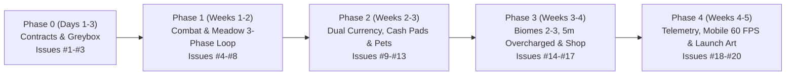

# 3-Person Development Split, Contracts & Issue Backlog (`TEAM_WORKFLOW_3P.md`)

**Team Composition:** 2 Scripters + 1 3D / Map Builder (**Dev A**, **Dev B**, **Dev C**)  
**Canonical Spec:** [GameIdea_Evolved_GDD.md](GameIdea_Evolved_GDD.md) (`v1.1`)  
**Machine Setup:** [TEAM_SETUP.md](TEAM_SETUP.md)  
**Target MVP Velocity:** ~4–5 weeks parallel execution (compressed from 7+ weeks solo)

---

## 1. Role Roster & Strict Ownership Boundaries

To eliminate Git merge conflicts and Roblox Studio Team Create overwrites, each teammate owns **mutually exclusive folders and Studio domains**:

| Role | Primary Focus | Owned Repo Paths & Studio Domains | Primary Quality Gate |
| :--- | :--- | :--- | :--- |
| **Dev A — Server Systems & Economy Engineer** (`role:server`) | Authoritative gameplay logic, 3-Phase Arena FSM, Boss AI, DataStore/ProfileStore, Dual Currency, Pet Income, `PolicyService` & Anti-Exploit. | `game/src/server/**` `game/src/shared/Configs/**` `game/src/shared/Net/**` *(co-owned contract)* `game/tests/*Service*.spec.luau`, `*Configs*.spec.luau` | `python scripts/check.py` (StyLua, Selene, Lune server/economy unit tests, Rojo build) |
| **Dev B — Client Combat, UI & Feel Engineer** (`role:client`) | Ball Throw feel, Stationary Pad vs. Free-Move/Dodge, Mobile Aim Assist, HUD/Modals, Cash Pad & 3s Hatch VFX, Codex/Shop UI, Mobile 60 FPS QA. | `game/src/client/**` `game/src/shared/Utils/**` `game/src/shared/Net/**` *(consumer / co-owned)* `game/tests/*Client*.spec.luau`, `*Math*.spec.luau` | `python scripts/check.py` + Roblox Studio Device Simulator (Phone/Tablet/PC) playtests |
| **Dev C — 3D Assets, Maps, VFX & Audio Artist** (`role:3d-map`) | Hub Plaza, 12 Personal Plots (Tier 1–3), 3 Biomes (Open PvE + Locked Boss/PvP Rooms), Blender Pets/Bosses/Eggs/Balls, Particle VFX, Audio & 16:9 Thumbnails. | **Roblox Studio Map / Terrain / Lighting / Models** `game/assets/blender/**` `game/assets/imports/**`, `exports/**`, `renders/**` `game/assets/audio/**`, `ui/**` | `python scripts/blender_run.py` + preview PNGs in `game/assets/renders/` + `CollectionService` tag audit |

> **Golden Rule of Zero Conflicts:** Never edit another role's owned directory in a feature PR without agreeing on a contract change first. If Dev B needs a new server field, open/update the shared schema in `game/src/shared/Net/Remotes.luau` with Dev A first.

---

## 2. Parallel-Work Interface Contracts (Never Block Each Other)

A 3-person Roblox team only moves 3× faster when **Server, Client, and Map/Art decouple behind explicit contracts** on Day 1:

### Contract A: Shared Typed Remotes & Configs (Dev A ↔ Dev B)
- All client-server communication is defined once in `game/src/shared/Net/Remotes.luau` and pure data tables in `game/src/shared/Configs/*.luau`.
- **Day 1–2 of Phase 0:** Dev A & Dev B lock the initial payload types (`ThrowBall`, `OptIn`, `ClaimEgg`, `CollectPad`, `HatchEgg`, `UpgradePet`, `FusePets`, `RerollTrait`, `CraftBiomeEgg`, `Ascend`, `ShopPurchase`).
- **How Dev B stays unblocked:** Dev B builds a lightweight client mock harness (`MockServerState`) so HUD, Opt-In modals, 5s Claim Ring, Cash Pad counters, and Shop UI can be built and playtested immediately—even before Dev A finishes the live `ArenaCycleService` or `DataService`.

### Contract B: Workspace Hierarchy & `CollectionService` Tags (Dev C ↔ Dev A & Dev B)
- Dev A and Dev B **never** hardcode arbitrary CFrames or mesh hierarchy paths. They query **canonical `Workspace` folders and `CollectionService` tags** placed by Dev C—first on simple greybox blocks (Phase 0), later swapped seamlessly for final art (Phases 2–3) with **zero Luau rewrites**:

| Space | Canonical Workspace Path | Required Child Names / `CollectionService` Tags |
| :--- | :--- | :--- |
| **Hub Plaza** | `Workspace.Hub` | `SpawnLocation`, `PortalRing` containing `Portal_EmeraldMeadow`, `Portal_FrostbiteCavern`, `Portal_MoltenCaldera` (each tagged `BiomePortal` with attribute `BiomeId`) |
| **Personal Plots** | `Workspace.Hub.Plots.Plot_1` .. `Plot_12` | Each plot has `PlotOwnerSign`, `TrainingPad` (tag `TrainingPad`), `TargetLane` (`TargetAnchor_1..N`), `Pedestals/Pedestal_1..12` (tag `PetPedestal`, attribute `SlotIndex`), each pedestal has child `CashPad` (tag `CashPad`) and `EggAnchor`, plus `Floor2Group` for Tier 3 expansion |
| **Each Biome** | `Workspace.Biomes.<BiomeId>` (`EmeraldMeadow`, `FrostbiteCavern`, `MoltenCaldera`) | Two sibling folders: `PvE_Layer` (`PlayerSpawn`, `ExitPortal`, `MobSpawns/*` tagged `MobSpawnPoint`) and `Boss_Room` (`PlayerSpawns/*` tagged `BossPlayerSpawn`, `BossSpawnPoint`, `EggClaimPedestal`, `StormCenter`, `ArenaBoundary` part) |
| **3D Models** | `ReplicatedStorage/Assets/{Pets,Bosses,Eggs,Balls}` | Rigged `Model` with `PrimaryPart` set (`HumanoidRootPart` for bosses/mobs, `Root` for pets/eggs/balls) matching the exact ID key in `PetConfigs.luau` / `BiomeConfigs.luau` |

### Contract C: Roblox Studio Team Create & Rojo Sync Hygiene
Because [game/default.project.json](../game/default.project.json) sets `"$ignoreUnknownInstances": true`, Rojo updates scripts without erasing Dev C's Studio-built maps/terrain—**provided the team follows these 3 rules**:
1. **Dev C owns the live Team Create map place:** Only Dev C edits Terrain, Parts, Lighting, and Workspace layout inside the shared Team Create place.
2. **Dev A & Dev B code against local place snapshots:** Download a fresh `.rbxl` / `.rbxlx` snapshot from Studio when Dev C finishes a map milestone, run `cd game && rojo serve` locally, test scripts, and merge via Git PRs.
3. **One Integration Sync to Team Create:** **Never** connect two teammates' `rojo serve` sessions to the same live Team Create place simultaneously. After PRs merge to `main`, **one designated engineer** (Dev A on Integration Days) pulls `main` and runs a single `rojo serve` sync (or `rojo build` import) into the shared playtest place.

---

## 3. Parallel 4-Phase Sprint Plan

| Phase | Target Window | Dev A (Server & Economy) | Dev B (Client, Combat & UI) | Dev C (3D, Maps & VFX) | Phase Exit Gate (All 3 Together) |
| :--- | :--- | :--- | :--- | :--- | :--- |
| **Phase 0: Foundation** | Days 1–3 | `#1` Shared Configs (`Biome`, `Pet`, `Trait`, `Egg`) + `Remotes.luau` + config Lune tests | `#2` Client bootstrapper, typed remote wrapper & local mock harness | `#3` Hub Plaza + Emerald Meadow greybox implementing `CollectionService` tag contract | All 3 verify greybox tags resolve cleanly and `python scripts/check.py` passes |
| **Phase 1: Core Loop** | Weeks 1–2 | `#4` `ArenaCycleService` (3-phase FSM, 5s claim, 75s storm) `#5` `CombatService` + `BossAIService` (Mossback Golem) | `#6` `BallThrowController` (pad lock, free-move/dodge, mobile aim assist) `#7` `ArenaHUDController` (Opt-In modal, 5s ring, Power badges) | `#8` Mossback Golem, Meadow mobs, starter Ball tiers, Meadow Boss Egg & combat VFX/SFX | **3-Person Playtest:** Complete Training → PvE → Opt-In → Boss → Full Heal → Uncapped PvP → 5s Claim with 0 soft-locks (solo, 3-player, disconnect mid-claim) |
| **Phase 2: Tycoon & Pets** | Weeks 2–3 | `#9` `DataService` + `EconomyService` (ProfileStore, Gems, Crafting, Ascension) `#10` `PetIncomeService` + `PlotService` (Cash Pads, `<=12h` offline, Lv 1–25, 3-to-1 Fusion, Traits) | `#11` `PlotCashController` + `HatchVFXController` (3s reveal, glowing Cash Pads, floating Followers) `#12` Hub Progression UIs (Pet bag, Fusion, Trait Altar, Shop, Ascension) | `#13` Hub Plaza art pass, Tier 1–3 Plots (`4→12` + 2nd floor), Target Tiers, Training Pup + 4 Meadow Pets | **30-Second Onboarding Gate:** New join hatches Starter Egg, sweeps Cash Pad, levels pet, tests offline accrual & 3-to-1 fusion atomically |
| **Phase 3: Full MVP & Shop** | Weeks 3–4 | `#14` 5-Min Overcharged Scheduler + Biome 2–3 Boss AI & Active Ball Perks `#15` `PolicyGuardService` + Game Passes + `ProcessReceipt` | `#16` Codex UI, Overcharged Skybox/Alert VFX, Ascension Crests & `PolicyService`-aware Shop UI (`100%` odds) | `#17` Frostbite Cavern & Molten Caldera maps + Glacier Yeti, Obsidian Wyrm & 8 Biome 2–3 Pets | **Compliance & 3-Biome Gate:** Verify `ArePaidRandomItemsRestricted = true` fallback, 100% odds display, and 5-min Overcharged event across all 3 biomes |
| **Phase 4: Soft Launch QA** | Weeks 4–5 | `#18` Telemetry hooks (`<60s` bounce, Opt-In rate, Ascension curve) & anti-exploit fuzz tests | `#19` Mobile 60 FPS optimization pass, audio mixing & 0–5m onboarding polish | `#20` 16:9 Home Thumbnails, Game Icon, cosmetic Ball Trails, Hatch/Elimination VFX & Plot Themes | **Launch Readiness Gate:** 60 FPS on mid-tier Android, `python scripts/check.py` green, 0 P0/P1 bugs |

---

## 4. Complete MVP Issue Backlog (20 Trackable Issues)

Each row corresponds directly to an issue on GitHub (`arvin-ferrer/Throw-a-ball`) with labels for role (`role:server`, `role:client`, `role:3d-map`), phase (`phase-0`..`phase-4`), and type (`type:feature`, `type:asset`):

| # | Phase | Role | Issue Title | Key Dependencies |
| :---: | :--- | :--- | :--- | :--- |
| **1** | Phase 0 | `role:server` | `[Phase 0][Server] Define Shared Config Tables & Typed Remote Contracts` | None (Day 1) |
| **2** | Phase 0 | `role:client` | `[Phase 0][Client] Build Client Bootstrapping, Remote Wrapper & Local Mock Harness` | Co-aligns with `#1` |
| **3** | Phase 0 | `role:3d-map` | `[Phase 0][3D/Map] Build Hub Plaza & Emerald Meadow Greybox with Workspace/Tag Contracts` | None (Day 1) |
| **4** | Phase 1 | `role:server` | `[Phase 1][Server] Implement ArenaCycleService (3-Phase FSM, 5s Claim & Sudden Death)` | `#1`, `#3` |
| **5** | Phase 1 | `role:server` | `[Phase 1][Server] Implement CombatService & BossAIService (Ball Validation & Mossback Golem)` | `#1`, `#3`, `#4` |
| **6** | Phase 1 | `role:client` | `[Phase 1][Client] Implement BallThrowController (Training Pad Lock, Dodge & Mobile Aim Assist)` | `#1`, `#2`, `#3` |
| **7** | Phase 1 | `role:client` | `[Phase 1][Client] Implement ArenaHUDController (Phase Banner, Opt-In Modal & 5s Claim Ring)` | `#1`, `#2` |
| **8** | Phase 1 | `role:3d-map` | `[Phase 1][3D/Map] Create Meadow 3D Assets: Mossback Golem, Mobs, Ball Tiers & Boss Egg` | `#3` |
| **9** | Phase 2 | `role:server` | `[Phase 2][Server] Implement DataService & EconomyService (ProfileStore, Dual Currency & Soft Ascension)` | `#1` |
| **10** | Phase 2 | `role:server` | `[Phase 2][Server] Implement PetIncomeService & PlotService (Cash Pads, <=12h Offline, Fusion & Traits)` | `#3`, `#9` |
| **11** | Phase 2 | `role:client` | `[Phase 2][Client] Implement PlotCashController & HatchVFXController (3s Reveal, Cash Pads & Followers)` | `#2`, `#3`, `#10` |
| **12** | Phase 2 | `role:client` | `[Phase 2][Client] Build Hub Progression UIs (Pet Inventory, Fusion, Trait Altar, Shop & Ascension)` | `#1`, `#2`, `#9` |
| **13** | Phase 2 | `role:3d-map` | `[Phase 2][3D/Map] Finalize Hub Plaza Art, Tier 1-3 Plots (2nd Floor) & Starter/Meadow Pets` | `#3` |
| **14** | Phase 3 | `role:server` | `[Phase 3][Server] Implement 5-Min Overcharged Global Scheduler, Biome 2-3 Boss AI & Active Perks` | `#4`, `#5`, `#10` |
| **15** | Phase 3 | `role:server` | `[Phase 3][Server] Implement PolicyGuardService & Monetization Receipts (Roblox 2026 Compliance)` | `#1`, `#9` |
| **16** | Phase 3 | `role:client` | `[Phase 3][Client] Build Codex UI, Overcharged Skybox/Alerts & PolicyService-Aware Shop UI` | `#12`, `#14`, `#15` |
| **17** | Phase 3 | `role:3d-map` | `[Phase 3][3D/Map] Build Frostbite Cavern & Molten Caldera Maps + Biome 2-3 Bosses & Pets` | `#3`, `#8` |
| **18** | Phase 4 | `role:server` | `[Phase 4][Server] Add Launch Telemetry Hooks & Anti-Exploit Fuzz Test Suite` | `#14`, `#15` |
| **19** | Phase 4 | `role:client` | `[Phase 4][Client] Mobile 60 FPS Ergonomics Pass, Audio Mixing & Onboarding Polish` | `#11`, `#16` |
| **20** | Phase 4 | `role:3d-map` | `[Phase 4][3D/Map] Create Launch Art Package (16:9 Thumbnails, Icon, Cosmetics & Plot Themes)` | `#13`, `#17` |

---

## 5. Daily Cadence, Branching & PR Review Matrix

### Branch Naming
- **Dev A:** `feat/server-<issue#>-<slug>` (e.g., `feat/server-4-arena-cycle-fsm`)
- **Dev B:** `feat/client-<issue#>-<slug>` (e.g., `feat/client-6-ball-throw-controller`)
- **Dev C:** `art/<issue#>-<slug>` (e.g., `art/8-meadow-golem-and-mobs`)

### Cross-Review Matrix (Every PR Requires 1 Teammate Approval + Passing CI)
- **Dev A's PRs** → reviewed by **Dev B** (verifies remote payloads match client expectations and UX edge cases are covered).
- **Dev B's PRs** → reviewed by **Dev A** (verifies zero client-trusted calculations, clean remote calls, and PvP safety).
- **Dev C's PRs** → reviewed by **Dev A or Dev B** (verifies `CollectionService` tag contract, `game/assets/renders/*.png` visual QA, and mobile triangle budget).

### Weekly Rhythm
- **Daily (5–10 min async Discord/chat check-in):** Yesterday's closed issue, today's active issue, and any contract/tag blockers.
- **Mid-Week Sync:** 15-min check on shared `Remotes.luau` or `Workspace` tag changes.
- **End-of-Phase Integration Day:** Merge phase PRs → single `rojo serve` sync into the Team Create test place → 3-person live playtest against the Phase Exit Gate → log any P0/P1 bugs via the Bug Report issue template before starting the next phase.
