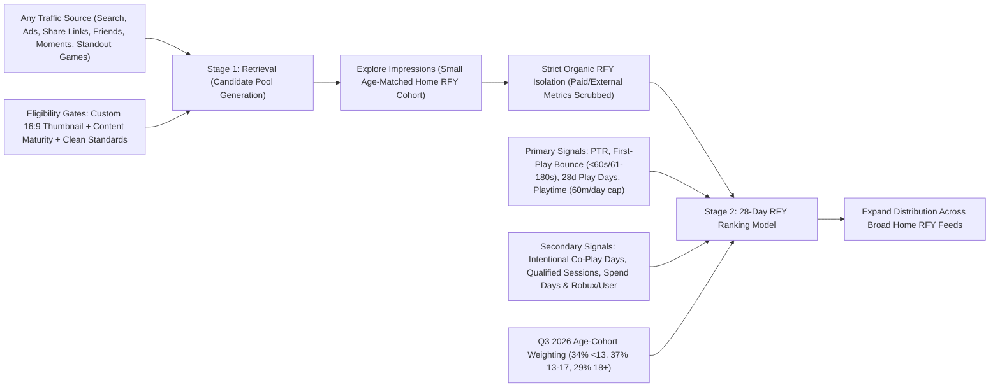

# Deliverable E — Roblox Discovery Playbook (Verified November 2026)

**Collection Date:** `2026-11-22`  
**Research Scope:** Section 5 of `Research.txt` — Official Roblox Recommendation Architecture, All 9 Discovery Surfaces, Latest Terminology Verification, 19-Signal 6-Point Audit, Cold-Start Mechanics, and Phase-by-Phase Discovery Optimization Playbook (`S01`–`S05`, `S10`, `S11`, `S19`, `S27`).

---

## 1. Late-2026 Discovery Architecture Overview

Between March 2025 and October 2026, Roblox completely modernized its content distribution engine `[Officially confirmed]` (`S01`, `S03`, `S04`). Outdated pre-June-2026 guides still cite **QPTR** and **7-day retention windows**; both are **obsolete**. Modern Home **"Recommended for You" (RFY)** runs a **two-stage Retrieval → Ranking pipeline** evaluated across a **28-day rolling funnel** (`Day 1`, `Days 2–7`, `Days 8–28`), augmented in Q3 2026 by **age-cohort weighting**, **auto-playing gameplay videos** (up to **+39% RFY playtime lift**), and the native **Roblox Moments** short-form video tab `[Officially confirmed]` (`S01`, `S03`, `S04`, `S05`).

### Verified Official Terminology Changes (Pre-June 2026 vs. November 2026) `[Officially confirmed]`

| Legacy Term (Outdated) | Current Official Term (Nov 2026) | Verified Change & Operational Meaning | Source |
| :--- | :--- | :--- | :--- |
| **Qualified Play-Through Rate (QPTR)** | **DEPRECATED & REMOVED** → Split into **PTR** + **First-Play Bounce Rate** | Removed **June 15, 2026**. Bundling click appeal and bounce hid whether thumbnails or first-minute onboarding failed. | `S03` |
| *(Inside QPTR)* | **Play-Through Rate (PTR)** | % of Home RFY viewers launching and staying at least a few seconds. *(Oct 12, 2026 telemetry fix captured more impressions, slightly lowering raw displayed PTR universally without affecting rankings.)* | `S03`, `S04` |
| *(Inside QPTR)* | **First-Play Bounce Rate** | **Negative ranking signal** tracking immediate exits across **`<60s`** (`RFYDuration0To60`) and **`61–180s`** (`RFYDuration61To180`). | `S03`, `S11` |
| **7-Day Evaluation Window** | **28-Day Rolling Window (`D1` / `D2–7` / `D8–28`)** | Rolled out Apr–Jun 2026. Blends immediate early cohorts with 28-day retention so new games don't wait 28 days while sticky games win long-term. | `S02`, `S03` |
| **Raw Session Length** | **Playtime Per User (60-Min/Day Cap)** | Capped at **60 minutes per user, per game, per day** in RFY Ranking, neutralizing overnight AFK farms. | `S04` |
| **Connections (Jul 2025 – Apr 2026)** | **Friends** (and **Trusted Friends**) | Formally reverted back to "Friends" in **April 2026**. | `S04` |
| **Today's Picks** | **Standout Games** | Evolved/rebranded in **March 2026** with a monthly-reviewed official creator nomination form. | `S04` |
| **Engagement-Based Payouts (EBP) / Affiliates** | **Creator Rewards** (**Daily Engagement** + **Audience Expansion**) | Replaced EBP/Affiliates July 2025 (5 R$/Active Spender ≥10m in first 3 games + 35% of first $100 via Share Links). | `S07` |

---

## 2. All 9 Verified Discovery Surfaces (November 2026)

1. **Home Recommendations ("Recommended for You" / RFY) `[Officially confirmed]` (`S03`, `S04`):** Dominant discovery surface. Two-stage ML pipeline (Retrieval accepts *all* traffic; Ranking strictly isolates *organic RFY* cohorts). Supports up to 5 active 16:9 thumbnails via **Thumbnail Personalization** (with Mid-2025 *Winning Thumbnail Memory*) and mid-2026 **Auto-Playing Gameplay Videos** (`Place Settings → Videos`, desktop hover / mobile scroll pause; real footage only—no CGI/text overlays/voiceovers; falls back to static 16:9 on Console/VR).
2. **Charts & Editorial Curation `[Officially confirmed]` (`S04`):** Segmented by core Genre/Subgenre filters across *Top Playing Now* (live CCU), *Top Trending* (short-window velocity surge; exact formula `[Unknown]`), *Up-and-Coming* (newer/smaller breakout traction; exact cutoffs `[Unknown]`), *Top Earning* (Robux spend volume), *Top Rated* (satisfaction), *Top Revisited* (repeat days), and **Standout Games** (human-curated Home showcase accepting direct indie nominations).
3. **Semantic Search Results `[Officially confirmed]` (`S04`):** Multilingual natural-language intent search blending experiences, items, communities, and profiles. Ranked by (1) personal history/account info, (2) semantic relevance (title, front-loaded first 1–2 sentences of description, genre/subgenre), and (3) technical quality/crash rate and engagement. Metadata indexing can lag up to ~14 days `[Developer-reported experience]`; erratic title changes and keyword stuffing harm visibility.
4. **Sponsored Experiences (Ads Manager) `[Officially confirmed]` (`S04`, `S10`):** Sponsored tiles are blended natively directly inside the Home RFY feed (with deduplication spacing) and unified with Search inventory. Supports objective-based automated bidding (*Acquire New Users*, *Plays & Retention*, *Earnings Objective / ROAS*). Funded via USD card (18+) or irreversible **Ad Credits** (`1 Credit = $1.00 = 285 R$`, min 10 credits). Paid users seed Retrieval but are excluded from organic RFY Ranking.
5. **Friend-Related Discovery & Roblox Party `[Officially confirmed]` (`S04`, `S05`):** *Friends Playing* rows, profile direct joins, **Roblox Party** (up to 6 friends traveling together via `Player.PartyId`), `SocialService:PromptGameInvite()` with `LaunchData`, private servers, and **reserved servers** (patched into **Intentional Co-Play** credit on **December 11, 2025**).
6. **Personalized Recommendations ("More Like This" & Genre Taxonomy) `[Officially confirmed]` (`S04`):** Algorithmic *Recommended Experiences* carousels on Experience Details Pages driven by overlapping player vectors. Paired with the strict **1 Primary Genre + 1 Optional Subgenre** taxonomy (3-month change cooldown + automated/human audits).
7. **Experience Details Pages (EDP) `[Officially confirmed]` (`S04`):** High-intent conversion page supporting up to **10 decoupled 16:9 images/videos**, mandatory **Content Maturity** label, front-loaded description, Store/Game Passes, and **Experience Events & Updates** (up to 10 scheduled events with 5 custom thumbnails and **Notify Me** opt-in alerts).
8. **External Traffic, Deep Linking & Share Links `[Officially confirmed]` (`S04`, `S07`):** Trackable `Creations > Share Links` and `SocialService:PromptLinkSharing` with `LaunchData` routing. Attribution reports clicks, D7 retention, 7-day playtime, and 30-day revenue per link—and unlocks **35% Audience Expansion Rewards** on the first $100 spent over 60 days by attributed new or ≥60-day reactivated users (requires ≥100 avg DAU).
9. **Roblox Moments (Native Short-Form Video Feed) `[Officially confirmed]` (`S01`, `S05`):** Launched beta at RDC 2025; expanded as a **native homepage tab** across most of the U.S. by Q3 2026. 13+ users capture/trim 30-second gameplay clips (backed by **Video Captures API**, **Upload API**, and **Recommendations API**) featuring **one-tap instant Join** directly into the experience—eliminating mobile browser redirect drop-off from TikTok/Shorts.

---

## 3. Complete 6-Point Audit of All 19 Discovery Signals

*(Baseline Creator Hub Dashboard unlock requires **>10 DAU and 10 play hours for 7 consecutive days** `[Officially confirmed]`. Exact proprietary ML weight coefficients remain `[Unknown]`.)*

| # | Signal | 1. Definition | 2. Recognition Status | 3. Where Measured | 4. Discovery Impact | 5. Practical Improvement Tactics | 6. Common Misconceptions |
| :-: | :--- | :--- | :--- | :--- | :--- | :--- | :--- |
| **1** | **QPTR (Deprecated) → PTR** | % of Home RFY viewers launching and staying a few seconds (replaced QPTR Jun 15, 2026). | `[Officially confirmed]` **Most Important Signal** | `Acquisition > Home Recommendations` | Top-of-funnel RFY gatekeeper; low PTR starves impressions. | 2–5 distinct 16:9 thumbnails via Personalization (>7d untouched); authentic auto-play Gameplay Video. | QPTR is retired; Oct 12, 2026 telemetry fix lowered raw displayed PTR globally without hurting rank. |
| **2** | **Impression-to-Play Conversion** | Ratio of total plays ÷ impressions across Home, Search, Charts, Ads, EDP. | `[Officially confirmed]` Tracking pillar (PTR on RFY) | `Acquisition` (by traffic source & device) | Governs RFY velocity, Ads CPP efficiency, Search conversion. | Audit separately by Mobile vs PC; ensure mobile title truncation readability; clean 10-slot EDP gallery. | Conversion naturally compresses as RFY expands from tiny seed fans to broad Home traffic. |
| **3** | **Thumbnail & Icon Performance** | Click/play appeal of 16:9 Home tiles (up to 5), 1:1 Icons (`512×512`), and Gameplay Videos. | `[Officially confirmed]` Custom 16:9 thumbnail is a **hard eligibility gate** | `Places > Thumbnails` (Home vs EDP tabs) & `Videos` | Primary lever on PTR and pre-click expectation accuracy (+39% playtime lift from authentic video). | Single bold focal subject, bright contrast, honest gameplay depiction, never reset tests daily. | CGI trailers & text overlays violate Gameplay Video rules; frequent thumbnail resets hurt ML learning. |
| **4** | **Session Duration / Playtime** | Average organic playtime/user, **capped at 60 min/user/game/day** in RFY. | `[Officially confirmed]` **Most Important Signal** | `Engagement` & `Acquisition > Home Recommendations` | Core RFY Ranking pillar & Top Trending velocity driver. | Layered loops (2m hook → 12m milestone → 30m goal); remove lobby waits & loading dead-time. | Overnight AFK chambers no longer farm infinite RFY Playtime due to the strict 60m/day cap. |
| **5** | **First-Session Experience (FTUE)** | Load time, spawn clarity, first 10–60s action, and initial reward completion. | `[Strongly supported by evidence]` Operational driver of Bounce & D1 | `Funnels` (`LogOnboardingFunnelStepEvent`) & Bounce Rate | Decisive cliff: poor games lose 30%–50% in first 10–30s, choking RFY scale. | Core action in `<10s`; glowing visual guidance; zero text walls/paywall popups; `StreamingEnabled`. | Players will NOT sit through a 2-minute lore cutscene to reach a great mid-game. |
| **6** | **Early Abandonment / First-Play Bounce Rate** | **Negative signal**: % of RFY newcomers leaving in **`<60s`** or **`61–180s`**. | `[Officially confirmed]` **Most Important Signal** (Jun 15, 2026) | `Acquisition > Home Recommendations` & Open Cloud (`RFYDuration0To60/61To180`) | Explicit clickbait, crash, and FTUE quality brake that rapidly cuts RFY impressions. | Match thumbnail to spawn screen; fix `<2GB` Android join crashes; kill empty waiting lobbies. | Bounce isn't only clickbait—a 25-second mobile load crash logs identically as a `<60s` bounce. |
| **7** | **D1, D7, D30 Retention** | % of D0 new-user cohort returning on exact Day 1, Day 7, Day 30. | `[Officially confirmed]` Core KPI aligned with 28-day RFY | `Retention` & `Benchmarks` (Similar Experiences P50–P90) | Highest long-term leverage on sustained organic impressions. | Separate D1 fixes (onboarding/async greeting) from D7/D30 fixes (co-op roles, systemic variety, events). | Moving to 28-day RFY does NOT make new games wait 28 days—horizons blend D1 → D2–7 → D8–28. |
| **8** | **Repeat Play Days (28-Day)** | Average unique calendar days RFY users return across `D1`, `D2–7`, `D8–28`. | `[Officially confirmed]` **Most Important Signal** (28-day window) | `Acquisition > Home Recommendations` (`Play days per user`) | Primary habit-formation signal & driver of *Top Revisited*. | Rotating quests, bounded offline rewards, scheduled Experience Events, multi-day goals. | One 4-hour Saturday marathon = `1 Play Day` + `60m` capped credit; four 20m days = `4 Play Days` + `80m` credit! |
| **9** | **Intentional Co-Play** | Avg unique days users play with friends via joins, invites, Parties, Private & **Reserved Servers**. | `[Officially confirmed]` **Other Important Signal** | `Acquisition > Home Recommendations` (`Intentional co-play days`) | Dual multiplier: boosts RFY Ranking AND fuels organic Friend-join acquisition. | Support `Player.PartyId`; trigger `SocialService:PromptGameInvite` at lobby/post-win peaks; non-verbal pings. | Reserved servers DO count for Intentional Co-Play (patched Dec 11, 2025); random strangers do NOT. |
| **10** | **Player Spending Behavior** | **Spend Days Per User** (unique spend days) & **Robux Spent Per User** (organic RFY cohort). | `[Officially confirmed]` **Other Important Signals** | `Acquisition > Home Recommendations` & `Monetization` | Rewards repeat ethical value; weighted by age-cohort (U.S. 18+ spends >50% more). | Layered price tiers (starter, cosmetics, QoL passes, subscriptions) delivered *after* core fun. | Aggressive 30-second P2W popups kill Bounce Rate & Play Days, net-hurting 28-day RFY. |
| **11** | **Payer Conversion** | % of DAU completing ≥1 Robux purchase (plus Active Spender `$9.99+`/60d). | `[Officially confirmed]` Core Monetization KPI | `Monetization` & `Benchmarks` | Drives Spend Days, Top Earning chart, and Ads Manager Earnings ROAS scaling. | Dynamic `GetProductInfo()` + Regional Pricing; clear previewed Starter Pack after minute 5; mobile-friendly shop UI. | One mega-whale cannot carry cohort Spend Days if 99.9% of players bounce or never spend. |
| **12** | **Player Satisfaction** | Public Like/Dislike ratio, Ratings, written feedback, `PromptFeedbackSubmissionAsync`. | `[Officially confirmed]` Direct on *Top Rated*; indirect on RFY | `Audience > Feedback` | Shapes human click trust (PTR) and flags bugs/P2W backlash early. | Read weekly Feedback logs; prompt rating after joyful milestone; never bait-and-switch passes. | Dropping to 78% does NOT trigger an automatic RFY shadowban; 96% like ratio alone doesn't prevent churn (*Garden Horizons*). |
| **13** | **Game Stability & Performance** | Client Crash Rate, Client RAM/OOM (Error 292), P10 FPS, Server 60 FPS Heartbeat. | `[Officially confirmed]` Direct Search/Discovery quality input | `Monitoring > Performance` (`<2GB` Android alert) & `Crashes` | High crash rates degrade Search & spike `<60s` mobile bounces across 80% mobile base. | Test on real 2–3GB Android phone; enable `StreamingEnabled`; audit OOM treemaps & P10 FPS. | A brief 2-hour buggy patch spike does NOT permanently blacklist a game if hotfixed promptly. |
| **14** | **Device Compatibility** | Ergonomics & stability across Mobile, Tablet, Desktop, Console, VR. | `[Officially confirmed]` Per-device analytics & *Standout Games* gate | Device filters across all Analytics tabs | Mobile = ~80% of DAU; ignoring touch controls forfeits 4/5 of addressable RFY inventory. | Mobile-first thumb UI, native gamepad navigation, crisp static 16:9 fallback for Console/VR. | Turning on Mobile/Console without testing hurts per-device Bounce Rate rather than adding free traffic. |
| **15** | **Social Engagement** | Friend joins, Parties, co-op mechanics, trading, Moments clips, Communities. | `[Officially confirmed]` (via Co-Play/Friends) & `[Strongly supported by evidence]` | `Acquisition` (Friends/Social) & Co-Play metric | Multiplies RFY, Friends Playing, and Roblox Moments clip circulation simultaneously. | Build 2–6p interdependent roles; integrate **Video Captures API** for auto-highlights; add quick pings for age-gated chat. | 50 silent strangers grinding independently in one server = near-zero Intentional Co-Play. |
| **16** | **Update Frequency** | Cadence of content updates, balance patches, and Experience Events. | `[Officially confirmed]` **Indirect** catalyst only | `Engagement > Events & Updates` & Version markers | High-value updates lift Play Days, D7/D28, Spend Days, and *Top Trending* velocity. | Pair meaningful bi-weekly/monthly systemic drops with scheduled Experience Events (`Notify Me`). | Publishing empty micro-edits daily does NOT "trick" the algorithm—staff explicitly debunked this. |
| **17** | **Audience Relevance / Cohort Matching** | Alignment with **age-cohort weighting** (Q3 2026), primary/subgenre, language, device. | `[Officially confirmed]` Confirmed Q3 2026 Shareholder Letter | `Audience` & `Benchmarks` (`Similar Players`) | Enables niche/13+/18+ games to scale deeply within target age groups (O18 = 37% US verified DAU). | Tag accurate Genre/Subgenre (3-month lock); match Thumbnail Personalization to target age; avoid noisy off-target ads. | Games do NOT have to target 9-year-olds to scale—18+ is fastest-growing and monetizes >50% higher. |
| **18** | **New Player Acquisition** | Volume & velocity of first-time entrants across all surfaces. | `[Officially confirmed]` Feeds Retrieval & Audience Expansion | `Acquisition` & `Share Links` | Clears Stage 1 Retrieval, fuels *Top Trending*/*Up-and-Coming*, and trains lookalike models. | Validate FTUE/D1 on small cohorts *before* scaling ads or influencer pushes; always attach Share Links. | Buying massive Day-1 traffic cannot force RFY expansion if organic retention fails. |
| **19** | **Traffic Source Quality** | Intent, authenticity, and demographic alignment by channel (Organic vs Ads vs External vs Bots). | `[Officially confirmed]` Strictly segmented & bot-filtered | `Acquisition` (by Source) | Clean niche cohorts seed stronger "similar player" Retrieval matches; bots are stripped/sanctioned. | Judge true algorithmic health strictly inside `Home Recommendations`, never blended Overview during ad bursts. | Giveaway/forced-teleport/untargeted ad clicks poison cohort diagnostics and risk ToS penalties. |

---

## 4. The Cold-Start Problem: Confirmed Facts vs. Developer Hypotheses

| Cold-Start Question | Confirmed Platform Facts `[Officially confirmed]` | Developer Consensus / Hypotheses | Actionable Solo-Dev Takeaway |
| :--- | :--- | :--- | :--- |
| **Does Roblox test new games with small audiences?** | **Yes.** Eligible games (custom 16:9 thumbnail + Content Maturity rating + clean Standards) that gather a small active baseline from *any* source clear Stage 1 Retrieval and receive small exploration impressions on Home RFY evaluated on **per-player averages** (`S03`, `S04`). | Exact exploration batch size & graduation confidence thresholds remain `[Unknown]`. | Never publish a raw broken prototype publicly; polish the first 60 seconds before clearing Retrieval. |
| **How does initial traffic affect future recommendations?** | Any source (Ads, Search, Friends, Share Links, Moments, Standout Games) feeds **Stage 1 Retrieval**, but external/paid players are **excluded from Stage 2 Ranking** (`S04`). | `[Reasonable inference]` Who plays initially shapes the behavioral "similar players" graph deciding *which* organic Home cohorts get your first test impressions. | Seed initial 100–500 players from tightly matched genre communities (Discord/TikTok/Shorts), NOT untargeted giveaways. |
| **Do paid ads trigger organic discovery?** | Ads help clear Retrieval without hurting or directly inflating organic RFY Ranking (`S04`). Official incrementality studies show median **+14% sessions & +10% D7** (`S10`). | `[Developer-reported experience]` Broad, poorly targeted ads sent into unvalidated games cause "post-ad slumps" by burning irreversible Ad Credits (`285 R$/credit`) on high-bounce users (`S27`). | Treat small Ads Manager runs (`$10–$25/day`, 3–5d) strictly as a **diagnostic seed** after Alpha/Beta FTUE fixes. |
| **Is a specific CCU threshold required?** | **No hard-coded CCU threshold exists** (`S04`). Practical feature floors: **>10 DAU & 10 play hrs for 7d** unlocks full Analytics; **100+ avg DAU** unlocks Audience Expansion (`S04`, `S07`). | `[Developer-reported experience]` Below ~15–30 CCU, multiplayer lobbies feel empty—causing `<60s` bounces that starve RFY statistically. | Design every solo MVP to be **100% fun solo or with 2 players** (instant solo/bot-fill fallback!) so low CCU never causes empty-lobby bounces. |
| **Do you need high monetization for RFY?** | **No.** Retention & playtime come first; monetization is normalized per user (`S04`). | `[Reasonable inference]` Because *Spend Days* & *Robux Spent* are active secondary signals, completely unmonetized games cede a ranking lever to equally retentive monetized rivals. | Launch with 3–5 clean, ethical, non-P2W passes/cosmetics from Day 1—never wait until "later" to add basic fair value. |
| **New vs. Established discovery dynamics?** | **Highly meritocratic at top-of-funnel:** **40% of weekly Top 100 RFY games (by impressions)** in Q3 2026 were created within the prior **3 months** (`S01`). | `[Strongly supported by evidence]` *Top Playing Now* & *Top Earning* stay incumbent-heavy, while RFY, *Up-and-Coming*, *Standout Games*, and *Moments* are the true indie ramps. | Aim squarely at Home RFY (`PTR` + low `<60s` bounce + 28d `Play Days`) + *Moments* + *Standout Games* nomination. |

---

## 5. Phase-by-Phase Discovery Optimization Framework (Policy-Compliant)

> [!CAUTION]
> **Strict Policy Compliance Boundaries (`S04`, `S08`, `S09`):** Never use bots, fake CCU/favorites, forced cross-game teleports, deceptive clickbait thumbnails, CGI/text-overlay Home Videos, or keyword-stuffed titles. All violate Community Standards and mechanically self-destruct under `First-Play Bounce Rate`.

| Development Phase | Mandatory Discovery Actions | Primary Metric Gate |
| :--- | :--- | :--- |
| **1. Pre-Production** | Choose an **instantly legible 3-second visual hook** (readable on mute for *Moments* & Auto-Play Video); design **1–4p solo-viable co-op** (supports *Intentional Co-Play* + survives 1 CCU); lock accurate Primary Genre + Subgenre (3-month cooldown); ensure R15 avatar compatibility (unlocks `$0.0054` U.S. 18+ DevEx). | Clear 1-sentence pitch & 3-second visual readability test. |
| **2. Prototype & Closed Alpha** | Use Early Tester / private playtests (never publish raw to Public); instrument `LogOnboardingFunnelStepEvent` (Steps 1–5); optimize mobile `<2GB` Android RAM (`StreamingEnabled`); build non-verbal ping wheel (Jan 2026 age-gated chat). | Core action reached in `<15s`; zero critical client crashes; testers voluntarily replay. |
| **3. Soft Launch (Diagnostic)** | Upload **3–5 conceptually distinct custom 16:9 thumbnails** (Home tab) + crisp `512×512` icon + authentic 15s unedited **Gameplay Video** (`Place Settings → Videos`); complete Content Maturity Questionnaire & `PolicyService` compliance; seed 200–500 players via targeted Discord/TikTok Share Links + optional `$50–$100` Ads Manager diagnostic (let 24–48h learning phase & 7d thumbnail personalization run untouched!). | `<60s` Bounce controlled; Avg Session ≥10–12m; D1 ≥13%–16% (beats GameAnalytics P75–P90). |
| **4. Full Launch (Momentum)** | Coordinate a **Flash Mob Launch** (Discord + Roblox Community + Share Links + scheduled **Experience Event** with `Notify Me`); enable **Video Captures API** auto-prompts on clutch/rare moments for **Roblox Moments**; submit novel/polished builds to official **Standout Games** nomination form. | Organic `Home Recommendations` impressions accelerating independently of paid/external seed. |
| **5. Post-Launch Live-Ops** | Protect 28-day `Play Days Per User` (`D2–7`, `D8–28`) via bi-weekly/monthly systemic modifiers & scheduled Experience Events; integrate `Player.PartyId` & contextual post-win friend invites; audit `Acquisition > Home Recommendations` weekly and run controlled A/B tests via Creator Hub **Configs & Experiments**. | D7 ≥3.9% (P90), D30 ≥2.0% (P90), rising *Intentional Co-Play Days* & healthy *Spend Days*. |
