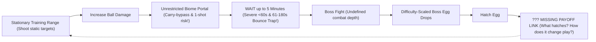

# Deliverable H — Preliminary Game Idea Critical Evaluation (`GameIdea.txt`)

**Collection Date:** `2026-11-22`  
**Research Scope:** Section 13 of `Research.txt` — Unbiased post-research evaluation of [GameIdea.txt](../../GameIdea.txt) held strictly against the independently collected late-2026 market, discovery, compliance, and feature-matrix evidence in Deliverables B–G.

> [!CAUTION]
> **Headline Verdict — DO NOT BUILD `GameIdea.txt` AS WRITTEN (Decision Matrix Score: `4.22 / 10`, Rank `#7 / 7` across all 5 weighting scenarios).**  
> As currently drafted, `GameIdea.txt` removes the exact high-adrenaline heist/chase hook that made *Steal An Egg* viral while retaining the most oversaturated, high-bounce, content-heavy simulator mechanics (`5-minute forced wait`, `stationary target clicking`, `multi-biome art treadmill`, `undefined egg payoff`). However, its underlying **kinetic kernel** (*throwable ball physics + boss encounters + collectible eggs*) is **salvageable if radically reimagined** into a fast-action PvE Boss-Vault extraction loop (`C2: Egg Heist: Boss Vault`, scored `8.43/10`) or stripped down to a pure physics-duel arcade game (`C3: Curve Clash`, `8.20/10`).

---

## 1. Inferred Gameplay Loop & Missing Progression Link Audit

Evaluating [GameIdea.txt](../../GameIdea.txt) exposes both a **broken structural connection** and three severe **late-2026 RFY bounce traps**:

### Critical Structural Omissions Identified in `GameIdea.txt`
1. **Unresolved Egg Payoff (`???`):** `GameIdea.txt` never defines *what* hatches from boss eggs or *how* hatched outputs feed back into combat, training, movement, or social play. If hatched pets merely grant a flat `+X% ball damage` stat multiplier, the entire egg system collapses into an indistinguishable clone of *Pet Simulator 99!* (which declined `-95%` from peak CCU amid genre fatigue, `S14`) while adding 3D pet modeling overhead and Paid Random Items legal risk (`S08`).
2. **Stripped-Out *Steal An Egg* Core Hook:** *Steal An Egg* (14.3M peak CCU, 800k–1M+ active in Nov 2026, `S14`) exploded because of **high-stakes stealth/sprint extraction chases** (snatching eggs from guarded nests or rival players while dodging hits and sprinting home to passive-income pens) amplified by **Do Big Studios' industrial LiveOps & `misfitsbsthree`'s portfolio** (`S14`, `S24`). Replacing *heist-and-escape tension* with *stationary target shooting + 5-minute boss waiting* removes the exact TikTok/Roblox Moments viral engine!
3. **Zero Cold-Start / Low-CCU Survival Plan:** A shared 5-minute boss arena breaks at `1–3 CCU` (either unkillable damage sponge or lonely empty room) during a solo developer's critical soft-launch phase.

---

## 2. Deep-Dive Evaluation of All 5 Preliminary Mechanics

### 2.1 Boss Spawning Every Five Minutes `[Officially confirmed]` `[Reasonable inference]`
- **Does waiting increase anticipation or cause player abandonment?** In late-2026 Roblox—where zero-install switching lets players quit in 10 seconds and Roblox's **June 15, 2026 RFY overhaul directly penalizes `<60s` and `61–180s` First-Play Bounce Rate** (`S03`)—a 5-minute mandatory wait is a **severe abandonment bomb**. If a newcomer spawns 20 seconds after a boss dies, facing a `4:40` countdown triggers immediate exit before experiencing the core hook. *(Anticipation timers only work for bonus **side spectacles** like Grow a Garden's 5-min Seed Shop or hourly world storms—never as a gate blocking the game's primary verb!)*
- **What should players do while waiting?** Waiting should **never** be mandatory to engage the main loop. If a server-wide mega-boss timer exists at all, it must be an *optional bonus event* layered on top of continuous, player-triggered action.
- **Would player-triggered bosses work better?** **Overwhelmingly YES.** Stepping onto a physical **Boss Summon Pad / Vault Gate** (analogous to *RIVALS*' instant lobby Duel Pads or *DOORS*' 10-second elevator countdown) guarantees every newcomer fights or heists a boss within **30 seconds of joining**, slashing `<60s` bounce.
- **Shared, instanced, or continuous?** **Instanced / Dynamic-Scaling 1–4 Player Runs** (using reserved servers—which officially credit **Intentional Co-Play Days** since Dec 11, 2025, `S03`) outperform static shared arenas by preventing high-level players from one-shotting bosses before newcomers can tag them.
- **How could bosses create social interaction?** Give bosses telegraphed attacks that reward **2–4 player non-verbal roles** (one player throws a Decoy/Freeze orb to stagger the boss while teammates crack its shield or revive downed allies—working smoothly across Jan 2026 age-gated chat walls, `S09`).
- **Low-population server behavior:** Player-triggered bosses with `HP = BaseHP × (1 + 0.65 × (PartySize - 1))` play identically at `1 CCU` or `100,000 CCU`.

### 2.2 Stationary Throwable Ball Combat `[Strongly supported by evidence]` `[Reasonable inference]`
- **Is the mechanic sufficiently engaging?** **No.** In our 44-game dataset, `clicking_repetitive` appears in only `22.7%` of top titles and `training_attribute_grinding` in just `13.6%` (`Deliverable D`). Static stationary shooting turns Roblox's expressive 3D avatar movement into a flat 2018 clicker UI.
- **Does stationary shooting become repetitive?** Within **60–90 seconds**, risking the classic `r/robloxgamedev` **"3-minute killer"** failure mode (`<5m` session length, `~2.5%` D1 retention, `S27`).
- **Would aiming, movement, dodging, or timing improve gameplay?** **Dramatically.** Adding fluid running/dashing, telegraphed boss AoE dodging, **curved trick-shot arcs**, **timing-bar power throws** (echoing *Fisch*'s tactile bar), or **ricochet deflects** transforms a passive click into a clippable skill verb readable in 3 seconds on Roblox Moments and Home Auto-Play Videos (`S04`, `S05`).
- **Should training differ from actual combat?** **Remove sterile training entirely**—or replace it with a **30-second optional moving-target arcade challenge** (combo multipliers for hitting moving rings/weak spots) so players earn real mechanical aim/curve mastery instead of mindlessly holding click.
- **Mobile accessibility (~80% of Roblox DAU, `S23`):** Stationary mouse aiming actually feels *clunky* on mobile touchscreens compared to left-thumb movement + right-thumb **hold-to-aim / release-to-throw with generous magnetic curve assist** (validated by *RIVALS* & *Illegal Soccer*).
- **Mastery ceiling:** Stationary clicking has a **zero skill ceiling** (pure numeric stat check); active dodge-and-curve combat unlocks genuine Competence (SDT, `S20`) and keeps 13+/18+ players returning across the 28-day RFY window.

### 2.3 Training Ranges `[Observational correlation]` `[Reasonable inference]`
- **Is repetitive attribute grinding enjoyable?** Only when embedded in a fast escalating loop with instant spatial feedback (e.g., *Steal An Egg* treadmills immediately unlock faster heist escapes across visible zones). Isolated personal shooting ranges separate players socially (hurting **Intentional Co-Play Days**) and feel like homework before the real game begins.
- **How quickly do players get bored?** In isolated stationary ranges with no hazards or social friction, novelty expires inside **2–4 minutes**.
- **Active challenges vs. passive progression vs. both?** **Replace raw click-grinding with active gameplay rewards + bounded passive/offline workshop upgrades.** Earning upgrade power *by actually fighting/heisting bosses* (plus lightweight 8–12h offline passive progress at your hub) eliminates tedious filler grind while preserving D1 check-in hooks.
- **Meaningful choices:** Replacing a single linear "Ball Damage" number with **3–4 distinct throwable orb archetypes** (Heavy Breaker, Curve Boomerang, Freeze Stunner, Bounce Splitter) creates Autonomy (SDT) and tactical replayability without linear stat inflation.
- **Clear reason to improve attributes:** Players only care about upgrading stats when they feel an exciting, visible threshold (e.g., cracking a Boss Vault's armored shield or surviving Wave 5) rather than watching an arbitrary damage counter tick from `124` to `125`.

### 2.4 Egg Rewards and Hatching `[Officially confirmed]` `[Strongly supported by evidence]`
- **Are egg systems still compelling in late 2026?** **Selectively—only as a secondary delivery wrapper, NOT as a standalone differentiator.** In our 44-game dataset, `egg_hatching` appears in only **`15.9%` (7/44)** of leading titles, and two of those (*Pet Simulator 99!* `-95%`, *Grow a Garden* `-99.9%`) are actively declining (`Deliverable D`, `S14`). *Steal An Egg* and *Climb For Animals Eggs* succeeded because of **extraction/climbing framing + offline pet base income + studio distribution**, not because egg-cracking UI itself is novel.
- **What should hatch from the eggs & what practical gameplay purpose should they serve?** Instead of generic floating stat-stick cubes, hatched items should grant **tangible mechanical abilities OR visible physical base value**: (a) **Active Orb Modifiers / Gadgets** (e.g., Frost Core turns throws into slowing ice balls; Magnet Core pulls dropped loot), OR (b) **Vault Guardians / Collectors** displayed physically in a customizable player hub generating bounded offline currency & unlocking heist utility.
- **How can collections remain meaningful?** Use a **visual silhouette Codex/Bestiary** (`collection_completion` = 63.6% overall prevalence) with mutation variants (e.g., Cracked, Golden, Storm-Charged) and deterministic crafting/fusion so duplicate hatches always advance a visible goal.
- **Responsible & legally compliant implementation (`S08`):** To avoid **Paid Random Items** country bans (BE, NL, UK `<18`, AU `<18`, and **Brazil `<18`/unverified effective March 17, 2026**) and dynamic 100%-odds UI overhead, make boss eggs **100% gameplay-earned only—NEVER sell egg currency for Robux and NEVER sell Paid Luck Boost Game Passes**! Monetize non-random cosmetics, hub pedestal slots, revives, and VIP Club subscriptions instead.

### 2.5 Biomes and Portals `[Strongly supported by evidence]` `[Reasonable inference]`
- **Does biome progression provide sufficient motivation?** Moderate short-term curiosity—players enjoy unlocking new visual themes (`area_biome_unlocks` = 50% overall)—but static biomes suffer severe **content exhaustion** once players walk through the final portal.
- **Is unrestricted biome access an advantage or disadvantage?** **A major progression-breaking disadvantage** unless heavily engineered around. Allowing a 10-damage newcomer to enter an Endgame Portal creates two fatal failure modes:
  1. **Instant Carry-Bypass Exploit:** High-level players or friends carry a Day-1 newbie into the Endgame Boss arena; if eggs drop for all participants, the newbie skips 100% of early progression in minute 2 and quits from boredom by minute 15. *(Mitigation if kept: personal damage-contribution thresholds + boss solo/tier mastery gates.)*
  2. **Newbie One-Shot Frustration:** Uninformed newcomers wander into Portal #5, get instantly deleted or deal `0.01%` HP damage, assume the game is broken/P2W, and quit inside `61–180s`.
- **Would recommended damage numbers alone suffice?** **No.** Roughly **34% of verified DAUs are under 13** (`S01`) and ignore text numbers; players walk into the coolest-looking glowing portal regardless of a `"Rec. 5,000 DMG"` text sign.
- **Making each zone meaningfully different & solo art cost:** Building 6–10 unique 3D biomes + unique bosses is an **expensive art treadmill** (`High` solo cost). Instead of separate static maps, a solo developer should use **1 modular arena/vault whose lighting, hazards, and modifiers dynamically transform by Threat Tier** (e.g., Lava Floor, Low-Gravity Storm, Darkness Fog, Double Boss)—giving 5x the mechanical variety at 1/5th the 3D modeling workload!

---

## 3. Overall Concept Assessment (Section 13 Checklist)

| Evaluation Question | Verdict | Evidence-Based Reasoning |
| :--- | :---: | :--- |
| **1. Strong, easily communicated hook?** | **No** | *"Shoot targets stationary, wait 5 mins for a boss, hatch eggs"* lacks a single punchy visual hook readable in 3 seconds on mute. |
| **2. Coherent gameplay loop?** | **No (Broken)** | Missing mechanical connection between hatched egg outputs and combat/training; forced 5-min wait stalls pacing. |
| **3. Sufficiently differentiated?** | **No** | Blends tired 2020–2023 simulator clichés without a fresh active skill twist or high-stakes extraction loop. |
| **4. Meaningful long-term objective?** | **No** | Pure numeric damage climb across static portals exhausts quickly and invites hyperinflation. |
| **5. Reasons to invite friends?** | **Weak** | Private solo training ranges + unscaled shared bosses fail to generate **Intentional Co-Play Days** (`S03`). |
| **6. Naturally creates shareable moments?** | **No** | Stationary target shooting produces zero TikTok/Roblox Moments drama, comedy, or clutch tension. |
| **7. Could sustain an active player base?** | **Unlikely** | High `<60s` bounce from wait timers + weak D7–D28 retention would choke off June 2026 Home RFY scaling. |
| **8. Realistic for a solo dev?** | **Poor ROI** | Multi-biome + multi-boss art load is heavy relative to low expected retention/discovery return. |
| **9. Do existing games already do this better?** | **Yes** | *Steal An Egg* (800k–1M+ CCU), *Throw Food For Animals*, *Climb For Animals Eggs* (98.6% rating), and *Bee Swarm* already dominate adjacent loops with tighter hooks and/or studio LiveOps. |

---

## 4. Feature Evaluation Table (Keep / Modify / Remove / Test)

| Existing Mechanic | Intended Purpose | Supporting Market Evidence | Potential Strengths | Potential Weaknesses | Impl. Complexity | Retention Contribution | Recommendation | Suggested Alternative |
| :--- | :--- | :--- | :--- | :--- | :--- | :--- | :---: | :--- |
| **5-Min Boss Spawn Timer** | Build server anticipation & schedule boss drops | June 2026 RFY penalizes `<60s` & `61–180s` bounce (`S03`); *RIVALS*/*DOORS* win via instant start (`S14`). | Simple server loop; creates occasional crowd gather. | Forces newcomers to sit idle up to 4:59; breaks at 1–3 CCU; spikes early bounce. | Low | **Negative** (Early Churn) | **REMOVE** | **Instant Player-Triggered Boss/Vault Pads** (1–4p dynamic scaling); reserve timers strictly for *optional* bonus hourly world mutators. |
| **Stationary Throwable Ball Combat** | Accessible core combat & training verb | `clicking_repetitive` (22.7%) & `training` (13.6%) underperform kinetic skill/co-op loops (`Deliverable D`); 80% mobile DAU (`S23`). | Easy to script; zero camera complexity. | Tedious "3-minute killer"; zero mastery ceiling; unclippable on Roblox Moments. | Low | **Very Low** | **MODIFY** | **Active Move-Dodge-Curve Throwable Physics** (mobile thumb auto-curve assist + utility orbs: Decoy, Freeze, Boomerang, Breaker). |
| **Private Training Ranges** | Let players grind ball damage between bosses | Isolated solo grinding yields zero *Intentional Co-Play* (`S03`) and separates players from social recognition. | Clear early stat feedback; easy solo scripting. | Feels like boring filler chore; isolates players; encourages AFK clicking (capped at 60m/day in RFY). | Low | **Low** | **REMOVE** | **Active Combat/Heist Mastery + Optional 30s Moving-Target Arcade Challenge** (or bounded 12h offline Hub upgrade passive income). |
| **Boss-Dropped Eggs & Hatching** | Aspirational rare reward & collection loop | `egg_hatching` = 15.9% overall (`Deliverable D`); Robux-linked eggs/Luck triggers strict 2026 `PolicyService` bans (`S08`). | Universally legible reward symbol; strong reveal anticipation. | Saturated cliché; **missing payoff loop** in `GameIdea.txt`; severe legal risk if linked to Robux currency/Luck. | Medium *(High if paid RNG)* | **Medium** *(only if payoff exists)* | **MODIFY / TEST** | **100% Gameplay-Earned Vault/Boss Eggs** (zero Robux-to-egg/Luck!) hatching into **functional active Orb Abilities or Hub Income Guardians** with Codex completion. |
| **Multiple Unique Biomes** | Visual progression & world exploration | `area_biome_unlocks` = 50% overall, but high art treadmill traps solo devs (`S18`, `S27`). | High visual novelty on screenshots. | Massive 3D art/QA workload; players finish 5 biomes in 2 hours and churn. | **High** | Medium (Short-term) | **REMOVE** *(from MVP)* | **1 Modular Arena / Boss Vault with Procedural/Tiered Lighting & Hazard Modifiers** (Frost, Storm, Magma, Gravity, Double-Boss) — 5x replayability at 1/5th art cost. |
| **Unrestricted Portals + Rec. Damage** | Give players freedom & challenge choice | 34% of DAUs are `<13` (`S01`); unrestricted endgame access invites carry-exploits & newbie one-shot quits. | Signals ambition ("cool endgame portal ahead"). | Enables Day-1 friend carry-skipping; causes clueless newbie insta-deaths & bounce. | Low | **Negative** (Breaks pacing) | **MODIFY** | **Soft-Gated Tier Unlocks** (clear Tier `N` once OR unlock via Vault Key crafted in Tier `N-1`) with visible locked preview pedestals to preserve curiosity without carry-breaks. |
| **Steal An Egg Inspiration** | Tap massive late-2026 viral momentum | *Steal An Egg* hit 14.3M peak CCU (`S14`), **BUT** is Do Big-affiliated and relies on heist/chase adrenaline, not stationary clicking (`S24`). | Proven massive 2026 player demand for egg-extraction fantasy. | Borrowing only static parts loses the viral hook; copying PvP theft directly invites griefing rage-quits & Do Big competition. | Medium | **High** *(if heist tension kept)* | **TEST (Reimagine)** | **PvE Co-Op Boss-Vault Extraction (`C2`)**: keep the thrilling *"stun boss → grab egg → sprint to extraction"* rush while eliminating toxic PvP base-robbing! |
