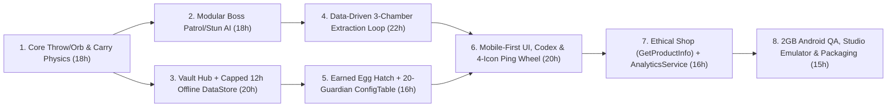

# Deliverable K — Prototype Roadmap, Market Validation, Analytics & Risk Assessment

**Collection Date:** `2026-11-22`  
**Research Scope:** Sections 16, 17, 18, and 19 of `Research.txt` — Anchored primarily to a **Solo Zero/Small-Budget Developer** (with Limited-Budget Duo and Small-Team comparisons), targeting Primary Validation Concept **`C2: Egg Heist: Boss Vault`** and Ultra-Lean Backup Concept **`C3: Curve Clash: Duel Pads`**.

---

## Part K1 — Minimum Viable Product & Solo Development Strategy (Section 16)

### 1.1 Resource Scenario Profiles

| Resource Tier | Team & Weekly Capacity | Upfront Cash Budget (USD / PHP @ `₱63.75`) | Recommended Concept Fit | Target MVP Window |
| :--- | :--- | :--- | :--- | :--- |
| **Scenario A (Primary Anchor): Solo Bootstrap** | 1 dev (~15–25 hrs/wk) | `$50 – $200` (`₱3,188 – ₱12,750`) | **`C2: Egg Heist`** (primary) OR **`C3: Curve Clash`** (fastest 2–4w) | 4–6 weeks (`C2`) / 2–4 weeks (`C3`) |
| **Scenario B: Limited-Budget Solo / Duo** | 1–2 devs (~35–50 hrs/wk) | `$300 – $900` (`₱19,125 – ₱57,375`) | **`C2: Egg Heist`** or **`C4: 12-Minute Outpost`** | 4–6 weeks |
| **Scenario C: Small Funded / Reinvesting Team** | 2–3 devs (~80–120 hrs/wk) | `$1,200 – $3,000+` (`₱76,500 – ₱191,250+`) | **`C2`** or **`C4`** with full seasonal live-ops | 3–5 weeks |

### 1.2 Four-Tier Feature Scope Discipline (Primary Concept `C2: Egg Heist: Boss Vault`)

| Scope Bucket | Features Included | Why Here (Anti-Bloat Guardrail) |
| :--- | :--- | :--- |
| **1. Prototype Essentials** *(Smallest playable hook — ~35–45 solo hrs)* | 1 greybox Vault Chamber; 1 patrolling Boss AI (sight/sound aggro + lunge telegraph); 2 throwable Utility Orbs (Decoy + Freeze); 1 heavy glowing Egg pickup (movement slowdown + extraction pad); basic 1–4p scaling. | Proves the **exact unique hook** (*"distract/stun boss → grab egg → sprint home"*) before building UI, art, or monetization. |
| **2. Public MVP Essentials** *(Soft-launch ready — ~110–145 total solo hrs)* | Personal Vault Hub (8 pedestals + **capped 12h offline income**); instant 1–4p Vault Elevator; 3 modular Chambers (lighting/trap swaps); 2 Boss AIs; 3 Utility Orbs (Decoy, Freeze, Dash-Bomb); 20 **100% earned-only** Guardians + 3 visual mutations; Codex UI; 4-icon non-verbal Ping Wheel; `ProfileStore` DataStore session-locking; `AnalyticsService` FTUE/Economy/Custom events; `PolicyService` safety check + Content Maturity Questionnaire; 4 ethical non-RNG passes/products + Private Servers; R15 avatars; 3–5 custom 16:9 thumbnails + 15s Gameplay Video. | Everything needed to pass Home RFY gates (`PTR`, low `<60s` bounce, 28-day Play Days, Intentional Co-Play, mobile `<2GB` RAM) and validate retention + monetization cleanly. |
| **3. Post-Launch Improvements** *(Only AFTER Gate 4 D1/D7 validation!)* | Chambers 4–5 + automated hourly **Vault Storm** mutator events; 3 new Utility Orbs; **Vault VIP Club Subscription** (100% Mo 2+ share!); **Rewarded Video Ads** (once ≥2,000 MAU); Roblox Moments **Video Captures API** auto-prompts; Experience Events (`Notify Me`); daily rotating quests & seasonal leaderboards. | High-leverage retention & monetization multipliers that should NOT delay initial concept proof. |
| **4. Features to AVOID Entirely** *(Solo Burnout & Failure Traps)* | **Peer-to-peer Trading** (severe anti-dupe + `IsPaidItemTradingAllowed` burden); **Robux-bought Egg Currency or Paid Luck Boosts** (triggers global Paid Random Items country bans in UK/AU/BR/BE/NL); **5+ Hand-Crafted Open Biomes** (art treadmill); **5-Minute Mandatory Boss Wait Timers** (`<60s` bounce killer); **Unlicensed Anime/Brand IP** (DMCA termination risk); **Custom Text Chat** (`TextChatService` compliance). | Every single omitted feature corresponds directly to a verified failure cascade in Section 19 (`S08`, `S09`, `S27`). |

### 1.3 Developer-Hour Estimates, Dependencies & Reusable Modular Systems (`C2` Solo MVP)

| System Module | Solo Dev Hours (`C2`) | Solo Dev Hours (`C3` Backup) | Reusable Data-Driven Architecture (Cuts Future Update Cost by ~70%) |
| :--- | :---: | :---: | :--- |
| Core Physics / Projectile & Carry Controller | 18h | 22h | Single config table `OrbConfigs.luau` (`arc`, `radius`, `effectType`, `cooldown`) — adding a new orb takes ~2 hours, not a rewrite. |
| Boss / Bot AI & Telegraph Framework | 18h | 10h | Behavior state-machine reading `BossConfigs.luau` (`patrolSpeed`, `aggroRadius`, `stunDuration`, `telegraphVfx`). |
| Modular Arena / Chamber & Mutator Generator | 22h | 12h | Swappable lighting presets + modular obstacle prefabs + `MutatorConfigs.luau` (`LowGravity`, `Darkness`, `DoubleBoss`, `LaserSweep`). |
| `ProfileStore` Persistence + Offline Income | 20h | 10h | Atomic session-locked save schema (`UpdateAsync`, kick-on-load-fail, `os.time()` delta capped at `43,200s` = 12h). |
| Earned Collection / Codex / Cosmetics | 16h | 12h | Shared `CollectionConfigs.luau` driving both 3D display pedestals and Codex silhouettes automatically. |
| Mobile-First UI, Onboarding Beams & Ping Wheel | 20h | 14h | Responsive `UIScale` layouts tested in `StudioDeviceSimulatorService`; diegetic floor beams replace text tutorials. |
| Monetization, `AnalyticsService` & Compliance | 16h | 12h | Server-side `ProcessReceipt`, dynamic `GetProductInfo()`, `PolicyService` fail-closed helper, `AnalyticsService` wrapper. |
| Performance QA (`<2GB` Android) & Packaging | 15h | 10h | `StreamingEnabled`, particle caps, 5 × 16:9 thumbnails, 15s raw gameplay video, Content Maturity Questionnaire. |
| **Total Public MVP Effort** | **~145 hrs** | **~102 hrs** | **~6–8 weeks part-time (`C2`) or ~4–5 weeks (`C3`) solo!** |

### 1.4 Illustrative Solo Roadmaps (2-Week, 1-Month, 3-Month)
- **2-Week Roadmap (Validation Prototype — ~40 hrs):**
  - *Week 1:* Core throwable Decoy/Freeze physics + heavy-egg movement slowdown + 1 greybox Vault Chamber + 1 patrolling Boss AI (`C2`) — *or* 1 court + Throw/Curve/Catch + AI Bot Pad (`C3`).
  - *Week 2:* Instant Extraction Pad + 3 starter hatched Guardians + `LogOnboardingFunnelStepEvent` + Closed Alpha qualitative playtest with 20–30 Discord/mobile testers → **Gate 1 / Gate 2 Go-or-Pivot Decision**.
- **1-Month Roadmap (Public Soft-Launch MVP — ~100–145 hrs cumulative):**
  - *Week 3:* Personal Vault Hub + capped 12h offline income (`ProfileStore`) + Chambers 2–3 + Boss AI #2 + 20 earned Guardians + Codex UI + 4-icon Ping Wheel.
  - *Week 4:* Ethical non-RNG shop (`GetProductInfo()` + Regional Pricing + Private Servers), mobile `<2GB` RAM polish, 5 custom 16:9 thumbnails + 15s auto-play Gameplay Video, Content Maturity rating → **Public Soft Launch** (`$50–$100` diagnostic test + TikTok/Moments Share Links).
- **3-Month Roadmap (Post-Validation Scale — Only If Gate 4 Passes!):**
  - *Month 2:* Fix top onboarding/bounce bottlenecks via Creator Hub **Configs & Experiments**; ship automated hourly **Vault Storm** mutator events, **Vault VIP Club Subscription** (100% Mo 2+ share!), and **Video Captures API** for Roblox Moments; submit to **Standout Games** curation.
  - *Month 3:* Enable opt-in **Rewarded Video Ads** (once ≥2,000 MAU); release Chambers 4–5 + 2 new Utility Orbs + scheduled weekend **Experience Events**; reinvest 4%–10% net DevEx into Ads Manager **Earnings Objective** + CPM clipping only if ROAS/RFY lift is verified.

### 1.5 Surviving Low CCU & Limited Solo Update Capacity
1. **1-CCU Proof Loop:** Vault runs launch cleanly for **1 player** (scaling boss speed/egg value cleanly for 1–4 players); `C3` includes an instant **AI Bot Duel Pad** so zero newcomers ever stare at an empty lobby.
2. **Automated Live-Ops:** Schedule hourly systemic mutators (`Vault Storm`, `Golden Egg Surge`) in code + queue up to 10 upcoming **Experience Events** in Creator Hub so the game feels alive 24/7 while the solo dev sleeps or studies/works.
3. **Bi-Weekly Modular Drops:** Instead of exhausting weekly new worlds, ship 1 config-driven Utility Orb, Boss Mutator, or Cosmetic Pack every 2 weeks (`~4–6 hours` dev time).

---

## Part K2 — Prototype Testing & Market Validation Framework (Section 17)

### 2.1 Qualitative Playtesting vs. Statistically Meaningful Quantitative Testing
- **Qualitative Playtesting (`n = 5–25` observed sessions):** Used *before* public launch to uncover UX confusion, broken mobile thumbs, dull physics, and comprehension cliffs. Watch live Discord screenshares **without speaking or helping**—if 4 of 10 testers hesitate for >10 seconds on spawn, you already have a confirmed FTUE blocker without needing 1,000 players!
- **Quantitative Testing (`n = 300–1,000+` real organic/diagnostic players):** Required for **PTR, `<60s` Bounce Rate, D1/D7 retention, and Payer Conversion**. At `n = 50`, a `12%` D1 retention has a massive `±9%` 95% confidence interval (`3%–21%`—statistically noisy); at `n = 400–600` over 3–5 days, D1 tightens to `±3%`—clean enough for Go/Fix/Kill decisions `[Reasonable inference]`.
- **Pre-Scale Measurable Metrics (Works at `n = 15–50`):** Time-to-First-Action (`<15s`), Onboarding Step 1→3 Completion (`%`), Voluntary 2nd-Run Start Rate (`%`), Mobile FPS/Crash Rate, Unprompted *"Can I play again?"* reactions, and 3-Second Thumbnail/Clip Click Intent.

### 2.2 Eleven Low-Cost Validation Experiments (All 9 Required Fields Each)

| # | Target Validation Area | 1. Hypothesis | 2. Prototype Req. | 3. Audience & 4. Sample / Limits | 5. Data to Collect | 6. Success Criteria | 7. Failure Criteria | 8. Interpretation & 9. Next Action |
| :-: | :--- | :--- | :--- | :--- | :--- | :--- | :--- | :--- |
| **E1** | **Concept Appeal** | Players click & comment enthusiastically on *"PvE Boss Vault Egg Heist with Stun Orbs"* over generic simulator hooks. | 3 mock 16:9 thumbnails + 15s greybox clip (no backend needed!). | Roblox Discords, `r/robloxgamedev`, TikTok/Shorts (`n = 500–2,000` views / 30+ poll votes; biased toward hobbyists). | Poll preference %, TikTok avg watch time, comments asking *"Game name?"* | >60% poll win vs generic sim; ≥10 organic *"Game link?"* comments. | Zero curiosity comments; viewers confuse it with a generic *Steal An Egg* clone. | Strong pull → build 10-day greybox; Weak pull → sharpen visual hook or test `C3` clip. |
| **E2** | **Gameplay Hook** | Dodging a boss, throwing a Freeze Orb, grabbing a glowing egg, and sprinting out creates immediate visceral excitement. | 10-day greybox (1 Chamber, 1 Boss, 2 Orbs, 1 Egg, zero shop/hub art). | 15–25 Discord/friend testers (include ≥50% mobile; small non-random bias). | Live screenshare emotional reactions; voluntary 2nd heist rate; verbalized fun rating (1–10). | ≥70% start a 2nd heist unprompted; ≥7.5/10 fun; audible panic/laughs. | Testers call boss boring/unfair; <40% want a 2nd run. | Core verb works → build Hub/MVP; Fails → tune speed/AI/orbs 3 days, re-test, else pivot to `C3`. |
| **E3** | **Thumbnail Effectiveness** | High-contrast action framing (*hero sprinting from giant Boss holding glowing Mythic Egg*) beats static pet-grid thumbnails. | 3–5 distinct 16:9 tiles uploaded to Creator Hub Thumbnail Personalization. | Soft-launch Home RFY / `$30–$50` diagnostic Ads test (`n = 5,000+` impressions; learning phase 48h). | CTR (Ads), PTR (Home RFY), `<60s` Bounce Rate per creative variant. | Ads CTR ≥2.0%–3.5%; strong RFY PTR without spiking `<60s` bounce. | CTR <0.8% OR high CTR paired with >45% `<60s` bounce (mismatch!). | Winner locked (>7d untouched); Mismatch → align spawn screen visually to winning tile. |
| **E4** | **Onboarding Clarity** | Diegetic floor beam + zero text walls gets newcomers to their first extracted egg within 90 seconds. | Full FTUE instrumented with `LogOnboardingFunnelStepEvent` Steps 1–5. | 10 silent observed screenshares + first 300 soft-launch joins (`n = 300`). | Step-by-step drop-off %; Time-to-First-Orb-Throw; `<60s` Bounce (`RFYDuration0To60`). | ≥80% reach Step 2 (`<15s`); ≥55% complete first extraction (`<120s`); low `<60s` bounce. | >35% drop before Step 2 or >45% `<60s` bounce. | Pinpoint exact cliff step, simplify spawn geometry/mobile buttons, re-test via Creator Hub Experiments. |
| **E5** | **Combat / Throw Enjoyment** | Moving + throwing curved utility orbs feels crisp and fair on both 60Hz mobile touchscreens and PC mouse. | Mobile touch aim-assist + PC throw controller on real 2–3GB Android & PC. | 15 mobile + 10 PC testers (`n = 25`; latency variation 40–180ms). | Orb hit accuracy %, miss frustration comments, Client P10 FPS & crash count. | ≥65% mobile throw accuracy; ≥30 FPS P10 on budget Android; 0 crashes. | Mobile players miss >50% throws or report cramped thumb buttons / Error 292 OOM. | Tune generous magnetic auto-curve assist & shrink texture memory before public launch. |
| **E6** | **Progression Speed** | Delivering Upgrade #1 (Freeze Orb) inside 3–4 minutes keeps newcomers past the `61–180s` bounce window. | Economy telemetry via `LogEconomyEvent` + `LogFunnelStepEvent` (Upgrade 1–3). | First 300–500 soft-launch players (`n = 400`). | Median timestamp of Upgrade #1 & #2; `61–180s` Bounce; Avg Session Length. | Median Upgrade #1 in 2.5–4.5 min; Avg Session ≥10–12 min (beats GA P50 `9.8m`). | Players grind >8 min for first unlock OR max out MVP in 12 min. | Rebalance early Vault cash costs via `Configs & Experiments` A/B test. |
| **E7** | **Reward Desirability** | Players value hatching functional/glowing Vault Guardians and pushing deeper for rare mutations (Cracked/Golden/Storm). | 20 earned Guardians + Codex silhouettes + 3 Chamber depth tiers. | Soft-launch cohort (`n = 300+`). | % of players hatching ≥2 eggs; % attempting Chamber 2+; Codex open events (`LogCustomEvent`). | ≥60% hatch ≥2 eggs; ≥45% attempt Chamber 2+; players inspect Codex repeatedly. | Players ignore hatched Guardians or stop after 1 egg. | Boost visual glow/size contrast & Hub pedestal visibility; add functional Guardian passive perks. |
| **E8** | **Replayability** | Push-your-luck depth decisions + 4 Chamber Mutators drive multi-run sessions without new maps. | Soft-launch build tracking runs per session (`LogCustomEvent`). | Soft-launch cohort (`n = 400+` over 5 days). | Runs completed per DAU; Avg Session Length; % choosing "Push Deeper" vs early extract. | ≥3.5 runs/session; Avg Session ≥12–15 min; 30%–65% Push-Deeper split (real tension!). | ≤1.5 runs/session OR 95% always take one trivial option. | Tighten risk-reward multiplier on deeper chambers & add dynamic Boss enrage cue. |
| **E9** | **Social Interaction** | 2–4p co-op role synergy + 4-icon Ping Wheel drives organic friend invites and *Intentional Co-Play Days*. | Party Elevator (`Player.PartyId`), Ping Wheel, contextual post-win `PromptGameInvite`. | Soft-launch + Discord squad nights (`n = 300+`). | Co-op run share %, Ping usage/run, Invite prompt conversion %, RFY `Intentional Co-Play Days`. | ≥35% of runs are 2–4p; players actively use Pings; measurable Co-Play Days climbing. | <10% co-op runs; solo players ignore teammates entirely. | Boost co-op distraction stagger bonus & +10% friend haul banner; surface invite button after close-call wins. |
| **E10** | **Willingness to Return** | Bounded 12h offline Vault income + Codex goals lift organic D1 & D7 above GameAnalytics 2026 P75–P90 medians. | Full 7-day soft-launch cohort (`n = 500+` unique D0 users). | Organic + diagnostic soft-launch cohort (segmented strictly by Acquisition Source!). | Creator Hub `Retention` D1, D7, RFY `Play Days Per User` (D1 & D2–7). | **D1 ≥13%–16%+** (GA P75–P90); **D7 ≥2.5%–3.9%+** (GA P75–P90); beats Similar Experiences P50. | **D1 <8.4%** (below GA P25) or **D7 <1.5%** after 1 FTUE fix cycle. | Pass → unlock monetization & scaling; Fail → diagnose D0 quit reason or execute Gate 5 Pivot. |
| **E11** | **Monetization Interest** | Ethical non-RNG passes (Extra Pedestals, Utility Belt Slot, Cosmetic Orbs, Revive) convert payers cleanly without hurting likes. | Dynamic `GetProductInfo()` shop + Regional Pricing live during soft launch. | Soft-launch cohort (`n = 500–1,000+` players; small sample high ARPPU variance). | Payer Conversion %, ARPDAU (net R$), top-selling SKUs, Like/Dislike ratio. | **CVR ≥2.0%–3.5%+**; Like Ratio **≥85%+**; zero P2W complaints in `Audience > Feedback`. | CVR <0.8% OR Like Ratio drops <75% with P2W complaints. | Low CVR → improve perceived cosmetic/convenience value & add post-minute-5 Starter Pack; P2W complaints → cut/rebalance offending item immediately. |

### 2.3 Six Explicit Decision Gates (Zero Sunk-Cost Fallacy)

| Gate | Timing & Sample | Pass → **Continue** | Yellow → **Revise / Cut** | Red → **Pivot (`C3`) or Discontinue** |
| :--- | :--- | :--- | :--- | :--- |
| **Gate 1: Hook Proof** | Day 10 (`n = 20` playtesters) | ≥70% start Run #2 unprompted; ≥7.5/10 fun. | 45%–69% rematch → **Revise Core Loop** (tune orb speed, boss pressure, 3-day sprint). | <45% rematch after 1 revision → **Pivot immediately to Backup `C3: Curve Clash`** (only 10 days spent!). |
| **Gate 2: Mobile & FTUE** | Week 4 (`n = 200` beta joins) | ≥75% clear Step 2 `<15s`; 0 critical crashes; mobile FPS ≥30. | High drop at 1 specific step → **Fix Onboarding Step** & re-test before spending ads. | Persistent `<2GB` OOM crashes or unreadable mobile loop → **Strip assets / simplify controls** before launch. |
| **Gate 3: Packaging (PTR)** | Soft Launch Day 5 (`n = 5k+` impr.) | Ads CTR ≥2% & healthy RFY PTR with low `<60s` bounce. | Strong D1 (≥13%) but CTR <1% → **Change Hook / Redo Thumbnails & Video ONLY**. | Both CTR <0.8% AND D1 <8% → Stop ads; core premise lacks market pull. |
| **Gate 4: Retention Gate** | Soft Launch Day 14 (`n = 500+` D0) | **D1 ≥13%+**, **D7 ≥2.5%+**, Avg Session **≥11m**, organic RFY climbing. | D1 ≥12% but D7 <2% → **Add mid-term depth / cut underperforming filler features** (run 14-day iteration). | **D1 <8.4% & Session <6m** after 2 targeted fix cycles → **Kill Ads & Pivot to `C3` (or Discontinue)**. |
| **Gate 5: Unit Economics** | Month 2 (`n = 2,000+` MAU) | CVR ≥2.5%, Like ≥85%, Net DevEx > operating costs, organic RFY compounding. | High retention, CVR <1.5% → **Revise Ethical Shop** (add VIP Club Subscription, cosmetic bundles, Rewarded Video). | Retention decaying & negative ROAS after monetization pass → **Place in low-maintenance mode / move to next prototype**. |
| **Gate 6: Live-Ops Scale** | Month 3+ | Sustaining ≥2,500 DAU (~32+ CCU), D7 ≥3.9%, profitable ROAS (≥100% or blended RFY lift). | Flat plateau at 500–2,000 DAU → **Maintain bi-weekly automated events**, harvest steady passive DevEx, begin Prototype #2. | Severe decay (<200 DAU) despite 2 major updates → **Discontinue active expansion** (never chase sunk costs!). |

---

## Part K3 — Analytics & Performance Instrumentation (Section 18)

### 3.1 Verified Nov 2026 `AnalyticsService` Limits & Critical Caveat `[Officially confirmed]` (`S11`)
- **Server-Side Only (`Script`) in Live Published Places:** Ignored in `LocalScript` and Roblox Studio local tests.
- **Hard Quotas:** Rate limit = **`120 + (20 × CCU)` req/min**; max **3 string custom fields** (`Enum.AnalyticsCustomFieldKeys.CustomField01..03`, max **8,000 unique value combinations**); max **5 currencies**, **20 transaction types**, **100 item SKUs** (`LogEconomyEvent`); max **10 funnels**, steps 1–100 (`LogFunnelStepEvent`); max **100 custom events** (`LogCustomEvent`); `LogJourneyEvent` (2–10 stages, 1–10 nodes).
- **CRITICAL API CAVEAT:** `AnalyticsService:LogProgressionEvent()` exists in Luau, **but does NOT currently populate any native Creator Hub dashboard chart** (`S11`). Use `LogFunnelStepEvent` (linear tiers), `LogJourneyEvent` (branching heist paths), and `LogCustomEvent` (Explore tab calculated formulas) for all progression analytics!

### 3.2 Complete 19-Metric Reference Framework (20 Itemized Rows)

| # | Metric | Exact Formula | Measurement Surface | Verified Benchmark vs. Provisional Target | Root Causes of Poor Performance & Corrective Actions |
| :-: | :--- | :--- | :--- | :--- | :--- |
| **1** | **Impression-to-Play Conv.** | `Plays ÷ Impressions × 100` | `Acquisition` (by Source/Device) | Ads CTR ~1.2% avg / 3–5%+ strong (`S27`); universal rate `Unknown` | Weak focal subject or tiny mobile title → run 3–5 distinct 16:9 thumbnails via Personalization. |
| **2** | **PTR (Play-Through Rate)** | `RFY Plays ÷ RFY Impressions × 100` | `Acquisition > Home Recs` | Dynamic genre P50–P90 in Creator Hub; universal cutoff `Unknown` | Unclear 3s hook → upload authentic 15s auto-play Gameplay Video (+39% lift, `S04`); never reset thumbnail tests daily. |
| **3** | **QPTR (Deprecated)** | *(Retired June 15, 2026)* | Removed (`S03`) | Do NOT track — replaced by **PTR + First-Play Bounce Rate** | Migrate legacy dashboards cleanly to PTR + `<60s`/`61–180s` Bounce. |
| **4** | **Onboarding Completion** | `Users Step N ÷ Users Step 1 × 100` | `Funnels` (`LogOnboardingFunnelStepEvent`) | Platform avg `Unknown`; *Provisional Solo Target:* **≥55%–65%** to Step 4 | Text walls, spawn confusion, or mobile button overlap → diegetic arrows, core action `<15s`, Studio Device Simulator QA. |
| **5** | **First-Play Bounce Rate** | `Exits (<60s or 61–180s) ÷ First-Time Joins × 100` | `Acquisition > Home Recs` & Open Cloud (`RFYDuration0To60/61To180`) | Poor FTUE hits >40% (`S19`, `S27`); *Provisional Target:* **<20% (`<60s`)** | Clickbait mismatch, `<2GB` Android OOM crash, empty lobby, or wait timers → `StreamingEnabled`, instant action pad, match thumbnail to spawn. |
| **6** | **Avg Session Duration** | `Total Playtime (min) ÷ Total Sessions` | `Engagement` | **Verified GA 2026:** P50 **`9.8m`**, P90 **`14.7m`**, P99 **`21.1m`** (`S17`) | Shallow loop or frustrating difficulty cliff → layer 90s micro-loop into 10–15m multi-chamber run; tune first clear forgiveness. |
| **7** | **Day 1 Retention (D1)** | `D0 Users Active D+1 ÷ D0 New Users × 100` | `Retention` & `Benchmarks` | **Verified GA 2026:** P25 `8.4%`, P50 **`10.3%`**, P75 `12.9%`, P90 **`15.9%`**, P99 `22.2%` (`S17`) | No unfinished goal or broken D0 fun → add bounded 12h offline Hub reward + clear next-tier unlock tease. |
| **8** | **Day 7 Retention (D7)** | `D0 Users Active D+7 ÷ D0 New Users × 100` | `Retention` & `Benchmarks` | **Verified GA 2026:** P25 `1.0%`, P50 **`1.6%`**, P75 `2.5%`, P90 **`3.9%`**, P99 `9.1%` (`S17`) | Content exhausted by Day 3 or lonely solo grind → add procedural chamber mutators, co-op roles, scheduled Experience Events. |
| **9** | **Day 30 Retention (D30)** | `D0 Users Active D+30 ÷ D0 New Users × 100` | `Retention` & `Benchmarks` | **Verified GA 2026:** P25 `0.3%`, P50 **`0.5%`**, P75 `0.9%`, P90 **`2.0%`**, P99 `4.7%` (`S17`) | Inflation/endgame dead end → add combinatorial gear/skill depth, seasonal prestige cosmetics, bi-weekly systemic drops. |
| **10** | **DAU** | Unique user accounts active/UTC day | `Overview`, `Engagement` | Unlock Analytics >10 DAU/7d; Audience Expansion ≥100 DAU (`S04`, `S07`) | Cold-start starvation → TikTok/Moments Share Links + Discord Flash Mob + *Standout Games* nomination. |
| **11** | **MAU & Stickiness** | Unique 30d users; `DAU ÷ MAU × 100` | `Overview`, `Engagement` | Platform overall ~20–22%; per-game bands `Unknown` (`S17`, `S23`) | Infrequent return habits → weekly Experience Events + bounded offline Hub greetings. |
| **12** | **CCU (Concurrent Users)** | Live active users simultaneously (`≈ DAU × Sessions × Min ÷ 1440`) | `Real-Time` & Public API | Highly skewed; Solo Moderate target ~30–100 Avg CCU (`Deliverable L`) | Low CCU breaking multiplayer → design 1-player dynamic scaling / AI Bot Pad so 1 CCU plays great. |
| **13** | **Repeat Play Days (28d)** | Avg unique calendar play days across `D1`, `D2–7`, `D8–28` | `Acquisition > Home Recs` | Dynamic genre benchmarks (`Unknown` public cutoff; top RFY pillar, `S03`) | Players exhaust game in 1 marathon day → pace daily quests, rotating mutators, gentle cumulative rewards. |
| **14** | **Progression Milestones** | `Users Completing Milestone M ÷ Starting M × 100` | `Funnels`, `Journeys`, `Explore` *(NOT `LogProgressionEvent`!)* | Experience-specific (`Unknown` universal) | Steep stall between Chamber 1 & 2 → inspect Economy Wallet Balance & lower Tier-2 difficulty wall. |
| **15** | **Payer Conversion (CVR)** | `Daily/Monthly Payers ÷ Active Users × 100` | `Monetization` & `Benchmarks` | **Verified GA 2026:** ~**`3.8%`** platform avg; `1%–5%` secondary (`S17`, `S27`) | Poor perceived value, missing Regional Pricing, or buried shop → enable Managed Pricing + clear Starter Pack post-minute-5. |
| **16** | **ARPPU** | `Net Robux Revenue ÷ Paying Users` | `Monetization` & `Benchmarks` | Median <`$1/day` vs Top 5% `$20+/day`; 19m+ hits reach `$20–$30+` (`S17`) | Only cheap 25 R$ passes available → offer fair layered tiers (cosmetics, pedestal slots, VIP Subscription, bundles). |
| **17** | **ARPDAU** | `Net Robux Revenue ÷ DAU` (`= CVR × ARPPU`) | `Monetization` & `Benchmarks` | Sub-dollar median; Simulator/RPG 50th–90th ~8.75–65 Gross R$ (`S27`) | Low session depth or low CVR → grow session length past 12–15m first (GameAnalytics proves ARPPU scales with session length!). |
| **18** | **PAC / CPP & CAC** | `CPP = Ad Spend ÷ Attributed Plays`; `CAC = Ad Spend ÷ New Payers` | **Ads Manager** (`Performance`) | Maximize Plays `$0.007–$0.02` (`S10`); targeted `$0.15–$0.45` (`S27`) | High CPP from weak creative or editing during 24–48h learning phase → test 3–5 bright 16:9 tiles & leave campaigns untouched 48h. |
| **19** | **Player LTV** | `≈ ARPDAU × Expected Active Lifetime Days` | Custom `Explore` / Open Cloud / Ads ROAS | Must strictly exceed `CAC` (`LTV per Play > CPP`) | Buying ads when LTV < CPP burns capital → kill ads immediately & fix D1/D7 retention first. |
| **20** | **Intentional Co-Play** | Avg unique days played intentionally with friends (joins/invites/Parties/Reserved Servers) | `Acquisition > Home Recs` | Dynamic peer bands (`Unknown` public cutoff; official RFY signal, `S03`) | Solo-only loop or age-gated chat friction → support `Player.PartyId`, add 4-icon Ping Wheel, post-win `PromptGameInvite`. |

### 3.3 Ten-Action Luau `AnalyticsService` Event Schema (Ready for Day-1 Implementation)

| # | Player Action | Official Luau Method | Event / Step Payload (Respecting 3-Field & Rate Caps) |
| :-: | :--- | :--- | :--- |
| **1** | **Joining the game** | `LogOnboardingFunnelStepEvent` | `(player, 1, "Join_Hub_Loaded", { CustomField01 = deviceType })` |
| **2** | **Starting gameplay** | `LogOnboardingFunnelStepEvent` | `(player, 2, "Entered_First_Vault_Run")` |
| **3** | **Completing onboarding** | `LogOnboardingFunnelStepEvent` | `(player, 5, "Completed_First_Extraction_And_Hatch")` |
| **4** | **Receiving first reward** | `LogOnboardingFunnelStepEvent` + `LogEconomyEvent` | Step `3` `"Claimed_First_Egg_Cash"` + `LogEconomyEvent(..., Source, "VaultCash", amt, bal, "Onboarding")` |
| **5** | **Completing training / drill** | `LogCustomEvent` | `(player, "UtilityOrb_Throw_Hit", 1, { CustomField01 = orbType })` *(batched at end of run to protect `120+20*CCU` rate cap!)* |
| **6** | **Participating in boss vault** | `LogFunnelStepEvent` + `LogJourneyEvent` | Funnel `"Vault_Run_Loop"` (Step 1 Start → 2 Grab Egg → 3 Extract/Depth2 → 4 Win/Wipe); Journey nodes `"Solo"` vs `"Coop"` |
| **7** | **Hatching an egg** | `LogCustomEvent` + `LogEconomyEvent` | `LogCustomEvent(player, "Egg_Hatched", 1, { CustomField01 = rarityTier, CustomField02 = mutation })` |
| **8** | **Unlocking progression milestone** | `LogFunnelStepEvent` | Funnel `"Chamber_Unlock_Progression"` (Step 1..5 = Chamber Tiers; replaces non-charted `LogProgressionEvent`!) |
| **9** | **Returning for another session** | `LogCustomEvent` + Native `Retention` | `(player, "Offline_Vault_Claimed", hoursAway, { CustomField01 = sessionBucket })` |
| **10** | **Making optional purchase** | `LogEconomyEvent` + Native `Monetization` | Fire strictly **after** `ProcessReceipt` succeeds: `(player, Sink/Source, currency, amt, bal, "IAP", itemSku)` |

**Stage-by-Stage Metric Priority:**
- *Prototype / Alpha:* Onboarding Step 1→3, Voluntary Run #2 rate, `<2GB` Android FPS/Crashes.
- *Soft Launch:* `<60s` & `61–180s` Bounce Rate, PTR, Avg Session Length, D1 & D7 Retention (segmented by Acquisition Source).
- *Growth & Live-Ops:* 28-Day Repeat Play Days, Intentional Co-Play Days, Economy Wallet Balance (inflation check), CVR/ARPDAU/ROAS, Server OOM/60 FPS Heartbeat.

---

## Part K4 — Failure Analysis, 19-Risk Matrix & 6-Month Pre-Mortem (Section 19)

### 4.1 Complete 19-Category Failure Risk Matrix

| # | Risk Category | Likelihood | Impact | Early Warning Signs | Preventive Measures | Mitigation Strategy |
| :-: | :--- | :---: | :---: | :--- | :--- | :--- |
| **1** | Market saturation / generic clones | Very High | High | Low PTR despite ads; `61–180s` bounce spike | Pick a differentiated hybrid (`C2`/`C3`/`C4`), never copy pure clicker templates | Pivot visual hook or inject distinct tactical twist before scaling |
| **2** | Lack of differentiation | High | High | Testers ask *"Isn't this just Steal An Egg?"* | Test 1-sentence pitch & 3-second mute clip (Experiment E1) pre-build | Highlight PvE co-op stun-orb heist or Duel-Pad curve physics prominently |
| **3** | Poor onboarding (`>40%` 60s drop) | Very High | **Critical** | Funnel Step 1→2 cliff; high `RFYDuration0To60` | Spawn right in front of action (`<15s`); diegetic beams; zero text walls | Watch 10 silent screenshares; A/B test spawn fixes via Creator Hub Experiments |
| **4** | Weak / broken gameplay loops | High | **Critical** | Avg Session `<5–6m`; `"3-minute killer"` | Greybox core verb first (Gate 1); ensure 90s first-reward loop | Strip waiting timers; amplify hitstop/audio/visual feedback |
| **5** | Insufficient D1 / D7 retention | High | **Critical** | D1 `<8.4%`, D7 `<1.5%`, weak 28d Play Days | Layer bounded 12h offline Hub + procedural mutators + co-op roles | Pause all UA; run 14-day retention sprint or trigger Gate 4 Pivot |
| **6** | Excessive grinding / waiting dead-time | Med–High | High | Mid-funnel stall; Economy sink > source | Zero mandatory boss wait timers; instant Vault Elevator / Duel Pads | Cut early upgrade costs 30%–50%; add active micro-rewards |
| **7** | Scope creep & solo dev burnout | **Very High** | High | Missed milestones; growing `Errors` backlog | Hard cap MVP at ~100–145 hrs; data-driven configs; 1 modular arena | Ruthlessly cut non-essential biomes/systems; ship vertical slice fast |
| **8** | Poor / predatory monetization | Med–High | High | Like ratio drops `<80%`; non-payer D7 crash | Ethical non-P2W passes/cosmetics/subs; never nerf bought items | Roll back backlash item immediately (*Fisch* redemption blueprint) |
| **9** | Low discoverability / cold start | Very High | High | Zero RFY impressions; `<10 DAU` lock | Build 1-CCU viable game; seed Discord/TikTok/Moments Share Links + *Standout Games* | Execute coordinated Flash Mob launch + `$50–$100` targeted Ads diagnostic |
| **10** | Unsustainable ad spend burn | High | **Critical** | Paid D1 <50% of organic; ROAS `<0.6x` | **Never** convert bulk Robux to irreversible Ad Credits pre-retention; fund `$0.0054` accounts via USD card! | Halt Ads Manager immediately upon Kill trigger; fix retention first |
| **11** | Content exhaustion / update treadmill | High | High | Veteran D30 decay; rising Avg Wallet Balance | Systems-driven replayability (mutators/classes/PvP), NOT linear worlds | Add rotating Challenge Modifiers & seasonal cosmetic prestige sinks |
| **12** | Exploits, RemoteEvent hacks & duping | High | **Critical** | Economy Top Source anomaly; Server CPU spike | Server-authoritative validation; **skip Trading in MVP**; Server Authority physics | Patch vulnerable RemoteEvent, add server rate-limiters, ban/reset exploiters |
| **13** | Low-end mobile RAM crashes / FPS lag | **Very High** | **Critical** | `<2GB` Android `>5%` crash alert; Error 292; low P10 FPS | Test on real 2–3GB Android; enable `StreamingEnabled`; cap particles/meshes | Strip heavy textures/unanchored parts; fix character-respawn connection leaks |
| **14** | Server leaks / DataStore `304` data wipes | Med–High | **Critical** | Heartbeat `<60 FPS`; RAM climbing toward `6.4GB+100MB×N`; `304` errors | Use `ProfileStore` (`UpdateAsync` + session-locking); **kick if load fails** (never overwrite blank!) | Audit OOM JSON treemaps; bind `DataModel.ServerLowMemoryWarning`; throttle autosaves to 3–5m |
| **15** | Economy hyperinflation | High | High | Rising Avg Wallet Balance in `Economy` tab | Cap offline income (12h); bound multipliers; permanent prestige/cosmetic sinks | Introduce high-tier cosmetic/hub crafting sinks; never run uncontrolled 15x admin drops |
| **16** | IP / Copyright / DMCA takedowns | High *(if derivative)* | **Catastrophic** | Rights Manager notice / instant 0 CCU delist | **100% original characters, creatures, audio & titles** (or official License Manager) | Never ship derivative anime/Sanrio/brand likenesses |
| **17** | Policy / Paid Random Items violations | High | **Critical** | Sudden UK/AU/BR/BE/NL or `<13` DAU cliff | **Zero Robux-bought RNG or Paid Luck Boosts**; `PolicyService` fail-closed; `TextChatService`; Maturity Questionnaire | Test all 5 regulated regions in Studio Player Emulator before every update |
| **18** | Solo maintenance & live-ops overload | **Very High** | High | Engine-update regressions; shrinking update cadence | Config-driven content tables; automated hourly events; pre-queued Experience Events | Contract part-time QA/community mod once DevEx crosses `$500+/mo` |
| **19** | Chasing fleeting meme trends too late | High | Med–High | Rapid Search/PTR decay; D7 `<1%` | Build timeless core verb (heist/dodgeball/survival) under original IP—never anchor MVP to one meme | Keep topical references strictly as optional swappable seasonal skins |

### 4.2 Top Five Most Consequential Risks Specifically for Solo Indie Developers
1. **First-60-Second Onboarding + `<2GB` Mobile Crash Cliff (`Categories 3 + 13`):** 80% of Roblox plays on mobile (`S23`), and June 2026 RFY immediately throttles games with elevated `<60s` Bounce Rate (`S03`). One unoptimized PC-tested spawn kills organic distribution globally.
2. **Premature Ad Credit Burn (`Category 10`):** Converting hard-earned cash or Robux into irreversible Ad Credits (`285 R$/credit`) *before* verifying D1 ≥13% and Session ≥10m turns a solo bootstrap budget into instant loss while poisoning cohort diagnostics (`S10`, `S27`).
3. **Scope Creep & Solo Content-Treadmill Burnout (`Categories 7 + 11 + 18`):** Spending 6 months hand-building 6 biomes and 12 custom bosses in isolation only to watch players finish everything in 45 minutes destroys solo morale (`S18`, `S27`).
4. **Developer-Caused DataStore Wipes & Exploit Economy Collapse (`Categories 12 + 14`):** A single naive `SetAsync` blank-table save bug or client-trusted RemoteEvent wipes player trust overnight (`S11`, `S27`).
5. **Paid Random Items / Regional Compliance Blindspots (`Category 17`):** Casually adding a "Buy Coins" pack or "2x Egg Luck" pass alongside boss eggs accidentally triggers UK/AU/Brazil/BE/NL legal blocks (`S08`).

### 4.3 Six-Month Post-Launch Pre-Mortem Analysis
> *Exercise: It is May 2027—six months after launch—and our solo Roblox game sits flatlined at 4 CCU with `$12/month` in DevEx. Why did it die, and what exact choices in November 2026 would have saved it?*

**The Most Plausible Failure Cascade:**
1. **Month 1 — Quiet Scope Creep:** Tempted by `GameIdea.txt`'s original vision, the solo dev delayed testing for 10 weeks to build 4 biomes, 4 bosses, and a fancy trading plaza instead of shipping a 10-day greybox prototype.
2. **Month 2 — The Silent Mobile Bounce:** Tested almost exclusively on a desktop PC, the game launched publicly without `StreamingEnabled` tuning and kept a 3-minute boss respawn timer. Mobile `<2GB` Android players hit 18 FPS or stared at a countdown clock, spiking `RFYDuration0To60` First-Play Bounce Rate to **48%**.
3. **Month 3 — The Ad Credit Panic:** Seeing only 9 CCU, the dev panicked and converted `$250` (`₱15,938`) into irreversible Ads Manager credits without fixing FTUE. Broad paid players bounced in 3 minutes (D1 = `5.8%`), organic Home RFY stayed dead, and the entire marketing budget evaporated.
4. **Month 4 — The Compliance & Economy Shock:** Hoping to monetize the remaining 40 regulars, the dev added a "2x Boss Egg Luck" pass + Robux Coin packs—accidentally triggering Paid Random Items compliance without `PolicyService` gating, causing an automatic regional/under-18 visibility block across UK, Australia, and Brazil!
5. **Months 5–6 — Burnout Abandonment:** Exhausted by 18-hour bug-fix weekends with near-zero return, updates stopped—and remaining regulars drifted away within 10 days.

**How Our Blueprint Prevents Every Link in That Chain:**
- **10-Day Greybox Gate 1** kills scope creep before Week 2 ends.
- **Zero wait timers + real 2GB Android QA** cuts `<60s` mobile bounce from 48% to <20%.
- **Strict Gate 4 Retention Hold** forbids scaling paid ads until organic/seed D1 ≥13% and Session ≥10m.
- **Zero Robux-linked RNG or Paid Luck** guarantees permanent immunity from global Paid Random Items country blocks.
- **Systems-driven mutators + automated hourly events** cut solo post-launch upkeep to ~6–10 hours/week!
